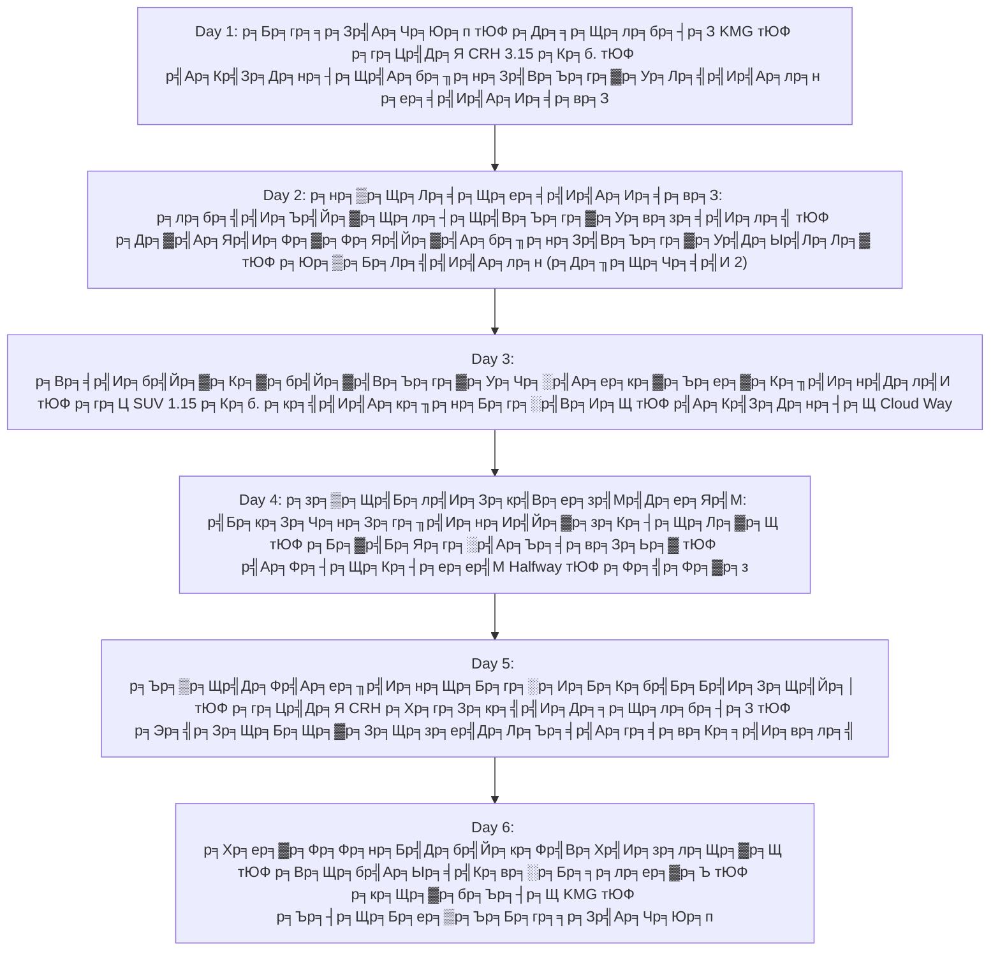

# р╣Бр╕Ьр╕Щр╕Чр╕╡р╣И 1: р╕нр╕▒р╕Щр╕Лр╕╡р╕Щр╕ер╕╡р╣Ир╣Ар╕Ир╕╡р╕вр╕З & р╕кр╣Вр╕ер╕зр╣Мр╣Др╕ер╕Яр╣Мр╕лр╕╕р╕Ър╣Ар╕Вр╕▓р╣Ар╕кр╕╖р╕нр╕Бр╕гр╕░р╣Вр╕Ир╕Щ (Unseen Lijiang & Tiger Leaping Gorge: BKK тЮФ р╕Др╕╕р╕Щр╕лр╕бр╕┤р╕З тЮФ р╕ер╕╡р╣Ир╣Ар╕Ир╕╡р╕вр╕З тЮФ р╕лр╕╕р╕Ър╣Ар╕Вр╕▓р╣Ар╕кр╕╖р╕нр╕Бр╕гр╕░р╣Вр╕Ир╕Щ тЮФ р╕Др╕╕р╕Щр╕лр╕бр╕┤р╕З тЮФ BKK)

> **р╕кр╕Цр╕▓р╕Щр╕░**: тнР **р╕Хр╕▒р╕зр╣Ар╕ер╕╖р╕нр╕Бр╣Бр╕Щр╕░р╕Щр╕│р╕нр╕▒р╕Щр╕Фр╕▒р╕Ър╕Чр╕╡р╣И 1 (р╕Йр╕Ър╕▒р╕Ър╕Др╕▒р╕кр╕Хр╕нр╕бр╕Юр╕┤р╣Ар╕ир╕й: р╕Хр╕▒р╕Фр╕Ир╕╕р╕Фр╣Бр╕бр╕кр╕Чр╕╡р╣Ир╣Ар╕Др╕вр╣Др╕Ыр╣Бр╕ер╣Йр╕з & р╕Хр╕▒р╕Фр╕Хр╣Йр╕▓р╕лр╕ер╕╡р╣Ир╕нр╕нр╕Б р╣Ар╕Юр╕╖р╣Ир╕нр╣Ар╕Ыр╕┤р╕Фр╕Ыр╕гр╕░р╕кр╕Ър╕Бр╕▓р╕гр╕Ур╣М Unseen р╕вр╕╣р╕Щр╕Щр╕▓р╕Щр╣Бр╕Ър╕Ър╕кр╣Вр╕ер╕зр╣Мр╣Др╕ер╕Яр╣Мр╣Бр╕Чр╣Йр╕Ир╕гр╕┤р╕З)**  
> **р╕кр╕Цр╕▓р╕Щр╕Чр╕╡р╣Ир╕Чр╕╡р╣Ир╕Хр╕▒р╕Фр╕нр╕нр╕Бр╕Хр╕▓р╕бр╕Ыр╕гр╕░р╕кр╕Зр╕Др╣М (р╣Ар╕Юр╕гр╕▓р╕░р╣Ар╕Др╕вр╣Др╕Ыр╣Бр╕ер╣Йр╕з)**: тЭМ р╕ар╕╣р╣Ар╕Вр╕▓р╕лр╕┤р╕бр╕░р╕бр╕▒р╕Зр╕Бр╕гр╕лр╕вр╕Б (р╕Бр╕нр╕Щр╣Вр╕Фр╕ер╣Ир╕▓р╣Гр╕лр╕Нр╣И) тЭМ р╕лр╕╕р╕Ър╣Ар╕Вр╕▓р╕Юр╕гр╕░р╕Ир╕▒р╕Щр╕Чр╕гр╣Мр╕кр╕╡р╕Щр╣Йр╕│р╣Ар╕Зр╕┤р╕Щ (р╕Ър╕ер╕╣р╕бр╕╣р╕Щр╕зр╕▒р╕ер╣Ар╕ер╕вр╣М) тЭМ р╣Ар╕бр╕╖р╕нр╕Зр╣Ар╕Бр╣Ир╕▓р╕ер╕╡р╣Ир╣Ар╕Ир╕╡р╕вр╕З (р╕Хр╣Йр╕▓р╣Ар╕лр╕вр╕╡р╕вр╕Щ) тЭМ р╕кр╕гр╕░р╕Щр╣Йр╕│р╕бр╕▒р╕Зр╕Бр╕гр╕Фр╕│ (р╣Ар╕ор╕вр╕лр╕ер╕Зр╕Цр╕▓р╕Щ) тЭМ р╕Хр╣Йр╕▓р╕лр╕ер╕╡р╣И  
> **р╕кр╕Цр╕▓р╕Щр╕Чр╕╡р╣Ир╕нр╕▒р╕Щр╕Лр╕╡р╕Щр╣Др╕ор╣Др╕ер╕Чр╣Мр╣Гр╕лр╕бр╣Ир╕Чр╕╡р╣Ир╕Ир╕▒р╕Фр╣Ар╕Щр╣Йр╕Щр╣Ар╕Ыр╣Зр╕Щр╕Юр╕┤р╣Ар╕ир╕й**:  
> 1. ЁЯПб **р╕лр╕бр╕╣р╣Ир╕Ър╣Йр╕▓р╕Щр╕лр╕┤р╕Щр╣Вр╕Ър╕гр╕▓р╕Ур╕вр╕зр╕╡р╣Ир╕лр╕╣ (чОЙц╣ЦцЭС - Yuhu Village)**: р╕Кр╕╕р╕бр╕Кр╕Щр╕лр╕┤р╕Щр╕ар╕╣р╣Ар╕Вр╕▓р╣Др╕Яр╕Фр╕▒р╣Йр╕Зр╣Ар╕Фр╕┤р╕бр╣Ар╕Кр╕┤р╕Зр╣Ар╕Вр╕▓р╕лр╕┤р╕бр╕░р╕бр╕▒р╕Зр╕Бр╕гр╕лр╕вр╕Б р╕Ър╣Йр╕▓р╕Щр╕Юр╕▒р╕Бр╕Ыр╕гр╕░р╕зр╕▒р╕Хр╕┤р╕ир╕▓р╕кр╕Хр╕гр╣Мр╕Вр╕нр╕З р╕Фр╕г.р╣Вр╕Ир╣Ар╕Лр╕Я р╕гр╣Зр╕нр╕Д (Joseph Rock) р╣Бр╕ер╕░р╕нр╣Ир╕▓р╕Зр╣Ар╕Бр╣Зр╕Ър╕Щр╣Йр╕│р╕лр╕вр╕Бр╕вр╕зр╕╡р╣Ир╕лр╕╣ р╣Ар╕Зр╕╡р╕вр╕Ър╕кр╕Зр╕Ъ р╣Др╕гр╣Йр╕Чр╕▒р╕зр╕гр╣Мр╕ер╕З  
> 2. тШХ **р╣Ар╕бр╕╖р╕нр╕Зр╣Вр╕Ър╕гр╕▓р╕Ур╣Др╕Ыр╣Лр╕Лр╕▓ (чЩ╜ц▓ЩхПдщХЗ - Baisha Ancient Town)**: р╣Ар╕бр╕╖р╕нр╕Зр╕лр╕ер╕зр╕Зр╣Бр╕гр╕Бр╕Вр╕нр╕Зр╕Кр╕▓р╕зр╕Щр╣Ир╕▓р╕Лр╕╡ р╕Ир╕┤р╕Ър╕Бр╕▓р╣Бр╕Яр╕Фр╕▓р╕Фр╕Яр╣Йр╕▓р╕Кр╕бр╕зр╕┤р╕зр╕вр╕нр╕Фр╣Ар╕Вр╕▓р╕лр╕┤р╕бр╕░р╕бр╕▒р╕Зр╕Бр╕гр╕лр╕вр╕Б 180 р╕нр╕Зр╕ир╕▓ р╣Бр╕ер╕░р╕Кр╕бр╕ар╕▓р╕Юр╕Ир╕┤р╕Хр╕гр╕Бр╕гр╕гр╕бр╕Эр╕▓р╕Ьр╕Щр╕▒р╕З 500 р╕Ыр╕╡  
> 3. ЁЯР┤ **р╕Чр╕░р╣Ар╕ер╕кр╕▓р╕Ър╕ер╕▓р╕Кр╕╖р╣Ир╕нр╣Др╕лр╣И (цЛЙх╕Вц╡╖ - Lashihai Wetland)**: р╕Вр╕╡р╣Ир╕бр╣Йр╕▓р╣Бр╕Др╕гр╕░р╕вр╕╣р╕Щр╕Щр╕▓р╕Щр╣Ар╕ер╕▓р╕░р╕Ыр╣Ир╕▓р╕кр╕Щр╣Ар╕Вр╕▓р╕Хр╕▓р╕бр╕гр╕нр╕в "р╣Ар╕кр╣Йр╕Щр╕Чр╕▓р╕Зр╕Др╕▓р╕гр╕▓р╕зр╕▓р╕Щр╕Кр╕▓р╕бр╣Йр╕▓р╣Вр╕Ър╕гр╕▓р╕У" (Tea-Horse Road) р╣Бр╕ер╕░р╕Кр╕бр╕Щр╕Бр╕нр╕Юр╕вр╕Юр╕др╕Фр╕╣р╕лр╕Щр╕▓р╕з  
> 4. ЁЯМ┐ **р╕Юр╕▒р╕Бр╣Ар╕бр╕╖р╕нр╕Зр╣Вр╕Ър╕гр╕▓р╕Ур╕Лр╕╣р╣Ир╣Ар╕лр╕н (цЭЯц▓│хПдщХЗ - Shuhe Ancient Town) 2 р╕Др╕╖р╕Щр╣Ар╕Хр╣Зр╕б**: р╣Ар╕бр╕╖р╕нр╕Зр╣Вр╕Ър╕гр╕▓р╕Ур╕кр╕▓р╕вр╕Щр╣Йр╕│р╣Гр╕кр╣Бр╕ер╕░р╕кр╕░р╕Юр╕▓р╕Щр╕лр╕┤р╕Щ 400 р╕Ыр╕╡ р╣Ар╕Зр╕╡р╕вр╕Ър╕кр╕Зр╕Ъ р╣Др╕бр╣Ир╕Юр╕ер╕╕р╕Бр╕Юр╕ер╣Ир╕▓р╕Щр╣Бр╕Ър╕Ър╣Ар╕бр╕╖р╕нр╕Зр╣Ар╕Бр╣Ир╕▓р╕Хр╣Йр╕▓р╣Ар╕лр╕вр╕╡р╕вр╕Щ  
> 5. ЁЯПФя╕П **р╕Юр╕▒р╕Бр╕Ьр╣Ир╕нр╕Щр╕гр╕┤р╕бр╕Ьр╕▓р╕кр╕╣р╕З Cloud Way Homestay р╣Ар╕кр╕╖р╕нр╕Бр╕гр╕░р╣Вр╕Ир╕Щ 2 р╕Др╕╖р╕Щр╣Ар╕Хр╣Зр╕б**: р╕Кр╕бр╣Бр╕кр╕Зр╣Бр╕гр╕Бр╕кр╕╡р╕Чр╕нр╕З "р╕гр╕╖р╣Ир╕нр╕Ир╣Йр╕▓р╕зр╕Кр╕┤р╕Щр╕Лр╕▓р╕Щ (цЧечЕзщЗСх▒▒)" р╕Ър╕Щр╣Ар╕Хр╕╡р╕вр╕Зр╕Щр╕нр╕Щ р╣Бр╕ер╕░р╕ер╕Зр╕Кр╕бр╣Бр╕Бр╣Ир╕Зр╕Щр╣Йр╕│р╕Фр╣Йр╕зр╕вр╕Ър╕▒р╕Щр╣Др╕Фр╣Ар╕ер╕╖р╣Ир╕нр╕Щр╕Бр╕гр╕░р╕Ир╕Б  
> **р╕гр╕╣р╕Ыр╣Бр╕Ър╕Ър╕Бр╕▓р╕гр╕Чр╣Ир╕нр╕Зр╣Ар╕Чр╕╡р╣Ир╕вр╕з**: р╕кр╣Вр╕ер╕зр╣Мр╣Др╕ер╕Яр╣М р╕Юр╕▒р╕Бр╕Ьр╣Ир╕нр╕Щр╕кр╕Ър╕▓р╕вр╣Ж р╣Др╕бр╣Ир╣Ар╕гр╣Ир╕Зр╕гр╕╡р╕Ъ (р╕Ир╕│р╕Бр╕▒р╕Фр╕кр╕Цр╕▓р╕Щр╕Чр╕╡р╣Ир╣Др╕ор╣Др╕ер╕Чр╣Мр╣Др╕бр╣Ир╣Ар╕Бр╕┤р╕Щ 1 - 2 р╣Бр╕лр╣Ир╕Зр╕Хр╣Ир╕нр╕зр╕▒р╕Щ)  
> **р╕Кр╣Ир╕зр╕Зр╣Ар╕зр╕ер╕▓р╣Ар╕Фр╕┤р╕Щр╕Чр╕▓р╕З**: 5 тАУ 10 р╕Шр╕▒р╕Щр╕зр╕▓р╕Др╕б 2026 (6 р╕зр╕▒р╕Щ 5 р╕Др╕╖р╕Щ)  
> **р╕ар╕╣р╕бр╕┤р╕ар╕▓р╕Д**: р╕бр╕Ур╕Ср╕ер╕вр╕╣р╕Щр╕Щр╕▓р╕Щ (Yunnan) р╕кр╕▓р╕Шр╕▓р╕гр╕Ур╕гр╕▒р╕Рр╕Ыр╕гр╕░р╕Кр╕▓р╕Кр╕Щр╕Ир╕╡р╕Щ (р╕Др╕╕р╕Щр╕лр╕бр╕┤р╕З тАУ р╕ер╕╡р╣Ир╣Ар╕Ир╕╡р╕вр╕З тАУ р╕лр╕╕р╕Ър╣Ар╕Вр╕▓р╣Ар╕кр╕╖р╕нр╕Бр╕гр╕░р╣Вр╕Ир╕Щ тАУ р╕Др╕╕р╕Щр╕лр╕бр╕┤р╕З)  
> **р╕Ир╕▒р╕Фр╕Чр╕│р╣Вр╕Фр╕в**: р╕Ър╕▒р╕З (р╕Щр╕▒р╕Бр╕Ир╕▒р╕Фр╕Чр╕гр╕┤р╕Ыр╕Ьр╕╣р╣Йр╣Ар╕Кр╕╡р╣Ир╕вр╕зр╕Кр╕▓р╕Нр╕Чр╣Ир╕нр╕Зр╣Ар╕Чр╕╡р╣Ир╕вр╕зр╕Ир╕╡р╕Щ)

---

## ЁЯМЯ р╕Ир╕╕р╕Фр╣Ар╕Фр╣Ир╕Щр╕Вр╕нр╕Зр╣Ар╕кр╣Йр╕Щр╕Чр╕▓р╕З "р╕нр╕▒р╕Щр╕Лр╕╡р╕Щр╕ер╕╡р╣Ир╣Ар╕Ир╕╡р╕вр╕З & р╣Ар╕кр╕╖р╕нр╕Бр╕гр╕░р╣Вр╕Ир╕Щ" (Unseen Travel Highlights)

р╣Ар╕бр╕╖р╣Ир╕нр╕Хр╕▒р╕Фр╕кр╕Цр╕▓р╕Щр╕Чр╕╡р╣Ир╣Бр╕бр╕кр╕Чр╕╡р╣Ир╣Ар╕Др╕вр╣Др╕Ыр╣Бр╕ер╣Йр╕зр╕нр╕нр╕Б р╣Бр╕ер╕░р╕Хр╕▒р╕Фр╕Бр╕▓р╕гр╣Ар╕Фр╕┤р╕Щр╕Чр╕▓р╕Зр╕ер╕Зр╣Гр╕Хр╣Йр╣Др╕Ыр╕Хр╣Йр╕▓р╕лр╕ер╕╡р╣Ир╕нр╕нр╕Б р╣Ар╕кр╣Йр╕Щр╕Чр╕▓р╕Зр╕Щр╕╡р╣Йр╕Ир╕░р╕Бр╕ер╕▓р╕вр╣Ар╕Ыр╣Зр╕Щр╕Бр╕▓р╕г **"р╣Ар╕Ыр╕┤р╕Фр╕бр╕╕р╕бр╕бр╕нр╕Зр╣Гр╕лр╕бр╣Ир╕Вр╕нр╕Зр╕ер╕╡р╣Ир╣Ар╕Ир╕╡р╕вр╕Зр╣Гр╕Щр╣Бр╕Ър╕Ър╕Чр╕╡р╣Ир╕Др╕Щр╕Чр╕▒р╣Ир╕зр╣Др╕Ыр╣Др╕бр╣Ир╣Ар╕Др╕вр╕кр╕▒р╕бр╕Ьр╕▒р╕к"**:

```mermaid
graph LR
    BKK["тЬИя╕П р╕Бр╕гр╕╕р╕Зр╣Ар╕Чр╕Юр╕п"] --> KMG["р╕Др╕╕р╕Щр╕лр╕бр╕┤р╕З (Kunming)"]
    KMG -- "ЁЯЪЕ р╕гр╕Цр╣Др╕Я CRH 3.15 р╕Кр╕б." --> LJ["1. р╕нр╕▒р╕Щр╕Лр╕╡р╕Щр╕ер╕╡р╣Ир╣Ар╕Ир╕╡р╕вр╕З (Lijiang Unseen)<br>р╕Юр╕▒р╕Бр╕Лр╕╣р╣Ир╣Ар╕лр╕н 2 р╕Др╕╖р╕Щр╣Ар╕Хр╣Зр╕б<br>р╕Ър╣Йр╕▓р╕Щр╕лр╕┤р╕Щр╕вр╕зр╕╡р╣Ир╕лр╕╣ тАв р╣Др╕Ыр╣Лр╕Лр╕▓ тАв р╕бр╣Йр╕▓р╕Кр╕▓р╕бр╣Йр╕▓р╕ер╕▓р╕Кр╕╖р╣Ир╕нр╣Др╕лр╣И"]
    LJ -- "ЁЯЪЧ р╕гр╕Ц SUV 1.15 р╕Кр╕б." --> TLG["2. р╕лр╕╕р╕Ър╣Ар╕Вр╕▓р╣Ар╕кр╕╖р╕нр╕Бр╕гр╕░р╣Вр╕Ир╕Щ (TLG)<br>р╕Юр╕▒р╕Б Cloud Way р╕гр╕┤р╕бр╕Ьр╕▓ 2 р╕Др╕╖р╕Щ<br>р╣Бр╕кр╕Зр╕Чр╕нр╕Зр╕гр╕╖р╣Ир╕нр╕Ир╣Йр╕▓р╕зр╕Кр╕┤р╕Щр╕Лр╕▓р╕Щ & р╕Ър╕▒р╕Щр╣Др╕Фр╣Ар╕ер╕╖р╣Ир╕нр╕Щ"]
    TLG -- "ЁЯЪЕ р╕гр╕Цр╣Др╕Я CRH 3.45 р╕Кр╕б." --> KM2["3. р╕Др╕╕р╕Щр╕лр╕бр╕┤р╕З (Kunming)<br>р╕Юр╕▒р╕Б 5 р╕Фр╕▓р╕з 1 р╕Др╕╖р╕Щ<br>р╕Щр╕Бр╕Щр╕▓р╕Зр╕Щр╕зр╕ер╣Др╕Лр╕Ър╕╡р╣Ар╕гр╕╡р╕в & р╕Хр╕ер╕▓р╕Фр╕Фр╕нр╕Бр╣Др╕бр╣Й"]
    KM2 --> BKK2["тЬИя╕П р╕Бр╕гр╕╕р╕Зр╣Ар╕Чр╕Юр╕п"]
    
    style LJ fill:#e1f5fe,stroke:#0288d1,stroke-width:2px
    style TLG fill:#fff3e0,stroke:#f57c00,stroke-width:2px
    style KM2 fill:#e8f5e9,stroke:#388e3c,stroke-width:2px
```

1. **р╕лр╕Щр╕╡р╕Др╕зр╕▓р╕бр╕зр╕╕р╣Ир╕Щр╕зр╕▓р╕в р╕кр╕▒р╕бр╕Ьр╕▒р╕кр╕зр╕┤р╕Цр╕╡р╕Кр╕╡р╕зр╕┤р╕Хр╕Фр╕▒р╣Йр╕Зр╣Ар╕Фр╕┤р╕бр╣Бр╕Чр╣Йр╣Ж 100%**:
   * р╕лр╕ер╕╡р╕Бр╣Ар╕ер╕╡р╣Ир╕вр╕Зр╕гр╣Йр╕▓р╕Щр╕Др╣Йр╕▓р╣Ар╕Кр╕┤р╕Зр╕Юр╕▓р╕Ур╕┤р╕Кр╕вр╣Мр╣Бр╕ер╕░р╕Эр╕╣р╕Зр╕Кр╕Щр╣Гр╕Щр╣Ар╕бр╕╖р╕нр╕Зр╣Ар╕Бр╣Ир╕▓р╕Хр╣Йр╕▓р╣Ар╕лр╕вр╕╡р╕вр╕Щ р╣Бр╕ер╣Йр╕зр╕бр╕▓р╕Лр╕╢р╕бр╕Лр╕▒р╕Ър╕Др╕зр╕▓р╕бр╕кр╕Зр╕Ър╕Чр╕╡р╣Ир╣Бр╕Чр╣Йр╕Ир╕гр╕┤р╕Зр╕Вр╕нр╕З **р╕лр╕бр╕╣р╣Ир╕Ър╣Йр╕▓р╕Щр╕лр╕┤р╕Щр╣Вр╕Ър╕гр╕▓р╕Ур╕вр╕зр╕╡р╣Ир╕лр╕╣** р╣Бр╕ер╕░ **р╣Ар╕бр╕╖р╕нр╕Зр╣Вр╕Ър╕гр╕▓р╕Ур╣Др╕Ыр╣Лр╕Лр╕▓** р╕Чр╕╡р╣Ир╕Др╕╕р╕Ур╕вр╕▓р╕вр╕Кр╕▓р╕зр╕Щр╣Ир╕▓р╕Лр╕╡р╕вр╕▒р╕Зр╕Др╕Зр╕Щр╕▒р╣Ир╕Зр╕Ыр╕▒р╕Бр╕Ьр╣Йр╕▓р╣Др╕лр╕б р╣Бр╕ер╕░р╕бр╕╡р╕Ър╣Йр╕▓р╕Щр╣Ар╕гр╕╖р╕нр╕Щр╕лр╕┤р╕Щр╕ар╕╣р╣Ар╕Вр╕▓р╣Др╕Яр╕нр╕▓р╕вр╕╕р╕Бр╕зр╣Ир╕▓р╕гр╣Йр╕нр╕вр╕Ыр╕╡
2. **р╕Вр╕╡р╣Ир╕бр╣Йр╕▓р╣Бр╕Др╕гр╕░р╕вр╕╣р╕Щр╕Щр╕▓р╕Щр╕Хр╕▓р╕бр╕гр╕нр╕вр╕Др╕▓р╕гр╕▓р╕зр╕▓р╕Щр╕Кр╕▓р╕бр╣Йр╕▓р╣Вр╕Ър╕гр╕▓р╕У (Tea-Horse Road) р╕Чр╕╡р╣Ир╕ер╕▓р╕Кр╕╖р╣Ир╕нр╣Др╕лр╣И**:
   * р╕кр╕▒р╕бр╕Ьр╕▒р╕кр╕Ыр╕гр╕░р╕кр╕Ър╕Бр╕▓р╕гр╕Ур╣Мр╕Вр╕╡р╣Ир╕бр╣Йр╕▓р╣Ар╕ер╕▓р╕░р╕Ыр╣Ир╕▓р╕кр╕Щр╣Ар╕Вр╕▓р╣Бр╕ер╕░р╕Чр╕╕р╣Ир╕Зр╕лр╕Нр╣Йр╕▓р╕Кр╕╕р╣Ир╕бр╕Щр╣Йр╕│р╕гр╕┤р╕бр╕Чр╕░р╣Ар╕ер╕кр╕▓р╕Ър╕ер╕▓р╕Кр╕╖р╣Ир╕нр╣Др╕лр╣И р╕Кр╕бр╕Эр╕╣р╕Зр╕Щр╕Бр╣Ар╕Ыр╣Зр╕Фр╕Щр╣Йр╕│р╣Бр╕ер╕░р╕Щр╕Бр╕нр╕Юр╕вр╕Юр╕Ир╕▓р╕Бр╣Др╕Лр╕Ър╕╡р╣Ар╕гр╕╡р╕в р╕Ър╕гр╕гр╕вр╕▓р╕Бр╕▓р╕ир╕кр╕Зр╕Ъ р╕Ьр╣Ир╕нр╕Щр╕Др╕ер╕▓р╕в р╕кр╕Фр╕Кр╕╖р╣Ир╕Щ
3. **р╣Др╕бр╣Ир╣Ар╕лр╕Щр╕╖р╣Ир╕нр╕в р╣Др╕бр╣Ир╕Хр╣Йр╕нр╕Зр╣Бр╕Юр╣Зр╕Бр╕Бр╕гр╕░р╣Ар╕Ыр╣Лр╕▓р╕вр╣Йр╕▓р╕вр╣Вр╕гр╕Зр╣Бр╕гр╕бр╕Чр╕╕р╕Бр╕зр╕▒р╕Щ**:
   * **р╕ер╕╡р╣Ир╣Ар╕Ир╕╡р╕вр╕З (р╕Лр╕╣р╣Ир╣Ар╕лр╕н) р╕Юр╕▒р╕Б 2 р╕Др╕╖р╕Щр╣Ар╕Хр╣Зр╕б (Day 1 & Day 2)**: р╣Ар╕Кр╣Зр╕Др╕нр╕┤р╕Щр╕Др╕гр╕▒р╣Йр╕Зр╣Ар╕Фр╕╡р╕вр╕з р╕зр╕▒р╕Щр╕Чр╕╡р╣И 2 р╣Ар╕Чр╕╡р╣Ир╕вр╕зр╕Хр╕▒р╕зр╣Ар╕Ыр╕ер╣Ир╕▓ р╣Др╕бр╣Ир╕Хр╣Йр╕нр╕Зр╕гр╕╡р╕Ър╣Ар╕Кр╣Зр╕Др╣Ар╕нр╕▓р╕Чр╣М
   * **р╕лр╕╕р╕Ър╣Ар╕Вр╕▓р╣Ар╕кр╕╖р╕нр╕Бр╕гр╕░р╣Вр╕Ир╕Щ р╕Юр╕▒р╕Б 2 р╕Др╕╖р╕Щр╣Ар╕Хр╣Зр╕б (Day 3 & Day 4)**: р╕кр╣Вр╕ер╕зр╣Мр╣Др╕ер╕Яр╣Мр╕Фр╕╖р╣Ир╕бр╕Фр╣Ир╕│р╕зр╕┤р╕зр╕лр╕Щр╣Йр╕▓р╕Ьр╕▓р╕лр╕┤р╕Щр╕гр╕░р╕Фр╕▒р╕Ър╣Вр╕ер╕Бр╕Чр╕╡р╣И Cloud Way Homestay р╕Хр╕╖р╣Ир╕Щр╕бр╕▓р╕Кр╕бр╕вр╕нр╕Фр╣Ар╕Вр╕▓р╕лр╕┤р╕бр╕░р╕бр╕▒р╕Зр╕Бр╕гр╕лр╕вр╕Бр╕кр╕╡р╕Чр╕нр╕Зр╣Бр╕Ър╕Ър╣Др╕бр╣Ир╕Хр╣Йр╕нр╕Зр╣Ар╕гр╣Ир╕Зр╕гр╕╡р╕Ъ
   * **р╕Др╕╕р╕Щр╕лр╕бр╕┤р╕З р╕Юр╕▒р╕Б 1 р╕Др╕╖р╕Щ (Day 5)**: р╕Юр╕▒р╕Бр╕Ьр╣Ир╕нр╕Щр╣Вр╕гр╕Зр╣Бр╕гр╕бр╕лр╕гр╕╣р╣Гр╕Ир╕Бр╕ер╕▓р╕Зр╣Ар╕бр╕╖р╕нр╕Зр╕гр╕┤р╕бр╕кр╕зр╕Щр╕Кр╕╕р╣Ир╕вр╕лр╕╣ р╕Бр╣Ир╕нр╕Щр╕Ър╕┤р╕Щр╕Бр╕ер╕▒р╕Ъ
4. **р╕Др╕зр╕▓р╕бр╕кр╕╣р╕Зр╕Бр╕│р╕ер╕▒р╕Зр╕кр╕Ър╕▓р╕в р╕Ыр╕ер╕нр╕Фр╕ар╕▒р╕вр╕Ир╕▓р╕Бр╕ар╕▓р╕зр╕░р╣Бр╕Юр╣Йр╕Чр╕╡р╣Ир╕кр╕╣р╕З (AMS Safe 100%)**:
   * р╕Др╕╕р╕Щр╕лр╕бр╕┤р╕З (1,890 р╕б.) тЮФ р╕ер╕╡р╣Ир╣Ар╕Ир╕╡р╕вр╕З (2,400 р╕б.) тЮФ р╕лр╕╕р╕Ър╣Ар╕Вр╕▓р╣Ар╕кр╕╖р╕нр╕Бр╕гр╕░р╣Вр╕Ир╕Щ (1,900 тАУ 2,100 р╕б.) тЮФ р╕Др╕╕р╕Щр╕лр╕бр╕┤р╕З (1,890 р╕б.)
   * р╕Хр╕ер╕нр╕Фр╕Чр╕▒р╣Йр╕Зр╕Чр╕гр╕┤р╕Ыр╣Др╕бр╣Ир╕бр╕╡р╕Ир╕╕р╕Фр╕Щр╕нр╕Щр╕Чр╕╡р╣Ир╕кр╕╣р╕Зр╣Ар╕Бр╕┤р╕Щ 2,400 р╣Ар╕бр╕Хр╕г р╕гр╣Ир╕▓р╕Зр╕Бр╕▓р╕вр╕Ыр╕гр╕▒р╕Ър╕Хр╕▒р╕зр╣Др╕Фр╣Йр╕кр╕Ър╕▓р╕в р╕нр╕нр╕Бр╕Лр╕┤р╣Ар╕Ир╕Щр╕лр╕Щр╕▓р╣Бр╕Щр╣Ир╕Щ р╣Ар╕Чр╕╡р╣Ир╕вр╕зр╣Др╕Фр╣Йр╕Чр╕╕р╕Бр╕зр╕▒р╕в

---

## ЁЯУК р╕кр╕гр╕╕р╕Ыр╕ар╕▓р╕Юр╕гр╕зр╕бр╕Вр╕нр╕Зр╕Чр╕гр╕┤р╕Ы (Trip Overview)

* **р╕кр╕ар╕▓р╕Юр╕нр╕▓р╕Бр╕▓р╕ир╕Кр╣Ир╕зр╕Зр╕Хр╣Йр╕Щр╕Шр╕▒р╕Щр╕зр╕▓р╕Др╕б (5 тАУ 10 р╕Шр╕▒р╕Щр╕зр╕▓р╕Др╕б)**: 
  * р╕ер╕╡р╣Ир╣Ар╕Ир╕╡р╕вр╕З (Lijiang): 5┬░C р╕Цр╕╢р╕З 16┬░C (р╕Бр╕ер╕▓р╕Зр╕зр╕▒р╕Щр╣Бр╕Фр╕Фр╕нр╕╕р╣Ир╕Щ р╕Яр╣Йр╕▓р╣Гр╕к р╣Др╕гр╣Йр╕Эр╕Щ р╕Бр╕ер╕▓р╕Зр╕Др╕╖р╕Щр╕лр╕Щр╕▓р╕зр╕кр╕Фр╕Кр╕╖р╣Ир╕Щ р╕бр╕╡р╕ор╕╡р╕Хр╣Ар╕Хр╕нр╕гр╣Мр╕нр╕╕р╣Ир╕Щр╕кр╕Ър╕▓р╕в)
  * р╕лр╕╕р╕Ър╣Ар╕Вр╕▓р╣Ар╕кр╕╖р╕нр╕Бр╕гр╕░р╣Вр╕Ир╕Щ (Tiger Leaping Gorge): 7┬░C р╕Цр╕╢р╕З 16┬░C (р╕нр╕▓р╕Бр╕▓р╕ир╕Ър╕Щр╕Фр╕нр╕вр╕Ър╕гр╕┤р╕кр╕╕р╕Чр╕Шр╕┤р╣М р╣Бр╕Фр╕Фр╕Ир╕▒р╕Ф р╕Яр╣Йр╕▓р╕кр╕╡р╕Др╕гр╕▓р╕бр╣Ар╕Вр╣Йр╕б)
  * р╕Др╕╕р╕Щр╕лр╕бр╕┤р╕З (Kunming): 11┬░C р╕Цр╕╢р╕З 18┬░C (р╣Ар╕бр╕╖р╕нр╕Зр╣Бр╕лр╣Ир╕Зр╕др╕Фр╕╣р╣Гр╕Ър╣Др╕бр╣Йр╕Ьр╕ер╕┤ р╕кр╕Ър╕▓р╕вр╕Хр╕▒р╕з)
* **р╕гр╕░р╕Фр╕▒р╕Ър╕Др╕зр╕▓р╕бр╕кр╕╣р╕З**: 1,890 тАУ 2,400 р╕б. (р╕нр╕нр╕Бр╕Лр╕┤р╣Ар╕Ир╕Щр╕кр╕бр╕Ър╕╣р╕гр╕Ур╣М р╣Др╕бр╣Ир╕бр╕╡р╕Др╕зр╕▓р╕бр╣Ар╕кр╕╡р╣Ир╕вр╕З AMS)
* **р╕Бр╕▓р╕гр╣Ар╕Фр╕┤р╕Щр╕Чр╕▓р╕Зр╕лр╕ер╕▒р╕Б**:
  * р╕Ър╕┤р╕Щр╕Хр╕гр╕Зр╕Бр╕гр╕╕р╕Зр╣Ар╕Чр╕Юр╕п тАУ р╕Др╕╕р╕Щр╕лр╕бр╕┤р╕З (р╣Ар╕Юр╕╡р╕вр╕З 2.15 р╕Кр╕б.)
  * р╕гр╕Цр╣Др╕Яр╕Др╕зр╕▓р╕бр╣Ар╕гр╣Зр╕зр╕кр╕╣р╕З (CRH) р╕Кр╕▒р╣Йр╕Щр╕лр╕Щр╕╢р╣Ир╕З (First Class): р╕Др╕╕р╕Щр╕лр╕бр╕┤р╕З тЮФ р╕ер╕╡р╣Ир╣Ар╕Ир╕╡р╕вр╕З (3.15 р╕Кр╕б.) р╣Бр╕ер╕░ р╣Ар╕кр╕╖р╕нр╕Бр╕гр╕░р╣Вр╕Ир╕Щ тЮФ р╕Др╕╕р╕Щр╕лр╕бр╕┤р╕З (~3.45 р╕Кр╕б.)
  * р╕гр╕Ц SUV / р╕гр╕Цр╕Хр╕╣р╣Й VIP р╕кр╣Ир╕зр╕Щр╕Хр╕▒р╕з: р╕гр╕▒р╕Ъ-р╕кр╣Ир╕Зр╕кр╕Цр╕▓р╕Щр╕╡р╕гр╕Цр╣Др╕Я р╣Ар╕Чр╕╡р╣Ир╕вр╕зр╕Ир╕╕р╕Фр╕нр╕▒р╕Щр╕Лр╕╡р╕Щ р╣Бр╕ер╕░р╕Юр╕▓р╕Вр╕╢р╣Йр╕Щр╕кр╕╣р╣Ир╕Чр╕╡р╣Ир╕Юр╕▒р╕Б Cloud Way р╕Ър╕Щр╣Ар╕Вр╕▓р╕кр╕╣р╕Зр╣Вр╕Фр╕вр╕Хр╕гр╕З

---

## тЬИя╕П тЮФ ЁЯЪЕ р╕Др╕╣р╣Ир╕бр╕╖р╕нр╕Бр╕▓р╕гр╣Ар╕Фр╕┤р╕Щр╕Чр╕▓р╕З: р╕кр╕Щр╕▓р╕бр╕Ър╕┤р╕Щр╕Др╕╕р╕Щр╕лр╕бр╕┤р╕Зр╕Йр╕▓р╕Зр╕кр╕╕р╣Ир╕в (KMG) р╕кр╕╣р╣Ир╕кр╕Цр╕▓р╕Щр╕╡р╕гр╕Цр╣Др╕Яр╕Др╕╕р╕Щр╕лр╕бр╕┤р╕З (Kunming Railway Station)

> **тЪая╕П р╕Вр╣Йр╕нр╕Др╕зр╕гр╕гр╕░р╕зр╕▒р╕Зр╕кр╕│р╕Др╕▒р╕Нр╣Ар╕гр╕╖р╣Ир╕нр╕З "р╕кр╕Цр╕▓р╕Щр╕╡р╕гр╕Цр╣Др╕Яр╣Гр╕Щр╕Др╕╕р╕Щр╕лр╕бр╕┤р╕З"**:
> р╣Гр╕Щр╣Ар╕бр╕╖р╕нр╕Зр╕Др╕╕р╕Щр╕лр╕бр╕┤р╕Зр╕бр╕╡ 2 р╕кр╕Цр╕▓р╕Щр╕╡р╕гр╕Цр╣Др╕Яр╕лр╕ер╕▒р╕Б:
> 1. **"р╕кр╕Цр╕▓р╕Щр╕╡р╕гр╕Цр╣Др╕Яр╕Др╕╕р╕Щр╕лр╕бр╕┤р╕З" (цШЖцШОчлЩ - Kunming Railway Station)** *(р╣Бр╕Щр╕░р╕Щр╕│ 100% р╕кр╕│р╕лр╕гр╕▒р╕Ър╕Чр╕гр╕┤р╕Ыр╕Щр╕╡р╣Й)*: р╕Хр╕▒р╣Йр╕Зр╕нр╕вр╕╣р╣Ир╣Гр╕Ир╕Бр╕ер╕▓р╕Зр╣Ар╕бр╕╖р╕нр╕З р╣Ар╕Ыр╣Зр╕Щр╕кр╕Цр╕▓р╕Щр╕╡р╕Хр╣Йр╕Щр╕Чр╕▓р╕Зр╕Вр╕нр╕Зр╕гр╕Цр╣Др╕Яр╕Др╕зр╕▓р╕бр╣Ар╕гр╣Зр╕зр╕кр╕╣р╕Зр╕Вр╕Ър╕зр╕Щр╕Хр╕гр╕Зр╕кр╕╣р╣И **р╕ер╕╡р╣Ир╣Ар╕Ир╕╡р╕вр╕З (Lijiang)** р╕Чр╕╡р╣Ир╕бр╕╡р╕гр╕нр╕Ър╕Цр╕╡р╣Ир╕Чр╕╡р╣Ир╕кр╕╕р╕Ф
> 2. **"р╕кр╕Цр╕▓р╕Щр╕╡р╕гр╕Цр╣Др╕Яр╕Др╕╕р╕Щр╕лр╕бр╕┤р╕Зр╣Гр╕Хр╣Й" (цШЖцШОхНЧчлЩ - Kunming South)**: р╕нр╕вр╕╣р╣Ир╣Др╕Бр╕ер╕нр╕нр╕Бр╣Др╕Ыр╕Чр╕▓р╕Зр╕Чр╕┤р╕ир╣Гр╕Хр╣Й (р╣Ар╕Бр╕╖р╕нр╕Ъ 50 р╕Бр╕б. р╕Ир╕▓р╕Бр╕кр╕Щр╕▓р╕бр╕Ър╕┤р╕Щ) **р╣Др╕бр╣Ир╣Бр╕Щр╕░р╕Щр╕│** р╣Гр╕лр╣Йр╣Ар╕ер╕╖р╕нр╕Бр╕кр╕Цр╕▓р╕Щр╕╡р╕Щр╕╡р╣Йр╣Ар╕Юр╕гр╕▓р╕░р╕Ир╕░р╣Ар╕кр╕╡р╕вр╣Ар╕зр╕ер╕▓р╣Ар╕Фр╕┤р╕Щр╕Чр╕▓р╕Зр╣Ар╕Юр╕┤р╣Ир╕бр╕Вр╕╢р╣Йр╕Щр╣Вр╕Фр╕вр╣Др╕бр╣Ир╕Ир╕│р╣Ар╕Ыр╣Зр╕Щ

### ЁЯУК р╕Хр╕▓р╕гр╕▓р╕Зр╣Ар╕Ыр╕гр╕╡р╕вр╕Ър╣Ар╕Чр╕╡р╕вр╕Ър╕Бр╕▓р╕гр╣Ар╕Фр╕┤р╕Щр╕Чр╕▓р╕Зр╕Ир╕▓р╕Бр╕кр╕Щр╕▓р╕бр╕Ър╕┤р╕Щ KMG р╕кр╕╣р╣Ир╕кр╕Цр╕▓р╕Щр╕╡р╕гр╕Цр╣Др╕Яр╕Др╕╕р╕Щр╕лр╕бр╕┤р╕З (цШЖцШОчлЩ)

| р╕зр╕┤р╕Шр╕╡р╕Бр╕▓р╕гр╣Ар╕Фр╕┤р╕Щр╕Чр╕▓р╕З | р╕вр╕▓р╕Щр╕Юр╕▓р╕лр╕Щр╕░ / р╣Ар╕кр╣Йр╕Щр╕Чр╕▓р╕З | р╕гр╕░р╕вр╕░р╣Ар╕зр╕ер╕▓р╣Ар╕Фр╕┤р╕Щр╕Чр╕▓р╕З | р╕Др╣Ир╕▓р╣Вр╕Фр╕вр╕кр╕▓р╕г (р╕Ыр╕гр╕░р╕бр╕▓р╕У) | р╕Ир╕╕р╕Фр╕Вр╕╢р╣Йр╕Щр╕гр╕Цр╣Гр╕Щр╕кр╕Щр╕▓р╕бр╕Ър╕┤р╕Щ KMG | р╕Ир╕╕р╕Фр╣Ар╕Фр╣Ир╕Щ & р╕Др╕зр╕▓р╕бр╣Ар╕лр╕бр╕▓р╕░р╕кр╕б |
| :--- | :--- | :---: | :---: | :--- | :--- |
| **р╕Хр╕▒р╕зр╣Ар╕ер╕╖р╕нр╕Бр╕Чр╕╡р╣И 1 (р╣Бр╕Щр╕░р╕Щр╕│р╕кр╕│р╕лр╕гр╕▒р╕Ър╕Др╕Щр╕кр╕▒р╕бр╕ар╕▓р╕гр╕░р╣Ар╕вр╕нр╕░ тнР)** | **р╕гр╕Цр╣Бр╕Чр╣Зр╕Бр╕Лр╕╡р╣И / DiDi** *(р╣Ар╕гр╕╡р╕вр╕Бр╕гр╕Цр╕Ьр╣Ир╕▓р╕Щр╣Бр╕нр╕Ы Alipay)* | **35 тАУ 45 р╕Щр╕▓р╕Чр╕╡** *(р╕Кр╣Ир╕зр╕Зр╣Ар╕гр╣Ир╕Зр╕Фр╣Ир╕зр╕Щ 50 р╕Щр╕▓р╕Чр╕╡)* | **80 тАУ 110 р╕лр╕вр╕зр╕Щ** (~400 тАУ 550 р╕Ър╕▓р╕Ч) *р╕гр╕зр╕бр╕Др╣Ир╕▓р╕Чр╕▓р╕Зр╕Фр╣Ир╕зр╕Щр╣Бр╕ер╣Йр╕з* | **р╕Кр╕▒р╣Йр╕Щ 1 (Arrival Hall)** р╕нр╕нр╕Бр╕Ыр╕гр╕░р╕Хр╕╣ 3 р╕Ир╕╕р╕Фр╕Щр╕▒р╕Фр╕Юр╕Ър╕гр╕Цр╕нр╕нр╕Щр╣Др╕ер╕Щр╣М **ч╜Сч║жш╜ж (DiDi)** | р╕кр╕░р╕Фр╕зр╕Бр╕кр╕Ър╕▓р╕вр╕Чр╕╡р╣Ир╕кр╕╕р╕Ф р╕Вр╕╢р╣Йр╕Щр╕Чр╕▓р╕Зр╕Фр╣Ир╕зр╕Щ Airport Expressway р╕кр╣Ир╕Зр╕Цр╕╢р╕Зр╕лр╕Щр╣Йр╕▓р╕Ыр╕гр╕░р╕Хр╕╣р╕Чр╕▓р╕Зр╣Ар╕Вр╣Йр╕▓р╕кр╕Цр╕▓р╕Щр╕╡р╕гр╕Цр╣Др╕Яр╕Кр╕▒р╣Йр╕Щ 2 р╣Др╕бр╣Ир╕Хр╣Йр╕нр╕Зр╕вр╕Бр╕Бр╕гр╕░р╣Ар╕Ыр╣Лр╕▓ |
| **р╕Хр╕▒р╕зр╣Ар╕ер╕╖р╕нр╕Бр╕Чр╕╡р╣И 2 (р╣Бр╕Щр╕░р╕Щр╕│р╕кр╕│р╕лр╕гр╕▒р╕Ър╕Др╕╕р╕бр╣Ар╕зр╕ер╕▓ 100%)** | **р╕гр╕Цр╣Др╕Яр╣Гр╕Хр╣Йр╕Фр╕┤р╕Щ (Kunming Metro)** тАв р╕кр╕▓р╕в 6 (р╕кр╕╡р╕Яр╣Йр╕▓) тЮФ р╕Хр╣Ир╕нр╕кр╕▓р╕в 2 (р╕кр╕╡р╣Бр╕Фр╕З) | **45 тАУ 50 р╕Щр╕▓р╕Чр╕╡** *(р╕Хр╕гр╕Зр╣Ар╕зр╕ер╕▓ р╣Др╕бр╣Ир╣Ар╕кр╕╡р╣Ир╕вр╕Зр╕гр╕Цр╕Хр╕┤р╕Ф)* | **6 р╕лр╕вр╕зр╕Щ** (~30 р╕Ър╕▓р╕Ч) / р╕Чр╣Ир╕▓р╕Щ | **р╕Кр╕▒р╣Йр╕Щ B1 Terminal** р╕кр╕Цр╕▓р╕Щр╕╡ **Airport Center (цЬ║хЬ║ф╕нх┐ГчлЩ)** | р╕Хр╕гр╕Зр╣Ар╕зр╕ер╕▓р╣Бр╕Щр╣Ир╕Щр╕нр╕Щ 100% р╕Вр╕Ър╕зр╕Щр╕гр╕Цр╣Др╕Яр╣Гр╕Хр╣Йр╕Фр╕┤р╕Щр╕бр╕╡р╣Бр╕нр╕гр╣М р╕Кр╣Ир╕нр╕Зр╕зр╕▓р╕Зр╕Бр╕гр╕░р╣Ар╕Ыр╣Лр╕▓ р╕бр╕╡р╕ер╕┤р╕Яр╕Хр╣Мр╣Бр╕ер╕░р╕Ър╕▒р╕Щр╣Др╕Фр╣Ар╕ер╕╖р╣Ир╕нр╕Щ |
| **р╕Хр╕▒р╕зр╣Ар╕ер╕╖р╕нр╕Бр╕Чр╕╡р╣И 3** | **р╣Бр╕нр╕гр╣Мр╕Юр╕нр╕гр╣Мр╕Хр╕Ър╕▒р╕к (Airport Express Line 2)** *(чй║ц╕пх┐лч║┐ 2хП╖ч║┐)* | **50 тАУ 60 р╕Щр╕▓р╕Чр╕╡** | **25 р╕лр╕вр╕зр╕Щ** (~125 р╕Ър╕▓р╕Ч) / р╕Чр╣Ир╕▓р╕Щ | **р╕Кр╕▒р╣Йр╕Щ 1 р╕Фр╣Йр╕▓р╕Щр╕Щр╕нр╕Бр╕Ыр╕гр╕░р╕Хр╕╣ 3** р╣Ар╕Др╕▓р╕Щр╣Мр╣Ар╕Хр╕нр╕гр╣Мр╕Ир╕│р╕лр╕Щр╣Ир╕▓р╕вр╕Хр╕▒р╣Лр╕з **чй║ц╕пх┐лч║┐** | р╕гр╕Цр╕Ър╕▒р╕кр╕Ыр╕гр╕▒р╕Ър╕нр╕▓р╕Бр╕▓р╕ир╕Вр╕Щр╕▓р╕Фр╣Гр╕лр╕Нр╣И р╣Вр╕лр╕ер╕Фр╕кр╕▒р╕бр╕ар╕▓р╕гр╕░р╣Гр╕Хр╣Йр╕Чр╣Йр╕нр╕Зр╕гр╕Ц р╕ер╕Зр╕лр╕Щр╣Йр╕▓р╣Вр╕гр╕Зр╣Бр╕гр╕б Jinjiang Hotel (р╣Ар╕Фр╕┤р╕Щ 300 р╣Ар╕бр╕Хр╕гр╕Цр╕╢р╕Зр╕кр╕Цр╕▓р╕Щр╕╡р╕гр╕Цр╣Др╕Я) |

---

## ЁЯЧУя╕П р╕кр╕гр╕╕р╕Ыр╕ар╕▓р╕Юр╕гр╕зр╕бр╕Бр╕▓р╕гр╕Ир╕▒р╕Фр╕Хр╕▓р╕гр╕▓р╕Зр╣Ар╕зр╕ер╕▓: 6 р╕зр╕▒р╕Щ 5 р╕Др╕╖р╕Щ (Lijiang Unseen 2 Nights + TLG 2 Nights + Kunming 1 Night)

| р╕зр╕▒р╕Щр╕Чр╕╡р╣И | р╣Бр╕Ьр╕Щр╕Бр╕▓р╕гр╣Ар╕Фр╕┤р╕Щр╕Чр╕▓р╕Зр╕лр╕ер╕▒р╕Б | р╣Др╕ор╣Др╕ер╕Чр╣Мр╕кр╕│р╕Др╕▒р╕Н | р╕Бр╕▓р╕гр╕Юр╕▒р╕Бр╕Ьр╣Ир╕нр╕Щ & р╕Чр╕╡р╣Ир╕Юр╕▒р╕Б |
| :---: | :--- | :--- | :--- |
| **Day 1** | р╕Бр╕гр╕╕р╕Зр╣Ар╕Чр╕Юр╕п тЮФ р╕Др╕╕р╕Щр╕лр╕бр╕┤р╕З тЮФ р╕гр╕Цр╣Др╕Я CRH 3.15 р╕Кр╕б. тЮФ р╕ер╕╡р╣Ир╣Ар╕Ир╕╡р╕вр╕З | р╣Ар╕Кр╣Зр╕Др╕нр╕┤р╕Щр╣Ар╕бр╕╖р╕нр╕Зр╣Вр╕Ър╕гр╕▓р╕Ур╕Лр╕╣р╣Ир╣Ар╕лр╕н р╕ер╕│р╕Шр╕▓р╕гр╕Щр╣Йр╕│р╣Гр╕к р╕кр╕░р╕Юр╕▓р╕Щр╕Кр╕┤р╕Зр╕лр╕ер╕З 400 р╕Ыр╕╡ р╕Фр╕┤р╕Щр╣Ар╕Щр╕нр╕гр╣Мр╕Щр╣Ир╕▓р╕Лр╕╡ | **р╕Юр╕▒р╕Бр╣Ар╕бр╕╖р╕нр╕Зр╣Вр╕Ър╕гр╕▓р╕Ур╕Лр╕╣р╣Ир╣Ар╕лр╕н р╕ер╕╡р╣Ир╣Ар╕Ир╕╡р╕вр╕З (р╕Др╕╖р╕Щр╕Чр╕╡р╣И 1)** |
| **Day 2** | р╣Ар╕Ир╕▓р╕░р╕ер╕╢р╕Бр╕нр╕▒р╕Щр╕Лр╕╡р╕Щр╕ер╕╡р╣Ир╣Ар╕Ир╕╡р╕вр╕З: р╕лр╕бр╕╣р╣Ир╕Ър╣Йр╕▓р╕Щр╕лр╕┤р╕Щр╕вр╕зр╕╡р╣Ир╕лр╕╣ & р╣Ар╕бр╕╖р╕нр╕Зр╣Вр╕Ър╕гр╕▓р╕Ур╣Др╕Ыр╣Лр╕Лр╕▓ | р╕Кр╕бр╕Ър╣Йр╕▓р╕Щр╕лр╕┤р╕Щр╕ар╕╣р╣Ар╕Вр╕▓р╣Др╕Я р╕Фр╕г.р╕гр╣Зр╕нр╕Д + р╕нр╣Ир╕▓р╕Зр╣Ар╕Бр╣Зр╕Ър╕Щр╣Йр╕│р╕лр╕вр╕Б + р╕Др╕▓р╣Ар╕Яр╣Ир╕Фр╕▓р╕Фр╕Яр╣Йр╕▓р╣Др╕Ыр╣Лр╕Лр╕▓ & р╕Ир╕┤р╕Хр╕гр╕Бр╕гр╕гр╕б 500 р╕Ыр╕╡ | **р╕Юр╕▒р╕Бр╣Ар╕бр╕╖р╕нр╕Зр╣Вр╕Ър╕гр╕▓р╕Ур╕Лр╕╣р╣Ир╣Ар╕лр╕н р╕ер╕╡р╣Ир╣Ар╕Ир╕╡р╕вр╕З (р╕Др╕╖р╕Щр╕Чр╕╡р╣И 2)** *(р╣Др╕бр╣Ир╕Хр╣Йр╕нр╕Зр╕вр╣Йр╕▓р╕вр╕Вр╕нр╕З!)* |
| **Day 3** | р╕Вр╕╡р╣Ир╕бр╣Йр╕▓р╕Кр╕▓р╕бр╣Йр╕▓р╣Вр╕Ър╕гр╕▓р╕Ур╕Чр╕░р╣Ар╕ер╕кр╕▓р╕Ър╕ер╕▓р╕Кр╕╖р╣Ир╕нр╣Др╕лр╣И тЮФ р╕кр╕╣р╣Ир╕лр╕╕р╕Ър╣Ар╕Вр╕▓р╣Ар╕кр╕╖р╕нр╕Бр╕гр╕░р╣Вр╕Ир╕Щ | р╕Вр╕╡р╣Ир╕бр╣Йр╕▓р╣Бр╕Др╕гр╕░р╣Ар╕ер╕▓р╕░р╕Ыр╣Ир╕▓р╕кр╕Щр╕гр╕┤р╕бр╕Чр╕░р╣Ар╕ер╕кр╕▓р╕Ъ + р╣Ар╕Кр╣Зр╕Др╕нр╕┤р╕Щ Cloud Way р╕гр╕┤р╕бр╕Ьр╕▓ р╕Ир╕┤р╕Ър╕Кр╕▓р╕вр╕▓р╕бр╕Ър╣Ир╕▓р╕в | **р╕Юр╕▒р╕Б Cloud Way р╣Ар╕кр╕╖р╕нр╕Бр╕гр╕░р╣Вр╕Ир╕Щ (р╕Др╕╖р╕Щр╕Чр╕╡р╣И 1)** |
| **Day 4** | р╕зр╕▒р╕Щр╕кр╣Вр╕ер╕зр╣Мр╣Др╕ер╕Яр╣Мр╕Ър╕Щр╣Ар╕Вр╕▓р╕кр╕╣р╕Зр╕лр╕╕р╕Ър╣Ар╕Вр╕▓р╣Ар╕кр╕╖р╕нр╕Бр╕гр╕░р╣Вр╕Ир╕Щр╣Ар╕Хр╣Зр╕бр╕зр╕▒р╕Щ | р╕Кр╕бр╣Бр╕кр╕Зр╣Бр╕гр╕Бр╕Чр╕нр╕Зр╕Др╕│ "р╕гр╕╖р╣Ир╕нр╕Ир╣Йр╕▓р╕зр╕Кр╕┤р╕Щр╕Лр╕▓р╕Щ" + р╣Ар╕Фр╕┤р╕Щр╕Кр╕┤р╕ер╕ер╣Мр╣Ар╕Чр╕гр╕ер╕гр╕▓р╕Ъ Halfway + р╕Фр╕╣р╕Фр╕▓р╕з | **р╕Юр╕▒р╕Б Cloud Way р╣Ар╕кр╕╖р╕нр╕Бр╕гр╕░р╣Вр╕Ир╕Щ (р╕Др╕╖р╕Щр╕Чр╕╡р╣И 2)** *(р╕кр╣Вр╕ер╕зр╣Мр╣Др╕ер╕Яр╣Мр╣Бр╕Чр╣Йр╕Ир╕гр╕┤р╕З)* |
| **Day 5** | р╕Ър╕▒р╕Щр╣Др╕Фр╣Ар╕ер╕╖р╣Ир╕нр╕Щр╣Бр╕Бр╣Ир╕Зр╣Ар╕кр╕╖р╕нр╕Бр╕гр╕░р╣Вр╕Ир╕Щ тЮФ р╕гр╕Цр╣Др╕Я CRH р╕кр╕╣р╣Ир╕Др╕╕р╕Щр╕лр╕бр╕┤р╕З | р╕Юр╕ер╕▒р╕Зр╕кр╕▓р╕вр╕Щр╣Йр╕│р╣Бр╕Бр╣Ир╕Зр╣Ар╕кр╕╖р╕нр╕Бр╕гр╕░р╣Вр╕Ир╕Щ + р╕Эр╕╣р╕Зр╕Щр╕Бр╕Щр╕▓р╕Зр╕Щр╕зр╕ер╣Др╕Лр╕Ър╕╡р╣Ар╕гр╕╡р╕вр╕кр╕зр╕Щр╕Кр╕╕р╣Ир╕вр╕лр╕╣ + р╕лр╕бр╕╡р╣Ир╣Ар╕Лр╕╡р╣Ир╕вр╕Щ | **р╕Юр╕▒р╕Бр╣Вр╕гр╕Зр╣Бр╕гр╕б 5 р╕Фр╕▓р╕зр╕Др╕╕р╕Щр╕лр╕бр╕┤р╕З (р╕Др╕╖р╕Щр╕Чр╕╡р╣И 1)** |
| **Day 6** | р╕Хр╕ер╕▓р╕Фр╕Фр╕нр╕Бр╣Др╕бр╣Йр╕кр╕Фр╣Вр╕Хр╣Ир╕зр╕лр╕Щр╕▓р╕Щ тЮФ р╕кр╕Щр╕▓р╕бр╕Ър╕┤р╕Щ KMG тЮФ р╕Бр╕гр╕╕р╕Зр╣Ар╕Чр╕Юр╕п | р╕Хр╕ер╕▓р╕Фр╕Фр╕нр╕Бр╣Др╕бр╣Йр╣Гр╕лр╕Нр╣Ир╕Чр╕╡р╣Ир╕кр╕╕р╕Фр╣Гр╕Щр╣Ар╕нр╣Ар╕Кр╕╡р╕в + р╕Вр╕Щр╕бр╣Ар╕Ыр╕╡р╣Кр╕вр╕░р╕Бр╕╕р╕лр╕ер╕▓р╕Ър╕нр╕Ър╕кр╕Ф + р╕Ър╕┤р╕Щр╕Бр╕ер╕▒р╕Ър╣Др╕Чр╕в | р╕Цр╕╢р╕Зр╕Бр╕гр╕╕р╕Зр╣Ар╕Чр╕Юр╕п р╣Вр╕Фр╕вр╕кр╕зр╕▒р╕кр╕Фр╕┤р╕ар╕▓р╕Ю |

---

## ЁЯЧ║я╕П р╣Бр╕Ьр╕Щр╕Бр╕▓р╕гр╣Ар╕Фр╕┤р╕Щр╕Чр╕▓р╕Зр╕гр╕▓р╕вр╕зр╕▒р╕Щр╣Бр╕Ър╕Ър╕ер╕░р╣Ар╕нр╕╡р╕вр╕Ф (Day-by-Day Itinerary 6 р╕зр╕▒р╕Щ 5 р╕Др╕╖р╕Щ)

---

### р╕зр╕▒р╕Щр╕Чр╕╡р╣И 1 (5 р╕Шр╕▒р╕Щр╕зр╕▓р╕Др╕б 2026): р╕Бр╕гр╕╕р╕Зр╣Ар╕Чр╕Юр╕п тАУ р╕Щр╕Др╕гр╕Др╕╕р╕Щр╕лр╕бр╕┤р╕З тАУ р╕гр╕Цр╣Др╕Яр╕Др╕зр╕▓р╕бр╣Ар╕гр╣Зр╕зр╕кр╕╣р╕Зр╕кр╕╣р╣Ир╕ер╕╡р╣Ир╣Ар╕Ир╕╡р╕вр╕З тАУ р╣Ар╕Кр╣Зр╕Др╕нр╕┤р╕Щр╣Ар╕бр╕╖р╕нр╕Зр╣Вр╕Ър╕гр╕▓р╕Ур╕Лр╕╣р╣Ир╣Ар╕лр╕н

* **08:00 тАУ 11:30 р╕Щ. (р╕Кр╣Ир╕зр╕Зр╣Ар╕Кр╣Йр╕▓: р╕Ър╕┤р╕Щр╕Хр╕гр╕Зр╕кр╕╣р╣Ир╕Фр╕┤р╕Щр╣Бр╕Фр╕Щр╣Бр╕лр╣Ир╕Зр╕др╕Фр╕╣р╣Гр╕Ър╣Др╕бр╣Йр╕Ьр╕ер╕┤)**:
  * р╕нр╕нр╕Бр╣Ар╕Фр╕┤р╕Щр╕Чр╕▓р╕Зр╕Ир╕▓р╕Бр╕Бр╕гр╕╕р╕Зр╣Ар╕Чр╕Юр╕п (BKK/DMK) р╕кр╕╣р╣И **р╕кр╕Щр╕▓р╕бр╕Ър╕┤р╕Щр╕Щр╕▓р╕Щр╕▓р╕Кр╕▓р╕Хр╕┤р╕Др╕╕р╕Щр╕лр╕бр╕┤р╕Зр╕Йр╕▓р╕Зр╕кр╕╕р╣Ир╕в (KMG - цШЖцШОщХ┐ц░┤хЫ╜щЩЕцЬ║хЬ║)** р╣Гр╕Кр╣Йр╣Ар╕зр╕ер╕▓р╕Ър╕┤р╕Щр╣Ар╕Юр╕╡р╕вр╕З 2 р╕Кр╕▒р╣Ир╕зр╣Вр╕бр╕З 15 р╕Щр╕▓р╕Чр╕╡
  * р╕Ьр╣Ир╕▓р╕Щр╕Фр╣Ир╕▓р╕Щр╕Хр╕гр╕зр╕Ир╕Др╕Щр╣Ар╕Вр╣Йр╕▓р╣Ар╕бр╕╖р╕нр╕Зр╕Ир╕╡р╕Щ (р╕Яр╕гр╕╡р╕зр╕╡р╕Лр╣Ир╕▓р╕кр╕│р╕лр╕гр╕▒р╕Ър╕Др╕Щр╣Др╕Чр╕в) р╕кр╣Бр╕Бр╕Щр╕ер╕▓р╕вр╕Щр╕┤р╣Йр╕зр╕бр╕╖р╕нр╣Бр╕ер╕░р╕Хр╕гр╕зр╕Ир╕Юр╕▓р╕кр╕Ыр╕нр╕гр╣Мр╕Х р╕гр╕▒р╕Ър╕Бр╕гр╕░р╣Ар╕Ыр╣Лр╕▓р╕кр╕▒р╕бр╕ар╕▓р╕гр╕░
* **11:30 тАУ 13:00 р╕Щ. (р╕Кр╣Ир╕зр╕Зр╣Ар╕Кр╕╖р╣Ир╕нр╕бр╕Хр╣Ир╕н: р╕кр╕Щр╕▓р╕бр╕Ър╕┤р╕Щ KMG тЮФ р╕кр╕Цр╕▓р╕Щр╕╡р╕гр╕Цр╣Др╕Яр╕Др╕╕р╕Щр╕лр╕бр╕┤р╕З цШЖцШОчлЩ)**:
  * р╕Щр╕▒р╣Ир╕Зр╕гр╕Цр╕вр╕Щр╕Хр╣М DiDi / Taxi р╕Вр╕╢р╣Йр╕Щр╕Чр╕▓р╕Зр╕Фр╣Ир╕зр╕Щ Airport Expressway р╣Ар╕Юр╕╡р╕вр╕З **35 тАУ 45 р╕Щр╕▓р╕Чр╕╡** (р╕Др╣Ир╕▓р╣Вр╕Фр╕вр╕кр╕▓р╕г ~80-100 р╕лр╕вр╕зр╕Щ) р╕кр╣Ир╕Зр╕Цр╕╢р╕Зр╕Ыр╕гр╕░р╕Хр╕╣р╕Чр╕▓р╕Зр╣Ар╕Вр╣Йр╕▓р╕кр╕Цр╕▓р╕Щр╕╡р╕гр╕Цр╣Др╕Яр╕Др╕╕р╕Щр╕лр╕бр╕┤р╕Зр╕Кр╕▒р╣Йр╕Щ 2
  * р╣Ар╕Фр╕┤р╕Щр╣Ар╕Вр╣Йр╕▓р╕кр╕Цр╕▓р╕Щр╕╡р╕Ьр╣Ир╕▓р╕Щр╕Кр╣Ир╕нр╕Зр╕Хр╕гр╕зр╕Ир╕Юр╕▓р╕кр╕Ыр╕нр╕гр╣Мр╕Х (ф║║х╖ещАЪщБУ) р╕Щр╕│р╕кр╕▒р╕бр╕ар╕▓р╕гр╕░р╣Ар╕Вр╣Йр╕▓р╣Ар╕Др╕гр╕╖р╣Ир╕нр╕Зр╕кр╣Бр╕Бр╕Щ р╣Бр╕зр╕░р╕Юр╕▒р╕Бр╕Чр╕▓р╕Щр╕бр╕╖р╣Йр╕нр╕Бр╕ер╕▓р╕Зр╕зр╕▒р╕Щр╕лр╕гр╕╖р╕нр╕Лр╕╖р╣Йр╕нр╣Ар╕Др╕гр╕╖р╣Ир╕нр╕Зр╕Фр╕╖р╣Ир╕б/р╕Вр╕нр╕Зр╕зр╣Ир╕▓р╕З
* **13:45 тАУ 17:00 р╕Щ. (р╣Др╕ор╣Др╕ер╕Чр╣Мр╕Чр╕╡р╣И 1: р╕Щр╕▒р╣Ир╕Зр╕гр╕Цр╣Др╕Яр╕лр╕▒р╕зр╕Бр╕гр╕░р╕кр╕╕р╕Щ CRH р╕Др╕╕р╕Щр╕лр╕бр╕┤р╕З тЮФ р╕ер╕╡р╣Ир╣Ар╕Ир╕╡р╕вр╕З 3 р╕Кр╕▒р╣Ир╕зр╣Вр╕бр╕З 15 р╕Щр╕▓р╕Чр╕╡)**:
  * р╕Вр╕╢р╣Йр╕Щр╕гр╕Цр╣Др╕Яр╕Др╕зр╕▓р╕бр╣Ар╕гр╣Зр╕зр╕кр╕╣р╕З (CRH) р╕Вр╕Ър╕зр╕Щр╕Ыр╕гр╕▒р╕Ър╕нр╕▓р╕Бр╕▓р╕ир╕Кр╕▒р╣Йр╕Щр╕лр╕Щр╕╢р╣Ир╕З (First Class) р╕бр╕╕р╣Ир╕Зр╕лр╕Щр╣Йр╕▓р╕кр╕╣р╣И **р╕кр╕Цр╕▓р╕Щр╕╡р╕гр╕Цр╣Др╕Яр╕ер╕╡р╣Ир╣Ар╕Ир╕╡р╕вр╕З (ф╕╜ц▒ЯчлЩ - Lijiang Railway Station)**
  * р╕Вр╕Ър╕зр╕Щр╕гр╕Цр╣Др╕Яр╕зр╕┤р╣Ир╕Зр╕Щр╕╕р╣Ир╕бр╕кр╕Ър╕▓р╕в р╕Вр╣Йр╕▓р╕бр╕Ьр╣Ир╕▓р╕Щр╕кр╕░р╕Юр╕▓р╕Щр╕ер╕нр╕вр╕Яр╣Йр╕▓ р╕Кр╣Ир╕нр╕Зр╣Ар╕Вр╕▓р╕лр╕┤р╕Щр╕Ыр╕╣р╕Щ р╕Ьр╣Ир╕▓р╕Щр╣Ар╕бр╕╖р╕нр╕Зр╕Йр╕╣р╣Ир╕кр╕З р╕Бр╣Ир╕нр╕Щр╣Др╕Хр╣Ир╕гр╕░р╕Фр╕▒р╕Ър╣Ар╕Вр╣Йр╕▓р╕кр╕╣р╣Ир╕Чр╕╡р╣Ир╕гр╕▓р╕Ър╕кр╕╣р╕Зр╕ер╕╡р╣Ир╣Ар╕Ир╕╡р╕вр╕З
* **17:30 тАУ 20:30 р╕Щ. (р╣Др╕ор╣Др╕ер╕Чр╣Мр╕Чр╕╡р╣И 2: р╕кр╣Вр╕ер╕зр╣Мр╣Др╕ер╕Яр╣Мр╣Ар╕бр╕╖р╕нр╕Зр╣Вр╕Ър╕гр╕▓р╕Ур╕Лр╕╣р╣Ир╣Ар╕лр╕н цЭЯц▓│хПдщХЗ Shuhe Ancient Town & р╕Фр╕┤р╕Щр╣Ар╕Щр╕нр╕гр╣Мр╕Щр╣Ир╕▓р╕Лр╕╡)**:
  * р╕гр╕Цр╕Хр╕╣р╣Йр╕кр╣Ир╕зр╕Щр╕Хр╕▒р╕зр╕гр╕▒р╕Ър╕Ир╕▓р╕Бр╕кр╕Цр╕▓р╕Щр╕╡р╕гр╕Цр╣Др╕Яр╕ер╕╡р╣Ир╣Ар╕Ир╕╡р╕вр╕З р╣Ар╕Фр╕┤р╕Щр╕Чр╕▓р╕Зр╣Ар╕Юр╕╡р╕вр╕З 25 р╕Щр╕▓р╕Чр╕╡ р╕кр╕╣р╣И **"р╣Ар╕бр╕╖р╕нр╕Зр╣Вр╕Ър╕гр╕▓р╕Ур╕Лр╕╣р╣Ир╣Ар╕лр╕н" (Shuhe Ancient Town)**
  * р╣Ар╕Кр╣Зр╕Др╕нр╕┤р╕Щр╣Ар╕Вр╣Йр╕▓р╣Вр╕гр╕Зр╣Бр╕гр╕бр╕Ър╕╣р╕Чр╕╡р╕Др╕гр╕░р╕Фр╕▒р╕Ър╕Юр╕гр╕╡р╣Ар╕бр╕╡р╕вр╕б р╣Ар╕Кр╣Ир╕Щ **The Bivou Lijiang** р╕лр╕гр╕╖р╕н **Banyan Tree Lijiang** 
  * р╕Фр╕╖р╣Ир╕бр╕Фр╣Ир╕│р╕Др╕зр╕▓р╕бр╣Ар╕Зр╕╡р╕вр╕Ър╕кр╕Зр╕Ъ р╕ер╕│р╕Шр╕▓р╕гр╕Щр╣Йр╕│р╣Гр╕кр╣Др╕лр╕ер╕Ьр╣Ир╕▓р╕Щр╕лр╕Щр╣Йр╕▓р╕гр╣Йр╕▓р╕Щр╕Др╣Йр╕▓р╣Др╕бр╣Йр╣Вр╕Ър╕гр╕▓р╕У р╣Бр╕ер╕░р╕бр╕╡р╕Чр╕┤р╕зр╕Чр╕▒р╕ир╕Щр╣Мр╕вр╕нр╕Фр╣Ар╕Вр╕▓р╕лр╕┤р╕бр╕░р╕бр╕▒р╕Зр╕Бр╕гр╕лр╕вр╕Бр╕Хр╕▒р╣Йр╕Зр╕Хр╕гр╕░р╕лр╕Зр╣Ир╕▓р╕Щр╕нр╕вр╕╣р╣Ир╣Ар╕Ър╕╖р╣Йр╕нр╕Зр╕лр╕ер╕▒р╕З
  * р╣Ар╕Фр╕┤р╕Щр╣Ар╕ер╣Ир╕Щр╕гр╕▒р╕Ър╕ер╕бр╕лр╕Щр╕▓р╕зр╕вр╕▓р╕бр╣Ар╕вр╣Зр╕Щ р╕Кр╕бр╕кр╕░р╕Юр╕▓р╕Щр╕Кр╕┤р╕Зр╕лр╕ер╕З (Qinglong Bridge) р╕Чр╕╡р╣Ир╕Ыр╕╣р╕Фр╣Йр╕зр╕вр╕лр╕┤р╕Щр╣Вр╕Ър╕гр╕▓р╕Ур╕нр╕▓р╕вр╕╕р╕Бр╕зр╣Ир╕▓ 400 р╕Ыр╕╡ р╣Вр╕Др╕бр╣Др╕Яр╕кр╕╡р╕кр╣Йр╕бр╕кр╕░р╕Чр╣Йр╕нр╕Щр╕Ьр╕┤р╕зр╕Щр╣Йр╕│ р╕Ър╕гр╕гр╕вр╕▓р╕Бр╕▓р╕ир╣Вр╕гр╣Бр╕бр╕Щр╕Хр╕┤р╕Б р╣Др╕бр╣Ир╣Бр╕нр╕нр╕▒р╕Фр╕Юр╕ер╕╕р╕Бр╕Юр╕ер╣Ир╕▓р╕Щр╣Бр╕Ър╕Ър╣Ар╕бр╕╖р╕нр╕Зр╣Ар╕Бр╣Ир╕▓р╕Хр╣Йр╕▓р╣Ар╕лр╕вр╕╡р╕вр╕Щ
* **р╕бр╕╖р╣Йр╕нр╕нр╕▓р╕лр╕▓р╕г**:
  * р╕Бр╕ер╕▓р╕Зр╕зр╕▒р╕Щ: р╕нр╕▓р╕лр╕▓р╕гр╕зр╣Ир╕▓р╕Зр╕Ър╕Щр╣Ар╕Др╕гр╕╖р╣Ир╕нр╕Зр╕Ър╕┤р╕Щ / р╕Бр╣Лр╕зр╕вр╣Ар╕Хр╕╡р╣Лр╕вр╕зр╣Бр╕ер╕░р╕Вр╕нр╕Зр╕зр╣Ир╕▓р╕Зр╕Чр╕╡р╣Ир╕кр╕Цр╕▓р╕Щр╕╡р╕гр╕Цр╣Др╕Яр╕Др╕╕р╕Щр╕лр╕бр╕┤р╕З
  * р╣Ар╕вр╣Зр╕Щ: **"р╕лр╕бр╣Йр╕нр╣Др╕Яр╕Лр╕╡р╣Ир╣Вр╕Др╕гр╕Зр╕лр╕бр╕╣р╣Бр╕лр╣Йр╕Зр╕Щр╣Ир╕▓р╕Лр╕╡" (Naxi Cured Ribs Hotpot - ф╕╜ц▒ЯшЕКцОТщкичБлщФЕ)** р╕Хр╣Йр╕бр╣Гр╕Щр╕Щр╣Йр╕│р╕Лр╕╕р╕Ыр╕Бр╕гр╕░р╕Фр╕╣р╕Бр╕лр╕бр╕╣р╕лр╕нр╕бр╕Бр╕гр╕╕р╣Ир╕Щ р╣Гр╕кр╣Ир╕Ьр╕▒р╕Бр╕кр╕Фр╕Ър╕Щр╕Фр╕нр╕в р╣Ар╕лр╣Зр╕Фр╕Ыр╣Ир╕▓р╕вр╕╣р╕Щр╕Щр╕▓р╕Щ р╣Бр╕ер╕░р╣Ар╕Хр╣Йр╕▓р╕лр╕╣р╣Йр╣Бр╕Ьр╣Ир╕Щ
* **р╕Чр╕╡р╣Ир╕Юр╕▒р╕Б**: р╣Вр╕гр╕Зр╣Бр╕гр╕бр╕Ър╕╣р╕Чр╕╡р╕Др╕кр╕╕р╕Фр╕кр╕Зр╕Ъ **The Bivou Lijiang (ф╕╜ц▒ЯшК▒щЧ┤хаВ / ф╕╜ц▒Ях╡МщЫкце╝ч▓╛хУБщЕТх║Ч)** р╕лр╕гр╕╖р╕н **Banyan Tree Lijiang (ф╕╜ц▒ЯцВжцжХх║Д)** (р╕Др╕╖р╕Щр╕Чр╕╡р╣И 1 р╣Гр╕Щр╕ер╕╡р╣Ир╣Ар╕Ир╕╡р╕вр╕З)

#### ЁЯЪМ р╕Хр╕▓р╕гр╕▓р╕Зр╕кр╕гр╕╕р╕Ыр╕Вр╕▒р╣Йр╕Щр╕Хр╕нр╕Щр╕Бр╕▓р╕гр╕Хр╣Ир╕нр╕гр╕Ц & р╕вр╕▓р╕Щр╕Юр╕▓р╕лр╕Щр╕░р╕Ир╕гр╕┤р╕З Day 1
| р╕Кр╣Ир╕зр╕Зр╕Чр╕╡р╣И | р╣Ар╕кр╣Йр╕Щр╕Чр╕▓р╕З (р╕Ир╕▓р╕Б тЮФ р╕Цр╕╢р╕З) | р╕вр╕▓р╕Щр╕Юр╕▓р╕лр╕Щр╕░ & р╕гр╕▓р╕вр╕ер╕░р╣Ар╕нр╕╡р╕вр╕Фр╕Бр╕▓р╕гр╣Ар╕Фр╕┤р╕Щр╕Чр╕▓р╕З | р╕гр╕░р╕вр╕░р╣Ар╕зр╕ер╕▓ | р╕Др╣Ир╕▓р╣Гр╕Кр╣Йр╕Ир╣Ир╕▓р╕в (р╕Ыр╕гр╕░р╕бр╕▓р╕У) | р╣Ар╕Др╕ер╣Зр╕Фр╕ер╕▒р╕Ър╕Вр╕нр╕Зр╕Ър╕▒р╕З (Pro-Tips) |
| :---: | :--- | :--- | :---: | :---: | :--- |
| **1** | р╕Бр╕гр╕╕р╕Зр╣Ар╕Чр╕Юр╕п (BKK/DMK) тЮФ р╕кр╕Щр╕▓р╕бр╕Ър╕┤р╕Щр╕Др╕╕р╕Щр╕лр╕бр╕┤р╕З (KMG) | **тЬИя╕П р╣Ар╕Др╕гр╕╖р╣Ир╕нр╕Зр╕Ър╕┤р╕Щр╕Юр╕▓р╕Ур╕┤р╕Кр╕вр╣М (Direct Flight)** р╕Ър╕┤р╕Щр╕Хр╕гр╕Зр╕Ир╕▓р╕Бр╣Др╕Чр╕в р╕Ьр╣Ир╕▓р╕Щ р╕Хр╕б. р╕Яр╕гр╕╡р╕зр╕╡р╕Лр╣Ир╕▓р╣Др╕Чр╕в-р╕Ир╕╡р╕Щ р╕Хр╕гр╕зр╕Ир╕Юр╕▓р╕кр╕Ыр╕нр╕гр╣Мр╕Хр╣Др╕Чр╕в | 2 р╕Кр╕б. 15 р╕Щр╕▓р╕Чр╕╡ | р╕гр╕зр╕бр╣Гр╕Щр╕Хр╕▒р╣Лр╕зр╣Ар╕Др╕гр╕╖р╣Ир╕нр╕Зр╕Ър╕┤р╕Щ | р╕Юр╕▓р╕кр╕Ыр╕нр╕гр╣Мр╕Хр╕Хр╣Йр╕нр╕Зр╕бр╕╡р╕нр╕▓р╕вр╕╕р╣Ар╕лр╕ер╕╖р╕нр╣Ар╕Бр╕┤р╕Щ 6 р╣Ар╕Фр╕╖р╕нр╕Щ р╣Др╕бр╣Ир╕Хр╣Йр╕нр╕Зр╕Бр╕гр╕нр╕Бр╣Гр╕Ъ р╕Хр╕б. р╕Бр╕гр╕░р╕Фр╕▓р╕йр╣Бр╕ер╣Йр╕з |
| **2** | р╕кр╕Щр╕▓р╕бр╕Ър╕┤р╕Щ KMG тЮФ р╕кр╕Цр╕▓р╕Щр╕╡р╕гр╕Цр╣Др╕Яр╕Др╕╕р╕Щр╕лр╕бр╕┤р╕З (цШЖцШОчлЩ) | **ЁЯЪХ DiDi / Taxi (р╕Чр╕▓р╕Зр╣Ар╕ер╕╖р╕нр╕Бр╣Бр╕Щр╕░р╕Щр╕│ тнР)**: р╕Вр╕╢р╣Йр╕Щр╕Чр╕▓р╕Зр╕Фр╣Ир╕зр╕Щр╕кр╣Ир╕Зр╕Цр╕╢р╕Зр╕лр╕Щр╣Йр╕▓р╕кр╕Цр╕▓р╕Щр╕╡р╕Кр╕▒р╣Йр╕Щ 2 р╣Др╕бр╣Ир╕Хр╣Йр╕нр╕Зр╕вр╕Бр╕Бр╕гр╕░р╣Ар╕Ыр╣Лр╕▓ *(р╕лр╕гр╕╖р╕н ЁЯЪЗ Metro р╕кр╕▓р╕в 6 р╕Хр╣Ир╕нр╕кр╕▓р╕в 2 р╕Чр╕╡р╣И Tangzixiang)* | 35 тАУ 45 р╕Щр╕▓р╕Чр╕╡ | 80 тАУ 110 р╕лр╕вр╕зр╕Щ / р╕Др╕▒р╕Щ *(Metro: 6 р╕лр╕вр╕зр╕Щ/р╕Др╕Щ)* | р╕лр╣Йр╕▓р╕бр╣Ар╕ер╕╖р╕нр╕Бр╕кр╕Цр╕▓р╕Щр╕╡ "р╕Др╕╕р╕Щр╕лр╕бр╕┤р╕Зр╣Гр╕Хр╣Й" (Kunming South) р╣Ар╕Фр╣Зр╕Фр╕Вр╕▓р╕Ф р╣Гр╕лр╣Йр╣Ар╕ер╕╖р╕нр╕Б "р╕кр╕Цр╕▓р╕Щр╕╡р╕Др╕╕р╕Щр╕лр╕бр╕┤р╕З" (цШЖцШОчлЩ) р╣Гр╕Щр╣Ар╕бр╕╖р╕нр╕Зр╣Ар╕Чр╣Ир╕▓р╕Щр╕▒р╣Йр╕Щ |
| **3** | р╕кр╕Цр╕▓р╕Щр╕╡р╕гр╕Цр╣Др╕Яр╕Др╕╕р╕Щр╕лр╕бр╕┤р╕З (цШЖцШОчлЩ) тЮФ р╕кр╕Цр╕▓р╕Щр╕╡р╕гр╕Цр╣Др╕Яр╕ер╕╡р╣Ир╣Ар╕Ир╕╡р╕вр╕З (ф╕╜ц▒ЯчлЩ) | **ЁЯЪЕ р╕гр╕Цр╣Др╕Яр╕Др╕зр╕▓р╕бр╣Ар╕гр╣Зр╕зр╕кр╕╣р╕З (CRH р╕Вр╕Ър╕зр╕Щ C/D р╕Кр╕▒р╣Йр╕Щр╕лр╕Щр╕╢р╣Ир╕З First Class)** р╣Ар╕Вр╣Йр╕▓р╕кр╕Цр╕▓р╕Щр╕╡р╕Ьр╣Ир╕▓р╕Щр╕Кр╣Ир╕нр╕З Manual Check (ф║║х╖ещАЪщБУ) р╕кр╣Бр╕Бр╕Щр╕Юр╕▓р╕кр╕Ыр╕нр╕гр╣Мр╕Хр╣Ар╕ер╣Ир╕бр╕Ир╕гр╕┤р╕З р╕бр╕╡р╣Бр╕нр╕гр╣М р╕Ыр╕ер╕▒р╣Кр╕Бр╣Др╕Я р╣Бр╕ер╕░р╕Кр╣Ир╕нр╕Зр╕зр╕▓р╕Зр╕Бр╕гр╕░р╣Ар╕Ыр╣Лр╕▓ 28 р╕Щр╕┤р╣Йр╕з | 3 р╕Кр╕б. 15 р╕Щр╕▓р╕Чр╕╡ | ~330 р╕лр╕вр╕зр╕Щ / р╕Чр╕╡р╣Ир╕Щр╕▒р╣Ир╕З (~1,650 р╕Ър╕▓р╕Ч) | р╕Ир╕нр╕Зр╕гр╕нр╕Ър╕Ър╣Ир╕▓р╕в 13:45 р╕лр╕гр╕╖р╕н 14:15 р╕Щ. р╕бр╕╡р╣Ар╕зр╕ер╕▓р╕Хр╣Ир╕нр╕Ир╕▓р╕Бр╣Др╕Яр╕ер╕Чр╣Мр╕Ър╕┤р╕Щр╣Ар╕Кр╣Йр╕▓р╕нр╕вр╣Ир╕▓р╕Зр╕кр╕Ър╕▓р╕в р╣Др╕бр╣Ир╕Хр╣Йр╕нр╕Зр╕зр╕┤р╣Ир╕Зр╣Ар╕гр╣Ир╕Зр╕гр╕╡р╕Ъ |
| **4** | р╕кр╕Цр╕▓р╕Щр╕╡р╕гр╕Цр╣Др╕Яр╕ер╕╡р╣Ир╣Ар╕Ир╕╡р╕вр╕З (ф╕╜ц▒ЯчлЩ) тЮФ р╣Вр╕гр╕Зр╣Бр╕гр╕бр╣Гр╕Щр╣Ар╕бр╕╖р╕нр╕Зр╣Вр╕Ър╕гр╕▓р╕Ур╕Лр╕╣р╣Ир╣Ар╕лр╕н (цЭЯц▓│хПдщХЗ) | **ЁЯЪР р╕гр╕Цр╕Хр╕╣р╣Йр╕гр╕▒р╕Ъ-р╕кр╣Ир╕Зр╕кр╣Ир╕зр╕Щр╕Хр╕▒р╕з / DiDi + ЁЯЫТ р╕гр╕Цр╣Ар╕Вр╣Зр╕Щр╕Бр╕гр╕░р╣Ар╕Ыр╣Лр╕▓р╣Вр╕гр╕Зр╣Бр╕гр╕б** р╕Др╕Щр╕Вр╕▒р╕Ър╕гр╕нр╕гр╕▒р╕Ър╕Чр╕╡р╣Ир╕Чр╕▓р╕Зр╕нр╕нр╕Бр╕кр╕Цр╕▓р╕Щр╕╡ р╕кр╣Ир╕Зр╕Цр╕╢р╕Зр╕Ыр╕гр╕░р╕Хр╕╣р╕Чр╕┤р╕ир╣Ар╕лр╕Щр╕╖р╕нр╣Ар╕бр╕╖р╕нр╕Зр╣Вр╕Ър╕гр╕▓р╕Ур╕Лр╕╣р╣Ир╣Ар╕лр╕н р╕Юр╕Щр╕▒р╕Бр╕Зр╕▓р╕Щр╣Вр╕гр╕Зр╣Бр╕гр╕бр╕Щр╕│р╕гр╕Цр╣Ар╕Вр╣Зр╕Щр╕бр╕▓р╕гр╕▒р╕Ър╕Бр╕гр╕░р╣Ар╕Ыр╣Лр╕▓р╕Юр╕▓р╣Ар╕Фр╕┤р╕Щр╣Ар╕Вр╣Йр╕▓р╣Вр╕гр╕Зр╣Бр╕гр╕б | 25 тАУ 30 р╕Щр╕▓р╕Чр╕╡ | 40 тАУ 60 р╕лр╕вр╕зр╕Щ / р╕Др╕▒р╕Щ (~200 тАУ 300 р╕Ър╕▓р╕Ч) | р╕Цр╕Щр╕Щр╣Гр╕Щр╣Ар╕бр╕╖р╕нр╕Зр╣Ар╕Бр╣Ир╕▓р╣Ар╕Ыр╣Зр╕Щр╕лр╕┤р╕Щр╣Вр╕Ър╕гр╕▓р╕У р╣Бр╕Ир╣Йр╕Зр╣Вр╕гр╕Зр╣Бр╕гр╕бр╕ер╣Ир╕зр╕Зр╕лр╕Щр╣Йр╕▓р╣Гр╕лр╣Йр╕Юр╕Щр╕▒р╕Бр╕Зр╕▓р╕Щр╣Ар╕Вр╣Зр╕Щр╕гр╕Цр╕ер╕▓р╕Бр╕Бр╕гр╕░р╣Ар╕Ыр╣Лр╕▓р╕Юр╕▓р╣Ар╕Вр╣Йр╕▓р╕Чр╕╡р╣Ир╕Юр╕▒р╕Б р╕ер╣Йр╕нр╕Бр╕гр╕░р╣Ар╕Ыр╣Лр╕▓р╕Ир╕░р╣Др╕бр╣Ир╕Юр╕▒р╕З |

---

### р╕зр╕▒р╕Щр╕Чр╕╡р╣И 2 (6 р╕Шр╕▒р╕Щр╕зр╕▓р╕Др╕б 2026): р╣Ар╕Ир╕▓р╕░р╕ер╕╢р╕Бр╕нр╕▒р╕Щр╕Лр╕╡р╕Щр╕ер╕╡р╣Ир╣Ар╕Ир╕╡р╕вр╕З: р╕лр╕бр╕╣р╣Ир╕Ър╣Йр╕▓р╕Щр╕лр╕┤р╕Щр╣Вр╕Ър╕гр╕▓р╕Ур╕вр╕зр╕╡р╣Ир╕лр╕╣ (р╕Ър╣Йр╕▓р╕Щ р╕Фр╕г.р╣Вр╕Ир╣Ар╕Лр╕Я р╕гр╣Зр╕нр╕Д) тАУ р╕Др╕▓р╣Ар╕Яр╣Ир╕Фр╕▓р╕Фр╕Яр╣Йр╕▓р╣Ар╕бр╕╖р╕нр╕Зр╣Вр╕Ър╕гр╕▓р╕Ур╣Др╕Ыр╣Лр╕Лр╕▓

* **09:00 тАУ 12:00 р╕Щ. (р╣Др╕ор╣Др╕ер╕Чр╣Мр╕Чр╕╡р╣И 1: р╕бр╕Щр╕Хр╣Мр╣Ар╕кр╕Щр╣Ир╕лр╣Мр╕лр╕бр╕╣р╣Ир╕Ър╣Йр╕▓р╕Щр╕лр╕┤р╕Щр╣Вр╕Ър╕гр╕▓р╕Ур╣Ар╕Кр╕┤р╕Зр╣Ар╕Вр╕▓р╕лр╕┤р╕бр╕░ "р╕вр╕зр╕╡р╣Ир╕лр╕╣р╕Кр╕╕р╕Щ" чОЙц╣ЦцЭС Yuhu Village)**:
  * р╕нр╕нр╕Бр╣Ар╕Фр╕┤р╕Щр╕Чр╕▓р╕Зр╕Фр╣Йр╕зр╕вр╕гр╕Цр╕кр╣Ир╕зр╕Щр╕Хр╕▒р╕зр╕кр╕╣р╣И **"р╕лр╕бр╕╣р╣Ир╕Ър╣Йр╕▓р╕Щр╣Вр╕Ър╕гр╕▓р╕Ур╕вр╕зр╕╡р╣Ир╕лр╕╣" (Yuhu Stone Village)** р╕Хр╕▒р╣Йр╕Зр╕нр╕вр╕╣р╣Ир╕Ър╕гр╕┤р╣Ар╕зр╕Ур╣Ар╕Кр╕┤р╕Зр╣Ар╕Вр╕▓р╕лр╕┤р╕бр╕░р╕бр╕▒р╕Зр╕Бр╕гр╕лр╕вр╕Б
  * р╕Кр╕бр╕кр╕Цр╕▓р╕Ыр╕▒р╕Хр╕вр╕Бр╕гр╕гр╕бр╣Ар╕нр╕Бр╕ер╕▒р╕Бр╕йр╕Ур╣Мр╕лр╕Щр╕╢р╣Ир╕Зр╣Ар╕Фр╕╡р╕вр╕зр╣Гр╕Щр╕вр╕╣р╕Щр╕Щр╕▓р╕Щ: р╕Ър╣Йр╕▓р╕Щр╣Ар╕гр╕╖р╕нр╕Щр╕кр╕гр╣Йр╕▓р╕Зр╕Фр╣Йр╕зр╕в **"р╕лр╕┤р╕Щр╕ар╕╣р╣Ар╕Вр╕▓р╣Др╕Яр╣Вр╕Ър╕гр╕▓р╕Ур╕кр╕╡р╣Ар╕Чр╕▓р╕Фр╕│"** р╣Ар╕гр╕╡р╕вр╕Зр╕Хр╣Ир╕нр╕Бр╕▒р╕Щр╣Ар╕Ыр╣Зр╕Щр╣Бр╕Щр╕зр╕Бр╕│р╣Бр╕Юр╕Зр╕лр╕┤р╕Щр╕кр╕╕р╕Фр╕Др╕ер╕▓р╕кр╕кр╕┤р╕Б р╕Ыр╕гр╕▓р╕ир╕Ир╕▓р╕Бр╕Др╕зр╕▓р╕бр╕зр╕╕р╣Ир╕Щр╕зр╕▓р╕вр╣Ар╕Кр╕┤р╕Зр╕Юр╕▓р╕Ур╕┤р╕Кр╕вр╣М
  * р╣Ар╕вр╕╡р╣Ир╕вр╕бр╕Кр╕б **"р╕Ър╣Йр╕▓р╕Щр╕Юр╕▒р╕Бр╕Ыр╕гр╕░р╕зр╕▒р╕Хр╕┤р╕ир╕▓р╕кр╕Хр╕гр╣Мр╕Вр╕нр╕З р╕Фр╕г.р╣Вр╕Ир╣Ар╕Лр╕Я р╕гр╣Зр╕нр╕Д" (Joseph Rock's Former Residence)** р╕Щр╕▒р╕Бр╕кр╕│р╕гр╕зр╕Ир╣Бр╕ер╕░р╕Щр╕▒р╕Бр╕Юр╕др╕Бр╕йр╕ир╕▓р╕кр╕Хр╕гр╣Мр╕Кр╕▓р╕зр╕нр╣Ар╕бр╕гр╕┤р╕Бр╕▒р╕Щр╕Ьр╕╣р╣Йр╕бр╕╡р╕Кр╕╖р╣Ир╕нр╣Ар╕кр╕╡р╕вр╕Зр╕гр╕░р╕Фр╕▒р╕Ър╕Хр╕│р╕Щр╕▓р╕Щр╕Вр╕нр╕З National Geographic р╕Ьр╕╣р╣Йр╣Гр╕Кр╣Йр╕Кр╕╡р╕зр╕┤р╕Хр╕нр╕вр╕╣р╣Ир╕Чр╕╡р╣Ир╕Щр╕╡р╣Ир╕лр╕ер╕▓р╕вр╕кр╕┤р╕Ър╕Ыр╕╡р╣Бр╕ер╕░р╣Бр╕Щр╕░р╕Щр╕│р╕зр╕▒р╕Тр╕Щр╕Шр╕гр╕гр╕бр╕Щр╣Ир╕▓р╕Лр╕╡р╕кр╕╣р╣Ир╕кр╕▓р╕вр╕Хр╕▓р╕Кр╕▓р╕зр╣Вр╕ер╕Б
  * р╣Ар╕Фр╕┤р╕Щр╣Ар╕ер╣Ир╕Щр╕гр╕▒р╕Ър╕ер╕бр╕лр╕Щр╕▓р╕зр╕гр╕┤р╕б **"р╕нр╣Ир╕▓р╕Зр╣Ар╕Бр╣Зр╕Ър╕Щр╣Йр╕│р╕лр╕вр╕Бр╕вр╕зр╕╡р╣Ир╕лр╕╣" (Yuhu Lake)** р╕Чр╕░р╣Ар╕ер╕кр╕▓р╕Ър╕Шр╕гр╕гр╕бр╕Кр╕▓р╕Хр╕┤р╕нр╕▒р╕Щр╣Ар╕Зр╕╡р╕вр╕Ър╕кр╕Зр╕Ър╣Гр╕Хр╣Йр╣Ар╕Зр╕▓р╕лр╕Щр╣Йр╕▓р╕Ьр╕▓р╕лр╕┤р╕бр╕░р╕бр╕▒р╕Зр╕Бр╕гр╕лр╕вр╕Б
* **12:30 тАУ 15:30 р╕Щ. (р╣Др╕ор╣Др╕ер╕Чр╣Мр╕Чр╕╡р╣И 2: р╣Ар╕бр╕╖р╕нр╕Зр╣Вр╕Ър╕гр╕▓р╕Ур╣Др╕Ыр╣Лр╕Лр╕▓ чЩ╜ц▓ЩхПдщХЗ Baisha Ancient Town & р╕Ир╕┤р╕Хр╕гр╕Бр╕гр╕гр╕б 500 р╕Ыр╕╡)**:
  * р╣Ар╕Фр╕┤р╕Щр╕Чр╕▓р╕Зр╕Хр╣Ир╕нр╣Ар╕Юр╕╡р╕вр╕З 15 р╕Щр╕▓р╕Чр╕╡ р╕кр╕╣р╣И **"р╣Ар╕бр╕╖р╕нр╕Зр╣Вр╕Ър╕гр╕▓р╕Ур╣Др╕Ыр╣Лр╕Лр╕▓"** р╣Ар╕бр╕╖р╕нр╕Зр╕лр╕ер╕зр╕Зр╣Бр╕лр╣Ир╕Зр╣Бр╕гр╕Бр╕Вр╕нр╕Зр╕гр╕▓р╕Кр╕зр╕Зр╕ир╣Мр╕Щр╣Ир╕▓р╕Лр╕╡р╣Вр╕Ър╕гр╕▓р╕У
  * р╣Бр╕зр╕░р╕Др╕▓р╣Ар╕Яр╣Ир╕кр╣Вр╕ер╕зр╣Мр╕Ър╕▓р╕гр╣Мр╕Ър╕Щр╕Фр╕▓р╕Фр╕Яр╣Йр╕▓р╣Др╕бр╣Й (р╣Ар╕Кр╣Ир╕Щ 7 Sea Cafe р╕лр╕гр╕╖р╕нр╕гр╣Йр╕▓р╕Щр╕Бр╕▓р╣Бр╕Яр╕Юр╕╖р╣Йр╕Щр╣Ар╕бр╕╖р╕нр╕З) р╕Ир╕┤р╕Ър╕Бр╕▓р╣Бр╕Яр╕Фр╕гр╕┤р╕Ыр╕гр╣Йр╕нр╕Щр╣Ж р╕кр╕╣р╕Фр╕ер╕бр╕лр╕Щр╕▓р╕зр╕Юр╕гр╣Йр╕нр╕бр╕Кр╕бр╕вр╕нр╕Фр╣Ар╕Вр╕▓р╕лр╕┤р╕бр╕░р╕бр╕▒р╕Зр╕Бр╕гр╕лр╕вр╕Бр╣Гр╕Щр╕бр╕╕р╕бр╕бр╕нр╕Зр╕Чр╕╡р╣Ир╣Ар╕Др╕ер╕╡р╕вр╕гр╣Мр╣Бр╕ер╕░р╕Бр╕зр╣Йр╕▓р╕Зр╕Чр╕╡р╣Ир╕кр╕╕р╕Ф
  * р╕Кр╕б **"р╕ар╕▓р╕Юр╕Ир╕┤р╕Хр╕гр╕Бр╕гр╕гр╕бр╕Эр╕▓р╕Ьр╕Щр╕▒р╕Зр╣Др╕Ыр╣Лр╕Лр╕▓ р╕У р╕зр╕▒р╕Фр╕Хр╣Йр╕▓р╣Ар╕Ыр╣Ир╕▓р╕Ир╕╡" (Baisha Murals)** р╕Зр╕▓р╕Щр╕ир╕┤р╕ер╕Ыр╕░р╕нр╕▓р╕вр╕╕р╕Бр╕зр╣Ир╕▓ 500 р╕Ыр╕╡р╕Чр╕╡р╣Ир╕Ьр╕кр╕▓р╕Щр╕Др╕зр╕▓р╕бр╣Ар╕Кр╕╖р╣Ир╕нр╕Юр╕╕р╕Чр╕Шр╕Щр╕┤р╕Бр╕▓р╕вр╕бр╕лр╕▓р╕вр╕▓р╕Щ р╣Ар╕Хр╣Лр╕▓ р╕Чр╕┤р╣Ар╕Ър╕Х р╣Бр╕ер╕░р╕ир╕▓р╕кр╕Щр╕▓р╕Хр╕Зр╕Ыр╕▓р╣Ар╕Вр╣Йр╕▓р╕Фр╣Йр╕зр╕вр╕Бр╕▒р╕Щр╕нр╕вр╣Ир╕▓р╕Зр╕ер╕Зр╕Хр╕▒р╕з
  * р╣Ар╕Фр╕┤р╕Щр╕Чр╕нр╕Фр╕Щр╣Ир╕нр╕Зр╕Кр╕бр╕зр╕┤р╕Цр╕╡р╕Кр╕╡р╕зр╕┤р╕Хр╕Кр╕▓р╕зр╕Щр╣Ир╕▓р╕Лр╕╡р╕вр╕┤р╣Йр╕бр╣Бр╕вр╣Йр╕б р╕Кр╣Ир╕▓р╕Зр╕Ыр╕▒р╕Бр╕Ьр╣Йр╕▓р╣Др╕лр╕бр╕ер╕зр╕Фр╕ер╕▓р╕вр╣Вр╕Ър╕гр╕▓р╕У
* **16:00 тАУ 20:30 р╕Щ. (р╕Бр╕ер╕▒р╕Ър╕бр╕▓р╕Юр╕▒р╕Бр╕Ьр╣Ир╕нр╕Щр╕кр╕Ър╕▓р╕вр╣Ж р╕У р╣Ар╕бр╕╖р╕нр╕Зр╣Вр╕Ър╕гр╕▓р╕Ур╕Лр╕╣р╣Ир╣Ар╕лр╕н Shuhe Ancient Town р╕Др╕╖р╕Щр╕Чр╕╡р╣И 2)**:
  * р╕Бр╕ер╕▒р╕Ър╕кр╕╣р╣Ир╣Вр╕гр╕Зр╣Бр╕гр╕бр╣Ар╕Фр╕┤р╕бр╣Гр╕Щр╣Ар╕бр╕╖р╕нр╕Зр╣Вр╕Ър╕гр╕▓р╕Ур╕Лр╕╣р╣Ир╣Ар╕лр╕н **р╣Др╕бр╣Ир╕Хр╣Йр╕нр╕Зр╣Ар╕лр╕Щр╕╖р╣Ир╕нр╕вр╣Ар╕Бр╣Зр╕Ър╕Бр╕гр╕░р╣Ар╕Ыр╣Лр╕▓р╕лр╕гр╕╖р╕нр╕вр╣Йр╕▓р╕вр╕Чр╕╡р╣Ир╕Юр╕▒р╕Б**
  * р╕Юр╕▒р╕Бр╕Ьр╣Ир╕нр╕Щр╕Ир╕┤р╕Ър╕Кр╕▓р╕нр╕╕р╣Ир╕Щр╣Ж р╕гр╕┤р╕бр╕ер╕│р╕Шр╕▓р╕г р╕Щр╕▒р╣Ир╕Зр╕нр╣Ир╕▓р╕Щр╕лр╕Щр╕▒р╕Зр╕кр╕╖р╕н р╕лр╕гр╕╖р╕нр╣Ар╕Фр╕┤р╕Щр╕Кр╕бр╕Зр╕▓р╕Щр╕ир╕┤р╕ер╕Ыр╕░р╕Др╕гр╕▓р╕Яр╕Хр╣Мр╣Др╕бр╣Йр╣Гр╕Щр╣Ар╕бр╕╖р╕нр╕Зр╣Ар╕Бр╣Ир╕▓р╕нр╕вр╣Ир╕▓р╕Зр╕Ьр╣Ир╕нр╕Щр╕Др╕ер╕▓р╕в
* **р╕бр╕╖р╣Йр╕нр╕нр╕▓р╕лр╕▓р╕г**:
  * р╣Ар╕Кр╣Йр╕▓: р╕Ър╕╕р╕Яр╣Ар╕Яр╕Хр╣Мр╕Вр╕нр╕Зр╣Вр╕гр╕Зр╣Бр╕гр╕бр╣Гр╕Щр╕Лр╕╣р╣Ир╣Ар╕лр╕н
  * р╕Бр╕ер╕▓р╕Зр╕зр╕▒р╕Щ: р╕нр╕▓р╕лр╕▓р╕гр╣Ар╕Лр╣Зр╕Хр╕Юр╕╖р╣Йр╕Щр╣Ар╕бр╕╖р╕нр╕Зр╕вр╕╣р╕Щр╕Щр╕▓р╕Щр╣Ар╕Кр╕┤р╕Зр╣Ар╕Вр╕▓ р╕У р╣Ар╕бр╕╖р╕нр╕Зр╣Вр╕Ър╕гр╕▓р╕Ур╣Др╕Ыр╣Лр╕Лр╕▓ (р╣Др╕Бр╣Ир╕Хр╕╕р╣Лр╕Щр╕лр╕бр╣Йр╕нр╕Фр╕┤р╕Щр╕кр╕бр╕╕р╕Щр╣Др╕Юр╕г р╕Ьр╕▒р╕Фр╣Ар╕лр╣Зр╕Фр╕кр╕Ф р╣Бр╕ер╕░р╕бр╕▒р╕Щр╕Эр╕гр╕▒р╣Ир╕Зр╕Чр╕нр╕Фр╕Щр╣Ир╕▓р╕Лр╕╡)
  * р╣Ар╕вр╣Зр╕Щ: р╕нр╕▓р╕лр╕▓р╕гр╕Щр╣Ир╕▓р╕Лр╕╡р╕Яр╕┤р╕зр╕Кр╕▒р╣Ир╕Щ р╕У р╕гр╣Йр╕▓р╕Щр╕нр╕▓р╕лр╕▓р╕гр╕гр╕┤р╕бр╕ер╕│р╕Шр╕▓р╕гр╣Гр╕Щр╣Ар╕бр╕╖р╕нр╕Зр╣Вр╕Ър╕гр╕▓р╕Ур╕Лр╕╣р╣Ир╣Ар╕лр╕н
* **р╕Чр╕╡р╣Ир╕Юр╕▒р╕Б**: р╣Вр╕гр╕Зр╣Бр╕гр╕бр╕Ър╕╣р╕Чр╕╡р╕Д **The Bivou Lijiang** р╕лр╕гр╕╖р╕н **Banyan Tree Lijiang** (р╕Др╕╖р╕Щр╕Чр╕╡р╣И 2 р╣Гр╕Щр╕ер╕╡р╣Ир╣Ар╕Ир╕╡р╕вр╕З)

#### ЁЯЪМ р╕Хр╕▓р╕гр╕▓р╕Зр╕кр╕гр╕╕р╕Ыр╕Вр╕▒р╣Йр╕Щр╕Хр╕нр╕Щр╕Бр╕▓р╕гр╕Хр╣Ир╕нр╕гр╕Ц & р╕вр╕▓р╕Щр╕Юр╕▓р╕лр╕Щр╕░р╕Ир╕гр╕┤р╕З Day 2
| р╕Кр╣Ир╕зр╕Зр╕Чр╕╡р╣И | р╣Ар╕кр╣Йр╕Щр╕Чр╕▓р╕З (р╕Ир╕▓р╕Б тЮФ р╕Цр╕╢р╕З) | р╕вр╕▓р╕Щр╕Юр╕▓р╕лр╕Щр╕░ & р╕гр╕▓р╕вр╕ер╕░р╣Ар╕нр╕╡р╕вр╕Фр╕Бр╕▓р╕гр╣Ар╕Фр╕┤р╕Щр╕Чр╕▓р╕З | р╕гр╕░р╕вр╕░р╣Ар╕зр╕ер╕▓ | р╕Др╣Ир╕▓р╣Гр╕Кр╣Йр╕Ир╣Ир╕▓р╕в (р╕Ыр╕гр╕░р╕бр╕▓р╕У) | р╣Ар╕Др╕ер╣Зр╕Фр╕ер╕▒р╕Ър╕Вр╕нр╕Зр╕Ър╕▒р╕З (Pro-Tips) |
| :---: | :--- | :--- | :---: | :---: | :--- |
| **1** | р╣Ар╕бр╕╖р╕нр╕Зр╣Вр╕Ър╕гр╕▓р╕Ур╕Лр╕╣р╣Ир╣Ар╕лр╕н тЮФ р╕лр╕бр╕╣р╣Ир╕Ър╣Йр╕▓р╕Щр╣Вр╕Ър╕гр╕▓р╕Ур╕вр╕зр╕╡р╣Ир╕лр╕╣ (чОЙц╣ЦцЭС) | **ЁЯЪЩ р╕гр╕Цр╕Хр╕╣р╣Й VIP / SUV р╕кр╣Ир╕зр╕Щр╕Хр╕▒р╕з** р╕зр╕┤р╣Ир╕Зр╣Ар╕ер╕▓р╕░р╣Ар╕Кр╕┤р╕Зр╣Ар╕Вр╕▓р╕Вр╕╢р╣Йр╕Щр╣Ар╕лр╕Щр╕╖р╕н р╕Цр╕Щр╕Щр╕ер╕▓р╕Фр╕вр╕▓р╕Зр╣Ар╕гр╕╡р╕вр╕Ър╕Бр╕гр╕┤р╕Ъ р╕Чр╕┤р╕зр╕Чр╕▒р╕ир╕Щр╣Мр╕Чр╕╕р╣Ир╕Зр╕лр╕Нр╣Йр╕▓р╣Бр╕ер╕░р╕вр╕нр╕Фр╣Ар╕Вр╕▓р╕лр╕┤р╕бр╕░ | 25 р╕Щр╕▓р╕Чр╕╡ (14 р╕Бр╕б.) | р╕гр╕зр╕бр╣Гр╕Щр╕Ър╕гр╕┤р╕Бр╕▓р╕гр╣Ар╕лр╕бр╕▓р╕гр╕Ц | р╕лр╕бр╕╣р╣Ир╕Ър╣Йр╕▓р╕Щр╕Щр╕╡р╣Йр╣Ар╕Зр╕╡р╕вр╕Ър╕кр╕Зр╕Ър╕бр╕▓р╕Б р╣Др╕бр╣Ир╕бр╕╡р╕гр╕Цр╕Ър╕▒р╕кр╕Чр╕▒р╕зр╕гр╣Мр╣Гр╕лр╕Нр╣Ир╣Ар╕Вр╣Йр╕▓ р╣Ар╕Фр╕┤р╕Щр╣Ар╕ер╣Ир╕Щр╕Цр╣Ир╕▓р╕вр╕гр╕╣р╕Ыр╕Ър╣Йр╕▓р╕Щр╕лр╕┤р╕Щр╣Вр╕Ър╕гр╕▓р╕Ур╣Др╕Фр╣Йр╕нр╕вр╣Ир╕▓р╕Зр╕кр╕Ър╕▓р╕вр╣Гр╕И |
| **2** | р╕лр╕бр╕╣р╣Ир╕Ър╣Йр╕▓р╕Щр╣Вр╕Ър╕гр╕▓р╕Ур╕вр╕зр╕╡р╣Ир╕лр╕╣ тЮФ р╣Ар╕бр╕╖р╕нр╕Зр╣Вр╕Ър╕гр╕▓р╕Ур╣Др╕Ыр╣Лр╕Лр╕▓ (чЩ╜ц▓ЩхПдщХЗ) | **ЁЯЪЩ р╕гр╕Цр╕Хр╕╣р╣Й / SUV р╕кр╣Ир╕зр╕Щр╕Хр╕▒р╕з** р╕зр╕┤р╣Ир╕Зр╕ер╕Зр╣Ар╕Вр╕▓р╕бр╕▓р╣Ар╕ер╣Зр╕Бр╕Щр╣Йр╕нр╕в р╕кр╕╣р╣Ир╕ер╕▓р╕Щр╕Ир╕нр╕Фр╕гр╕Цр╣Ар╕бр╕╖р╕нр╕Зр╣Вр╕Ър╕гр╕▓р╕Ур╣Др╕Ыр╣Лр╕Лр╕▓ | 15 р╕Щр╕▓р╕Чр╕╡ (8 р╕Бр╕б.) | р╕гр╕зр╕бр╣Гр╕Щр╕Ър╕гр╕┤р╕Бр╕▓р╕гр╣Ар╕лр╕бр╕▓р╕гр╕Ц | р╣Бр╕зр╕░р╕Др╕▓р╣Ар╕Яр╣Ир╕Кр╕▒р╣Йр╕Щр╕кр╕нр╕Зр╕Ър╕Щр╕Цр╕Щр╕Щр╣Вр╕Ър╕гр╕▓р╕У р╕Щр╕▒р╣Ир╕Зр╕Ир╕┤р╕Ър╕Бр╕▓р╣Бр╕Яр╕Фр╕гр╕┤р╕Ыр╕гр╣Йр╕нр╕Щр╣Ж р╕бр╕нр╕Зр╣Ар╕лр╣Зр╕Щр╕вр╕нр╕Фр╣Ар╕Вр╕▓р╕лр╕┤р╕бр╕░р╕бр╕▒р╕Зр╕Бр╕гр╕лр╕вр╕Бр╣Гр╕Щр╕бр╕╕р╕бр╕Чр╕╡р╣Ир╕Кр╕▒р╕Фр╕Чр╕╡р╣Ир╕кр╕╕р╕Ф |
| **3** | р╣Ар╕бр╕╖р╕нр╕Зр╣Вр╕Ър╕гр╕▓р╕Ур╣Др╕Ыр╣Лр╕Лр╕▓ тЮФ р╣Ар╕бр╕╖р╕нр╕Зр╣Вр╕Ър╕гр╕▓р╕Ур╕Лр╕╣р╣Ир╣Ар╕лр╕н (цЭЯц▓│хПдщХЗ) | **ЁЯЪЩ р╕гр╕Цр╕Хр╕╣р╣Йр╕кр╣Ир╕зр╕Щр╕Хр╕▒р╕з** р╕зр╕┤р╣Ир╕Зр╕Бр╕ер╕▒р╕Ър╕кр╕╣р╣Ир╣Вр╕гр╕Зр╣Бр╕гр╕бр╣Гр╕Щр╣Ар╕бр╕╖р╕нр╕Зр╣Вр╕Ър╕гр╕▓р╕Ур╕Лр╕╣р╣Ир╣Ар╕лр╕нр╕гр╕░р╕вр╕░р╕Чр╕▓р╕Зр╣Ар╕Юр╕╡р╕вр╕З 5 р╕Бр╕б. | 10 тАУ 15 р╕Щр╕▓р╕Чр╕╡ | р╕гр╕зр╕бр╣Гр╕Щр╕Ър╕гр╕┤р╕Бр╕▓р╕гр╣Ар╕лр╕бр╕▓р╕гр╕Ц | р╣Др╕Фр╣Йр╕Бр╕ер╕▒р╕Ър╕бр╕▓р╕Юр╕▒р╕Бр╕Ьр╣Ир╕нр╕Щр╕Чр╕╡р╣Ир╣Вр╕гр╕Зр╣Бр╕гр╕бр╣Ар╕Фр╕┤р╕бр╣Вр╕Фр╕вр╣Др╕бр╣Ир╕Хр╣Йр╕нр╕Зр╕вр╣Йр╕▓р╕вр╕кр╕▒р╕бр╕ар╕▓р╕гр╕░ р╕гр╣Ир╕▓р╕Зр╕Бр╕▓р╕вр╣Др╕Фр╣Йр╕Юр╕▒р╕Бр╕Ьр╣Ир╕нр╕Щр╕нр╕вр╣Ир╕▓р╕Зр╣Ар╕Хр╣Зр╕бр╕Чр╕╡р╣И |

---

### р╕зр╕▒р╕Щр╕Чр╕╡р╣И 3 (7 р╕Шр╕▒р╕Щр╕зр╕▓р╕Др╕б 2026): р╕Чр╕░р╣Ар╕ер╕кр╕▓р╕Ър╕ер╕▓р╕Кр╕╖р╣Ир╕нр╣Др╕лр╣И (р╕Вр╕╡р╣Ир╕бр╣Йр╕▓р╣Бр╕Др╕гр╕░р╕Хр╕▓р╕бр╕гр╕нр╕вр╕Др╕▓р╕гр╕▓р╕зр╕▓р╕Щр╕Кр╕▓р╕бр╣Йр╕▓р╣Вр╕Ър╕гр╕▓р╕У) тАУ р╣Ар╕Фр╕┤р╕Щр╕Чр╕▓р╕Зр╕кр╕╣р╣Ир╕лр╕╕р╕Ър╣Ар╕Вр╕▓р╣Ар╕кр╕╖р╕нр╕Бр╕гр╕░р╣Вр╕Ир╕Щ тАУ р╣Ар╕Кр╣Зр╕Др╕нр╕┤р╕Щ Cloud Way р╕гр╕┤р╕бр╕Ьр╕▓р╣Ар╕Вр╕▓р╕кр╕╣р╕З

* **09:00 тАУ 11:30 р╕Щ. (р╣Др╕ор╣Др╕ер╕Чр╣Мр╕Чр╕╡р╣И 1: р╕Вр╕╡р╣Ир╕бр╣Йр╕▓р╣Бр╕Др╕гр╕░р╕вр╕╣р╕Щр╕Щр╕▓р╕Щр╕Хр╕▓р╕бр╕гр╕нр╕вр╕Др╕▓р╕гр╕▓р╕зр╕▓р╕Щр╕Кр╕▓р╕бр╣Йр╕▓р╣Вр╕Ър╕гр╕▓р╕У р╕У р╕Чр╕░р╣Ар╕ер╕кр╕▓р╕Ър╕ер╕▓р╕Кр╕╖р╣Ир╕нр╣Др╕лр╣И цЛЙх╕Вц╡╖)**:
  * р╕нр╕нр╕Бр╣Ар╕Фр╕┤р╕Щр╕Чр╕▓р╕Зр╕кр╕╣р╣И **"р╕нр╕╕р╕Чр╕вр╕▓р╕Щр╕Юр╕╖р╣Йр╕Щр╕Чр╕╡р╣Ир╕Кр╕╕р╣Ир╕бр╕Щр╣Йр╕│р╕Чр╕░р╣Ар╕ер╕кр╕▓р╕Ър╕ер╕▓р╕Кр╕╖р╣Ир╕нр╣Др╕лр╣И" (Lashihai Wetland Park)** р╕Ир╕╕р╕Фр╕Юр╕▒р╕Бр╕Др╕▓р╕гр╕▓р╕зр╕▓р╕Щр╕бр╣Йр╕▓р╕Кр╕▓р╕бр╣Йр╕▓р╣Вр╕Ър╕гр╕▓р╕У (Ancient Tea-Horse Road) р╕Чр╕▓р╕Зр╕Чр╕┤р╕ир╕Хр╕░р╕зр╕▒р╕Щр╕Хр╕Бр╕Вр╕нр╕Зр╕ер╕╡р╣Ир╣Ар╕Ир╕╡р╕вр╕З
  * **р╕Вр╕╡р╣Ир╕бр╣Йр╕▓р╣Бр╕Др╕гр╕░р╕вр╕╣р╕Щр╕Щр╕▓р╕Щр╕кр╕▓р╕вр╕Юр╕▒р╕Щр╕Шр╕╕р╣Мр╣Бр╕Чр╣Й**: р╣Ар╕Фр╕┤р╕Щр╕Чр╕нр╕Фр╕Щр╣Ир╕нр╕Зр╕ер╕▒р╕Фр╣Ар╕ер╕▓р╕░р╕Ьр╣Ир╕▓р╕Щр╣Бр╕Щр╕зр╕Ыр╣Ир╕▓р╕кр╕Щр╣Ар╕Вр╕▓ р╕ер╕│р╕Шр╕▓р╕г р╣Бр╕ер╕░р╕Чр╕╕р╣Ир╕Зр╕лр╕Нр╣Йр╕▓р╕Шр╕гр╕гр╕бр╕Кр╕▓р╕Хр╕┤ р╕бр╕╡р╕Др╕Щр╕Ир╕╣р╕Зр╕бр╣Йр╕▓р╕Др╕нр╕вр╕Фр╕╣р╣Бр╕ер╕Хр╕ер╕нр╕Фр╕Чр╕▓р╕З р╕Ыр╕ер╕нр╕Фр╕ар╕▒р╕вр╣Бр╕ер╕░р╣Ар╕Юр╕ер╕┤р╕Фр╣Ар╕Юр╕ер╕┤р╕Щ
  * р╕ер╣Ир╕нр╕Зр╣Бр╕Юр╣Др╕бр╣Йр╣Др╕Ьр╣Ир╕лр╕гр╕╖р╕нр╣Ар╕Фр╕┤р╕Щр╣Ар╕ер╣Ир╕Щр╕гр╕┤р╕бр╕Чр╕░р╣Ар╕ер╕кр╕▓р╕Ъ р╕Кр╕б **р╕Эр╕╣р╕Зр╕Щр╕Бр╕Щр╣Йр╕│р╕нр╕Юр╕вр╕Юр╕др╕Фр╕╣р╕лр╕Щр╕▓р╕з** р╕Ир╕▓р╕Бр╣Др╕Лр╕Ър╕╡р╣Ар╕гр╕╡р╕вр╕Чр╕╡р╣Ир╕Ър╕┤р╕Щр╕бр╕▓р╕лр╕▓р╕Бр╕┤р╕Щр╣Гр╕Щр╕Ьр╕╖р╕Щр╕Щр╣Йр╕│р╕кр╕Зр╕Ъ р╕кр╕░р╕Чр╣Йр╕нр╕Щр╣Ар╕Зр╕▓р╕Чр╣Йр╕нр╕Зр╕Яр╣Йр╕▓р╕кр╕╡р╕Др╕гр╕▓р╕бр╕кр╕Фр╣Гр╕к
* **12:00 тАУ 13:30 р╕Щ. (р╕Бр╕▓р╕гр╣Ар╕Фр╕┤р╕Щр╕Чр╕▓р╕З: р╕бр╕╕р╣Ир╕Зр╕лр╕Щр╣Йр╕▓р╕кр╕╣р╣Ир╕лр╕╕р╕Ър╣Ар╕Вр╕▓р╣Ар╕кр╕╖р╕нр╕Бр╕гр╕░р╣Вр╕Ир╕Щ & р╕гр╕Ц SUV р╣Др╕Хр╣Ир╕Цр╕Щр╕Щр╣Ар╕Вр╕▓р╕кр╕╣р╕З)**:
  * р╕Чр╕▓р╕Щр╕бр╕╖р╣Йр╕нр╕Бр╕ер╕▓р╕Зр╕зр╕▒р╕Щр╕Ыр╕ер╕▓р╕Др╕▓р╕гр╣Мр╕Ыр╕Хр╣Йр╕бр╕лр╕бр╣Йр╕нр╕Фр╕┤р╕Щр╕гр╕┤р╕бр╕Чр╕░р╣Ар╕ер╕кр╕▓р╕Ъ р╕Ир╕▓р╕Бр╕Щр╕▒р╣Йр╕Щр╕нр╕нр╕Бр╣Ар╕Фр╕┤р╕Щр╕Чр╕▓р╕Зр╕Фр╣Йр╕зр╕вр╕гр╕Ц SUV р╕бр╕╕р╣Ир╕Зр╕лр╕Щр╣Йр╕▓р╕кр╕╣р╣И **"р╕лр╕╕р╕Ър╣Ар╕Вр╕▓р╣Ар╕кр╕╖р╕нр╕Бр╕гр╕░р╣Вр╕Ир╕Щ" (Tiger Leaping Gorge - шЩОш╖│х│б)** р╕гр╕░р╕вр╕░р╕Чр╕▓р╕З 75 р╕Бр╕б. р╣Гр╕Кр╣Йр╣Ар╕зр╕ер╕▓р╣Ар╕Фр╕┤р╕Щр╕Чр╕▓р╕Зр╣Ар╕Юр╕╡р╕вр╕З 1 р╕Кр╕▒р╣Ир╕зр╣Вр╕бр╕З 15 р╕Щр╕▓р╕Чр╕╡
  * р╕Ьр╣Ир╕▓р╕Щр╕Фр╣Ир╕▓р╕Щр╕Хр╕гр╕зр╕Ир╕Ър╕▒р╕Хр╕гр╕нр╕╕р╕Чр╕вр╕▓р╕Щ р╕гр╕Ц SUV р╕Юр╕▓р╣Др╕Хр╣Ир╕гр╕░р╕Фр╕▒р╕Ър╕Вр╕╢р╣Йр╕Щр╕кр╕╣р╣Ир╕Цр╕Щр╕Щр╣Ар╕Вр╕▓р╕кр╕╣р╕Зр╕Кр╕▒р╣Йр╕Щр╕Ър╕Щ (Upper Trekking Route / р╕лр╕бр╕╣р╣Ир╕Ър╣Йр╕▓р╕Щр╣Ар╕Ыр╕┤р╣Ир╕Щр╕Хр╕╡р╣Йр╕зр╕▓р╕Щ Bendiwan) р╕нр╕вр╣Ир╕▓р╕Зр╕Щр╕╕р╣Ир╕бр╕Щр╕зр╕е р╣Вр╕Фр╕вр╣Др╕бр╣Ир╕Хр╣Йр╕нр╕Зр╣Ар╕Фр╕┤р╕Щр╣Ар╕Чр╣Йр╕▓р╣Бр╕Ър╕Бр╣Ар╕Ыр╣Йр╣Ар╕нр╕З
* **14:00 тАУ 17:30 р╕Щ. (р╣Др╕ор╣Др╕ер╕Чр╣Мр╕Чр╕╡р╣И 2: р╣Ар╕Кр╣Зр╕Др╕нр╕┤р╕Щ Cloud Way Homestay р╕зр╕┤р╕зр╕лр╕Щр╣Йр╕▓р╕Ьр╕▓р╕бр╕▓р╕кр╣Ар╕Хр╕нр╕гр╣Мр╕Юр╕╡р╕Л)**:
  * р╣Ар╕Кр╣Зр╕Др╕нр╕┤р╕Щр╣Ар╕Вр╣Йр╕▓р╕Юр╕▒р╕Бр╕Чр╕╡р╣И: **"Upper trekking route ┬╖ Cloud Way ┬╖ Snowy mountain view homestay" (шЩОш╖│х│бщлШш╖п┬╖ф║СщАФ┬╖щЫкх▒▒шзВцЩпц░Схо┐)**
  * **р╕Ыр╕гр╕░р╕кр╕Ър╕Бр╕▓р╕гр╕Ур╣Мр╕гр╕░р╕Фр╕▒р╕Ър╕Юр╕гр╕╡р╣Ар╕бр╕╡р╕вр╕б**: р╣Вр╕ор╕бр╕кр╣Ар╕Хр╕вр╣Мр╣Вр╕бр╣Ар╕Фр╕┤р╕гр╣Мр╕Щр╕гр╕┤р╕бр╕лр╕Щр╣Йр╕▓р╕Ьр╕▓р╕лр╕▒р╕Щр╕лр╕Щр╣Йр╕▓р╣Ар╕Вр╣Йр╕▓р╕лр╕▓р╕лр╕Щр╣Йр╕▓р╕Ьр╕▓р╕лр╕┤р╕Щр╕вр╕▒р╕Бр╕йр╣Мр╣Бр╕ер╕░р╕вр╕нр╕Фр╣Ар╕Вр╕▓р╕лр╕┤р╕бр╕░р╕бр╕▒р╕Зр╕Бр╕гр╕лр╕вр╕Бр╕Хр╕гр╕Зр╕Вр╣Йр╕▓р╕бр╣Бр╕Ър╕Ъ Eye-Level р╕лр╕Щр╣Йр╕▓р╕Хр╣Ир╕▓р╕Зр╕Бр╕гр╕░р╕Ир╕Бр╕Ър╕▓р╕Щр╣Гр╕лр╕Нр╣Ир╕Хр╕▒р╣Йр╕Зр╣Бр╕Хр╣Ир╕Юр╕╖р╣Йр╕Щр╕Ир╕гр╕Фр╣Ар╕Юр╕Фр╕▓р╕Щ р╕бр╕╡р╕ор╕╡р╕Хр╣Ар╕Хр╕нр╕гр╣Мр╕Юр╕╖р╣Йр╕Щ р╣Ар╕Хр╕▓р╕Ьр╕┤р╕Зр╣Др╕бр╣Йр╕кр╕Щ р╣Бр╕ер╕░р╕кр╕гр╕░р╕Щр╣Йр╕│р╕Бр╕гр╕░р╕Ир╕Бр╣Ар╕Зр╕▓р╕Яр╣Йр╕▓р╕Ър╕Щр╕Фр╕▓р╕Фр╕Яр╣Йр╕▓
  * р╕Юр╕▒р╕Бр╕Ьр╣Ир╕нр╕Щр╕Ир╕┤р╕Ър╕Кр╕▓р╕вр╕▓р╕бр╕Ър╣Ир╕▓р╕вр╕гр╕┤р╕бр╕гр╕░р╣Ар╕Ър╕╡р╕вр╕З р╕Кр╕бр╣Бр╕кр╕Зр╣Бр╕Фр╕Фр╕вр╕▓р╕бр╣Ар╕вр╣Зр╕Щр╕кр╕╡р╕Чр╕нр╕Зр╕кр╕▓р╕Фр╕кр╣Ир╕нр╕Зр╕ер╕Зр╕Ър╕Щр╕лр╕Щр╣Йр╕▓р╕Ьр╕▓р╕лр╕┤р╕Щр╕Ыр╕╣р╕Щ р╕кр╕╣р╕Зр╕Кр╕▒р╕Щр╣Бр╕ер╕░р╕ер╕╢р╕Бр╕Чр╕╡р╣Ир╕кр╕╕р╕Фр╣Бр╕лр╣Ир╕Зр╕лр╕Щр╕╢р╣Ир╕Зр╣Гр╕Щр╣Вр╕ер╕Б
* **р╕бр╕╖р╣Йр╕нр╕нр╕▓р╕лр╕▓р╕г**:
  * р╣Ар╕Кр╣Йр╕▓: р╕Ър╕╕р╕Яр╣Ар╕Яр╕Хр╣Мр╕Вр╕нр╕Зр╣Вр╕гр╕Зр╣Бр╕гр╕бр╣Гр╕Щр╕ер╕╡р╣Ир╣Ар╕Ир╕╡р╕вр╕З
  * р╕Бр╕ер╕▓р╕Зр╕зр╕▒р╕Щ: р╕нр╕▓р╕лр╕▓р╕гр╣Ар╕Лр╣Зр╕Хр╕Чр╣Йр╕нр╕Зр╕Цр╕┤р╣Ир╕Щр╕гр╕┤р╕бр╕Чр╕░р╣Ар╕ер╕кр╕▓р╕Ър╕ер╕▓р╕Кр╕╖р╣Ир╕нр╣Др╕лр╣И
  * р╣Ар╕вр╣Зр╕Щ: **"р╕лр╕бр╣Йр╕нр╣Др╕Яр╣Др╕Бр╣Ир╕Фр╕│р╕кр╕бр╕╕р╕Щр╣Др╕Юр╕гр╣Бр╕ер╕░р╕Ьр╕▒р╕Фр╕Ьр╕▒р╕Бр╕кр╕Фр╕ар╕╣р╣Ар╕Вр╕▓"** р╣Ар╕кр╕┤р╕гр╣Мр╕Яр╣Гр╕Щр╕лр╣Йр╕нр╕Зр╕нр╕▓р╕лр╕▓р╕гр╕Бр╕гр╕░р╕Ир╕Бр╕зр╕┤р╕зр╕лр╕╕р╕Ър╣Ар╕Вр╕▓р╕Вр╕нр╕З Cloud Way
* **р╕Чр╕╡р╣Ир╕Юр╕▒р╕Б**: **Upper trekking route┬╖Cloud Way┬╖Snowy mountain view homestay** (р╕Др╕╖р╕Щр╕Чр╕╡р╣И 1 р╕Ър╕Щр╣Ар╕Вр╕▓р╕кр╕╣р╕З)

#### ЁЯЪМ р╕Хр╕▓р╕гр╕▓р╕Зр╕кр╕гр╕╕р╕Ыр╕Вр╕▒р╣Йр╕Щр╕Хр╕нр╕Щр╕Бр╕▓р╕гр╕Хр╣Ир╕нр╕гр╕Ц & р╕вр╕▓р╕Щр╕Юр╕▓р╕лр╕Щр╕░р╕Ир╕гр╕┤р╕З Day 3
| р╕Кр╣Ир╕зр╕Зр╕Чр╕╡р╣И | р╣Ар╕кр╣Йр╕Щр╕Чр╕▓р╕З (р╕Ир╕▓р╕Б тЮФ р╕Цр╕╢р╕З) | р╕вр╕▓р╕Щр╕Юр╕▓р╕лр╕Щр╕░ & р╕гр╕▓р╕вр╕ер╕░р╣Ар╕нр╕╡р╕вр╕Фр╕Бр╕▓р╕гр╣Ар╕Фр╕┤р╕Щр╕Чр╕▓р╕З | р╕гр╕░р╕вр╕░р╣Ар╕зр╕ер╕▓ | р╕Др╣Ир╕▓р╣Гр╕Кр╣Йр╕Ир╣Ир╕▓р╕в (р╕Ыр╕гр╕░р╕бр╕▓р╕У) | р╣Ар╕Др╕ер╣Зр╕Фр╕ер╕▒р╕Ър╕Вр╕нр╕Зр╕Ър╕▒р╕З (Pro-Tips) |
| :---: | :--- | :--- | :---: | :---: | :--- |
| **1** | р╣Ар╕бр╕╖р╕нр╕Зр╣Вр╕Ър╕гр╕▓р╕Ур╕Лр╕╣р╣Ир╣Ар╕лр╕н тЮФ р╕Чр╕░р╣Ар╕ер╕кр╕▓р╕Ър╕ер╕▓р╕Кр╕╖р╣Ир╕нр╣Др╕лр╣И (цЛЙх╕Вц╡╖) | **ЁЯЪЩ р╕гр╕Цр╕Хр╕╣р╣Й / SUV р╕кр╣Ир╕зр╕Щр╕Хр╕▒р╕з** р╕зр╕┤р╣Ир╕Зр╕Вр╣Йр╕▓р╕бр╣Ар╕Щр╕┤р╕Щр╣Ар╕Вр╕▓р╣Др╕Ыр╕Чр╕▓р╕Зр╕Чр╕┤р╕ир╕Хр╕░р╕зр╕▒р╕Щр╕Хр╕Бр╕кр╕╣р╣Ир╕ир╕╣р╕Щр╕вр╣Мр╕Ър╕гр╕┤р╕Бр╕▓р╕гр╕Юр╕╖р╣Йр╕Щр╕Чр╕╡р╣Ир╕Кр╕╕р╣Ир╕бр╕Щр╣Йр╕│р╕ер╕▓р╕Кр╕╖р╣Ир╕нр╣Др╕лр╣И | 20 тАУ 25 р╕Щр╕▓р╕Чр╕╡ (16 р╕Бр╕б.) | р╕гр╕зр╕бр╣Гр╕Щр╕Ър╕гр╕┤р╕Бр╕▓р╕гр╣Ар╕лр╕бр╕▓р╕гр╕Ц | р╣Бр╕Щр╕░р╕Щр╕│р╣Бр╕Юр╣Зр╕Бр╣Ар╕Бр╕Ир╕Вр╕╡р╣Ир╕бр╣Йр╕▓р╕бр╕▓р╕Хр╕гр╕Рр╕▓р╕Щ 1 - 1.5 р╕Кр╕б. р╕Чр╕▓р╕Зр╣Др╕бр╣Ир╕Кр╕▒р╕Щ р╕бр╕╡р╕Др╕Щр╕Ир╕╣р╕Зр╕бр╣Йр╕▓р╕Хр╕ер╕нр╕Фр╕Чр╕▓р╕З р╕кр╕Ър╕▓р╕вр╕бр╕▓р╕Б |
| **2** | р╕Чр╕░р╣Ар╕ер╕кр╕▓р╕Ър╕ер╕▓р╕Кр╕╖р╣Ир╕нр╣Др╕лр╣И тЮФ р╕Чр╕▓р╕Зр╣Ар╕Вр╣Йр╕▓р╕нр╕╕р╕Чр╕вр╕▓р╕Щр╕лр╕╕р╕Ър╣Ар╕Вр╕▓р╣Ар╕кр╕╖р╕нр╕Бр╕гр╕░р╣Вр╕Ир╕Щ (шЩОш╖│х│б) | **ЁЯЪЩ р╕гр╕Ц SUV р╕кр╣Ир╕зр╕Щр╕Хр╕▒р╕з** р╕зр╕┤р╣Ир╕Зр╕Вр╣Йр╕▓р╕бр╕Юр╕гр╕бр╣Бр╕Фр╕Щр╕ер╕╡р╣Ир╣Ар╕Ир╕╡р╕вр╕Зр╕кр╕╣р╣Ир╣Ар╕Вр╕Хр╕Хр╕╡р╣Лр╕Кр╕┤р╣Ир╕З р╣Ар╕ер╕╡р╕вр╕Ър╣Бр╕бр╣Ир╕Щр╣Йр╕│р╕Ир╕┤р╕Щр╕Лр╕▓р╣Ар╕Ир╕╡р╕вр╕З р╕Цр╕Щр╕Щр╕ер╕▓р╕Фр╕вр╕▓р╕Зр╣Ар╕гр╕╡р╕вр╕Ър╕Бр╕гр╕┤р╕Ъ р╕Ьр╣Ир╕▓р╕Щр╕Фр╣Ир╕▓р╕Щр╕Хр╕гр╕зр╕Ир╕Ър╕▒р╕Хр╕гр╕нр╕╕р╕Чр╕вр╕▓р╕Щр╣Ар╕кр╕╖р╕нр╕Бр╕гр╕░р╣Вр╕Ир╕Щ | 1 р╕Кр╕б. 15 р╕Щр╕▓р╕Чр╕╡ | р╕Хр╕▒р╣Лр╕зр╣Ар╕Вр╣Йр╕▓р╕нр╕╕р╕Чр╕вр╕▓р╕Щ 45 р╕лр╕вр╕зр╕Щ/р╕Др╕Щ | р╕гр╕Цр╕кр╕▓р╕бр╕▓р╕гр╕Цр╕Вр╕▒р╕Ър╕Ьр╣Ир╕▓р╕Щр╕Фр╣Ир╕▓р╕Щр╕Хр╕гр╕зр╕Ир╕Вр╕╢р╣Йр╕Щр╕кр╕╣р╣Ир╕Цр╕Щр╕Щ Upper Trail р╣Др╕Фр╣Йр╣Ар╕ер╕в р╣Вр╕Фр╕вр╣Др╕бр╣Ир╕Хр╣Йр╕нр╕Зр╣Бр╕зр╕░р╣Ар╕Ыр╕ер╕╡р╣Ир╕вр╕Щр╕гр╕Ц |
| **3** | р╕Чр╕▓р╕Зр╣Ар╕Вр╣Йр╕▓р╕нр╕╕р╕Чр╕вр╕▓р╕Щр╣Ар╕кр╕╖р╕нр╕Бр╕гр╕░р╣Вр╕Ир╕Щ тЮФ р╣Вр╕ор╕бр╕кр╣Ар╕Хр╕вр╣М Cloud Way (р╕гр╕┤р╕бр╕Ьр╕▓р╣Ар╕Вр╕▓р╕кр╕╣р╕З) | **ЁЯЪЩ р╕гр╕Ц SUV 4WD р╕Вр╕▒р╕Ър╣Ар╕Др╕ер╕╖р╣Ир╕нр╕Щ 4 р╕ер╣Йр╕нр╕Вр╕нр╕Зр╣Вр╕гр╕Зр╣Бр╕гр╕б Cloud Way (р╣Бр╕Щр╕░р╕Щр╕│ 100% тнР)** р╣Др╕Хр╣Ир╕Цр╕Щр╕Щр╕Др╕нр╕Щр╕Бр╕гр╕╡р╕Хр╣Ар╕ер╕╡р╕вр╕Ър╕лр╕Щр╣Йр╕▓р╕Ьр╕▓р╕лр╕┤р╕Щр╕вр╕▒р╕Бр╕йр╣М р╕ер╕▒р╕Фр╣Ар╕ер╕▓р╕░р╕Ьр╣Ир╕▓р╕Щр╕лр╕бр╕╣р╣Ир╕Ър╣Йр╕▓р╕Щр╣Ар╕Ыр╕┤р╣Ир╕Щр╕Хр╕╡р╣Йр╕зр╕▓р╕Щ (Bendiwan) р╕кр╣Ир╕Зр╕Цр╕╢р╕Зр╕лр╕Щр╣Йр╕▓р╕ер╣Зр╕нр╕Ър╕Ър╕╡р╣Й Cloud Way | 25 тАУ 30 р╕Щр╕▓р╕Чр╕╡ | р╕Ър╕гр╕┤р╕Бр╕▓р╕гр╕гр╕▒р╕Ър╕кр╣Ир╕Зр╕Вр╕нр╕Зр╣Вр╕гр╕Зр╣Бр╕гр╕б / р╕гр╕зр╕бр╣Гр╕Щр╣Ар╕лр╕бр╕▓р╕гр╕Ц | р╣Др╕бр╣Ир╕Хр╣Йр╕нр╕Зр╣Бр╕Ър╕Бр╣Ар╕Ыр╣Йр╣Ар╕Фр╕┤р╕Щр╣Ар╕Вр╕▓ 2 р╕зр╕▒р╕Щ р╕Щр╕▒р╣Ир╕Зр╕гр╕Ц SUV р╕кр╕Ър╕▓р╕вр╣Ж р╕Кр╕бр╕зр╕┤р╕зр╕лр╕Щр╣Йр╕▓р╕Ьр╕▓р╕Юр╕▓р╣Вр╕Щр╕гр╕▓р╕бр╕▓р╣Др╕Фр╣Йр╣Бр╕Ър╕Ър╣Ар╕Фр╕╡р╕вр╕зр╕Бр╕▒р╕Щ 100% |

---

### р╕зр╕▒р╕Щр╕Чр╕╡р╣И 4 (8 р╕Шр╕▒р╕Щр╕зр╕▓р╕Др╕б 2026): р╕зр╕▒р╕Щр╣Бр╕лр╣Ир╕Зр╕Др╕зр╕▓р╕бр╕кр╕╕р╕Вр╕кр╣Вр╕ер╕зр╣Мр╣Др╕ер╕Яр╣М: р╕бр╕лр╕▒р╕ир╕Ир╕гр╕гр╕вр╣Мр╣Бр╕кр╕Зр╣Бр╕гр╕Б "р╕гр╕╖р╣Ир╕нр╕Ир╣Йр╕▓р╕зр╕Кр╕┤р╕Щр╕Лр╕▓р╕Щ" тАУ р╕Ир╕┤р╕Ър╕Бр╕▓р╣Бр╕Яр╕гр╕░р╣Ар╕Ър╕╡р╕вр╕Зр╕Ьр╕▓ тАУ р╕Кр╕бр╕Чр╕░р╣Ар╕ер╕Фр╕▓р╕зр╕лр╕Щр╣Йр╕▓р╣Ар╕Хр╕▓р╕Ьр╕┤р╕З

* **07:30 тАУ 09:30 р╕Щ. (р╣Др╕ор╣Др╕ер╕Чр╣Мр╕Чр╕╡р╣И 1: р╣Бр╕кр╕Зр╣Бр╕гр╕Бр╣Бр╕лр╣Ир╕Зр╕Вр╕╕р╕Щр╣Ар╕Вр╕▓р╕Чр╕нр╕Зр╕Др╕│ "р╕гр╕╖р╣Ир╕нр╕Ир╣Йр╕▓р╕зр╕Кр╕┤р╕Щр╕Лр╕▓р╕Щ" цЧечЕзщЗСх▒▒ Rizhao Jinshan)**:
  * р╣Др╕бр╣Ир╕Хр╣Йр╕нр╕Зр╕Хр╕╖р╣Ир╕Щр╣Ар╕Кр╣Йр╕▓р╣Др╕Ыр╣Бр╕вр╣Ир╕Зр╕Др╕┤р╕зр╕Бр╕▒р╕Ър╣Гр╕Др╕г р╣Ар╕Юр╕╡р╕вр╕Зр╕ер╕╖р╕бр╕Хр╕▓р╕Хр╕╖р╣Ир╕Щр╕Вр╕╢р╣Йр╕Щр╕бр╕▓р╣Бр╕ер╣Йр╕зр╣Ар╕Ыр╕┤р╕Фр╕бр╣Ир╕▓р╕Щр╕лр╣Йр╕нр╕Зр╕Щр╕нр╕Щ р╕У Cloud Way
  * р╕Кр╕бр╕Ыр╕гр╕▓р╕Бр╕Пр╕Бр╕▓р╕гр╕Ур╣Мр╕Шр╕гр╕гр╕бр╕Кр╕▓р╕Хр╕┤р╕кр╕╕р╕Фр╕нр╕▒р╕ир╕Ир╕гр╕гр╕вр╣М **"р╕гр╕╖р╣Ир╕нр╕Ир╣Йр╕▓р╕зр╕Кр╕┤р╕Щр╕Лр╕▓р╕Щ" (Rizhao Jinshan - Golden Snow Mountain Sunrise)** р╣Бр╕кр╕Зр╕нр╕▓р╕Чр╕┤р╕Хр╕вр╣Мр╕вр╕▓р╕бр╕гр╕╕р╣Ир╕Зр╕нр╕гр╕╕р╕Ур╕кр╕▓р╕Фр╕кр╣Ир╕нр╕Зр╕ер╕Зр╕Ър╕Щр╕вр╕нр╕Фр╣Ар╕Вр╕▓р╕лр╕┤р╕бр╕░р╕бр╕▒р╕Зр╕Бр╕гр╕лр╕вр╕Б р╣Ар╕Ыр╕ер╕╡р╣Ир╕вр╕Щр╕вр╕нр╕Фр╣Ар╕Вр╕▓р╕кр╕╡р╕Вр╕▓р╕зр╣Гр╕лр╣Йр╕Бр╕ер╕▓р╕вр╣Ар╕Ыр╣Зр╕Щр╕Ыр╕гр╕░р╕Бр╕▓р╕вр╕кр╕╡р╕Чр╕нр╕Зр╕Др╕│р╕нр╕гр╣Ир╕▓р╕бр╕Хр╕▓ р╕кр╕░р╕Чр╣Йр╕нр╕Щр╕ер╕Зр╕Ър╕Щр╕кр╕гр╕░р╕Щр╣Йр╕│р╕Бр╕гр╕░р╕Ир╕Бр╣Ар╕Зр╕▓р╕Яр╣Йр╕▓ (Sky Mirror Pool) р╕Ър╕Щр╕Фр╕▓р╕Фр╕Яр╣Йр╕▓р╣Вр╕ор╕бр╕кр╣Ар╕Хр╕вр╣М
  * р╕Чр╕▓р╕Щр╕нр╕▓р╕лр╕▓р╕гр╣Ар╕Кр╣Йр╕▓р╕кр╣Др╕Хр╕ер╣Мр╕Др╕▒р╕Щр╕Чр╕гр╕╡р╣Ир╕Кр╣Йр╕▓р╣Ж р╕Ир╕┤р╕Ър╕Бр╕▓р╣Бр╕Яр╕Фр╕гр╕┤р╕Ыр╕гр╣Йр╕нр╕Щр╣Ж р╕кр╕╣р╕Фр╕ер╕бр╕лр╕Щр╕▓р╕зр╕кр╕Фр╕Кр╕╖р╣Ир╕Щ 8┬░C
* **10:30 тАУ 16:30 р╕Щ. (р╣Др╕ор╣Др╕ер╕Чр╣Мр╕Чр╕╡р╣И 2: р╕Ир╕┤р╕Ър╕Бр╕▓р╣Бр╕Яр╕гр╕░р╣Ар╕Ър╕╡р╕вр╕Зр╕Ьр╕▓ & р╣Ар╕Фр╕┤р╕Щр╣Ар╕ер╣Ир╕Щр╣Ар╕кр╣Йр╕Щр╕Чр╕▓р╕Зр╕гр╕▓р╕Ър╣Ар╕ер╕╡р╕вр╕Ър╕лр╕Щр╣Йр╕▓р╕Ьр╕▓р╕лр╕╕р╕Ър╣Ар╕Вр╕▓р╕ер╕╢р╕Б)**:
  * р╕зр╕▒р╕Щр╕Щр╕╡р╣Йр╣Ар╕Ыр╣Зр╕Щр╕зр╕▒р╕Щр╕Юр╕▒р╕Бр╕Ьр╣Ир╕нр╕Щр╕нр╕вр╣Ир╕▓р╕Зр╣Бр╕Чр╣Йр╕Ир╕гр╕┤р╕З р╣Др╕бр╣Ир╕Хр╣Йр╕нр╕Зр╣Ар╕Бр╣Зр╕Ър╕Бр╕гр╕░р╣Ар╕Ыр╣Лр╕▓ р╣Др╕бр╣Ир╕Хр╣Йр╕нр╕Зр╕вр╣Йр╕▓р╕вр╣Вр╕гр╕Зр╣Бр╕гр╕б
  * р╕Щр╕нр╕Щр╣Ар╕ер╣Ир╕Щр╕нр╣Ир╕▓р╕Щр╕лр╕Щр╕▒р╕Зр╕кр╕╖р╕н р╕Цр╣Ир╕▓р╕вр╕ар╕▓р╕Ю р╣Бр╕ер╕░р╕Кр╕бр╕зр╕┤р╕зр╣Вр╕Хр╕гр╕Бр╕Ьр╕▓р╕Чр╕╡р╣Ир╕ер╕╢р╕Бр╕Чр╕╡р╣Ир╕кр╕╕р╕Фр╣Бр╕лр╣Ир╕Зр╕лр╕Щр╕╢р╣Ир╕Зр╣Гр╕Щр╣Вр╕ер╕Б
  * р╕лр╕▓р╕Бр╕Хр╣Йр╕нр╕Зр╕Бр╕▓р╕гр╣Ар╕Фр╕┤р╕Щр╕вр╕╖р╕Фр╣Ар╕кр╣Йр╕Щ р╕кр╕▓р╕бр╕▓р╕гр╕Цр╣Ар╕Фр╕┤р╕Щр╣Ар╕ер╣Ир╕Щр╕Хр╕▓р╕бр╣Ар╕кр╣Йр╕Щр╕Чр╕▓р╕Зр╣Ар╕Чр╕гр╕ер╕гр╕▓р╕Ър╣Ар╕гр╕╡р╕вр╕Ър╣Ар╕ер╕╡р╕вр╕Ър╣Др╕лр╕ер╣Ир╣Ар╕Вр╕▓ (р╕Чр╕▓р╕Зр╕гр╕▓р╕Ър╕кр╕Ър╕▓р╕в р╣Др╕бр╣Ир╕Хр╣Йр╕нр╕Зр╕Ыр╕╡р╕Щр╕Ыр╣Ир╕▓р╕в) р╣Др╕Ыр╕вр╕▒р╕З **"р╕Ир╕╕р╕Фр╕Кр╕бр╕зр╕┤р╕зр╕Щр╣Йр╕│р╕Хр╕Бр╕Бр╕зр╕Щр╕нр╕┤р╕Щ" (Guanyin Waterfall)** р╣Бр╕ер╕░р╣Бр╕зр╕░р╕Щр╕▒р╣Ир╕Зр╕Кр╕┤р╕ер╕ер╣Мр╕Чр╕╡р╣Ир╕гр╕░р╣Ар╕Ър╕╡р╕вр╕Зр╕Вр╕нр╕З **Halfway Guesthouse** р╕Кр╕бр╕зр╕┤р╕зр╕бр╕╕р╕бр╕Бр╕зр╣Йр╕▓р╕З 360 р╕нр╕Зр╕ир╕▓
* **р╕Кр╣Ир╕зр╕Зр╕Др╣Ир╕│ (р╕Др╕зр╕▓р╕бр╕кр╕╕р╕Вр╕лр╕Щр╣Йр╕▓р╣Ар╕Хр╕▓р╕Ьр╕┤р╕З & р╕Чр╕░р╣Ар╕ер╕Фр╕▓р╕зр╣Ар╕Хр╣Зр╕бр╕Яр╣Йр╕▓ Stargazing)**:
  * р╕Фр╕╖р╣Ир╕бр╕Фр╣Ир╕│р╕Бр╕▒р╕Ър╕бр╕╖р╣Йр╕нр╕Др╣Ир╕│р╕Ър╕▓р╕гр╣Мр╕Ър╕╡р╕Др╕┤р╕зр╕вр╣Ир╕▓р╕Зр╕Бр╕гр╕░р╕Чр╕░р╕гр╣Йр╕нр╕Щр╕лр╕Щр╣Йр╕▓р╣Ар╕Хр╕▓р╕Ьр╕┤р╕Зр╕Яр╕╖р╕Щр╣Др╕бр╣Йр╕кр╕Щ
  * р╕Фр╕▓р╕Фр╕Яр╣Йр╕▓р╕Вр╕нр╕З Cloud Way р╕бр╕╖р╕Фр╕кр╕Щр╕┤р╕Ч р╕Ыр╕гр╕▓р╕ир╕Ир╕▓р╕Бр╕бр╕ер╕ар╕▓р╕зр╕░р╕Чр╕▓р╕Зр╣Бр╕кр╕З р╕вр╕▓р╕бр╕Др╣Ир╕│р╕Др╕╖р╕Щр╕Ир╕░р╕бр╕нр╕Зр╣Ар╕лр╣Зр╕Щр╕Чр╕▓р╕Зр╕Кр╣Йр╕▓р╕Зр╣Ар╕Ьр╕╖р╕нр╕Бр╣Бр╕ер╕░р╕Чр╕░р╣Ар╕ер╕Фр╕▓р╕зр╕гр╕░р╕вр╕┤р╕Ър╕гр╕░р╕вр╕▒р╕Ър╣Ар╕Хр╣Зр╕бр╕Чр╣Йр╕нр╕Зр╕Яр╣Йр╕▓
* **р╕бр╕╖р╣Йр╕нр╕нр╕▓р╕лр╕▓р╕г**:
  * р╣Ар╕Кр╣Йр╕▓: р╕нр╕▓р╕лр╕▓р╕гр╣Ар╕Кр╣Йр╕▓р╕кр╣Др╕Хр╕ер╣Мр╕Др╕▒р╕Щр╕Чр╕гр╕╡р╣Ир╕Вр╕нр╕З Cloud Way (р╣Др╕Вр╣Ир╕Фр╕▓р╕з р╣Бр╕Юр╕Щр╣Ар╕Др╣Йр╕Б р╕Вр╣Йр╕▓р╕зр╕Хр╣Йр╕б р╕Кр╕▓р╕гр╣Йр╕нр╕Щ)
  * р╕Бр╕ер╕▓р╕Зр╕зр╕▒р╕Щ: р╣Др╕Бр╣Ир╕Ър╣Йр╕▓р╕Щр╕Ьр╕▒р╕Фр╣Ар╕лр╣Зр╕Фр╣Вр╕Др╕Щр╣Бр╕ер╕░р╕бр╕▒р╕Щр╕Эр╕гр╕▒р╣Ир╕Зр╕нр╕Ър╕Кр╕╡р╕к
  * р╣Ар╕вр╣Зр╕Щ: р╕Ър╕▓р╕гр╣Мр╕Ър╕╡р╕Др╕┤р╕зр╣Ар╕Щр╕╖р╣Йр╕нр╕вр╣Ир╕▓р╕Зр╕Бр╕гр╕░р╕Чр╕░р╕гр╣Йр╕нр╕Щр╕кр╣Др╕Хр╕ер╣Мр╕Юр╕╖р╣Йр╕Щр╣Ар╕бр╕╖р╕нр╕Зр╕гр╕┤р╕бр╕гр╕░р╣Ар╕Ър╕╡р╕вр╕Зр╕Кр╕бр╕Фр╕▓р╕з
* **р╕Чр╕╡р╣Ир╕Юр╕▒р╕Б**: **Upper trekking route┬╖Cloud Way┬╖Snowy mountain view homestay** (р╕Др╕╖р╕Щр╕Чр╕╡р╣И 2 р╕Ър╕Щр╣Ар╕Вр╕▓р╕кр╕╣р╕З)

#### ЁЯЪМ р╕Хр╕▓р╕гр╕▓р╕Зр╕кр╕гр╕╕р╕Ыр╕Вр╕▒р╣Йр╕Щр╕Хр╕нр╕Щр╕Бр╕▓р╕гр╕Хр╣Ир╕нр╕гр╕Ц & р╕вр╕▓р╕Щр╕Юр╕▓р╕лр╕Щр╕░р╕Ир╕гр╕┤р╕З Day 4
| р╕Кр╣Ир╕зр╕Зр╕Чр╕╡р╣И | р╣Ар╕кр╣Йр╕Щр╕Чр╕▓р╕З (р╕Ир╕▓р╕Б тЮФ р╕Цр╕╢р╕З) | р╕вр╕▓р╕Щр╕Юр╕▓р╕лр╕Щр╕░ & р╕гр╕▓р╕вр╕ер╕░р╣Ар╕нр╕╡р╕вр╕Фр╕Бр╕▓р╕гр╣Ар╕Фр╕┤р╕Щр╕Чр╕▓р╕З | р╕гр╕░р╕вр╕░р╣Ар╕зр╕ер╕▓ | р╕Др╣Ир╕▓р╣Гр╕Кр╣Йр╕Ир╣Ир╕▓р╕в (р╕Ыр╕гр╕░р╕бр╕▓р╕У) | р╣Ар╕Др╕ер╣Зр╕Фр╕ер╕▒р╕Ър╕Вр╕нр╕Зр╕Ър╕▒р╕З (Pro-Tips) |
| :---: | :--- | :--- | :---: | :---: | :--- |
| **1** | р╕лр╣Йр╕нр╕Зр╕Юр╕▒р╕Б Cloud Way тЮФ р╕кр╕гр╕░р╕Бр╕гр╕░р╕Ир╕Бр╣Ар╕Зр╕▓р╕Яр╣Йр╕▓р╕Ър╕Щр╕Фр╕▓р╕Фр╕Яр╣Йр╕▓ (Sky Mirror Pool) | **ЁЯЪ╢ р╣Ар╕Фр╕┤р╕Щр╣Ар╕Чр╣Йр╕▓р╕Вр╕╢р╣Йр╕Щр╕Ър╕▒р╕Щр╣Др╕Фр╕ар╕▓р╕вр╣Гр╕Щр╣Вр╕гр╕Зр╣Бр╕гр╕б** р╕Хр╕╖р╣Ир╕Щр╕Щр╕нр╕Щ 07:15 р╕Щ. р╣Ар╕Фр╕┤р╕Щр╕Вр╕╢р╣Йр╕Щр╕Фр╕▓р╕Фр╕Яр╣Йр╕▓р╣Ар╕Юр╕╖р╣Ир╕нр╕Кр╕бр╕Ыр╕гр╕▓р╕Бр╕Пр╕Бр╕▓р╕гр╕Ур╣М "р╕гр╕╖р╣Ир╕нр╕Ир╣Йр╕▓р╕зр╕Кр╕┤р╕Щр╕Лр╕▓р╕Щ" р╕кр╕гр╕░р╕Щр╣Йр╕│р╕Ир╕░р╕кр╕░р╕Чр╣Йр╕нр╕Щр╣Ар╕Зр╕▓р╕вр╕нр╕Фр╣Ар╕Вр╕▓р╕кр╕╡р╕Чр╕нр╕Зр╕Др╕╣р╣Ир╕Вр╕Щр╕▓р╕Щ | 3 р╕Щр╕▓р╕Чр╕╡ | р╕Яр╕гр╕╡ (р╣Ар╕Йр╕Юр╕▓р╕░р╣Бр╕Вр╕Бр╕Юр╕▒р╕Б) | р╣Бр╕кр╕Зр╕кр╕╡р╕Чр╕нр╕Зр╕Ир╕░р╕Йр╕▓р╕Ър╕вр╕нр╕Фр╣Ар╕Вр╕▓р╣Ар╕Юр╕╡р╕вр╕Зр╕Кр╣Ир╕зр╕Зр╣Ар╕зр╕ер╕▓р╕кр╕▒р╣Йр╕Щр╣Ж р╕Ыр╕гр╕░р╕бр╕▓р╕У 07:35 тАУ 08:00 р╕Щ. р╣Ар╕Чр╣Ир╕▓р╕Щр╕▒р╣Йр╕Щ р╣Ар╕Хр╕гр╕╡р╕вр╕бр╕Бр╕ер╣Йр╕нр╕Зр╣Бр╕ер╕░р╕бр╕╖р╕нр╕Цр╕╖р╕нр╣Гр╕лр╣Йр╕Юр╕гр╣Йр╕нр╕б |
| **2** | Cloud Way тЮФ р╕Ир╕╕р╕Фр╕Кр╕бр╕зр╕┤р╕зр╕Щр╣Йр╕│р╕Хр╕Бр╕Бр╕зр╕Щр╕нр╕┤р╕Щ & Halfway Guesthouse | **ЁЯЪ╢тАНтЩВя╕П р╣Ар╕Фр╕┤р╕Щр╣Ар╕Чр╣Йр╕▓р╣Ар╕кр╣Йр╕Щр╕Чр╕▓р╕Зр╕гр╕▓р╕Ър╣Ар╕ер╕╡р╕вр╕Ър╕лр╕Щр╣Йр╕▓р╕Ьр╕▓ (Flat Cliff Trail - р╣Др╕бр╣Ир╕Кр╕▒р╕Щ)** р╕Чр╕▓р╕Зр╣Ар╕Фр╕┤р╕Щр╕Фр╕┤р╕Щр╣Бр╕ер╕░р╕лр╕┤р╕Щр╣Ар╕ер╕╡р╕вр╕Ър╕лр╕Щр╣Йр╕▓р╕Ьр╕▓ р╕ер╕бр╕Юр╕▒р╕Фр╣Ар╕вр╣Зр╕Щр╕кр╕Ър╕▓р╕в р╕Кр╕бр╕зр╕┤р╕зр╕Фр╣Йр╕▓р╕Щр╕ер╣Ир╕▓р╕Зр╣Бр╕бр╣Ир╕Щр╣Йр╕│р╕Ир╕┤р╕Щр╕Лр╕▓р╣Ар╕Ир╕╡р╕вр╕Зр╣Бр╕ер╕░р╕лр╕Щр╣Йр╕▓р╕Ьр╕▓р╕лр╕┤р╕Щр╕Хр╕▒р╣Йр╕Зр╕Йр╕▓р╕Б | 30 тАУ 40 р╕Щр╕▓р╕Чр╕╡ (1.5 р╕Бр╕б.) | р╕Яр╕гр╕╡ | р╣Ар╕кр╣Йр╕Щр╕Чр╕▓р╕Зр╕Кр╣Ир╕зр╕Зр╕Щр╕╡р╣Йр╣Ар╕Ыр╣Зр╕Щр╕Чр╕▓р╕Зр╕гр╕▓р╕Ър╣Ар╕ер╕▓р╕░р╣Др╕лр╕ер╣Ир╣Ар╕Вр╕▓ р╣Др╕бр╣Ир╣Гр╕Кр╣Ир╕Чр╕▓р╕Зр╕Ыр╕╡р╕Щр╣Ар╕Вр╕▓р╕Кр╕▒р╕Щ р╣Гр╕кр╣Ир╕гр╕нр╕Зр╣Ар╕Чр╣Йр╕▓р╕Ьр╣Йр╕▓р╣Гр╕Ър╣Ар╕Фр╕┤р╕Щр╣Ар╕ер╣Ир╕Щр╕кр╕Ър╕▓р╕вр╣Ж р╣Др╕Фр╣Йр╕Чр╕╕р╕Бр╕Др╕Щ |

---

### р╕зр╕▒р╕Щр╕Чр╕╡р╣И 5 (9 р╕Шр╕▒р╕Щр╕зр╕▓р╕Др╕б 2026): р╕Ър╕▒р╕Щр╣Др╕Фр╣Ар╕ер╕╖р╣Ир╕нр╕Щр╕Бр╕гр╕░р╕Ир╕Бр╕Кр╕бр╣Бр╕Бр╣Ир╕Зр╕Щр╣Йр╕│р╣Ар╕кр╕╖р╕нр╕Бр╕гр╕░р╣Вр╕Ир╕Щ тАУ р╕гр╕Цр╣Др╕Яр╕Др╕зр╕▓р╕бр╣Ар╕гр╣Зр╕зр╕кр╕╣р╕Зр╕Хр╕гр╕Зр╕кр╕╣р╣Ир╕Др╕╕р╕Щр╕лр╕бр╕┤р╕З тАУ р╕Эр╕╣р╕Зр╕Щр╕Бр╕Щр╕▓р╕Зр╕Щр╕зр╕ер╣Др╕Лр╕Ър╕╡р╣Ар╕гр╕╡р╕вр╕Чр╕░р╣Ар╕ер╕кр╕▓р╕Ър╕Кр╕╕р╣Ир╕вр╕лр╕╣

* **09:00 тАУ 11:30 р╕Щ. (р╣Др╕ор╣Др╕ер╕Чр╣Мр╕Чр╕╡р╣И 1: р╕кр╕▒р╕бр╕Ьр╕▒р╕кр╕Юр╕ер╕▒р╕Зр╕кр╕▓р╕вр╕Щр╣Йр╕│р╕лр╕╕р╕Ър╣Ар╕Вр╕▓р╣Ар╕кр╕╖р╕нр╕Бр╕гр╕░р╣Вр╕Ир╕Щр╕Хр╕нр╕Щр╕Ър╕Щ & р╕Ър╕▒р╕Щр╣Др╕Фр╣Ар╕ер╕╖р╣Ир╕нр╕Щр╕Бр╕гр╕░р╕Ир╕Бр╕Кр╕бр╕зр╕┤р╕з ф╕КшЩОш╖│х│б)**:
  * р╕гр╕Цр╕бр╕▓р╕гр╕▒р╕Ър╕Бр╕гр╕░р╣Ар╕Ыр╣Лр╕▓р╕кр╕▒р╕бр╕ар╕▓р╕гр╕░р╣Бр╕ер╕░р╕Щр╕│р╕Чр╣Ир╕▓р╕Щр╕ер╕Зр╕кр╕╣р╣Ир╕Бр╣Йр╕Щр╕лр╕╕р╕Ър╣Ар╕Вр╕▓р╣Ар╕кр╕╖р╕нр╕Бр╕гр╕░р╣Вр╕Ир╕Щр╕Хр╕нр╕Щр╕Ър╕Щ (Upper Tiger Leaping Gorge)
  * р╕ер╕Зр╕кр╕╣р╣Ир╕гр╕┤р╕бр╕Эр╕▒р╣Ир╕Зр╣Бр╕бр╣Ир╕Щр╣Йр╕│р╕Ир╕┤р╕Щр╕Лр╕▓р╣Ар╕Ир╕╡р╕вр╕Зр╕Фр╣Йр╕зр╕в **"р╕Ър╕▒р╕Щр╣Др╕Фр╣Ар╕ер╕╖р╣Ир╕нр╕Щр╕Бр╕гр╕░р╕Ир╕Бр╕Кр╕бр╕зр╕┤р╕з" (Scenic Escalator)** р╕кр╕░р╕Фр╕зр╕Бр╕кр╕Ър╕▓р╕в р╣Др╕бр╣Ир╕Хр╣Йр╕нр╕Зр╣Ар╕Фр╕┤р╕Щр╕Ър╕▒р╕Щр╣Др╕Фр╕лр╕ер╕▓р╕вр╕гр╣Йр╕нр╕вр╕Вр╕▒р╣Йр╕Щ
  * р╕вр╕╖р╕Щр╕Вр╣Йр╕▓р╕З **"р╣Вр╕Вр╕Фр╕лр╕┤р╕Щр╣Ар╕кр╕╖р╕нр╕Бр╕гр╕░р╣Вр╕Ир╕Щ" (Tiger Leaping Stone - шЩОш╖│чЯ│)** р╕кр╕▒р╕бр╕Ьр╕▒р╕кр╕Юр╕ер╕▒р╕Зр╕кр╕▓р╕вр╕Щр╣Йр╕│р╕кр╕╡р╣Ар╕Вр╕╡р╕вр╕зр╕бр╕гр╕Бр╕Хр╕Чр╕╡р╣Ир╕Ър╕╡р╕Ър╣Бр╕Др╕Ър╣Др╕лр╕ер╣Ар╕Кр╕╡р╣Ир╕вр╕зр╕Бр╕гр╕▓р╕Бр╕Бр╕гр╕░р╕Чр╕Ър╣Вр╕Вр╕Фр╕лр╕┤р╕Щ р╣Ар╕Бр╕┤р╕Фр╕ер╕░р╕нр╕нр╕Зр╕Щр╣Йр╕│р╕Яр╕╕р╣Йр╕Зр╕Бр╕гр╕░р╕Ир╕▓р╕вр╣Бр╕ер╕░р╣Ар╕кр╕╡р╕вр╕Зр╕Др╕│р╕гр╕▓р╕бр╕Бр╕╢р╕Бр╕Бр╣Йр╕нр╕Зр╕кр╕░р╕Чр╣Йр╕нр╕Щр╕лр╕╕р╕Ър╕Ьр╕▓
* **12:00 тАУ 13:00 р╕Щ. (р╕бр╕╖р╣Йр╕нр╕Бр╕ер╕▓р╕Зр╕зр╕▒р╕Щ & р╣Ар╕Фр╕┤р╕Щр╕Чр╕▓р╕Зр╕кр╕╣р╣Ир╕кр╕Цр╕▓р╕Щр╕╡р╕гр╕Цр╣Др╕Я)**:
  * р╕Чр╕▓р╕Щр╕бр╕╖р╣Йр╕нр╕Бр╕ер╕▓р╕Зр╕зр╕▒р╕Щр╕нр╕▓р╕лр╕▓р╕гр╕Чр╣Йр╕нр╕Зр╕Цр╕┤р╣Ир╕Щр╕гр╕кр╕Кр╕▓р╕Хр╕┤р╕Фр╕▒р╣Йр╕Зр╣Ар╕Фр╕┤р╕б р╕Ир╕▓р╕Бр╕Щр╕▒р╣Йр╕Щр╕гр╕Цр╕кр╣Ир╕Зр╕кр╕╣р╣И **р╕кр╕Цр╕▓р╕Щр╕╡р╕гр╕Цр╣Др╕Яр╕Др╕зр╕▓р╕бр╣Ар╕гр╣Зр╕зр╕кр╕╣р╕Зр╣Ар╕кр╕╖р╕нр╕Бр╕гр╕░р╣Вр╕Ир╕Щ (Tiger Leaping Gorge Station - шЩОш╖│х│бчлЩ)**
* **13:30 тАУ 17:15 р╕Щ. (р╕Бр╕▓р╕гр╣Ар╕Фр╕┤р╕Щр╕Чр╕▓р╕З: р╕гр╕Цр╣Др╕Яр╕Др╕зр╕▓р╕бр╣Ар╕гр╣Зр╕зр╕кр╕╣р╕Зр╕Вр╕Ър╕зр╕Щр╕Хр╕гр╕З р╣Ар╕кр╕╖р╕нр╕Бр╕гр╕░р╣Вр╕Ир╕Щ тЮФ р╕Др╕╕р╕Щр╕лр╕бр╕┤р╕З 3.5 тАУ 3.45 р╕Кр╕▒р╣Ир╕зр╣Вр╕бр╕З)**:
  * р╕Вр╕╢р╣Йр╕Щр╕гр╕Цр╣Др╕Яр╕лр╕▒р╕зр╕Бр╕гр╕░р╕кр╕╕р╕Щ (CRH) р╕Вр╕Ър╕зр╕Щр╕Хр╕гр╕З р╕бр╕╕р╣Ир╕Зр╕лр╕Щр╣Йр╕▓р╕Бр╕ер╕▒р╕Ър╕кр╕╣р╣Ир╣Гр╕Ир╕Бр╕ер╕▓р╕З **р╕кр╕Цр╕▓р╕Щр╕╡р╕гр╕Цр╣Др╕Яр╕Др╕╕р╕Щр╕лр╕бр╕┤р╕З (цШЖцШОчлЩ - Kunming Station)**
  * р╕Вр╕Ър╕зр╕Щр╕гр╕Цр╣Др╕Яр╕зр╕┤р╣Ир╕Зр╕Щр╕╕р╣Ир╕б р╕Хр╕гр╕Зр╣Ар╕зр╕ер╕▓ р╕бр╕╡р╣Бр╕нр╕гр╣М р╕Кр╣Ир╕нр╕Зр╣Ар╕кр╕╡р╕вр╕Ър╕Ыр╕ер╕▒р╣Кр╕Бр╣Др╕Я р╣Бр╕ер╕░р╕Чр╕╡р╣Ир╕зр╕▓р╕Зр╕кр╕▒р╕бр╕ар╕▓р╕гр╕░р╕Вр╕Щр╕▓р╕Фр╣Гр╕лр╕Нр╣И р╕Щр╕▒р╣Ир╕Зр╕Юр╕▒р╕Бр╕Ьр╣Ир╕нр╕Щр╕лр╕гр╕╖р╕нр╕Кр╕бр╕Чр╕┤р╕зр╕Чр╕▒р╕ир╕Щр╣Мр╕кр╕нр╕Зр╕Вр╣Йр╕▓р╕Зр╕Чр╕▓р╕Зр╣Др╕Фр╣Йр╕нр╕вр╣Ир╕▓р╕Зр╣Ар╕Юр╕ер╕┤р╕Фр╣Ар╕Юр╕ер╕┤р╕Щ
* **17:45 тАУ 20:30 р╕Щ. (р╣Др╕ор╣Др╕ер╕Чр╣Мр╕Чр╕╡р╣И 2: р╕кр╕зр╕Щр╕кр╕▓р╕Шр╕▓р╕гр╕Ур╕░р╕Кр╕╕р╣Ир╕вр╕лр╕╣ & р╕бр╕лр╕▒р╕ир╕Ир╕гр╕гр╕вр╣Мр╕Эр╕╣р╕Зр╕Щр╕Бр╕Щр╕▓р╕Зр╕Щр╕зр╕ер╣Др╕Лр╕Ър╕╡р╣Ар╕гр╕╡р╕в ч┐ац╣ЦхЕмхЫн ч║вхШ┤щ╕е)**:
  * р╕гр╕Ц DiDi р╕гр╕▒р╕Ър╕Ир╕▓р╕Бр╕кр╕Цр╕▓р╕Щр╕╡р╕гр╕Цр╣Др╕Яр╕Др╕╕р╕Щр╕лр╕бр╕┤р╕Зр╣Ар╕Юр╕╡р╕вр╕З 15 р╕Щр╕▓р╕Чр╕╡ р╣Ар╕Кр╣Зр╕Др╕нр╕┤р╕Щр╣Ар╕Вр╣Йр╕▓р╣Вр╕гр╕Зр╣Бр╕гр╕бр╕лр╕гр╕╣ 5 р╕Фр╕▓р╕з **Grand Park Kunming** р╕гр╕┤р╕бр╕кр╕зр╕Щр╕Кр╕╕р╣Ир╕вр╕лр╕╣
  * р╣Ар╕Фр╕┤р╕Щр╣Ар╕ер╣Ир╕Щр╕Кр╕бр╕Ър╕гр╕гр╕вр╕▓р╕Бр╕▓р╕ир╕вр╕▓р╕бр╣Ар╕вр╣Зр╕Щ р╕У **"р╕кр╕зр╕Щр╕кр╕▓р╕Шр╕▓р╕гр╕Ур╕░р╕Кр╕╕р╣Ир╕вр╕лр╕╣" (Green Lake Park)**
  * р╕кр╕▒р╕бр╕Ьр╕▒р╕кр╕Др╕зр╕▓р╕бр╕Щр╣Ир╕▓р╕гр╕▒р╕Бр╕Вр╕нр╕З **"р╕Эр╕╣р╕Зр╕Щр╕Бр╕Щр╕▓р╕Зр╕Щр╕зр╕ер╕Ыр╕▓р╕Бр╣Бр╕Фр╕Зр╣Др╕Лр╕Ър╕╡р╣Ар╕гр╕╡р╕в" (Red-billed Gulls)** р╕Щр╕▒р╕Ър╕лр╕бр╕╖р╣Ир╕Щр╕Хр╕▒р╕зр╕Чр╕╡р╣Ир╕Ър╕┤р╕Щр╕нр╕Юр╕вр╕Юр╕лр╕Щр╕╡р╕лр╕Щр╕▓р╕зр╕бр╕▓р╕нр╕▓р╕ир╕▒р╕в р╕Лр╕╖р╣Йр╕нр╕Вр╕Щр╕бр╕Ыр╕▒р╕Зр╣Гр╕лр╣Йр╕Щр╕Бр╕Щр╕▓р╕Зр╕Щр╕зр╕ер╕Чр╕╡р╣Ир╕Ър╕┤р╕Щр╣Вр╕Йр╕Ър╕гр╕▒р╕Ър╕Ир╕▓р╕Бр╕бр╕╖р╕н р╕Ър╕гр╕гр╕вр╕▓р╕Бр╕▓р╕ир╕нр╕Ър╕нр╕╕р╣Ир╕Щр╣Бр╕ер╕░р╕бр╕╡р╕Кр╕╡р╕зр╕┤р╕Хр╕Кр╕╡р╕зр╕▓
* **р╕бр╕╖р╣Йр╕нр╕нр╕▓р╕лр╕▓р╕г**:
  * р╣Ар╕Кр╣Йр╕▓: р╕Ър╕╕р╕Яр╣Ар╕Яр╕Хр╣Мр╕Вр╕нр╕З Cloud Way
  * р╕Бр╕ер╕▓р╕Зр╕зр╕▒р╕Щ: р╕нр╕▓р╕лр╕▓р╕гр╣Ар╕Лр╣Зр╕Хр╕Чр╣Йр╕нр╕Зр╕Цр╕┤р╣Ир╕Щр╣Ар╕Кр╕┤р╕Зр╣Ар╕Вр╕▓р╣Ар╕кр╕╖р╕нр╕Бр╕гр╕░р╣Вр╕Ир╕Щ
  * р╣Ар╕вр╣Зр╕Щ: **"р╕Бр╣Лр╕зр╕вр╣Ар╕Хр╕╡р╣Лр╕вр╕зр╕Вр╣Йр╕▓р╕бр╕кр╕░р╕Юр╕▓р╕Щ" (Guoqiao Mixian - ш┐Зцбеч▒│ч║┐)** р╕Хр╣Йр╕Щр╕Хр╕│р╕гр╕▒р╕Ър╕вр╕╣р╕Щр╕Щр╕▓р╕Щр╣Бр╕Чр╣Й р╣Ар╕кр╕┤р╕гр╣Мр╕Яр╣Гр╕Щр╕Кр╕▓р╕бр╕лр╕┤р╕Щр╕гр╣Йр╕нр╕Щр╣Ар╕Фр╕╖р╕нр╕Фр╕Юр╕гр╣Йр╕нр╕бр╣Ар╕Др╕гр╕╖р╣Ир╕нр╕Зр╣Ар╕Др╕╡р╕вр╕Зр╕Бр╕зр╣Ир╕▓ 10 р╕Кр╕Щр╕┤р╕Ф
* **р╕Чр╕╡р╣Ир╕Юр╕▒р╕Б**: р╣Вр╕гр╕Зр╣Бр╕гр╕бр╕гр╕░р╕Фр╕▒р╕Ъ 5 р╕Фр╕▓р╕зр╣Гр╕Ир╕Бр╕ер╕▓р╕Зр╣Ар╕бр╕╖р╕нр╕З **Grand Park Kunming (цШЖцШОхРЫф╣РщЕТх║Ч)** р╕лр╕гр╕╖р╕н **Sofitel Kunming**

#### ЁЯЪМ р╕Хр╕▓р╕гр╕▓р╕Зр╕кр╕гр╕╕р╕Ыр╕Вр╕▒р╣Йр╕Щр╕Хр╕нр╕Щр╕Бр╕▓р╕гр╕Хр╣Ир╕нр╕гр╕Ц & р╕вр╕▓р╕Щр╕Юр╕▓р╕лр╕Щр╕░р╕Ир╕гр╕┤р╕З Day 5
| р╕Кр╣Ир╕зр╕Зр╕Чр╕╡р╣И | р╣Ар╕кр╣Йр╕Щр╕Чр╕▓р╕З (р╕Ир╕▓р╕Б тЮФ р╕Цр╕╢р╕З) | р╕вр╕▓р╕Щр╕Юр╕▓р╕лр╕Щр╕░ & р╕гр╕▓р╕вр╕ер╕░р╣Ар╕нр╕╡р╕вр╕Фр╕Бр╕▓р╕гр╣Ар╕Фр╕┤р╕Щр╕Чр╕▓р╕З | р╕гр╕░р╕вр╕░р╣Ар╕зр╕ер╕▓ | р╕Др╣Ир╕▓р╣Гр╕Кр╣Йр╕Ир╣Ир╕▓р╕в (р╕Ыр╕гр╕░р╕бр╕▓р╕У) | р╣Ар╕Др╕ер╣Зр╕Фр╕ер╕▒р╕Ър╕Вр╕нр╕Зр╕Ър╕▒р╕З (Pro-Tips) |
| :---: | :--- | :--- | :---: | :---: | :--- |
| **1** | р╣Вр╕ор╕бр╕кр╣Ар╕Хр╕вр╣М Cloud Way тЮФ р╕ир╕╣р╕Щр╕вр╣Мр╕Ър╕гр╕┤р╕Бр╕▓р╕гр╣Ар╕кр╕╖р╕нр╕Бр╕гр╕░р╣Вр╕Ир╕Щр╕Хр╕нр╕Щр╕Ър╕Щ (ф╕КшЩОш╖│) | **ЁЯЪЩ р╕гр╕Ц SUV 4WD р╕ер╕Зр╕Ир╕▓р╕Бр╣Ар╕Вр╕▓р╕кр╕╣р╕З** р╕гр╕Цр╕Вр╕Щр╕кр╕▒р╕бр╕ар╕▓р╕гр╕░р╣Бр╕ер╕░р╕Ьр╕╣р╣Йр╣Ар╕Фр╕┤р╕Щр╕Чр╕▓р╕Зр╕ер╕Зр╕Ир╕▓р╕Бр╕Цр╕Щр╕Щр╣Ар╕Вр╕▓р╕кр╕╣р╕З р╕кр╕╣р╣Ир╕ер╕▓р╕Щр╕Ир╕нр╕Фр╕гр╕Цр╕ир╕╣р╕Щр╕вр╣Мр╕Ър╕гр╕┤р╕Бр╕▓р╕гр╕Щр╕▒р╕Бр╕Чр╣Ир╕нр╕Зр╣Ар╕Чр╕╡р╣Ир╕вр╕зр╕Ир╕╕р╕Фр╕Кр╕бр╕зр╕┤р╕зр╣Ар╕кр╕╖р╕нр╕Бр╕гр╕░р╣Вр╕Ир╕Щр╕Хр╕нр╕Щр╕Ър╕Щ | 25 р╕Щр╕▓р╕Чр╕╡ | р╕гр╕зр╕бр╣Гр╕Щр╕Ър╕гр╕┤р╕Бр╕▓р╕гр╣Ар╕лр╕бр╕▓р╕гр╕Ц | р╕Эр╕▓р╕Бр╕кр╕▒р╕бр╕ар╕▓р╕гр╕░р╣Гр╕Ър╣Гр╕лр╕Нр╣Ир╣Др╕зр╣Йр╣Гр╕Щр╕Бр╕гр╕░р╣Вр╕Ыр╕гр╕Зр╕Чр╣Йр╕▓р╕вр╕гр╕Ц р╕Щр╕│р╣Ар╕Йр╕Юр╕▓р╕░р╕Бр╕гр╕░р╣Ар╕Ыр╣Лр╕▓р╕кр╕░р╕Юр╕▓р╕вр╣Бр╕ер╕░р╕Бр╕ер╣Йр╕нр╕Зр╕ер╕Зр╣Др╕Ыр╕Кр╕бр╣Бр╕Бр╣Ир╕Зр╕Щр╣Йр╕│ |
| **2** | р╕ер╕▓р╕Щр╕Ир╕╕р╕Фр╕Кр╕бр╕зр╕┤р╕з тЮФ р╕гр╕┤р╕бр╕Эр╕▒р╣Ир╕Зр╣Бр╕бр╣Ир╕Щр╣Йр╕│р╕Ир╕┤р╕Щр╕Лр╕▓р╣Ар╕Ир╕╡р╕вр╕З (р╣Вр╕Вр╕Фр╕лр╕┤р╕Щр╣Ар╕кр╕╖р╕нр╕Бр╕гр╕░р╣Вр╕Ир╕Щ) | **ЁЯЫЧ р╕Ър╕▒р╕Щр╣Др╕Фр╣Ар╕ер╕╖р╣Ир╕нр╕Щр╕Бр╕гр╕░р╕Ир╕Бр╕Кр╕бр╕зр╕┤р╕з (Scenic Escalator 4 р╕Хр╕нр╕Щ р╣Др╕Ы-р╕Бр╕ер╕▒р╕Ъ) тнР** р╕вр╕╖р╕Щр╕Ър╕Щр╕Ър╕▒р╕Щр╣Др╕Фр╣Ар╕ер╕╖р╣Ир╕нр╕Щр╕Ыр╕гр╕▒р╕Ър╕нр╕▓р╕Бр╕▓р╕ир╕Кр╕бр╕зр╕┤р╕зр╕Ьр╣Ир╕▓р╕Щр╕Бр╕гр╕░р╕Ир╕Б 4 р╕Хр╕нр╕Щ р╣Ар╕ер╕╖р╣Ир╕нр╕Щр╕ер╕Зр╕кр╕╣р╣Ир╕гр╕┤р╕бр╣Бр╕бр╣Ир╕Щр╣Йр╕│р╕Ир╕┤р╕Щр╕Лр╕▓р╣Ар╕Ир╕╡р╕вр╕З р╣Бр╕ер╕░р╣Ар╕ер╕╖р╣Ир╕нр╕Щр╕Вр╕╢р╣Йр╕Щр╕Бр╕ер╕▒р╕Ър╕Кр╕┤р╕ер╕ер╣Мр╣Ж | 10 р╕Щр╕▓р╕Чр╕╡ | р╣Др╕Ы-р╕Бр╕ер╕▒р╕Ъ 70 р╕лр╕вр╕зр╕Щ (~350 р╕Ър╕▓р╕Ч) | р╕кр╕Ър╕▓р╕вр╕бр╕▓р╕Б р╣Др╕бр╣Ир╕Ыр╕зр╕Фр╣Ар╕Вр╣Ир╕▓ р╕Ыр╕гр╕░р╕лр╕вр╕▒р╕Фр╕Юр╕ер╕▒р╕Зр╕Зр╕▓р╕Щр╕Вр╕▓р╣Др╕Фр╣Й 100% р╣Ар╕лр╕бр╕▓р╕░р╕кр╕│р╕лр╕гр╕▒р╕Ър╕Чр╕╕р╕Бр╕зр╕▒р╕в |
| **3** | р╕ир╕╣р╕Щр╕вр╣Мр╕Ър╕гр╕┤р╕Бр╕▓р╕гр╣Ар╕кр╕╖р╕нр╕Бр╕гр╕░р╣Вр╕Ир╕Щ тЮФ р╕кр╕Цр╕▓р╕Щр╕╡р╕гр╕Цр╣Др╕Яр╕Др╕зр╕▓р╕бр╣Ар╕гр╣Зр╕зр╕кр╕╣р╕Зр╣Ар╕кр╕╖р╕нр╕Бр╕гр╕░р╣Вр╕Ир╕Щ (шЩОш╖│х│бчлЩ) | **ЁЯЪЩ р╕гр╕Цр╕вр╕Щр╕Хр╣Мр╕кр╣Ир╕зр╕Щр╕Хр╕▒р╕з / р╣Бр╕Чр╣Зр╕Бр╕Лр╕╡р╣Ир╕Чр╣Йр╕нр╕Зр╕Цр╕┤р╣Ир╕Щ** р╕зр╕┤р╣Ир╕Зр╕нр╕нр╕Бр╕Ир╕▓р╕Бр╣Ар╕Вр╕Хр╕лр╕╕р╕Ър╣Ар╕Вр╕▓р╕Вр╣Йр╕▓р╕бр╕кр╕░р╕Юр╕▓р╕Щр╕кр╕╣р╣Ир╕Хр╕▒р╕зр╕нр╕│р╣Ар╕ар╕нр╣Ар╕кр╕╖р╕нр╕Бр╕гр╕░р╣Вр╕Ир╕Щ р╕кр╣Ир╕Зр╕Цр╕╢р╕Зр╕ер╕▓р╕Щр╕лр╕Щр╣Йр╕▓р╕кр╕Цр╕▓р╕Щр╕╡р╕гр╕Цр╣Др╕Яр╕Др╕зр╕▓р╕бр╣Ар╕гр╣Зр╕зр╕кр╕╣р╕Зр╣Ар╕кр╕╖р╕нр╕Бр╕гр╕░р╣Вр╕Ир╕Щ (р╕кр╕Цр╕▓р╕Щр╕╡р╣Гр╕лр╕бр╣Ир╕кр╕▓р╕вр╕ер╕╡р╣Ир╣Ар╕Ир╕╡р╕вр╕З-р╣Бр╕Кр╕Зр╕Бр╕гр╕╡р╕ер╣Ир╕▓) | 15 тАУ 20 р╕Щр╕▓р╕Чр╕╡ | р╕гр╕зр╕бр╣Гр╕Щр╣Ар╕лр╕бр╕▓р╕гр╕Ц / р╣Бр╕Чр╣Зр╕Бр╕Лр╕╡р╣И ~40 р╕лр╕вр╕зр╕Щ | р╣Ар╕Ьр╕╖р╣Ир╕нр╣Ар╕зр╕ер╕▓р╕Цр╕╢р╕Зр╕кр╕Цр╕▓р╕Щр╕╡р╕Бр╣Ир╕нр╕Щр╣Ар╕зр╕ер╕▓р╕гр╕Цр╣Др╕Яр╕нр╕нр╕Б 30 р╕Щр╕▓р╕Чр╕╡ р╣Ар╕Юр╕╖р╣Ир╕нр╕кр╣Бр╕Бр╕Щр╕Юр╕▓р╕кр╕Ыр╕нр╕гр╣Мр╕Хр╣Бр╕ер╕░р╕кр╕▒р╕бр╕ар╕▓р╕гр╕░ |
| **4** | р╕кр╕Цр╕▓р╕Щр╕╡р╕гр╕Цр╣Др╕Яр╣Ар╕кр╕╖р╕нр╕Бр╕гр╕░р╣Вр╕Ир╕Щ (шЩОш╖│х│бчлЩ) тЮФ р╕кр╕Цр╕▓р╕Щр╕╡р╕гр╕Цр╣Др╕Яр╕Др╕╕р╕Щр╕лр╕бр╕┤р╕З (цШЖцШОчлЩ) | **ЁЯЪЕ р╕гр╕Цр╣Др╕Яр╕Др╕зр╕▓р╕бр╣Ар╕гр╣Зр╕зр╕кр╕╣р╕З (CRH р╕Вр╕Ър╕зр╕Щр╕Хр╕гр╕З)** р╕Вр╕╢р╣Йр╕Щр╕гр╕Цр╣Др╕Яр╕лр╕▒р╕зр╕Бр╕гр╕░р╕кр╕╕р╕Щр╕кр╕▓р╕вр╕Хр╕гр╕З р╕бр╕╕р╣Ир╕Зр╕лр╕Щр╣Йр╕▓р╕Бр╕ер╕▒р╕Ър╕кр╕╣р╣Ир╕кр╕Цр╕▓р╕Щр╕╡р╕Др╕╕р╕Щр╕лр╕бр╕┤р╕Зр╣Гр╕Ир╕Бр╕ер╕▓р╕Зр╣Ар╕бр╕╖р╕нр╕З р╕зр╕┤р╣Ир╕Зр╕Щр╕╕р╣Ир╕б р╕Хр╕гр╕Зр╣Ар╕зр╕ер╕▓ р╣Др╕бр╣Ир╕Хр╣Йр╕нр╕Зр╣Ар╕Ыр╕ер╕╡р╣Ир╕вр╕Щр╕Вр╕Ър╕зр╕Щ | ~3 р╕Кр╕б. 45 р╕Щр╕▓р╕Чр╕╡ | ~240 р╕лр╕вр╕зр╕Щ / р╕Чр╕╡р╣Ир╕Щр╕▒р╣Ир╕З (~1,200 р╕Ър╕▓р╕Ч) | р╕гр╕Цр╣Др╕Яр╕Вр╕Ър╕зр╕Щр╕Хр╕гр╕Зр╕кр╕▓р╕вр╕Щр╕╡р╣Йр╕кр╕░р╕Фр╕зр╕Бр╕бр╕▓р╕Б р╕зр╕┤р╣Ир╕Зр╕Ьр╣Ир╕▓р╕Щр╕ер╕╡р╣Ир╣Ар╕Ир╕╡р╕вр╕З р╕Хр╣Йр╕▓р╕лр╕ер╕╡р╣И р╣Бр╕ер╣Йр╕зр╕Хр╕гр╕Зр╣Ар╕Вр╣Йр╕▓р╕Др╕╕р╕Щр╕лр╕бр╕┤р╕Зр╕Чр╕▒р╕Щр╕Чр╕╡ р╕кр╕▒р╕бр╕ар╕▓р╕гр╕░р╕зр╕▓р╕Зр╕кр╕Ър╕▓р╕в |
| **5** | р╕кр╕Цр╕▓р╕Щр╕╡р╕гр╕Цр╣Др╕Яр╕Др╕╕р╕Щр╕лр╕бр╕┤р╕З (цШЖцШОчлЩ) тЮФ р╣Вр╕гр╕Зр╣Бр╕гр╕б 5 р╕Фр╕▓р╕з & р╕кр╕зр╕Щр╕кр╕▓р╕Шр╕▓р╕гр╕Ур╕░р╕Кр╕╕р╣Ир╕вр╕лр╕╣ (ч┐ац╣ЦхЕмхЫн) | **ЁЯЪХ DiDi / Taxi** р╣Ар╕гр╕╡р╕вр╕Бр╕гр╕Ц DiDi р╕лр╕Щр╣Йр╕▓р╕кр╕Цр╕▓р╕Щр╕╡р╕кр╣Ир╕Зр╕Хр╕гр╕Зр╕Цр╕╢р╕Зр╕ер╣Зр╕нр╕Ър╕Ър╕╡р╣Йр╣Вр╕гр╕Зр╣Бр╕гр╕б Grand Park Kunming р╕гр╕┤р╕бр╕кр╕зр╕Щр╕Кр╕╕р╣Ир╕вр╕лр╕╣ р╣Ар╕Фр╕┤р╕Щр╕Вр╣Йр╕▓р╕бр╕Цр╕Щр╕Щ 3 р╕Щр╕▓р╕Чр╕╡р╣Др╕Ыр╕Кр╕бр╕Эр╕╣р╕Зр╕Щр╕Бр╕Щр╕▓р╕Зр╕Щр╕зр╕ер╣Др╕Лр╕Ър╕╡р╣Ар╕гр╕╡р╕вр╕Щр╕▒р╕Ър╕лр╕бр╕╖р╣Ир╕Щр╕Хр╕▒р╕з | 12 тАУ 15 р╕Щр╕▓р╕Чр╕╡ (5 р╕Бр╕б.) | ~20 р╕лр╕вр╕зр╕Щ / р╕Др╕▒р╕Щ | р╕Лр╕╖р╣Йр╕нр╕Вр╕Щр╕бр╕Ыр╕▒р╕Зр╣Гр╕лр╣Йр╕Щр╕Бр╕Щр╕▓р╕Зр╕Щр╕зр╕ер╕Чр╕╡р╣Ир╕Лр╕╕р╣Йр╕бр╕Вр╕▓р╕вр╣Гр╕Щр╕кр╕зр╕Щр╕Кр╕┤р╣Йр╕Щр╕ер╕░ 10 р╕лр╕вр╕зр╕Щ р╕Щр╕Бр╕Ир╕░р╕Ър╕┤р╕Щр╣Вр╕Йр╕Ър╕гр╕▒р╕Ър╕Ир╕▓р╕Бр╕бр╕╖р╕н р╕Ър╕гр╕гр╕вр╕▓р╕Бр╕▓р╕ир╕Щр╣Ир╕▓р╕гр╕▒р╕Бр╕бр╕▓р╕Б |

---

### р╕зр╕▒р╕Щр╕Чр╕╡р╣И 6 (10 р╕Шр╕▒р╕Щр╕зр╕▓р╕Др╕б 2026): р╕Хр╕ер╕▓р╕Фр╕Фр╕нр╕Бр╣Др╕бр╣Йр╕кр╕Фр╣Вр╕Хр╣Ир╕зр╕лр╕Щр╕▓р╕Щ тАУ р╣Ар╕Фр╕┤р╕Щр╕Чр╕▓р╕Зр╕кр╕╣р╣Ир╕кр╕Щр╕▓р╕бр╕Ър╕┤р╕Щр╕Др╕╕р╕Щр╕лр╕бр╕┤р╕Зр╕Йр╕▓р╕Зр╕кр╕╕р╣Ир╕в тАУ р╕Ър╕┤р╕Щр╕Хр╕гр╕Зр╕Бр╕ер╕▒р╕Ър╕Бр╕гр╕╕р╕Зр╣Ар╕Чр╕Юр╕п

* **09:30 тАУ 12:00 р╕Щ. (р╣Др╕ор╣Др╕ер╕Чр╣Мр╕Чр╕╡р╣И 1: р╕Хр╕ер╕▓р╕Фр╕Др╣Йр╕▓р╕Фр╕нр╕Бр╣Др╕бр╣Йр╕кр╕Фр╣Вр╕Хр╣Ир╕зр╕лр╕Щр╕▓р╕Щ цЦЧхНЧшК▒хНЙх╕ВхЬ║ Dounan Flower Market)**:
  * р╣Ар╕вр╕╡р╣Ир╕вр╕бр╕Кр╕б **"р╕Хр╕ер╕▓р╕Фр╕Фр╕нр╕Бр╣Др╕бр╣Йр╣Вр╕Хр╣Ир╕зр╕лр╕Щр╕▓р╕Щ"** р╕Хр╕ер╕▓р╕Фр╕Др╣Йр╕▓р╕кр╣Ир╕Зр╕Фр╕нр╕Бр╣Др╕бр╣Йр╕кр╕Фр╕Чр╕╡р╣Ир╣Гр╕лр╕Нр╣Ир╕Чр╕╡р╣Ир╕кр╕╕р╕Фр╣Гр╕Щр╕Чр╕зр╕╡р╕Ыр╣Ар╕нр╣Ар╕Кр╕╡р╕в р╕ер╕░р╕ер╕▓р╕Щр╕Хр╕▓р╕Бр╕▒р╕Ър╕Фр╕нр╕Бр╣Др╕бр╣Йр╣Ар╕бр╕╖р╕нр╕Зр╕лр╕Щр╕▓р╕зр╕Щр╕▓р╕Щр╕▓р╕Юр╕▒р╕Щр╕Шр╕╕р╣М р╣Ар╕Кр╣Ир╕Щ р╕Бр╕╕р╕лр╕ер╕▓р╕Ъ р╕ер╕┤р╕ер╕ер╕╡р╣И р╣Др╕ор╣Ар╕Фр╕гр╕Щр╣Ар╕вр╕╡р╕в р╣Гр╕Щр╕гр╕▓р╕Др╕▓р╕Чр╣Йр╕нр╕Зр╕Цр╕┤р╣Ир╕Щ
  * р╣Бр╕зр╕░р╕Кр╕┤р╕бр╣Бр╕ер╕░р╕Лр╕╖р╣Йр╕н **"р╕Вр╕Щр╕бр╣Ар╕Ыр╕╡р╣Кр╕вр╕░р╕нр╕Ър╕кр╕Фр╣Др╕кр╣Йр╕Бр╕ер╕╡р╕Ър╕Фр╕нр╕Бр╕Бр╕╕р╕лр╕ер╕▓р╕Ъ" (Flower Cake / щ▓ЬшК▒ще╝)** р╕нр╕Ър╣Гр╕лр╕бр╣Ир╕Ир╕▓р╕Бр╣Ар╕Хр╕▓р╕гр╣Йр╕нр╕Щр╣Ж р╕Бр╕ер╕┤р╣Ир╕Щр╕лр╕нр╕бр╕ер╕░р╕бр╕╕р╕Щ р╕Вр╕нр╕Зр╕Эр╕▓р╕Бр╕нр╕▒р╕Щр╕Фр╕▒р╕Ър╕лр╕Щр╕╢р╣Ир╕Зр╕Ыр╕гр╕░р╕Ир╕│р╕бр╕Ур╕Ср╕ер╕вр╕╣р╕Щр╕Щр╕▓р╕Щ
* **12:30 тАУ 14:00 р╕Щ. (р╕Бр╕▓р╕гр╣Ар╕Фр╕┤р╕Щр╕Чр╕▓р╕З: р╕бр╕╕р╣Ир╕Зр╕лр╕Щр╣Йр╕▓р╕кр╕╣р╣Ир╕кр╕Щр╕▓р╕бр╕Ър╕┤р╕Щр╕Щр╕▓р╕Щр╕▓р╕Кр╕▓р╕Хр╕┤р╕Др╕╕р╕Щр╕лр╕бр╕┤р╕Зр╕Йр╕▓р╕Зр╕кр╕╕р╣Ир╕в KMG)**:
  * р╕гр╕Цр╕гр╕▒р╕Ър╕кр╣Ир╕Зр╕Чр╣Ир╕▓р╕Щр╕кр╕╣р╣Ир╕кр╕Щр╕▓р╕бр╕Ър╕┤р╕Щ KMG р╣Гр╕Кр╣Йр╣Ар╕зр╕ер╕▓р╣Ар╕Фр╕┤р╕Щр╕Чр╕▓р╕Зр╕Ыр╕гр╕░р╕бр╕▓р╕У 40 р╕Щр╕▓р╕Чр╕╡
  * р╣Ар╕Кр╣Зр╕Др╕нр╕┤р╕Щ р╣Вр╕лр╕ер╕Фр╕кр╕▒р╕бр╕ар╕▓р╕гр╕░ р╣Бр╕ер╕░р╕Ьр╣Ир╕▓р╕Щр╕Фр╣Ир╕▓р╕Щр╕Хр╕гр╕зр╕Ир╕Др╕зр╕▓р╕бр╕Ыр╕ер╕нр╕Фр╕ар╕▒р╕в
* **16:00 тАУ 17:30 р╕Щ. (р╕Кр╣Ир╕зр╕Зр╣Ар╕вр╣Зр╕Щ: р╕Ър╕┤р╕Щр╕Хр╕гр╕Зр╕Бр╕ер╕▒р╕Ър╕кр╕╣р╣Ир╕Бр╕гр╕╕р╕Зр╣Ар╕Чр╕Юр╕п р╣Вр╕Фр╕вр╕кр╕зр╕▒р╕кр╕Фр╕┤р╕ар╕▓р╕Ю)**:
  * р╕Ър╕┤р╕Щр╕Хр╕гр╕Зр╕Бр╕ер╕▒р╕Ър╕кр╕╣р╣Ир╕Бр╕гр╕╕р╕Зр╣Ар╕Чр╕Юр╕п (BKK/DMK) р╣Гр╕Кр╣Йр╣Ар╕зр╕ер╕▓р╕Ър╕┤р╕Щр╣Ар╕Юр╕╡р╕вр╕З 2 р╕Кр╕▒р╣Ир╕зр╣Вр╕бр╕З 15 р╕Щр╕▓р╕Чр╕╡
  * р╕Ир╕Ър╕Чр╕гр╕┤р╕Ыр╕вр╕╣р╕Щр╕Щр╕▓р╕Щр╕бр╕▓р╕кр╣Ар╕Хр╕нр╕гр╣Мр╕Юр╕╡р╕Л р╣Ар╕Хр╣Зр╕бр╣Ар╕Ыр╕╡р╣Ир╕вр╕бр╕Фр╣Йр╕зр╕вр╕Др╕зр╕▓р╕бр╕кр╕╕р╕В р╕Бр╕▓р╕гр╕Юр╕▒р╕Бр╕Ьр╣Ир╕нр╕Щр╕нр╕вр╣Ир╕▓р╕Зр╣Бр╕Чр╣Йр╕Ир╕гр╕┤р╕З р╣Бр╕ер╕░р╕ар╕▓р╕Юр╕Цр╣Ир╕▓р╕вр╕Др╕зр╕▓р╕бр╕Чр╕гр╕Зр╕Ир╕│р╕нр╕▒р╕Щр╕Чр╕гр╕Зр╕Др╕╕р╕Ур╕Др╣Ир╕▓
* **р╕бр╕╖р╣Йр╕нр╕нр╕▓р╕лр╕▓р╕г**:
  * р╣Ар╕Кр╣Йр╕▓: р╕Ър╕╕р╕Яр╣Ар╕Яр╕Хр╣Мр╕Щр╕▓р╕Щр╕▓р╕Кр╕▓р╕Хр╕┤р╕Вр╕нр╕Зр╣Вр╕гр╕Зр╣Бр╕гр╕б 5 р╕Фр╕▓р╕з
  * р╕Бр╕ер╕▓р╕Зр╕зр╕▒р╕Щ: р╕нр╕▓р╕лр╕▓р╕гр╕Хр╕▓р╕бр╕нр╕▒р╕Шр╕вр╕▓р╕ир╕▒р╕вр╕Чр╕╡р╣Ир╕кр╕Щр╕▓р╕бр╕Ър╕┤р╕Щр╕Др╕╕р╕Щр╕лр╕бр╕┤р╕Зр╕Йр╕▓р╕Зр╕кр╕╕р╣Ир╕в

#### ЁЯЪМ р╕Хр╕▓р╕гр╕▓р╕Зр╕кр╕гр╕╕р╕Ыр╕Вр╕▒р╣Йр╕Щр╕Хр╕нр╕Щр╕Бр╕▓р╕гр╕Хр╣Ир╕нр╕гр╕Ц & р╕вр╕▓р╕Щр╕Юр╕▓р╕лр╕Щр╕░р╕Ир╕гр╕┤р╕З Day 6
| р╕Кр╣Ир╕зр╕Зр╕Чр╕╡р╣И | р╣Ар╕кр╣Йр╕Щр╕Чр╕▓р╕З (р╕Ир╕▓р╕Б тЮФ р╕Цр╕╢р╕З) | р╕вр╕▓р╕Щр╕Юр╕▓р╕лр╕Щр╕░ & р╕гр╕▓р╕вр╕ер╕░р╣Ар╕нр╕╡р╕вр╕Фр╕Бр╕▓р╕гр╣Ар╕Фр╕┤р╕Щр╕Чр╕▓р╕З | р╕гр╕░р╕вр╕░р╣Ар╕зр╕ер╕▓ | р╕Др╣Ир╕▓р╣Гр╕Кр╣Йр╕Ир╣Ир╕▓р╕в (р╕Ыр╕гр╕░р╕бр╕▓р╕У) | р╣Ар╕Др╕ер╣Зр╕Фр╕ер╕▒р╕Ър╕Вр╕нр╕Зр╕Ър╕▒р╕З (Pro-Tips) |
| :---: | :--- | :--- | :---: | :---: | :--- |
| **1** | р╣Вр╕гр╕Зр╣Бр╕гр╕бр╕гр╕┤р╕бр╕кр╕зр╕Щр╕Кр╕╕р╣Ир╕вр╕лр╕╣ тЮФ р╕Хр╕ер╕▓р╕Фр╕Др╣Йр╕▓р╕Фр╕нр╕Бр╣Др╕бр╣Йр╕кр╕Фр╣Вр╕Хр╣Ир╕зр╕лр╕Щр╕▓р╕Щ (цЦЧхНЧшК▒хНЙх╕ВхЬ║) | **ЁЯЪЧ DiDi / р╕гр╕Цр╕Хр╕╣р╣Й VIP (р╣Бр╕Щр╕░р╕Щр╕│ тнР) р╕лр╕гр╕╖р╕н ЁЯЪЗ Metro р╕кр╕▓р╕в 1/4** р╣Ар╕гр╕╡р╕вр╕Б DiDi р╕Вр╕╢р╣Йр╕Щр╕Чр╕▓р╕Зр╕Фр╣Ир╕зр╕Щр╕зр╕Зр╣Бр╕лр╕зр╕Щр╣Гр╕Хр╣Й р╕кр╣Ир╕Зр╕Цр╕╢р╕Зр╕лр╕Щр╣Йр╕▓р╕Хр╕ер╕▓р╕Фр╕Фр╕нр╕Бр╣Др╕бр╣Йр╣Вр╕Хр╣Ир╕зр╕лр╕Щр╕▓р╕Щ р╕бр╕╡р╕Чр╕╡р╣Ир╣Ар╕Бр╣Зр╕Ър╕кр╕▒р╕бр╕ар╕▓р╕гр╕░р╕Юр╕гр╣Йр╕нр╕б *(р╕лр╕гр╕╖р╕нр╕Вр╕╢р╣Йр╕Щ Metro р╕ер╕Зр╕кр╕Цр╕▓р╕Щр╕╡ Dounan р╕нр╕нр╕Б Exit C)* | 25 тАУ 30 р╕Щр╕▓р╕Чр╕╡ (20 р╕Бр╕б.) | 45 тАУ 60 р╕лр╕вр╕зр╕Щ / р╕Др╕▒р╕Щ *(Metro: 5 р╕лр╕вр╕зр╕Щ/р╕Др╕Щ)* | р╕Хр╕ер╕▓р╕Фр╣Вр╕Хр╣Ир╕зр╕лр╕Щр╕▓р╕Щр╣Ар╕Ыр╣Зр╕Щр╕Хр╕ер╕▓р╕Фр╕Фр╕нр╕Бр╣Др╕бр╣Йр╕кр╕Фр╕Чр╕╡р╣Ир╣Гр╕лр╕Нр╣Ир╕Чр╕╡р╣Ир╕кр╕╕р╕Фр╣Гр╕Щр╣Ар╕нр╣Ар╕Кр╕╡р╕в р╕кр╕▓р╕бр╕▓р╕гр╕Цр╕Лр╕╖р╣Йр╕нр╕Вр╕Щр╕бр╣Ар╕Ыр╕╡р╣Кр╕вр╕░р╕Фр╕нр╕Бр╕Бр╕╕р╕лр╕ер╕▓р╕Ър╕нр╕Ър╕кр╕Ф (щ▓ЬшК▒ще╝) р╣Ар╕Ыр╣Зр╕Щр╕Вр╕нр╕Зр╕Эр╕▓р╕Бр╕Бр╕ер╕▒р╕Ър╣Др╕Чр╕вр╣Др╕Фр╣Й |
| **2** | р╕Хр╕ер╕▓р╕Фр╕Фр╕нр╕Бр╣Др╕бр╣Йр╕кр╕Фр╣Вр╕Хр╣Ир╕зр╕лр╕Щр╕▓р╕Щ тЮФ р╕кр╕Щр╕▓р╕бр╕Ър╕┤р╕Щр╕Щр╕▓р╕Щр╕▓р╕Кр╕▓р╕Хр╕┤р╕Др╕╕р╕Щр╕лр╕бр╕┤р╕Зр╕Йр╕▓р╕Зр╕кр╕╕р╣Ир╕в (KMG) | **ЁЯЪЧ р╕гр╕Цр╕вр╕Щр╕Хр╣Мр╕кр╣Ир╕зр╕Щр╕Хр╕▒р╕з / DiDi** р╕Вр╕╢р╣Йр╕Щр╕Чр╕▓р╕Зр╕Фр╣Ир╕зр╕Щр╕зр╕Зр╣Бр╕лр╕зр╕Щр╕Хр╕░р╕зр╕▒р╕Щр╕нр╕нр╕Бр╕Хр╣Ир╕н Airport Expressway р╕зр╕┤р╣Ир╕Зр╕Хр╕гр╕Зр╕кр╕╣р╣Ир╕Кр╕▒р╣Йр╕Щ 3 р╕нр╕▓р╕Др╕▓р╕гр╕Ьр╕╣р╣Йр╣Вр╕Фр╕вр╕кр╕▓р╕гр╕Вр╕▓р╕нр╕нр╕Б р╕кр╕Щр╕▓р╕бр╕Ър╕┤р╕Щ KMG | 35 тАУ 40 р╕Щр╕▓р╕Чр╕╡ (38 р╕Бр╕б.) | 90 тАУ 110 р╕лр╕вр╕зр╕Щ / р╕Др╕▒р╕Щ | р╕Др╕зр╕гр╕Цр╕╢р╕Зр╕кр╕Щр╕▓р╕бр╕Ър╕┤р╕Щр╕Бр╣Ир╕нр╕Щр╣Ар╕зр╕ер╕▓р╕Ър╕┤р╕Щр╕нр╕вр╣Ир╕▓р╕Зр╕Щр╣Йр╕нр╕в 2.5 р╕Кр╕▒р╣Ир╕зр╣Вр╕бр╕З р╣Ар╕Юр╕╖р╣Ир╕нр╣Ар╕Кр╣Зр╕Др╕нр╕┤р╕Щ р╣Вр╕лр╕ер╕Фр╕кр╕▒р╕бр╕ар╕▓р╕гр╕░ р╣Бр╕ер╕░р╕Ьр╣Ир╕▓р╕Щр╕Фр╣Ир╕▓р╕Щ р╕Хр╕б. р╕Вр╕▓р╕нр╕нр╕Б |
| **3** | р╕кр╕Щр╕▓р╕бр╕Ър╕┤р╕Щр╕Щр╕▓р╕Щр╕▓р╕Кр╕▓р╕Хр╕┤р╕Др╕╕р╕Щр╕лр╕бр╕┤р╕Зр╕Йр╕▓р╕Зр╕кр╕╕р╣Ир╕в (KMG) тЮФ р╕Бр╕гр╕╕р╕Зр╣Ар╕Чр╕Юр╕п (BKK / DMK) | **тЬИя╕П р╣Ар╕Др╕гр╕╖р╣Ир╕нр╕Зр╕Ър╕┤р╕Щр╕Юр╕▓р╕Ур╕┤р╕Кр╕вр╣М (Direct Flight)** р╕Ър╕┤р╕Щр╕Хр╕гр╕Зр╕Бр╕ер╕▒р╕Ър╕кр╕╣р╣Ир╕кр╕Щр╕▓р╕бр╕Ър╕┤р╕Щр╕кр╕╕р╕зр╕гр╕гр╕Ур╕ар╕╣р╕бр╕┤/р╕Фр╕нр╕Щр╣Ар╕бр╕╖р╕нр╕З р╕Ир╕Ър╕Чр╕гр╕┤р╕Ыр╕вр╕╣р╕Щр╕Щр╕▓р╕Щр╕гр╕░р╕Фр╕▒р╕Ър╕бр╕▓р╕кр╣Ар╕Хр╕нр╕гр╣Мр╕Юр╕╡р╕Лр╕нр╕вр╣Ир╕▓р╕Зр╕гр╕▓р╕Ър╕гр╕╖р╣Ир╕Щр╣Бр╕ер╕░р╣Ар╕Ыр╕╡р╣Ир╕вр╕бр╕кр╕╕р╕В | 2 р╕Кр╕б. 15 р╕Щр╕▓р╕Чр╕╡ | р╕гр╕зр╕бр╣Гр╕Щр╕Хр╕▒р╣Лр╕зр╣Ар╕Др╕гр╕╖р╣Ир╕нр╕Зр╕Ър╕┤р╕Щ | р╕нр╕вр╣Ир╕▓р╕ер╕╖р╕бр╕Щр╕│р╕Вр╕Щр╕бр╣Ар╕Ыр╕╡р╣Кр╕вр╕░р╕Бр╕╕р╕лр╕ер╕▓р╕Ър╣Бр╕ер╕░р╕Вр╕нр╕Зр╕Эр╕▓р╕Бр╕Вр╕╢р╣Йр╕Щр╣Ар╕Др╕гр╕╖р╣Ир╕нр╕Зр╕лр╕гр╕╖р╕нр╣Вр╕лр╕ер╕Фр╣Гр╕Хр╣Йр╕Чр╣Йр╕нр╕Зр╣Ар╕Др╕гр╕╖р╣Ир╕нр╕Зр╕Хр╕▓р╕бр╕Вр╣Йр╕нр╕Бр╕│р╕лр╕Щр╕Фр╕Вр╕нр╕Зр╕кр╕▓р╕вр╕Бр╕▓р╕гр╕Ър╕┤р╕Щ |

---

## ЁЯПи р╕гр╕▓р╕вр╕ер╕░р╣Ар╕нр╕╡р╕вр╕Фр╕Чр╕╡р╣Ир╕Юр╕▒р╕Бр╕Хр╕▓р╕бр╕Чр╕╡р╣Ир╕гр╕░р╕Ър╕╕ (Accommodation Details)

| р╣Ар╕бр╕╖р╕нр╕З | р╕Ир╕│р╕Щр╕зр╕Щр╕Др╕╖р╕Щ | р╕Кр╕╖р╣Ир╕нр╕Чр╕╡р╣Ир╕Юр╕▒р╕Бр╣Бр╕Щр╕░р╕Щр╕│ | р╕Ир╕╕р╕Фр╣Ар╕Фр╣Ир╕Щ & р╕Др╕зр╕▓р╕бр╕Юр╕┤р╣Ар╕ир╕й |
| :--- | :---: | :--- | :--- |
| **р╕ер╕╡р╣Ир╣Ар╕Ир╕╡р╕вр╕З (р╕Лр╕╣р╣Ир╣Ар╕лр╕н)** | **2 р╕Др╕╖р╕Щ** *(Day 1 & 2)* | **The Bivou Lijiang (ф╕╜ц▒ЯшК▒щЧ┤хаВ / ф╕╜ц▒Ях╡МщЫкце╝)** р╕лр╕гр╕╖р╕н **Banyan Tree Lijiang (ф╕╜ц▒ЯцВжцжХх║Д)** | р╕Хр╕▒р╣Йр╕Зр╕нр╕вр╕╣р╣Ир╣Гр╕Щр╣Ар╕бр╕╖р╕нр╕Зр╣Вр╕Ър╕гр╕▓р╕Ур╕Лр╕╣р╣Ир╣Ар╕лр╕н р╕кр╕Цр╕▓р╕Ыр╕▒р╕Хр╕вр╕Бр╕гр╕гр╕бр╣Др╕бр╣Йр╕Др╕ер╕▓р╕кр╕кр╕┤р╕Бр╕гр╕┤р╕бр╕ер╕│р╕Шр╕▓р╕гр╣Гр╕к р╕бр╕нр╕Зр╣Ар╕лр╣Зр╕Щр╕вр╕нр╕Фр╣Ар╕Вр╕▓р╕лр╕┤р╕бр╕░р╕бр╕▒р╕Зр╕Бр╕гр╕лр╕вр╕Б р╕кр╕Зр╕Ър╣Ар╕Зр╕╡р╕вр╕Ъ р╣Др╕бр╣Ир╕Хр╣Йр╕нр╕Зр╕вр╣Йр╕▓р╕вр╕Бр╕гр╕░р╣Ар╕Ыр╣Лр╕▓р╣Гр╕Щр╕зр╕▒р╕Щр╕Чр╕╡р╣И 2 |
| **р╕лр╕╕р╕Ър╣Ар╕Вр╕▓р╣Ар╕кр╕╖р╕нр╕Бр╕гр╕░р╣Вр╕Ир╕Щ** | **2 р╕Др╕╖р╕Щ** *(Day 3 & 4)* | **Upper trekking route┬╖Cloud Way┬╖Snowy mountain view homestay** *(шЩОш╖│х│бщлШш╖п┬╖ф║СщАФ┬╖щЫкх▒▒шзВцЩпц░Схо┐)* | р╣Вр╕ор╕бр╕кр╣Ар╕Хр╕вр╣Мр╕Бр╕гр╕░р╕Ир╕Бр╕гр╕┤р╕бр╕Ьр╕▓р╕Ър╕Щ Upper Trail р╕лр╕▒р╕Щр╕лр╕Щр╣Йр╕▓р╣Ар╕Вр╣Йр╕▓р╕лр╕▓р╕вр╕нр╕Фр╣Ар╕Вр╕▓р╕лр╕┤р╕бр╕░р╕бр╕▒р╕Зр╕Бр╕гр╕лр╕вр╕Бр╣Вр╕Фр╕вр╕Хр╕гр╕З р╕Кр╕бр╣Бр╕кр╕Зр╣Бр╕гр╕Б "р╕гр╕╖р╣Ир╕нр╕Ир╣Йр╕▓р╕зр╕Кр╕┤р╕Щр╕Лр╕▓р╕Щ" р╕Ир╕▓р╕Бр╣Ар╕Хр╕╡р╕вр╕Зр╕Щр╕нр╕Щ р╕бр╕╡р╕ор╕╡р╕Хр╣Ар╕Хр╕нр╕гр╣Мр╕Юр╕╖р╣Йр╕Щр╣Бр╕ер╕░р╕кр╕гр╕░р╕Щр╣Йр╕│р╕кр╕░р╕Чр╣Йр╕нр╕Щр╣Ар╕Зр╕▓р╕Яр╣Йр╕▓ |
| **р╕Др╕╕р╕Щр╕лр╕бр╕┤р╕З (Kunming)** | **1 р╕Др╕╖р╕Щ** *(Day 5)* | **Grand Park Kunming (цШЖцШОхРЫф╣РщЕТх║Ч)** р╕лр╕гр╕╖р╕н **Sofitel Kunming (цШЖцШОч┤вшП▓чЙ╣хдзщЕТх║Ч)** | р╣Вр╕гр╕Зр╣Бр╕гр╕бр╕гр╕░р╕Фр╕▒р╕Ъ 5 р╕Фр╕▓р╕зр╣Гр╕Ир╕Бр╕ер╕▓р╕Зр╣Ар╕бр╕╖р╕нр╕З р╕Хр╕┤р╕Фр╕кр╕зр╕Щр╕кр╕▓р╕Шр╕▓р╕гр╕Ур╕░р╕Кр╕╕р╣Ир╕вр╕лр╕╣ р╣Ар╕Фр╕┤р╕Щр╣Ар╕Юр╕╡р╕вр╕Зр╣Др╕бр╣Ир╕Бр╕╡р╣Ир╕Бр╣Йр╕▓р╕зр╣Др╕Ыр╕Кр╕бр╕Эр╕╣р╕Зр╕Щр╕Бр╕Щр╕▓р╕Зр╕Щр╕зр╕ер╣Др╕Лр╕Ър╕╡р╣Ар╕гр╕╡р╕в р╣Ар╕Хр╕╡р╕вр╕Зр╕Щр╕╕р╣Ир╕бр╕кр╕Ър╕▓р╕вр╕бр╕▓р╕Хр╕гр╕Рр╕▓р╕Щр╕кр╕▓р╕Бр╕е |

---

## ЁЯЪЕ р╕Вр╣Йр╕нр╕бр╕╣р╕ер╕кр╕Цр╕▓р╕Щр╕╡р╕гр╕Цр╣Др╕Яр╣Бр╕ер╕░р╕Вр╕Ър╕зр╕Щр╕гр╕Цр╣Др╕Яр╕Др╕зр╕▓р╕бр╣Ар╕гр╣Зр╕зр╕кр╕╣р╕З (High-Speed Rail Guide)

| р╣Ар╕кр╣Йр╕Щр╕Чр╕▓р╕З | р╕кр╕Цр╕▓р╕Щр╕╡р╕Хр╣Йр╕Щр╕Чр╕▓р╕З тЮФ р╕кр╕Цр╕▓р╕Щр╕╡р╕Ыр╕ер╕▓р╕вр╕Чр╕▓р╕З | р╕гр╕░р╕вр╕░р╣Ар╕зр╕ер╕▓р╣Ар╕Фр╕┤р╕Щр╕Чр╕▓р╕З | р╕Ыр╕гр╕░р╣Ар╕ар╕Чр╕Вр╕Ър╕зр╕Щ | р╕Вр╣Йр╕нр╣Бр╕Щр╕░р╕Щр╕│ |
| :--- | :--- | :---: | :---: | :--- |
| **р╕Кр╣Ир╕зр╕Зр╕Чр╕╡р╣И 1** | **Kunming (цШЖцШОчлЩ)** тЮФ **Lijiang (ф╕╜ц▒ЯчлЩ)** | **~3 р╕Кр╕б. 15 р╕Щр╕▓р╕Чр╕╡** | CRH р╕Вр╕Ър╕зр╕Щ C / D | р╣Бр╕Щр╕░р╕Щр╕│р╣Ар╕ер╕╖р╕нр╕Бр╕гр╕нр╕Ър╕Ър╣Ир╕▓р╕в (13:45 тАУ 14:30 р╕Щ.) р╣Ар╕Ьр╕╖р╣Ир╕нр╣Ар╕зр╕ер╕▓р╕Хр╣Ир╕нр╕Ир╕▓р╕Бр╣Др╕Яр╕ер╕Чр╣Мр╕Ър╕┤р╕Щр╣Ар╕Кр╣Йр╕▓р╣Др╕Фр╣Йр╕нр╕вр╣Ир╕▓р╕Зр╕кр╕Ър╕▓р╕в |
| **р╕Кр╣Ир╕зр╕Зр╕Чр╕╡р╣И 2** | **Tiger Leaping Gorge (шЩОш╖│х│бчлЩ)** тЮФ **Kunming (цШЖцШОчлЩ)** | **~3 р╕Кр╕б. 45 р╕Щр╕▓р╕Чр╕╡** | CRH р╕Вр╕Ър╕зр╕Щ C / D | р╕гр╕Цр╣Др╕Яр╕Вр╕Ър╕зр╕Щр╕Хр╕гр╕Зр╕кр╕▓р╕вр╣Гр╕лр╕бр╣И (ф╕╜щжЩщУБш╖п р╣Ар╕Кр╕╖р╣Ир╕нр╕бр╕Хр╕гр╕Зр╕Др╕╕р╕Щр╕лр╕бр╕┤р╕З) р╕зр╕┤р╣Ир╕Зр╕Хр╕гр╕Зр╕Бр╕ер╕▒р╕Ър╣Гр╕Ир╕Бр╕ер╕▓р╕Зр╣Ар╕бр╕╖р╕нр╕Зр╕Др╕╕р╕Щр╕лр╕бр╕┤р╕З р╕кр╕░р╕Фр╕зр╕Бр╕бр╕▓р╕Б |

---

## ЁЯТ░ р╕Ыр╕гр╕░р╕бр╕▓р╕Ур╕Бр╕▓р╕гр╕Зр╕Ър╕Ыр╕гр╕░р╕бр╕▓р╕У (р╕Хр╣Ир╕нр╕Чр╣Ир╕▓р╕Щ)

| р╕гр╕▓р╕вр╕Бр╕▓р╕г | р╕гр╕▓р╕вр╕ер╕░р╣Ар╕нр╕╡р╕вр╕Ф | р╕Др╣Ир╕▓р╣Гр╕Кр╣Йр╕Ир╣Ир╕▓р╕вр╕Ыр╕гр╕░р╕бр╕▓р╕Ур╕Бр╕▓р╕г (р╕Ър╕▓р╕Ч) |
| :--- | :--- | :---: |
| **р╕Хр╕▒р╣Лр╕зр╣Ар╕Др╕гр╕╖р╣Ир╕нр╕Зр╕Ър╕┤р╕Щр╣Др╕Ы-р╕Бр╕ер╕▒р╕Ъ** | BKK - Kunming KMG (р╕Ър╕┤р╕Щр╕Хр╕гр╕З р╕гр╕зр╕бр╕Щр╣Йр╕│р╕лр╕Щр╕▒р╕Бр╕Бр╕гр╕░р╣Ар╕Ыр╣Лр╕▓) | 7,500 тАУ 10,500 |
| **р╕гр╕Цр╣Др╕Яр╕Др╕зр╕▓р╕бр╣Ар╕гр╣Зр╕зр╕кр╕╣р╕З (CRH)** | р╕Кр╕▒р╣Йр╕Щр╕лр╕Щр╕╢р╣Ир╕З (First Class) р╕Др╕╕р╕Щр╕лр╕бр╕┤р╕З тЮФ р╕ер╕╡р╣Ир╣Ар╕Ир╕╡р╕вр╕З р╣Бр╕ер╕░ р╣Ар╕кр╕╖р╕нр╕Бр╕гр╕░р╣Вр╕Ир╕Щ тЮФ р╕Др╕╕р╕Щр╕лр╕бр╕┤р╕З | 2,800 тАУ 3,500 |
| **р╕гр╕Цр╕Хр╕╣р╣Й/SUV р╕гр╕▒р╕Ър╕кр╣Ир╕Зр╕Хр╕ер╕нр╕Фр╕Чр╕гр╕┤р╕Ы** | р╕гр╕зр╕бр╕гр╕Ц SUV р╕гр╕▒р╕Ър╕кр╣Ир╕Зр╕Вр╕╢р╣Йр╕Щ-р╕ер╕З Cloud Way р╣Бр╕ер╕░р╕Юр╕▓р╣Ар╕Чр╕╡р╣Ир╕вр╕зр╕Ир╕╕р╕Фр╕нр╕▒р╕Щр╕Лр╕╡р╕Щ (р╕вр╕зр╕╡р╣Ир╕лр╕╣, р╣Др╕Ыр╣Лр╕Лр╕▓, р╕ер╕▓р╕Кр╕╖р╣Ир╕нр╣Др╕лр╣И) р╕лр╕▓р╕г 2-4 р╕Чр╣Ир╕▓р╕Щ | 3,800 тАУ 5,000 |
| **р╣Вр╕гр╕Зр╣Бр╕гр╕бр╕Чр╕╡р╣Ир╕Юр╕▒р╕Бр╕кр╕╕р╕Фр╕лр╕гр╕╣ (5 р╕Др╕╖р╕Щ)** | р╕Ър╕╣р╕Чр╕╡р╕Др╕Лр╕╣р╣Ир╣Ар╕лр╕нр╕ер╕╡р╣Ир╣Ар╕Ир╕╡р╕вр╕З 2 р╕Др╕╖р╕Щ + Cloud Way 2 р╕Др╕╖р╕Щ + 5 р╕Фр╕▓р╕зр╕Др╕╕р╕Щр╕лр╕бр╕┤р╕З 1 р╕Др╕╖р╕Щ | 12,000 тАУ 16,000 |
| **р╕Др╣Ир╕▓р╕Бр╕┤р╕Ир╕Бр╕гр╕гр╕б & р╕Ър╕▒р╕Хр╕гр╣Ар╕Вр╣Йр╕▓р╕Кр╕б** | р╣Бр╕Юр╣Зр╕Бр╣Ар╕Бр╕Ир╕Вр╕╡р╣Ир╕бр╣Йр╕▓р╕ер╕▓р╕Кр╕╖р╣Ир╕нр╣Др╕лр╣И + р╕Ър╕▒р╕Хр╕гр╕вр╕зр╕╡р╣Ир╕лр╕╣ + р╕Ър╕▒р╕Хр╕гр╣Ар╕кр╕╖р╕нр╕Бр╕гр╕░р╣Вр╕Ир╕Щ + р╕Ър╕▒р╕Щр╣Др╕Фр╣Ар╕ер╕╖р╣Ир╕нр╕Щр╕Бр╕гр╕░р╕Ир╕Бр╕Кр╕бр╕зр╕┤р╕з | 1,800 тАУ 2,400 |
| **р╕Др╣Ир╕▓р╕нр╕▓р╕лр╕▓р╕гр╣Бр╕ер╕░р╣Ар╕Др╕гр╕╖р╣Ир╕нр╕Зр╕Фр╕╖р╣Ир╕б** | р╕бр╕╖р╣Йр╕нр╕ер╕░р╕Ыр╕гр╕░р╕бр╕▓р╕У 50-80 р╕лр╕вр╕зр╕Щ + р╕бр╕╖р╣Йр╕нр╕Др╣Ир╕│р╕зр╕┤р╕зр╕лр╕Щр╣Йр╕▓р╕Ьр╕▓ Cloud Way & р╕лр╕бр╣Йр╕нр╣Др╕Яр╕Щр╣Ир╕▓р╕Лр╕╡ | 4,200 тАУ 5,200 |
| **р╕Ыр╕гр╕░р╕Бр╕▒р╕Щр╕Бр╕▓р╕гр╣Ар╕Фр╕┤р╕Щр╕Чр╕▓р╕З & р╕Лр╕┤р╕бр╕Бр╕▓р╕гр╣Мр╕Ф** | Roaming р╣Ар╕Щр╣Зр╕Х 6 р╕зр╕▒р╕Щ + р╕Ыр╕гр╕░р╕Бр╕▒р╕Щр╕Бр╕▓р╕гр╣Ар╕Фр╕┤р╕Щр╕Чр╕▓р╕Зр╕Др╕гр╕нр╕Ър╕Др╕ер╕╕р╕бр╕Хр╣Ир╕▓р╕Зр╕Ыр╕гр╕░р╣Ар╕Чр╕и | 1,000 тАУ 1,500 |
| **р╕гр╕зр╕бр╕Ыр╕гр╕░р╕бр╕▓р╕Ур╕Бр╕▓р╕гр╕Хр╣Ир╕нр╕Чр╣Ир╕▓р╕Щ** | **р╕Чр╕гр╕┤р╕Ыр╕Юр╕гр╕╡р╣Ар╕бр╕╡р╕вр╕б р╕кр╣Вр╕ер╕зр╣Мр╣Др╕ер╕Яр╣Мр╕нр╕▒р╕Щр╕Лр╕╡р╕Щр╣Бр╕Чр╣Йр╕Ир╕гр╕┤р╕З р╣Др╕бр╣Ир╕Лр╣Йр╕│р╕Чр╕╡р╣Ир╣Ар╕Фр╕┤р╕б р╕Юр╕▒р╕Бр╕Чр╕╡р╣Ир╕ер╕░ 2 р╕Др╕╖р╕Щ р╣Др╕бр╣Ир╣Ар╕лр╕Щр╕╖р╣Ир╕нр╕в** | **~33,100 тАУ 44,100 р╕Ър╕▓р╕Ч** |

---

## ЁЯУ▒ р╣Ар╕Кр╣Зр╕Др╕ер╕┤р╕кр╕Хр╣Мр╣Бр╕нр╕Ыр╕Юр╕ер╕┤р╣Ар╕Др╕Кр╕▒р╕Щр╣Бр╕ер╕░р╕Бр╕▓р╕гр╣Ар╕Хр╕гр╕╡р╕вр╕бр╕Хр╕▒р╕зр╕кр╕│р╕лр╕гр╕▒р╕Ър╕Чр╣Ир╕нр╕Зр╣Ар╕Чр╕╡р╣Ир╕вр╕зр╕Ир╕╡р╕Щ (р╕Ыр╕╡ 2026)

* **р╕Яр╕гр╕╡р╕зр╕╡р╕Лр╣Ир╕▓р╕Ир╕╡р╕Щ (Visa-Free)**: р╕Юр╕▓р╕кр╕Ыр╕нр╕гр╣Мр╕Хр╣Др╕Чр╕вр╣Ар╕Вр╣Йр╕▓р╕Ир╕╡р╕Щр╣Др╕Фр╣Йр╣Вр╕Фр╕вр╣Др╕бр╣Ир╕Хр╣Йр╕нр╕Зр╕Вр╕нр╕зр╕╡р╕Лр╣Ир╕▓ р╕Юр╕│р╕Щр╕▒р╕Бр╣Др╕Фр╣Йр╕кр╕╣р╕Зр╕кр╕╕р╕Ф 30 р╕зр╕▒р╕Щ (р╕Хр╣Ир╕нр╕Др╕гр╕▒р╣Йр╕З) р╕Хр╕гр╕зр╕Ир╕кр╕нр╕Ър╕нр╕▓р╕вр╕╕р╕Юр╕▓р╕кр╕Ыр╕нр╕гр╣Мр╕Хр╣Гр╕лр╣Йр╣Ар╕лр╕ер╕╖р╕нр╕бр╕▓р╕Бр╕Бр╕зр╣Ир╕▓ 6 р╣Ар╕Фр╕╖р╕нр╕Щ
* **р╕Бр╕▓р╕гр╕Кр╕│р╕гр╕░р╣Ар╕Зр╕┤р╕Щ (Cashless Society)**:
  * **Alipay**: р╕Ьр╕╣р╕Бр╕Ър╕▒р╕Хр╕г YouTrip, Travel Card, TrueMoney р╕лр╕гр╕╖р╕нр╕Ър╕▒р╕Хр╕гр╣Ар╕Др╕гр╕Фр╕┤р╕Хр╣Др╕Чр╕в р╣Гр╕Кр╣Йр╕кр╣Бр╕Бр╕Щр╕Ир╣Ир╕▓р╕вр╣Др╕Фр╣Й 100% р╕Хр╕▒р╣Йр╕Зр╣Бр╕Хр╣Ир╕гр╣Йр╕▓р╕Щр╕лр╕гр╕╣р╕вр╕▒р╕Щр╕гр╣Йр╕▓р╕Щр╕Вр╣Йр╕▓р╕Зр╕Чр╕▓р╕З
  * **WeChat Pay**: р╕Ьр╕╣р╕Бр╕Ър╕▒р╕Хр╕гр╣Ар╕Др╕гр╕Фр╕┤р╕Хр╣Др╕Чр╕вр╣Др╕зр╣Йр╣Ар╕Ыр╣Зр╕Щр╕Кр╣Ир╕нр╕Зр╕Чр╕▓р╕Зр╕кр╕│р╕гр╕нр╕З
* **р╕Бр╕▓р╕гр╣Ар╕Фр╕┤р╕Щр╕Чр╕▓р╕З & р╣Бр╕Ьр╕Щр╕Чр╕╡р╣И**:
  * **Amap (щлШх╛╖хЬ░хЫ╛ - Gaode Map)**: р╣Бр╕бр╣Ир╕Щр╕вр╕│р╕Чр╕╡р╣Ир╕кр╕╕р╕Фр╣Гр╕Щр╕Ир╕╡р╕Щ р╕Др╣Йр╕Щр╕лр╕▓р╕Юр╕┤р╕Бр╕▒р╕Фр╣Бр╕ер╕░р╣Ар╕кр╣Йр╕Щр╕Чр╕▓р╕Зр╣Др╕Фр╣Йр╣Ар╕Ыр╣Кр╕░
  * **DiDi**: р╣Ар╕гр╕╡р╕вр╕Бр╕гр╕Цр╕Ьр╣Ир╕▓р╕Щр╕бр╕┤р╕Щр╕┤р╣Бр╕нр╕Ыр╣Гр╕Щ Alipay р╣Др╕Фр╣Йр╕Чр╕▒р╕Щр╕Чр╕╡ р╕Хр╕▒р╕Фр╣Ар╕Зр╕┤р╕Щр╕нр╕▒р╕Хр╣Вр╕Щр╕бр╕▒р╕Хр╕┤ р╣Др╕бр╣Ир╕Хр╣Йр╕нр╕Зр╣Вр╕Чр╕гр╕Др╕╕р╕в
* **р╕нр╕┤р╕Щр╣Ар╕Чр╕нр╕гр╣Мр╣Ар╕Щр╣Зр╕Х**: р╕Лр╕┤р╕б Roaming р╕Ир╕▓р╕Бр╣Др╕Чр╕в (р╣Ар╕Кр╣Ир╕Щ AIS SIM2Fly, True Travel SIM) р╕лр╕гр╕╖р╕н eSIM р╕Вр╣Йр╕▓р╕бр╕Юр╕гр╕бр╣Бр╕Фр╕Щ р╣Ар╕Юр╕╖р╣Ир╕нр╣Гр╕лр╣Йр╣Гр╕Кр╣Йр╕Зр╕▓р╕Щ Facebook, LINE, Google, YouTube р╣Др╕Фр╣Йр╕Хр╕▓р╕бр╕Ыр╕Бр╕Хр╕┤р╣Вр╕Фр╕вр╣Др╕бр╣Ир╕Хр╕┤р╕Фр╕Ър╕ер╣Зр╕нр╕БЩр╣Бр╕Кр╣Ир╕Щр╣Йр╕│р╕нр╕╕р╣Ир╕Щ р╕лр╕гр╕╖р╕нр╣Ар╕Фр╕┤р╕Щр╕Чр╕нр╕Фр╕Щр╣Ир╕нр╕Зр╕Кр╕бр╕гр╣Йр╕▓р╕Щр╕Кр╕▓р╣Бр╕ер╕░р╕Зр╕▓р╕Щр╕Др╕гр╕▓р╕Яр╕Хр╣Мр╣Др╕бр╣Йр╣Гр╕Щр╣Ар╕бр╕╖р╕нр╕Зр╣Ар╕Бр╣Ир╕▓р╕нр╕вр╣Ир╕▓р╕Зр╕Ьр╣Ир╕нр╕Щр╕Др╕ер╕▓р╕в
* **р╕бр╕╖р╣Йр╕нр╕нр╕▓р╕лр╕▓р╕г**:
  * р╣Ар╕Кр╣Йр╕▓: р╕Ър╕╕р╕Яр╣Ар╕Яр╕Хр╣Мр╕Вр╕нр╕Зр╣Вр╕гр╕Зр╣Бр╕гр╕бр╣Гр╕Щр╕Лр╕╣р╣Ир╣Ар╕лр╕н
  * р╕Бр╕ер╕▓р╕Зр╕зр╕▒р╕Щ: р╕нр╕▓р╕лр╕▓р╕гр╣Ар╕Лр╣Зр╕Хр╕вр╕╣р╕Щр╕Щр╕▓р╕Щр╣Ар╕Кр╕┤р╕Зр╣Ар╕Вр╕▓ р╕У р╣Ар╕бр╕╖р╕нр╕Зр╣Вр╕Ър╕гр╕▓р╕Ур╣Др╕Ыр╣Лр╕Лр╕▓
  * р╣Ар╕вр╣Зр╕Щ: р╕нр╕▓р╕лр╕▓р╕гр╕Щр╣Ир╕▓р╕Лр╕╡р╕Юр╕╖р╣Йр╕Щр╣Ар╕бр╕╖р╕нр╕З р╕У р╕гр╣Йр╕▓р╕Щр╕нр╕▓р╕лр╕▓р╕гр╕гр╕┤р╕бр╕ер╕│р╕Шр╕▓р╕гр╣Гр╕Щр╣Ар╕бр╕╖р╕нр╕Зр╣Ар╕Бр╣Ир╕▓р╕Лр╕╣р╣Ир╣Ар╕лр╕н
* **р╕Чр╕╡р╣Ир╕Юр╕▒р╕Б**: р╣Вр╕гр╕Зр╣Бр╕гр╕бр╕Ър╕╣р╕Чр╕╡р╕Д **The Bivou Lijiang** р╕лр╕гр╕╖р╕н **Banyan Tree Lijiang** (р╕Др╕╖р╕Щр╕Чр╕╡р╣И 2 р╣Гр╕Щр╕ер╕╡р╣Ир╣Ар╕Ир╕╡р╕вр╕З)

#### ЁЯЪМ р╕Хр╕▓р╕гр╕▓р╕Зр╕кр╕гр╕╕р╕Ыр╕Вр╕▒р╣Йр╕Щр╕Хр╕нр╕Щр╕Бр╕▓р╕гр╕Хр╣Ир╕нр╕гр╕Ц & р╕вр╕▓р╕Щр╕Юр╕▓р╕лр╕Щр╕░р╕Ир╕гр╕┤р╕З Day 2
| р╕Кр╣Ир╕зр╕Зр╕Чр╕╡р╣И | р╣Ар╕кр╣Йр╕Щр╕Чр╕▓р╕З (р╕Ир╕▓р╕Б тЮФ р╕Цр╕╢р╕З) | р╕вр╕▓р╕Щр╕Юр╕▓р╕лр╕Щр╕░ & р╕гр╕▓р╕вр╕ер╕░р╣Ар╕нр╕╡р╕вр╕Фр╕Бр╕▓р╕гр╣Ар╕Фр╕┤р╕Щр╕Чр╕▓р╕З | р╕гр╕░р╕вр╕░р╣Ар╕зр╕ер╕▓ | р╕Др╣Ир╕▓р╣Гр╕Кр╣Йр╕Ир╣Ир╕▓р╕в (р╕Ыр╕гр╕░р╕бр╕▓р╕У) | р╣Ар╕Др╕ер╣Зр╕Фр╕ер╕▒р╕Ър╕Вр╕нр╕Зр╕Ър╕▒р╕З (Pro-Tips) |
| :---: | :--- | :--- | :---: | :---: | :--- |
| **1** | р╣Ар╕бр╕╖р╕нр╕Зр╣Вр╕Ър╕гр╕▓р╕Ур╕Лр╕╣р╣Ир╣Ар╕лр╕н тЮФ р╕кр╕Цр╕▓р╕Щр╕╡р╕ир╕╣р╕Щр╕вр╣Мр╕Ър╕гр╕┤р╕Бр╕▓р╕гр╕Щр╕▒р╕Бр╕Чр╣Ир╕нр╕Зр╣Ар╕Чр╕╡р╣Ир╕вр╕з тЮФ р╕ар╕╣р╣Ар╕Вр╕▓р╕лр╕┤р╕бр╕░р╕бр╕▒р╕Зр╕Бр╕гр╕лр╕вр╕Б | **ЁЯЪЧ р╕гр╕Цр╕кр╣Ир╕зр╕Щр╕Хр╕▒р╕з тЮФ ЁЯЪК р╕гр╕Цр╣Др╕Яр╕Чр╣Ир╕нр╕Зр╣Ар╕Чр╕╡р╣Ир╕вр╕зр╕Кр╕бр╕зр╕┤р╕зр╕ар╕╣р╣Ар╕Вр╕▓р╕лр╕┤р╕бр╕░р╕бр╕▒р╕Зр╕Бр╕гр╕лр╕вр╕Б (щЫкх▒▒шзВхЕЙчБлш╜ж)** р╕гр╕Цр╣Др╕Ыр╕кр╣Ир╕Зр╕кр╕Цр╕▓р╕Щр╕╡р╕гр╕Цр╣Др╕Я р╕Щр╕▒р╣Ир╕Зр╕гр╕Цр╣Др╕Яр╕Бр╕гр╕░р╕Ир╕Бр╕Юр╕▓р╣Вр╕Щр╕гр╕▓р╕бр╕▓р╕Кр╕┤р╕ер╕ер╣Мр╣Ж 35 р╕Щр╕▓р╕Чр╕╡р╕кр╕╣р╣Ир╕кр╕Цр╕▓р╕Щр╕╡р╕Ыр╕ер╕▓р╕вр╕Чр╕▓р╕Зр╣Гр╕Щр╕нр╕╕р╕Чр╕вр╕▓р╕Щ | 50 р╕Щр╕▓р╕Чр╕╡ | р╕гр╕Цр╣Др╕Яр╣Ар╕Чр╕╡р╣Ир╕вр╕зр╕ер╕░ 50 р╕лр╕вр╕зр╕Щ (р╣Др╕Ы-р╕Бр╕ер╕▒р╕Ъ 80 р╕лр╕вр╕зр╕Щ) | р╕гр╕Цр╣Др╕Яр╕Вр╕Ър╕зр╕Щр╕Щр╕╡р╣Йр╕лр╕Щр╣Йр╕▓р╕Хр╣Ир╕▓р╕Зр╕Ър╕▓р╕Щр╣Гр╕лр╕Нр╣Ир╕бр╕▓р╕Б р╕бр╕нр╕Зр╣Ар╕лр╣Зр╕Щр╕вр╕нр╕Фр╣Ар╕Вр╕▓р╕лр╕┤р╕бр╕░р╕бр╕▒р╕Зр╕Бр╕гр╕лр╕вр╕Бр╕Кр╕▒р╕Фр╣Ар╕Ир╕Щр╣Бр╕ер╕░р╕кр╕Ър╕▓р╕в р╣Др╕бр╣Ир╕Хр╣Йр╕нр╕Зр╕Щр╕▒р╣Ир╕Зр╕Ър╕▒р╕кр╣Ар╕Ър╕╡р╕вр╕Фр╣Ар╕кр╕╡р╕вр╕Ф |
| **2** | р╕кр╕Цр╕▓р╕Щр╕╡р╕гр╕Цр╣Др╕Яр╕нр╕╕р╕Чр╕вр╕▓р╕Щ тЮФ р╕лр╕╕р╕Ър╣Ар╕Вр╕▓р╕Юр╕гр╕░р╕Ир╕▒р╕Щр╕Чр╕гр╣Мр╕кр╕╡р╕Щр╣Йр╕│р╣Ар╕Зр╕┤р╕Щ (шУЭцЬИш░╖) | **ЁЯЪМ р╕гр╕Цр╕Ър╕▒р╕кр╕кр╕╡р╣Ар╕Вр╕╡р╕вр╕зр╕нр╕╕р╕Чр╕вр╕▓р╕Щ (Eco-Shuttle)** р╕Щр╕▒р╣Ир╕Зр╕Хр╣Ир╕нр╕гр╕░р╕вр╕░р╕кр╕▒р╣Йр╕Щр╕кр╕╣р╣Ир╕Ир╕╕р╕Фр╕Кр╕бр╕зр╕┤р╕зр╕кр╕гр╕░р╕бр╕гр╕Бр╕Хр╕Вр╕▒р╣Йр╕Щр╕Ър╕▒р╕Щр╣Др╕Фр╕лр╕┤р╕Щр╕Ыр╕╣р╕Щ | 15 р╕Щр╕▓р╕Чр╕╡ | р╕гр╕зр╕бр╣Гр╕Щр╕Хр╕▒р╣Лр╕зр╕нр╕╕р╕Чр╕вр╕▓р╕Щ | р╣Ар╕Фр╕┤р╕Щр╣Ар╕ер╣Ир╕Щр╣Ар╕ер╕╡р╕вр╕Ър╕гр╕┤р╕бр╕Щр╣Йр╕│ р╕Цр╣Ир╕▓р╕вр╕гр╕╣р╕Ыр╕Др╕╣р╣Ир╕Бр╕▒р╕Ър╕Ир╕▓р╕бр╕гр╕╡р╕Вр╕▓р╕зр╣Бр╕ер╕░р╕Щр╣Йр╕│р╕Хр╕Бр╕Кр╕▒р╣Йр╕Щр╕лр╕┤р╕Щр╕Ыр╕╣р╕Щ р╕нр╕▓р╕Бр╕▓р╕ир╣Ар╕вр╣Зр╕Щр╕кр╕Ър╕▓р╕в |
| **3** | р╕лр╕╕р╕Ър╣Ар╕Вр╕▓р╕Юр╕гр╕░р╕Ир╕▒р╕Щр╕Чр╕гр╣Мр╕кр╕╡р╕Щр╣Йр╕│р╣Ар╕Зр╕┤р╕Щ тЮФ р╣Ар╕бр╕╖р╕нр╕Зр╣Вр╕Ър╕гр╕▓р╕Ур╣Др╕Ыр╣Лр╕Лр╕▓ (чЩ╜ц▓ЩхПдщХЗ) | **ЁЯЪЩ р╕гр╕Цр╕Хр╕╣р╣Й / SUV р╕кр╣Ир╕зр╕Щр╕Хр╕▒р╕з** р╕гр╕Цр╕гр╕▒р╕Ър╕Ир╕▓р╕Бр╕Ир╕╕р╕Фр╕Щр╕▒р╕Фр╕Юр╕Ъ р╕зр╕┤р╣Ир╕Зр╕ер╕Зр╣Ар╕Вр╕▓р╕кр╕╣р╣Ир╣Ар╕бр╕╖р╕нр╕Зр╣Вр╕Ър╕гр╕▓р╕Ур╣Др╕Ыр╣Лр╕Лр╕▓ р╣Ар╕бр╕╖р╕нр╕Зр╕Фр╕▒р╣Йр╕Зр╣Ар╕Фр╕┤р╕бр╕кр╕Зр╕Ър╕Вр╕нр╕Зр╕Кр╕▓р╕зр╕Щр╣Ир╕▓р╕Лр╕╡ | 25 р╕Щр╕▓р╕Чр╕╡ | р╕гр╕зр╕бр╣Гр╕Щр╕Ър╕гр╕┤р╕Бр╕▓р╕гр╣Ар╕лр╕бр╕▓р╕гр╕Ц | р╣Бр╕зр╕░р╕Др╕▓р╣Ар╕Яр╣Ир╕Кр╕▒р╣Йр╕Щр╕кр╕нр╕Зр╕Ър╕Щр╕Цр╕Щр╕Щр╣Вр╕Ър╕гр╕▓р╕У р╕Щр╕▒р╣Ир╕Зр╕Ир╕┤р╕Ър╕Бр╕▓р╣Бр╕Яр╕Фр╕гр╕┤р╕Ыр╕гр╣Йр╕нр╕Щр╣Ж р╕бр╕нр╕Зр╣Ар╕лр╣Зр╕Щр╕вр╕нр╕Фр╣Ар╕Вр╕▓р╕лр╕┤р╕бр╕░р╕бр╕▒р╕Зр╕Бр╕гр╕лр╕вр╕Бр╣Гр╕Щр╕бр╕╕р╕бр╕Чр╕╡р╣Ир╕Кр╕▒р╕Фр╕Чр╕╡р╣Ир╕кр╕╕р╕Ф |
| **4** | р╣Ар╕бр╕╖р╕нр╕Зр╣Вр╕Ър╕гр╕▓р╕Ур╣Др╕Ыр╣Лр╕Лр╕▓ тЮФ р╣Ар╕бр╕╖р╕нр╕Зр╣Вр╕Ър╕гр╕▓р╕Ур╕Лр╕╣р╣Ир╣Ар╕лр╕н (цЭЯц▓│хПдщХЗ) | **ЁЯЪЩ р╕гр╕Цр╕Хр╕╣р╣Йр╕кр╣Ир╕зр╕Щр╕Хр╕▒р╕з** р╕зр╕┤р╣Ир╕Зр╕Бр╕ер╕▒р╕Ър╕кр╕╣р╣Ир╣Вр╕гр╕Зр╣Бр╕гр╕бр╣Гр╕Щр╣Ар╕бр╕╖р╕нр╕Зр╣Вр╕Ър╕гр╕▓р╕Ур╕Лр╕╣р╣Ир╣Ар╕лр╕нр╕гр╕░р╕вр╕░р╕Чр╕▓р╕Зр╣Ар╕Юр╕╡р╕вр╕З 5 р╕Бр╕б. | 10 тАУ 15 р╕Щр╕▓р╕Чр╕╡ | р╕гр╕зр╕бр╣Гр╕Щр╕Ър╕гр╕┤р╕Бр╕▓р╕гр╣Ар╕лр╕бр╕▓р╕гр╕Ц | р╣Др╕Фр╣Йр╕Бр╕ер╕▒р╕Ър╕бр╕▓р╕Юр╕▒р╕Бр╕Ьр╣Ир╕нр╕Щр╕Чр╕╡р╣Ир╣Вр╕гр╕Зр╣Бр╕гр╕бр╣Ар╕Фр╕┤р╕бр╣Вр╕Фр╕вр╣Др╕бр╣Ир╕Хр╣Йр╕нр╕Зр╕вр╣Йр╕▓р╕вр╕кр╕▒р╕бр╕ар╕▓р╕гр╕░ р╕гр╣Ир╕▓р╕Зр╕Бр╕▓р╕вр╣Др╕Фр╣Йр╕Юр╕▒р╕Бр╕Ьр╣Ир╕нр╕Щр╕нр╕вр╣Ир╕▓р╕Зр╣Ар╕Хр╣Зр╕бр╕Чр╕╡р╣И |

---

### р╕зр╕▒р╕Щр╕Чр╕╡р╣И 3 (7 р╕Шр╕▒р╕Щр╕зр╕▓р╕Др╕б 2026): р╕кр╕гр╕░р╕Щр╣Йр╕│р╕бр╕▒р╕Зр╕Бр╕гр╕Фр╕│р╕вр╕▓р╕бр╣Ар╕Кр╣Йр╕▓ тАУ р╣Ар╕Фр╕┤р╕Щр╕Чр╕▓р╕Зр╕кр╕╣р╣Ир╕лр╕╕р╕Ър╣Ар╕Вр╕▓р╣Ар╕кр╕╖р╕нр╕Бр╕гр╕░р╣Вр╕Ир╕Щ (1.15 р╕Кр╕б.) тАУ р╣Ар╕Кр╣Зр╕Др╕нр╕┤р╕Щ Cloud Way р╕гр╕┤р╕бр╕Ьр╕▓р╣Ар╕Вр╕▓р╕кр╕╣р╕З

* **08:30 тАУ 10:30 р╕Щ. (р╣Др╕ор╣Др╕ер╕Чр╣Мр╕Чр╕╡р╣И 1: р╣Ар╕Зр╕▓р╕кр╕░р╕Чр╣Йр╕нр╕Щр╣Гр╕Щр╕Хр╕│р╕Щр╕▓р╕Щ "р╕кр╕гр╕░р╕Щр╣Йр╕│р╕бр╕▒р╕Зр╕Бр╕гр╕Фр╕│" щ╗Сщ╛Щц╜нхЕмхЫн Black Dragon Pool)**:
  * р╕нр╕нр╕Бр╕Ир╕▓р╕Бр╕Лр╕╣р╣Ир╣Ар╕лр╕н р╕Щр╕▒р╣Ир╕Зр╕гр╕Цр╣Ар╕Юр╕╡р╕вр╕З 15 р╕Щр╕▓р╕Чр╕╡р╕кр╕╣р╣И **"р╕кр╕зр╕Щр╕кр╕гр╕░р╕Щр╣Йр╕│р╕бр╕▒р╕Зр╕Бр╕гр╕Фр╕│" (Black Dragon Pool Park)**
  * р╣Бр╕зр╕░р╕Кр╕бр╕бр╕╕р╕бр╕Цр╣Ир╕▓р╕вр╕ар╕▓р╕Юр╣Вр╕Ыр╕кр╕Бр╕▓р╕гр╣Мр╕Фр╕гр╕░р╕Фр╕▒р╕Ър╣Вр╕ер╕Б: р╕кр╕░р╕Юр╕▓р╕Щр╕лр╕┤р╕Щ 5 р╕Кр╣Ир╕нр╕Зр╕Лр╕╣р╕Йр╕╕р╣Ир╕вр╣Ар╕Йр╕╡р╕вр╕з р╣Бр╕ер╕░р╕ир╕▓р╕ер╕▓р╣Вр╕Ър╕гр╕▓р╕Ур╣Ар╕Хр╣Лр╕нр╕вр╕▒р╣Ир╕зр╣Вр╕лр╕ер╕з р╕Чр╕╡р╣Ир╕Чр╕нр╕Фр╣Ар╕Зр╕▓р╕кр╕░р╕Чр╣Йр╕нр╕Щр╕ер╕Зр╕Ър╕Щр╕Ьр╕┤р╕зр╕Щр╣Йр╕│р╣Гр╕кр╣Бр╕Ир╣Лр╕зр╕Фр╕╕р╕Ир╕Бр╕гр╕░р╕Ир╕Бр╣Ар╕Зр╕▓ р╣Вр╕Фр╕вр╕бр╕╡р╕вр╕нр╕Фр╣Ар╕Вр╕▓р╕лр╕┤р╕бр╕░р╕бр╕▒р╕Зр╕Бр╕гр╕лр╕вр╕Бр╕кр╕╡р╕Вр╕▓р╕зр╕Ър╕гр╕┤р╕кр╕╕р╕Чр╕Шр╕┤р╣Мр╕Хр╕▒р╣Йр╕Зр╕Хр╕гр╕░р╕лр╕Зр╣Ир╕▓р╕Щр╕нр╕вр╕╣р╣Ир╣Ар╕Ър╕╖р╣Йр╕нр╕Зр╕лр╕ер╕▒р╕З
* **11:00 тАУ 12:30 р╕Щ. (р╕Бр╕▓р╕гр╣Ар╕Фр╕┤р╕Щр╕Чр╕▓р╕З: р╕бр╕╕р╣Ир╕Зр╕лр╕Щр╣Йр╕▓р╕кр╕╣р╣Ир╕лр╕╕р╕Ър╣Ар╕Вр╕▓р╣Ар╕кр╕╖р╕нр╕Бр╕гр╕░р╣Вр╕Ир╕Щ & р╕гр╕Ц SUV р╣Др╕Хр╣Ир╕Цр╕Щр╕Щр╣Ар╕Вр╕▓р╕кр╕╣р╕З)**:
  * р╕нр╕нр╕Бр╣Ар╕Фр╕┤р╕Щр╕Чр╕▓р╕Зр╕Фр╣Йр╕зр╕вр╕гр╕Ц SUV р╕кр╣Ир╕зр╕Щр╕Хр╕▒р╕зр╕Ир╕▓р╕Бр╕ер╕╡р╣Ир╣Ар╕Ир╕╡р╕вр╕З р╕бр╕╕р╣Ир╕Зр╕лр╕Щр╣Йр╕▓р╕кр╕╣р╣И **"р╕лр╕╕р╕Ър╣Ар╕Вр╕▓р╣Ар╕кр╕╖р╕нр╕Бр╕гр╕░р╣Вр╕Ир╕Щ" (Tiger Leaping Gorge - шЩОш╖│х│б)** р╕гр╕░р╕вр╕░р╕Чр╕▓р╕Зр╣Ар╕Юр╕╡р╕вр╕З 75 р╕Бр╕б. р╣Гр╕Кр╣Йр╣Ар╕зр╕ер╕▓р╣Ар╕Фр╕┤р╕Щр╕Чр╕▓р╕Зр╣Ар╕Юр╕╡р╕вр╕З 1 р╕Кр╕▒р╣Ир╕зр╣Вр╕бр╕З 15 р╕Щр╕▓р╕Чр╕╡
  * р╕Ьр╣Ир╕▓р╕Щр╕Фр╣Ир╕▓р╕Щр╕Хр╕гр╕зр╕Ир╕Ър╕▒р╕Хр╕гр╕нр╕╕р╕Чр╕вр╕▓р╕Щ р╕гр╕Ц SUV р╕Юр╕▓р╣Др╕Хр╣Ир╕гр╕░р╕Фр╕▒р╕Ър╕Вр╕╢р╣Йр╕Щр╕кр╕╣р╣Ир╕Цр╕Щр╕Щр╣Ар╕Вр╕▓р╕кр╕╣р╕Зр╕Кр╕▒р╣Йр╕Щр╕Ър╕Щ (Upper Trekking Route / р╕лр╕бр╕╣р╣Ир╕Ър╣Йр╕▓р╕Щр╣Ар╕Ыр╕┤р╣Ир╕Щр╕Хр╕╡р╣Йр╕зр╕▓р╕Щ Bendiwan) р╕нр╕вр╣Ир╕▓р╕Зр╕Щр╕╕р╣Ир╕бр╕Щр╕зр╕е р╣Вр╕Фр╕вр╕Ьр╕╣р╣Йр╣Ар╕Фр╕┤р╕Щр╕Чр╕▓р╕Зр╣Др╕бр╣Ир╕Хр╣Йр╕нр╕Зр╣Бр╕Ър╕Бр╣Ар╕Ыр╣Йр╣Ар╕Фр╕┤р╕Щр╣Ар╕Чр╣Йр╕▓р╕Ыр╕╡р╕Щр╣Ар╕Вр╕▓р╣Ар╕нр╕З
* **13:00 тАУ 17:30 р╕Щ. (р╣Др╕ор╣Др╕ер╕Чр╣Мр╕Чр╕╡р╣И 2: р╣Ар╕Кр╣Зр╕Др╕нр╕┤р╕Щ Cloud Way Homestay р╕зр╕┤р╕зр╕лр╕Щр╣Йр╕▓р╕Ьр╕▓р╕бр╕▓р╕кр╣Ар╕Хр╕нр╕гр╣Мр╕Юр╕╡р╕Л)**:
  * р╣Ар╕Кр╣Зр╕Др╕нр╕┤р╕Щр╣Ар╕Вр╣Йр╕▓р╕Юр╕▒р╕Бр╕Чр╕╡р╣И: **"Upper trekking route ┬╖ Cloud Way ┬╖ Snowy mountain view homestay" (шЩОш╖│х│бщлШш╖п┬╖ф║СщАФ┬╖щЫкх▒▒шзВцЩпц░Схо┐)**
  * **р╕Ыр╕гр╕░р╕кр╕Ър╕Бр╕▓р╕гр╕Ур╣Мр╕гр╕░р╕Фр╕▒р╕Ър╕Юр╕гр╕╡р╣Ар╕бр╕╡р╕вр╕б**: р╣Вр╕ор╕бр╕кр╣Ар╕Хр╕вр╣Мр╣Вр╕бр╣Ар╕Фр╕┤р╕гр╣Мр╕Щр╕гр╕┤р╕бр╕лр╕Щр╣Йр╕▓р╕Ьр╕▓р╕лр╕▒р╕Щр╕лр╕Щр╣Йр╕▓р╣Ар╕Вр╣Йр╕▓р╕лр╕▓р╕лр╕Щр╣Йр╕▓р╕Ьр╕▓р╕лр╕┤р╕Щр╕вр╕▒р╕Бр╕йр╣Мр╣Бр╕ер╕░р╕вр╕нр╕Фр╣Ар╕Вр╕▓р╕лр╕┤р╕бр╕░р╕бр╕▒р╕Зр╕Бр╕гр╕лр╕вр╕Бр╕Хр╕гр╕Зр╕Вр╣Йр╕▓р╕бр╣Бр╕Ър╕Ъ Eye-Level р╕лр╕Щр╣Йр╕▓р╕Хр╣Ир╕▓р╕Зр╕Бр╕гр╕░р╕Ир╕Бр╕Ър╕▓р╕Щр╣Гр╕лр╕Нр╣Ир╕Хр╕▒р╣Йр╕Зр╣Бр╕Хр╣Ир╕Юр╕╖р╣Йр╕Щр╕Ир╕гр╕Фр╣Ар╕Юр╕Фр╕▓р╕Щ р╕бр╕╡р╕ор╕╡р╕Хр╣Ар╕Хр╕нр╕гр╣Мр╕Юр╕╖р╣Йр╕Щ р╣Ар╕Хр╕▓р╕Ьр╕┤р╕Зр╣Др╕бр╣Йр╕кр╕Щ р╣Бр╕ер╕░р╕кр╕гр╕░р╕Щр╣Йр╕│р╕Бр╕гр╕░р╕Ир╕Бр╣Ар╕Зр╕▓р╕Яр╣Йр╕▓р╕Ър╕Щр╕Фр╕▓р╕Фр╕Яр╣Йр╕▓
  * р╕Юр╕▒р╕Бр╕Ьр╣Ир╕нр╕Щр╕Ир╕┤р╕Ър╕Кр╕▓р╕вр╕▓р╕бр╕Ър╣Ир╕▓р╕вр╕гр╕┤р╕бр╕гр╕░р╣Ар╕Ър╕╡р╕вр╕З р╕Кр╕бр╣Бр╕кр╕Зр╣Бр╕Фр╕Фр╕вр╕▓р╕бр╣Ар╕вр╣Зр╕Щр╕кр╕╡р╕Чр╕нр╕Зр╕кр╕▓р╕Фр╕кр╣Ир╕нр╕Зр╕ер╕Зр╕Ър╕Щр╕лр╕Щр╣Йр╕▓р╕Ьр╕▓р╕лр╕┤р╕Щр╕Ыр╕╣р╕Щ р╕кр╕╣р╕Зр╕Кр╕▒р╕Щр╣Бр╕ер╕░р╕ер╕╢р╕Бр╕Чр╕╡р╣Ир╕кр╕╕р╕Фр╣Бр╕лр╣Ир╕Зр╕лр╕Щр╕╢р╣Ир╕Зр╣Гр╕Щр╣Вр╕ер╕Б
* **р╕бр╕╖р╣Йр╕нр╕нр╕▓р╕лр╕▓р╕г**:
  * р╣Ар╕Кр╣Йр╕▓: р╕Ър╕╕р╕Яр╣Ар╕Яр╕Хр╣Мр╕Вр╕нр╕Зр╣Вр╕гр╕Зр╣Бр╕гр╕бр╣Гр╕Щр╕ер╕╡р╣Ир╣Ар╕Ир╕╡р╕вр╕З
  * р╕Бр╕ер╕▓р╕Зр╕зр╕▒р╕Щ: р╕нр╕▓р╕лр╕▓р╕гр╣Ар╕Лр╣Зр╕Хр╕Чр╣Йр╕нр╕Зр╕Цр╕┤р╣Ир╕Щр╣Ар╕Кр╕┤р╕Зр╣Ар╕Вр╕▓р╣Ар╕кр╕╖р╕нр╕Бр╕гр╕░р╣Вр╕Ир╕Щ
  * р╣Ар╕вр╣Зр╕Щ: **"р╕лр╕бр╣Йр╕нр╣Др╕Яр╣Др╕Бр╣Ир╕Фр╕│р╕кр╕бр╕╕р╕Щр╣Др╕Юр╕гр╣Бр╕ер╕░р╕Ьр╕▒р╕Фр╕Ьр╕▒р╕Бр╕кр╕Фр╕ар╕╣р╣Ар╕Вр╕▓"** р╣Ар╕кр╕┤р╕гр╣Мр╕Яр╣Гр╕Щр╕лр╣Йр╕нр╕Зр╕нр╕▓р╕лр╕▓р╕гр╕Бр╕гр╕░р╕Ир╕Бр╕зр╕┤р╕зр╕лр╕╕р╕Ър╣Ар╕Вр╕▓р╕Вр╕нр╕З Cloud Way
* **р╕Чр╕╡р╣Ир╕Юр╕▒р╕Б**: **Upper trekking route┬╖Cloud Way┬╖Snowy mountain view homestay** (р╕Др╕╖р╕Щр╕Чр╕╡р╣И 1 р╕Ър╕Щр╣Ар╕Вр╕▓р╕кр╕╣р╕З)

#### ЁЯЪМ р╕Хр╕▓р╕гр╕▓р╕Зр╕кр╕гр╕╕р╕Ыр╕Вр╕▒р╣Йр╕Щр╕Хр╕нр╕Щр╕Бр╕▓р╕гр╕Хр╣Ир╕нр╕гр╕Ц & р╕вр╕▓р╕Щр╕Юр╕▓р╕лр╕Щр╕░р╕Ир╕гр╕┤р╕З Day 3
| р╕Кр╣Ир╕зр╕Зр╕Чр╕╡р╣И | р╣Ар╕кр╣Йр╕Щр╕Чр╕▓р╕З (р╕Ир╕▓р╕Б тЮФ р╕Цр╕╢р╕З) | р╕вр╕▓р╕Щр╕Юр╕▓р╕лр╕Щр╕░ & р╕гр╕▓р╕вр╕ер╕░р╣Ар╕нр╕╡р╕вр╕Фр╕Бр╕▓р╕гр╣Ар╕Фр╕┤р╕Щр╕Чр╕▓р╕З | р╕гр╕░р╕вр╕░р╣Ар╕зр╕ер╕▓ | р╕Др╣Ир╕▓р╣Гр╕Кр╣Йр╕Ир╣Ир╕▓р╕в (р╕Ыр╕гр╕░р╕бр╕▓р╕У) | р╣Ар╕Др╕ер╣Зр╕Фр╕ер╕▒р╕Ър╕Вр╕нр╕Зр╕Ър╕▒р╕З (Pro-Tips) |
| :---: | :--- | :--- | :---: | :---: | :--- |
| **1** | р╣Ар╕бр╕╖р╕нр╕Зр╣Вр╕Ър╕гр╕▓р╕Ур╕Лр╕╣р╣Ир╣Ар╕лр╕н тЮФ р╕кр╕зр╕Щр╕кр╕гр╕░р╕Щр╣Йр╕│р╕бр╕▒р╕Зр╕Бр╕гр╕Фр╕│ (щ╗Сщ╛Щц╜н) | **ЁЯЪЩ р╕гр╕Цр╕Хр╕╣р╣Й / SUV р╕кр╣Ир╕зр╕Щр╕Хр╕▒р╕з** р╕зр╕┤р╣Ир╕Зр╣Ар╕Вр╣Йр╕▓р╣Ар╕бр╕╖р╕нр╕Зр╕ер╕╡р╣Ир╣Ар╕Ир╕╡р╕вр╕З р╕кр╣Ир╕Зр╕Цр╕╢р╕Зр╕Ыр╕гр╕░р╕Хр╕╣р╕Чр╕▓р╕Зр╣Ар╕Вр╣Йр╕▓р╕кр╕зр╕Щр╣Ар╕ор╕вр╕лр╕ер╕Зр╕Цр╕▓р╕Щ | 15 р╕Щр╕▓р╕Чр╕╡ | р╕гр╕зр╕бр╣Гр╕Щр╣Ар╕лр╕бр╕▓р╕гр╕Ц | р╕Кр╣Ир╕зр╕Зр╣Ар╕Кр╣Йр╕▓ 08:30 тАУ 09:30 р╕Щ. р╕ер╕бр╕кр╕Зр╕Ъ р╕Ьр╕┤р╕зр╕Щр╣Йр╕│р╕Щр╕┤р╣Ир╕З р╕Цр╣Ир╕▓р╕вр╕гр╕╣р╕Ыр╣Ар╕Зр╕▓р╕кр╕░р╕Чр╣Йр╕нр╕Щр╣Ар╕Вр╕▓р╕лр╕┤р╕бр╕░р╣Др╕Фр╣Йр╕Др╕бр╕Кр╕▒р╕Фр╕Чр╕╡р╣Ир╕кр╕╕р╕Ф |
| **2** | р╕кр╕зр╕Щр╕кр╕гр╕░р╕Щр╣Йр╕│р╕бр╕▒р╕Зр╕Бр╕гр╕Фр╕│ тЮФ р╕Чр╕▓р╕Зр╣Ар╕Вр╣Йр╕▓р╕нр╕╕р╕Чр╕вр╕▓р╕Щр╕лр╕╕р╕Ър╣Ар╕Вр╕▓р╣Ар╕кр╕╖р╕нр╕Бр╕гр╕░р╣Вр╕Ир╕Щ (шЩОш╖│х│б) | **ЁЯЪЩ р╕гр╕Ц SUV р╕кр╣Ир╕зр╕Щр╕Хр╕▒р╕з** р╕зр╕┤р╣Ир╕Зр╕Вр╣Йр╕▓р╕бр╕Юр╕гр╕бр╣Бр╕Фр╕Щр╕ер╕╡р╣Ир╣Ар╕Ир╕╡р╕вр╕Зр╕кр╕╣р╣Ир╣Ар╕Вр╕Хр╕Хр╕╡р╣Лр╕Кр╕┤р╣Ир╕З р╣Ар╕ер╕╡р╕вр╕Ър╣Бр╕бр╣Ир╕Щр╣Йр╕│р╕Ир╕┤р╕Щр╕Лр╕▓р╣Ар╕Ир╕╡р╕вр╕З р╕Цр╕Щр╕Щр╕ер╕▓р╕Фр╕вр╕▓р╕Зр╣Ар╕гр╕╡р╕вр╕Ър╕Бр╕гр╕┤р╕Ъ р╕Ьр╣Ир╕▓р╕Щр╕Фр╣Ир╕▓р╕Щр╕Хр╕гр╕зр╕Ир╕Ър╕▒р╕Хр╕гр╕нр╕╕р╕Чр╕вр╕▓р╕Щр╣Ар╕кр╕╖р╕нр╕Бр╕гр╕░р╣Вр╕Ир╕Щ | 1 р╕Кр╕б. 15 р╕Щр╕▓р╕Чр╕╡ | р╕Хр╕▒р╣Лр╕зр╣Ар╕Вр╣Йр╕▓р╕нр╕╕р╕Чр╕вр╕▓р╕Щ 45 р╕лр╕вр╕зр╕Щ/р╕Др╕Щ | р╕гр╕Цр╕кр╕▓р╕бр╕▓р╕гр╕Цр╕Вр╕▒р╕Ър╕Ьр╣Ир╕▓р╕Щр╕Фр╣Ир╕▓р╕Щр╕Хр╕гр╕зр╕Ир╕Вр╕╢р╣Йр╕Щр╕кр╕╣р╣Ир╕Цр╕Щр╕Щ Upper Trail р╣Др╕Фр╣Йр╣Ар╕ер╕в р╣Вр╕Фр╕вр╣Др╕бр╣Ир╕Хр╣Йр╕нр╕Зр╣Бр╕зр╕░р╣Ар╕Ыр╕ер╕╡р╣Ир╕вр╕Щр╕гр╕Ц |
| **3** | р╕Чр╕▓р╕Зр╣Ар╕Вр╣Йр╕▓р╕нр╕╕р╕Чр╕вр╕▓р╕Щр╣Ар╕кр╕╖р╕нр╕Бр╕гр╕░р╣Вр╕Ир╕Щ тЮФ р╣Вр╕ор╕бр╕кр╣Ар╕Хр╕вр╣М Cloud Way (р╕гр╕┤р╕бр╕Ьр╕▓р╣Ар╕Вр╕▓р╕кр╕╣р╕З) | **ЁЯЪЩ р╕гр╕Ц SUV 4WD р╕Вр╕▒р╕Ър╣Ар╕Др╕ер╕╖р╣Ир╕нр╕Щ 4 р╕ер╣Йр╕нр╕Вр╕нр╕Зр╣Вр╕гр╕Зр╣Бр╕гр╕б Cloud Way (р╣Бр╕Щр╕░р╕Щр╕│ 100% тнР)** р╣Др╕Хр╣Ир╕Цр╕Щр╕Щр╕Др╕нр╕Щр╕Бр╕гр╕╡р╕Хр╣Ар╕ер╕╡р╕вр╕Ър╕лр╕Щр╣Йр╕▓р╕Ьр╕▓р╕лр╕┤р╕Щр╕вр╕▒р╕Бр╕йр╣М р╕ер╕▒р╕Фр╣Ар╕ер╕▓р╕░р╕Ьр╣Ир╕▓р╕Щр╕лр╕бр╕╣р╣Ир╕Ър╣Йр╕▓р╕Щр╣Ар╕Ыр╕┤р╣Ир╕Щр╕Хр╕╡р╣Йр╕зр╕▓р╕Щ (Bendiwan) р╕кр╣Ир╕Зр╕Цр╕╢р╕Зр╕лр╕Щр╣Йр╕▓р╕ер╣Зр╕нр╕Ър╕Ър╕╡р╣Й Cloud Way | 25 тАУ 30 р╕Щр╕▓р╕Чр╕╡ | р╕Ър╕гр╕┤р╕Бр╕▓р╕гр╕гр╕▒р╕Ър╕кр╣Ир╕Зр╕Вр╕нр╕Зр╣Вр╕гр╕Зр╣Бр╕гр╕б / р╕гр╕зр╕бр╣Гр╕Щр╣Ар╕лр╕бр╕▓р╕гр╕Ц | р╣Др╕бр╣Ир╕Хр╣Йр╕нр╕Зр╣Бр╕Ър╕Бр╣Ар╕Ыр╣Йр╣Ар╕Фр╕┤р╕Щр╣Ар╕Вр╕▓ 2 р╕зр╕▒р╕Щ р╕Щр╕▒р╣Ир╕Зр╕гр╕Ц SUV р╕кр╕Ър╕▓р╕вр╣Ж р╕Кр╕бр╕зр╕┤р╕зр╕лр╕Щр╣Йр╕▓р╕Ьр╕▓р╕Юр╕▓р╣Вр╕Щр╕гр╕▓р╕бр╕▓р╣Др╕Фр╣Йр╣Бр╕Ър╕Ър╣Ар╕Фр╕╡р╕вр╕зр╕Бр╕▒р╕Щ 100% |

---

### р╕зр╕▒р╕Щр╕Чр╕╡р╣И 4 (8 р╕Шр╕▒р╕Щр╕зр╕▓р╕Др╕б 2026): р╕зр╕▒р╕Щр╣Бр╕лр╣Ир╕Зр╕Др╕зр╕▓р╕бр╕кр╕╕р╕Вр╕кр╣Вр╕ер╕зр╣Мр╣Др╕ер╕Яр╣М: р╕бр╕лр╕▒р╕ир╕Ир╕гр╕гр╕вр╣Мр╣Бр╕кр╕Зр╣Бр╕гр╕Б "р╕гр╕╖р╣Ир╕нр╕Ир╣Йр╕▓р╕зр╕Кр╕┤р╕Щр╕Лр╕▓р╕Щ" тАУ р╕Ир╕┤р╕Ър╕Бр╕▓р╣Бр╕Яр╕гр╕░р╣Ар╕Ър╕╡р╕вр╕Зр╕Ьр╕▓ тАУ р╕Кр╕бр╕Чр╕░р╣Ар╕ер╕Фр╕▓р╕зр╕лр╕Щр╣Йр╕▓р╣Ар╕Хр╕▓р╕Ьр╕┤р╕З

* **07:30 тАУ 09:30 р╕Щ. (р╣Др╕ор╣Др╕ер╕Чр╣Мр╕Чр╕╡р╣И 1: р╣Бр╕кр╕Зр╣Бр╕гр╕Бр╣Бр╕лр╣Ир╕Зр╕Вр╕╕р╕Щр╣Ар╕Вр╕▓р╕Чр╕нр╕Зр╕Др╕│ "р╕гр╕╖р╣Ир╕нр╕Ир╣Йр╕▓р╕зр╕Кр╕┤р╕Щр╕Лр╕▓р╕Щ" цЧечЕзщЗСх▒▒ Rizhao Jinshan)**:
  * р╣Др╕бр╣Ир╕Хр╣Йр╕нр╕Зр╕Хр╕╖р╣Ир╕Щр╣Ар╕Кр╣Йр╕▓р╣Др╕Ыр╣Бр╕вр╣Ир╕Зр╕Др╕┤р╕зр╕Бр╕▒р╕Ър╣Гр╕Др╕г р╣Ар╕Юр╕╡р╕вр╕Зр╕ер╕╖р╕бр╕Хр╕▓р╕Хр╕╖р╣Ир╕Щр╕Вр╕╢р╣Йр╕Щр╕бр╕▓р╣Бр╕ер╣Йр╕зр╣Ар╕Ыр╕┤р╕Фр╕бр╣Ир╕▓р╕Щр╕лр╣Йр╕нр╕Зр╕Щр╕нр╕Щ р╕У Cloud Way
  * р╕Кр╕бр╕Ыр╕гр╕▓р╕Бр╕Пр╕Бр╕▓р╕гр╕Ур╣Мр╕Шр╕гр╕гр╕бр╕Кр╕▓р╕Хр╕┤р╕кр╕╕р╕Фр╕нр╕▒р╕ир╕Ир╕гр╕гр╕вр╣М **"р╕гр╕╖р╣Ир╕нр╕Ир╣Йр╕▓р╕зр╕Кр╕┤р╕Щр╕Лр╕▓р╕Щ" (Rizhao Jinshan - Golden Snow Mountain Sunrise)** р╣Бр╕кр╕Зр╕нр╕▓р╕Чр╕┤р╕Хр╕вр╣Мр╕вр╕▓р╕бр╕гр╕╕р╣Ир╕Зр╕нр╕гр╕╕р╕Ур╕кр╕▓р╕Фр╕кр╣Ир╕нр╕Зр╕ер╕Зр╕Ър╕Щр╕вр╕нр╕Фр╣Ар╕Вр╕▓р╕лр╕┤р╕бр╕░р╕бр╕▒р╕Зр╕Бр╕гр╕лр╕вр╕Б р╣Ар╕Ыр╕ер╕╡р╣Ир╕вр╕Щр╕вр╕нр╕Фр╣Ар╕Вр╕▓р╕кр╕╡р╕Вр╕▓р╕зр╣Гр╕лр╣Йр╕Бр╕ер╕▓р╕вр╣Ар╕Ыр╣Зр╕Щр╕Ыр╕гр╕░р╕Бр╕▓р╕вр╕кр╕╡р╕Чр╕нр╕Зр╕Др╕│р╕нр╕гр╣Ир╕▓р╕бр╕Хр╕▓ р╕кр╕░р╕Чр╣Йр╕нр╕Щр╕ер╕Зр╕Ър╕Щр╕кр╕гр╕░р╕Щр╣Йр╕│р╕Бр╕гр╕░р╕Ир╕Бр╣Ар╕Зр╕▓р╕Яр╣Йр╕▓ (Sky Mirror Pool) р╕Ър╕Щр╕Фр╕▓р╕Фр╕Яр╣Йр╕▓р╣Вр╕ор╕бр╕кр╣Ар╕Хр╕вр╣М
  * р╕Чр╕▓р╕Щр╕нр╕▓р╕лр╕▓р╕гр╣Ар╕Кр╣Йр╕▓р╕кр╣Др╕Хр╕ер╣Мр╕Др╕▒р╕Щр╕Чр╕гр╕╡р╣Ир╕Кр╣Йр╕▓р╣Ж р╕Ир╕┤р╕Ър╕Бр╕▓р╣Бр╕Яр╕Фр╕гр╕┤р╕Ыр╕гр╣Йр╕нр╕Щр╣Ж р╕кр╕╣р╕Фр╕ер╕бр╕лр╕Щр╕▓р╕зр╕кр╕Фр╕Кр╕╖р╣Ир╕Щ 8┬░C
* **10:30 тАУ 16:30 р╕Щ. (р╣Др╕ор╣Др╕ер╕Чр╣Мр╕Чр╕╡р╣И 2: р╕Ир╕┤р╕Ър╕Бр╕▓р╣Бр╕Яр╕гр╕░р╣Ар╕Ър╕╡р╕вр╕Зр╕Ьр╕▓ & р╣Ар╕Фр╕┤р╕Щр╣Ар╕ер╣Ир╕Щр╣Ар╕кр╣Йр╕Щр╕Чр╕▓р╕Зр╕гр╕▓р╕Ър╣Ар╕ер╕╡р╕вр╕Ър╕лр╕Щр╣Йр╕▓р╕Ьр╕▓р╕лр╕╕р╕Ър╣Ар╕Вр╕▓р╕ер╕╢р╕Б)**:
  * р╕зр╕▒р╕Щр╕Щр╕╡р╣Йр╣Ар╕Ыр╣Зр╕Щр╕зр╕▒р╕Щр╕Юр╕▒р╕Бр╕Ьр╣Ир╕нр╕Щр╕нр╕вр╣Ир╕▓р╕Зр╣Бр╕Чр╣Йр╕Ир╕гр╕┤р╕З р╣Др╕бр╣Ир╕Хр╣Йр╕нр╕Зр╣Ар╕Бр╣Зр╕Ър╕Бр╕гр╕░р╣Ар╕Ыр╣Лр╕▓ р╣Др╕бр╣Ир╕Хр╣Йр╕нр╕Зр╕вр╣Йр╕▓р╕вр╣Вр╕гр╕Зр╣Бр╕гр╕б
  * р╕Щр╕нр╕Щр╣Ар╕ер╣Ир╕Щр╕нр╣Ир╕▓р╕Щр╕лр╕Щр╕▒р╕Зр╕кр╕╖р╕н р╕Цр╣Ир╕▓р╕вр╕ар╕▓р╕Ю р╣Бр╕ер╕░р╕Кр╕бр╕зр╕┤р╕зр╣Вр╕Хр╕гр╕Бр╕Ьр╕▓р╕Чр╕╡р╣Ир╕ер╕╢р╕Бр╕Чр╕╡р╣Ир╕кр╕╕р╕Фр╣Бр╕лр╣Ир╕Зр╕лр╕Щр╕╢р╣Ир╕Зр╣Гр╕Щр╣Вр╕ер╕Б
  * р╕лр╕▓р╕Бр╕Хр╣Йр╕нр╕Зр╕Бр╕▓р╕гр╣Ар╕Фр╕┤р╕Щр╕вр╕╖р╕Фр╣Ар╕кр╣Йр╕Щ р╕кр╕▓р╕бр╕▓р╕гр╕Цр╣Ар╕Фр╕┤р╕Щр╣Ар╕ер╣Ир╕Щр╕Хр╕▓р╕бр╣Ар╕кр╣Йр╕Щр╕Чр╕▓р╕Зр╣Ар╕Чр╕гр╕ер╕гр╕▓р╕Ър╣Ар╕гр╕╡р╕вр╕Ър╣Ар╕ер╕╡р╕вр╕Ър╣Др╕лр╕ер╣Ир╣Ар╕Вр╕▓ (р╕Чр╕▓р╕Зр╕гр╕▓р╕Ър╕кр╕Ър╕▓р╕в р╣Др╕бр╣Ир╕Хр╣Йр╕нр╕Зр╕Ыр╕╡р╕Щр╕Ыр╣Ир╕▓р╕в) р╣Др╕Ыр╕вр╕▒р╕З **"р╕Ир╕╕р╕Фр╕Кр╕бр╕зр╕┤р╕зр╕Щр╣Йр╕│р╕Хр╕Бр╕Бр╕зр╕Щр╕нр╕┤р╕Щ" (Guanyin Waterfall)** р╣Бр╕ер╕░р╣Бр╕зр╕░р╕Щр╕▒р╣Ир╕Зр╕Кр╕┤р╕ер╕ер╣Мр╕Чр╕╡р╣Ир╕гр╕░р╣Ар╕Ър╕╡р╕вр╕Зр╕Вр╕нр╕З **Halfway Guesthouse** р╕Кр╕бр╕зр╕┤р╕зр╕бр╕╕р╕бр╕Бр╕зр╣Йр╕▓р╕З 360 р╕нр╕Зр╕ир╕▓
* **р╕Кр╣Ир╕зр╕Зр╕Др╣Ир╕│ (р╕Др╕зр╕▓р╕бр╕кр╕╕р╕Вр╕лр╕Щр╣Йр╕▓р╣Ар╕Хр╕▓р╕Ьр╕┤р╕З & р╕Чр╕░р╣Ар╕ер╕Фр╕▓р╕зр╣Ар╕Хр╣Зр╕бр╕Яр╣Йр╕▓ Stargazing)**:
  * р╕Фр╕╖р╣Ир╕бр╕Фр╣Ир╕│р╕Бр╕▒р╕Ър╕бр╕╖р╣Йр╕нр╕Др╣Ир╕│р╕Ър╕▓р╕гр╣Мр╕Ър╕╡р╕Др╕┤р╕зр╕вр╣Ир╕▓р╕Зр╕Бр╕гр╕░р╕Чр╕░р╕гр╣Йр╕нр╕Щр╕лр╕Щр╣Йр╕▓р╣Ар╕Хр╕▓р╕Ьр╕┤р╕Зр╕Яр╕╖р╕Щр╣Др╕бр╣Йр╕кр╕Щ
  * р╕Фр╕▓р╕Фр╕Яр╣Йр╕▓р╕Вр╕нр╕З Cloud Way р╕бр╕╖р╕Фр╕кр╕Щр╕┤р╕Ч р╕Ыр╕гр╕▓р╕ир╕Ир╕▓р╕Бр╕бр╕ер╕ар╕▓р╕зр╕░р╕Чр╕▓р╕Зр╣Бр╕кр╕З р╕вр╕▓р╕бр╕Др╣Ир╕│р╕Др╕╖р╕Щр╕Ир╕░р╕бр╕нр╕Зр╣Ар╕лр╣Зр╕Щр╕Чр╕▓р╕Зр╕Кр╣Йр╕▓р╕Зр╣Ар╕Ьр╕╖р╕нр╕Бр╣Бр╕ер╕░р╕Чр╕░р╣Ар╕ер╕Фр╕▓р╕зр╕гр╕░р╕вр╕┤р╕Ър╕гр╕░р╕вр╕▒р╕Ър╣Ар╕Хр╣Зр╕бр╕Чр╣Йр╕нр╕Зр╕Яр╣Йр╕▓
* **р╕бр╕╖р╣Йр╕нр╕нр╕▓р╕лр╕▓р╕г**:
  * р╣Ар╕Кр╣Йр╕▓: р╕нр╕▓р╕лр╕▓р╕гр╣Ар╕Кр╣Йр╕▓р╕кр╣Др╕Хр╕ер╣Мр╕Др╕▒р╕Щр╕Чр╕гр╕╡р╣Ир╕Вр╕нр╕З Cloud Way (р╣Др╕Вр╣Ир╕Фр╕▓р╕з р╣Бр╕Юр╕Щр╣Ар╕Др╣Йр╕Б р╕Вр╣Йр╕▓р╕зр╕Хр╣Йр╕б р╕Кр╕▓р╕гр╣Йр╕нр╕Щ)
  * р╕Бр╕ер╕▓р╕Зр╕зр╕▒р╕Щ: р╣Др╕Бр╣Ир╕Ър╣Йр╕▓р╕Щр╕Ьр╕▒р╕Фр╣Ар╕лр╣Зр╕Фр╣Вр╕Др╕Щр╣Бр╕ер╕░р╕бр╕▒р╕Щр╕Эр╕гр╕▒р╣Ир╕Зр╕нр╕Ър╕Кр╕╡р╕к
  * р╣Ар╕вр╣Зр╕Щ: р╕Ър╕▓р╕гр╣Мр╕Ър╕╡р╕Др╕┤р╕зр╣Ар╕Щр╕╖р╣Йр╕нр╕вр╣Ир╕▓р╕Зр╕Бр╕гр╕░р╕Чр╕░р╕гр╣Йр╕нр╕Щр╕кр╣Др╕Хр╕ер╣Мр╕Юр╕╖р╣Йр╕Щр╣Ар╕бр╕╖р╕нр╕Зр╕гр╕┤р╕бр╕гр╕░р╣Ар╕Ър╕╡р╕вр╕Зр╕Кр╕бр╕Фр╕▓р╕з
* **р╕Чр╕╡р╣Ир╕Юр╕▒р╕Б**: **Upper trekking route┬╖Cloud Way┬╖Snowy mountain view homestay** (р╕Др╕╖р╕Щр╕Чр╕╡р╣И 2 р╕Ър╕Щр╣Ар╕Вр╕▓р╕кр╕╣р╕З)

#### ЁЯЪМ р╕Хр╕▓р╕гр╕▓р╕Зр╕кр╕гр╕╕р╕Ыр╕Вр╕▒р╣Йр╕Щр╕Хр╕нр╕Щр╕Бр╕▓р╕гр╕Хр╣Ир╕нр╕гр╕Ц & р╕вр╕▓р╕Щр╕Юр╕▓р╕лр╕Щр╕░р╕Ир╕гр╕┤р╕З Day 4
| р╕Кр╣Ир╕зр╕Зр╕Чр╕╡р╣И | р╣Ар╕кр╣Йр╕Щр╕Чр╕▓р╕З (р╕Ир╕▓р╕Б тЮФ р╕Цр╕╢р╕З) | р╕вр╕▓р╕Щр╕Юр╕▓р╕лр╕Щр╕░ & р╕гр╕▓р╕вр╕ер╕░р╣Ар╕нр╕╡р╕вр╕Фр╕Бр╕▓р╕гр╣Ар╕Фр╕┤р╕Щр╕Чр╕▓р╕З | р╕гр╕░р╕вр╕░р╣Ар╕зр╕ер╕▓ | р╕Др╣Ир╕▓р╣Гр╕Кр╣Йр╕Ир╣Ир╕▓р╕в (р╕Ыр╕гр╕░р╕бр╕▓р╕У) | р╣Ар╕Др╕ер╣Зр╕Фр╕ер╕▒р╕Ър╕Вр╕нр╕Зр╕Ър╕▒р╕З (Pro-Tips) |
| :---: | :--- | :--- | :---: | :---: | :--- |
| **1** | р╕лр╣Йр╕нр╕Зр╕Юр╕▒р╕Б Cloud Way тЮФ р╕кр╕гр╕░р╕Бр╕гр╕░р╕Ир╕Бр╣Ар╕Зр╕▓р╕Яр╣Йр╕▓р╕Ър╕Щр╕Фр╕▓р╕Фр╕Яр╣Йр╕▓ (Sky Mirror Pool) | **ЁЯЪ╢ р╣Ар╕Фр╕┤р╕Щр╣Ар╕Чр╣Йр╕▓р╕Вр╕╢р╣Йр╕Щр╕Ър╕▒р╕Щр╣Др╕Фр╕ар╕▓р╕вр╣Гр╕Щр╣Вр╕гр╕Зр╣Бр╕гр╕б** р╕Хр╕╖р╣Ир╕Щр╕Щр╕нр╕Щ 07:15 р╕Щ. р╣Ар╕Фр╕┤р╕Щр╕Вр╕╢р╣Йр╕Щр╕Фр╕▓р╕Фр╕Яр╣Йр╕▓р╣Ар╕Юр╕╖р╣Ир╕нр╕Кр╕бр╕Ыр╕гр╕▓р╕Бр╕Пр╕Бр╕▓р╕гр╕Ур╣М "р╕гр╕╖р╣Ир╕нр╕Ир╣Йр╕▓р╕зр╕Кр╕┤р╕Щр╕Лр╕▓р╕Щ" р╕кр╕гр╕░р╕Щр╣Йр╕│р╕Ир╕░р╕кр╕░р╕Чр╣Йр╕нр╕Щр╣Ар╕Зр╕▓р╕вр╕нр╕Фр╣Ар╕Вр╕▓р╕кр╕╡р╕Чр╕нр╕Зр╕Др╕╣р╣Ир╕Вр╕Щр╕▓р╕Щ | 3 р╕Щр╕▓р╕Чр╕╡ | р╕Яр╕гр╕╡ (р╣Ар╕Йр╕Юр╕▓р╕░р╣Бр╕Вр╕Бр╕Юр╕▒р╕Б) | р╣Бр╕кр╕Зр╕кр╕╡р╕Чр╕нр╕Зр╕Ир╕░р╕Йр╕▓р╕Ър╕вр╕нр╕Фр╣Ар╕Вр╕▓р╣Ар╕Юр╕╡р╕вр╕Зр╕Кр╣Ир╕зр╕Зр╣Ар╕зр╕ер╕▓р╕кр╕▒р╣Йр╕Щр╣Ж р╕Ыр╕гр╕░р╕бр╕▓р╕У 07:35 тАУ 08:00 р╕Щ. р╣Ар╕Чр╣Ир╕▓р╕Щр╕▒р╣Йр╕Щ р╣Ар╕Хр╕гр╕╡р╕вр╕бр╕Бр╕ер╣Йр╕нр╕Зр╣Бр╕ер╕░р╕бр╕╖р╕нр╕Цр╕╖р╕нр╣Гр╕лр╣Йр╕Юр╕гр╣Йр╕нр╕б |
| **2** | Cloud Way тЮФ р╕Ир╕╕р╕Фр╕Кр╕бр╕зр╕┤р╕зр╕Щр╣Йр╕│р╕Хр╕Бр╕Бр╕зр╕Щр╕нр╕┤р╕Щ & Halfway Guesthouse | **ЁЯЪ╢тАНтЩВя╕П р╣Ар╕Фр╕┤р╕Щр╣Ар╕Чр╣Йр╕▓р╣Ар╕кр╣Йр╕Щр╕Чр╕▓р╕Зр╕гр╕▓р╕Ър╣Ар╕ер╕╡р╕вр╕Ър╕лр╕Щр╣Йр╕▓р╕Ьр╕▓ (Flat Cliff Trail - р╣Др╕бр╣Ир╕Кр╕▒р╕Щ)** р╕Чр╕▓р╕Зр╣Ар╕Фр╕┤р╕Щр╕Фр╕┤р╕Щр╣Бр╕ер╕░р╕лр╕┤р╕Щр╣Ар╕ер╕╡р╕вр╕Ър╕лр╕Щр╣Йр╕▓р╕Ьр╕▓ р╕ер╕бр╕Юр╕▒р╕Фр╣Ар╕вр╣Зр╕Щр╕кр╕Ър╕▓р╕в р╕Кр╕бр╕зр╕┤р╕зр╕Фр╣Йр╕▓р╕Щр╕ер╣Ир╕▓р╕Зр╣Бр╕бр╣Ир╕Щр╣Йр╕│р╕Ир╕┤р╕Щр╕Лр╕▓р╣Ар╕Ир╕╡р╕вр╕Зр╣Бр╕ер╕░р╕лр╕Щр╣Йр╕▓р╕Ьр╕▓р╕лр╕┤р╕Щр╕Хр╕▒р╣Йр╕Зр╕Йр╕▓р╕Б | 30 тАУ 40 р╕Щр╕▓р╕Чр╕╡ (1.5 р╕Бр╕б.) | р╕Яр╕гр╕╡ | р╣Ар╕кр╣Йр╕Щр╕Чр╕▓р╕Зр╕Кр╣Ир╕зр╕Зр╕Щр╕╡р╣Йр╣Ар╕Ыр╣Зр╕Щр╕Чр╕▓р╕Зр╕гр╕▓р╕Ър╣Ар╕ер╕▓р╕░р╣Др╕лр╕ер╣Ир╣Ар╕Вр╕▓ р╣Др╕бр╣Ир╣Гр╕Кр╣Ир╕Чр╕▓р╕Зр╕Ыр╕╡р╕Щр╣Ар╕Вр╕▓р╕Кр╕▒р╕Щ р╣Гр╕кр╣Ир╕гр╕нр╕Зр╣Ар╕Чр╣Йр╕▓р╕Ьр╣Йр╕▓р╣Гр╕Ър╣Ар╕Фр╕┤р╕Щр╣Ар╕ер╣Ир╕Щр╕кр╕Ър╕▓р╕вр╣Ж р╣Др╕Фр╣Йр╕Чр╕╕р╕Бр╕Др╕Щ |

---

### р╕зр╕▒р╕Щр╕Чр╕╡р╣И 5 (9 р╕Шр╕▒р╕Щр╕зр╕▓р╕Др╕б 2026): р╕Ър╕▒р╕Щр╣Др╕Фр╣Ар╕ер╕╖р╣Ир╕нр╕Щр╕Бр╕гр╕░р╕Ир╕Бр╕Кр╕бр╣Бр╕Бр╣Ир╕Зр╕Щр╣Йр╕│р╣Ар╕кр╕╖р╕нр╕Бр╕гр╕░р╣Вр╕Ир╕Щ тАУ р╕гр╕Цр╣Др╕Яр╕Др╕зр╕▓р╕бр╣Ар╕гр╣Зр╕зр╕кр╕╣р╕Зр╕Хр╕гр╕Зр╕кр╕╣р╣Ир╕Др╕╕р╕Щр╕лр╕бр╕┤р╕З тАУ р╕Эр╕╣р╕Зр╕Щр╕Бр╕Щр╕▓р╕Зр╕Щр╕зр╕ер╣Др╕Лр╕Ър╕╡р╣Ар╕гр╕╡р╕вр╕Чр╕░р╣Ар╕ер╕кр╕▓р╕Ър╕Кр╕╕р╣Ир╕вр╕лр╕╣

* **09:00 тАУ 11:30 р╕Щ. (р╣Др╕ор╣Др╕ер╕Чр╣Мр╕Чр╕╡р╣И 1: р╕кр╕▒р╕бр╕Ьр╕▒р╕кр╕Юр╕ер╕▒р╕Зр╕кр╕▓р╕вр╕Щр╣Йр╕│р╕лр╕╕р╕Ър╣Ар╕Вр╕▓р╣Ар╕кр╕╖р╕нр╕Бр╕гр╕░р╣Вр╕Ир╕Щр╕Хр╕нр╕Щр╕Ър╕Щ & р╕Ър╕▒р╕Щр╣Др╕Фр╣Ар╕ер╕╖р╣Ир╕нр╕Щр╕Бр╕гр╕░р╕Ир╕Бр╕Кр╕бр╕зр╕┤р╕з ф╕КшЩОш╖│х│б)**:
  * р╕гр╕Цр╕бр╕▓р╕гр╕▒р╕Ър╕Бр╕гр╕░р╣Ар╕Ыр╣Лр╕▓р╕кр╕▒р╕бр╕ар╕▓р╕гр╕░р╣Бр╕ер╕░р╕Щр╕│р╕Чр╣Ир╕▓р╕Щр╕ер╕Зр╕кр╕╣р╣Ир╕Бр╣Йр╕Щр╕лр╕╕р╕Ър╣Ар╕Вр╕▓р╣Ар╕кр╕╖р╕нр╕Бр╕гр╕░р╣Вр╕Ир╕Щр╕Хр╕нр╕Щр╕Ър╕Щ (Upper Tiger Leaping Gorge)
  * р╕ер╕Зр╕кр╕╣р╣Ир╕гр╕┤р╕бр╕Эр╕▒р╣Ир╕Зр╣Бр╕бр╣Ир╕Щр╣Йр╕│р╕Ир╕┤р╕Щр╕Лр╕▓р╣Ар╕Ир╕╡р╕вр╕Зр╕Фр╣Йр╕зр╕в **"р╕Ър╕▒р╕Щр╣Др╕Фр╣Ар╕ер╕╖р╣Ир╕нр╕Щр╕Бр╕гр╕░р╕Ир╕Бр╕Кр╕бр╕зр╕┤р╕з" (Scenic Escalator)** р╕кр╕░р╕Фр╕зр╕Бр╕кр╕Ър╕▓р╕в р╣Др╕бр╣Ир╕Хр╣Йр╕нр╕Зр╣Ар╕Фр╕┤р╕Щр╕Ър╕▒р╕Щр╣Др╕Фр╕лр╕ер╕▓р╕вр╕гр╣Йр╕нр╕вр╕Вр╕▒р╣Йр╕Щ
  * р╕вр╕╖р╕Щр╕Вр╣Йр╕▓р╕З **"р╣Вр╕Вр╕Фр╕лр╕┤р╕Щр╣Ар╕кр╕╖р╕нр╕Бр╕гр╕░р╣Вр╕Ир╕Щ" (Tiger Leaping Stone - шЩОш╖│чЯ│)** р╕кр╕▒р╕бр╕Ьр╕▒р╕кр╕Юр╕ер╕▒р╕Зр╕кр╕▓р╕вр╕Щр╣Йр╕│р╕кр╕╡р╣Ар╕Вр╕╡р╕вр╕зр╕бр╕гр╕Бр╕Хр╕Чр╕╡р╣Ир╕Ър╕╡р╕Ър╣Бр╕Др╕Ър╣Др╕лр╕ер╣Ар╕Кр╕╡р╣Ир╕вр╕зр╕Бр╕гр╕▓р╕Бр╕Бр╕гр╕░р╕Чр╕Ър╣Вр╕Вр╕Фр╕лр╕┤р╕Щ р╣Ар╕Бр╕┤р╕Фр╕ер╕░р╕нр╕нр╕Зр╕Щр╣Йр╕│р╕Яр╕╕р╣Йр╕Зр╕Бр╕гр╕░р╕Ир╕▓р╕вр╣Бр╕ер╕░р╣Ар╕кр╕╡р╕вр╕Зр╕Др╕│р╕гр╕▓р╕бр╕Бр╕╢р╕Бр╕Бр╣Йр╕нр╕Зр╕кр╕░р╕Чр╣Йр╕нр╕Щр╕лр╕╕р╕Ър╕Ьр╕▓
* **12:00 тАУ 13:00 р╕Щ. (р╕бр╕╖р╣Йр╕нр╕Бр╕ер╕▓р╕Зр╕зр╕▒р╕Щ & р╣Ар╕Фр╕┤р╕Щр╕Чр╕▓р╕Зр╕кр╕╣р╣Ир╕кр╕Цр╕▓р╕Щр╕╡р╕гр╕Цр╣Др╕Я)**:
  * р╕Чр╕▓р╕Щр╕бр╕╖р╣Йр╕нр╕Бр╕ер╕▓р╕Зр╕зр╕▒р╕Щр╕нр╕▓р╕лр╕▓р╕гр╕Чр╣Йр╕нр╕Зр╕Цр╕┤р╣Ир╕Щр╕гр╕кр╕Кр╕▓р╕Хр╕┤р╕Фр╕▒р╣Йр╕Зр╣Ар╕Фр╕┤р╕б р╕Ир╕▓р╕Бр╕Щр╕▒р╣Йр╕Щр╕гр╕Цр╕кр╣Ир╕Зр╕кр╕╣р╣И **р╕кр╕Цр╕▓р╕Щр╕╡р╕гр╕Цр╣Др╕Яр╕Др╕зр╕▓р╕бр╣Ар╕гр╣Зр╕зр╕кр╕╣р╕Зр╣Ар╕кр╕╖р╕нр╕Бр╕гр╕░р╣Вр╕Ир╕Щ (Tiger Leaping Gorge Station - шЩОш╖│х│бчлЩ)**
* **13:30 тАУ 17:15 р╕Щ. (р╕Бр╕▓р╕гр╣Ар╕Фр╕┤р╕Щр╕Чр╕▓р╕З: р╕гр╕Цр╣Др╕Яр╕Др╕зр╕▓р╕бр╣Ар╕гр╣Зр╕зр╕кр╕╣р╕Зр╕Вр╕Ър╕зр╕Щр╕Хр╕гр╕З р╣Ар╕кр╕╖р╕нр╕Бр╕гр╕░р╣Вр╕Ир╕Щ тЮФ р╕Др╕╕р╕Щр╕лр╕бр╕┤р╕З 3.5 тАУ 3.45 р╕Кр╕▒р╣Ир╕зр╣Вр╕бр╕З)**:
  * р╕Вр╕╢р╣Йр╕Щр╕гр╕Цр╣Др╕Яр╕лр╕▒р╕зр╕Бр╕гр╕░р╕кр╕╕р╕Щ (CRH) р╕Вр╕Ър╕зр╕Щр╕Хр╕гр╕З р╕бр╕╕р╣Ир╕Зр╕лр╕Щр╣Йр╕▓р╕Бр╕ер╕▒р╕Ър╕кр╕╣р╣Ир╣Гр╕Ир╕Бр╕ер╕▓р╕З **р╕кр╕Цр╕▓р╕Щр╕╡р╕гр╕Цр╣Др╕Яр╕Др╕╕р╕Щр╕лр╕бр╕┤р╕З (цШЖцШОчлЩ - Kunming Station)**
  * р╕Вр╕Ър╕зр╕Щр╕гр╕Цр╣Др╕Яр╕зр╕┤р╣Ир╕Зр╕Щр╕╕р╣Ир╕б р╕Хр╕гр╕Зр╣Ар╕зр╕ер╕▓ р╕бр╕╡р╣Бр╕нр╕гр╣М р╕Кр╣Ир╕нр╕Зр╣Ар╕кр╕╡р╕вр╕Ър╕Ыр╕ер╕▒р╣Кр╕Бр╣Др╕Я р╣Бр╕ер╕░р╕Чр╕╡р╣Ир╕зр╕▓р╕Зр╕кр╕▒р╕бр╕ар╕▓р╕гр╕░р╕Вр╕Щр╕▓р╕Фр╣Гр╕лр╕Нр╣И р╕Щр╕▒р╣Ир╕Зр╕Юр╕▒р╕Бр╕Ьр╣Ир╕нр╕Щр╕лр╕гр╕╖р╕нр╕Кр╕бр╕Чр╕┤р╕зр╕Чр╕▒р╕ир╕Щр╣Мр╕кр╕нр╕Зр╕Вр╣Йр╕▓р╕Зр╕Чр╕▓р╕Зр╣Др╕Фр╣Йр╕нр╕вр╣Ир╕▓р╕Зр╣Ар╕Юр╕ер╕┤р╕Фр╣Ар╕Юр╕ер╕┤р╕Щ
* **17:45 тАУ 20:30 р╕Щ. (р╣Др╕ор╣Др╕ер╕Чр╣Мр╕Чр╕╡р╣И 2: р╕кр╕зр╕Щр╕кр╕▓р╕Шр╕▓р╕гр╕Ур╕░р╕Кр╕╕р╣Ир╕вр╕лр╕╣ & р╕бр╕лр╕▒р╕ир╕Ир╕гр╕гр╕вр╣Мр╕Эр╕╣р╕Зр╕Щр╕Бр╕Щр╕▓р╕Зр╕Щр╕зр╕ер╣Др╕Лр╕Ър╕╡р╣Ар╕гр╕╡р╕в ч┐ац╣ЦхЕмхЫн ч║вхШ┤щ╕е)**:
  * р╕гр╕Ц DiDi р╕гр╕▒р╕Ър╕Ир╕▓р╕Бр╕кр╕Цр╕▓р╕Щр╕╡р╕гр╕Цр╣Др╕Яр╕Др╕╕р╕Щр╕лр╕бр╕┤р╕Зр╣Ар╕Юр╕╡р╕вр╕З 15 р╕Щр╕▓р╕Чр╕╡ р╣Ар╕Кр╣Зр╕Др╕нр╕┤р╕Щр╣Ар╕Вр╣Йр╕▓р╣Вр╕гр╕Зр╣Бр╕гр╕бр╕лр╕гр╕╣ 5 р╕Фр╕▓р╕з **Grand Park Kunming** р╕гр╕┤р╕бр╕кр╕зр╕Щр╕Кр╕╕р╣Ир╕вр╕лр╕╣
  * р╣Ар╕Фр╕┤р╕Щр╣Ар╕ер╣Ир╕Щр╕Кр╕бр╕Ър╕гр╕гр╕вр╕▓р╕Бр╕▓р╕ир╕вр╕▓р╕бр╣Ар╕вр╣Зр╕Щ р╕У **"р╕кр╕зр╕Щр╕кр╕▓р╕Шр╕▓р╕гр╕Ур╕░р╕Кр╕╕р╣Ир╕вр╕лр╕╣" (Green Lake Park)**
  * р╕кр╕▒р╕бр╕Ьр╕▒р╕кр╕Др╕зр╕▓р╕бр╕Щр╣Ир╕▓р╕гр╕▒р╕Бр╕Вр╕нр╕З **"р╕Эр╕╣р╕Зр╕Щр╕Бр╕Щр╕▓р╕Зр╕Щр╕зр╕ер╕Ыр╕▓р╕Бр╣Бр╕Фр╕Зр╣Др╕Лр╕Ър╕╡р╣Ар╕гр╕╡р╕в" (Red-billed Gulls)** р╕Щр╕▒р╕Ър╕лр╕бр╕╖р╣Ир╕Щр╕Хр╕▒р╕зр╕Чр╕╡р╣Ир╕Ър╕┤р╕Щр╕нр╕Юр╕вр╕Юр╕лр╕Щр╕╡р╕лр╕Щр╕▓р╕зр╕бр╕▓р╕нр╕▓р╕ир╕▒р╕в р╕Лр╕╖р╣Йр╕нр╕Вр╕Щр╕бр╕Ыр╕▒р╕Зр╣Гр╕лр╣Йр╕Щр╕Бр╕Щр╕▓р╕Зр╕Щр╕зр╕ер╕Чр╕╡р╣Ир╕Ър╕┤р╕Щр╣Вр╕Йр╕Ър╕гр╕▒р╕Ър╕Ир╕▓р╕Бр╕бр╕╖р╕н р╕Ър╕гр╕гр╕вр╕▓р╕Бр╕▓р╕ир╕нр╕Ър╕нр╕╕р╣Ир╕Щр╣Бр╕ер╕░р╕бр╕╡р╕Кр╕╡р╕зр╕┤р╕Хр╕Кр╕╡р╕зр╕▓
* **р╕бр╕╖р╣Йр╕нр╕нр╕▓р╕лр╕▓р╕г**:
  * р╣Ар╕Кр╣Йр╕▓: р╕Ър╕╕р╕Яр╣Ар╕Яр╕Хр╣Мр╕Вр╕нр╕З Cloud Way
  * р╕Бр╕ер╕▓р╕Зр╕зр╕▒р╕Щ: р╕нр╕▓р╕лр╕▓р╕гр╣Ар╕Лр╣Зр╕Хр╕Чр╣Йр╕нр╕Зр╕Цр╕┤р╣Ир╕Щр╣Ар╕Кр╕┤р╕Зр╣Ар╕Вр╕▓р╣Ар╕кр╕╖р╕нр╕Бр╕гр╕░р╣Вр╕Ир╕Щ
  * р╣Ар╕вр╣Зр╕Щ: **"р╕Бр╣Лр╕зр╕вр╣Ар╕Хр╕╡р╣Лр╕вр╕зр╕Вр╣Йр╕▓р╕бр╕кр╕░р╕Юр╕▓р╕Щ" (Guoqiao Mixian - ш┐Зцбеч▒│ч║┐)** р╕Хр╣Йр╕Щр╕Хр╕│р╕гр╕▒р╕Ър╕вр╕╣р╕Щр╕Щр╕▓р╕Щр╣Бр╕Чр╣Й р╣Ар╕кр╕┤р╕гр╣Мр╕Яр╣Гр╕Щр╕Кр╕▓р╕бр╕лр╕┤р╕Щр╕гр╣Йр╕нр╕Щр╣Ар╕Фр╕╖р╕нр╕Фр╕Юр╕гр╣Йр╕нр╕бр╣Ар╕Др╕гр╕╖р╣Ир╕нр╕Зр╣Ар╕Др╕╡р╕вр╕Зр╕Бр╕зр╣Ир╕▓ 10 р╕Кр╕Щр╕┤р╕Ф
* **р╕Чр╕╡р╣Ир╕Юр╕▒р╕Б**: р╣Вр╕гр╕Зр╣Бр╕гр╕бр╕гр╕░р╕Фр╕▒р╕Ъ 5 р╕Фр╕▓р╕зр╣Гр╕Ир╕Бр╕ер╕▓р╕Зр╣Ар╕бр╕╖р╕нр╕З **Grand Park Kunming (цШЖцШОхРЫф╣РщЕТх║Ч)** р╕лр╕гр╕╖р╕н **Sofitel Kunming**

#### ЁЯЪМ р╕Хр╕▓р╕гр╕▓р╕Зр╕кр╕гр╕╕р╕Ыр╕Вр╕▒р╣Йр╕Щр╕Хр╕нр╕Щр╕Бр╕▓р╕гр╕Хр╣Ир╕нр╕гр╕Ц & р╕вр╕▓р╕Щр╕Юр╕▓р╕лр╕Щр╕░р╕Ир╕гр╕┤р╕З Day 5
| р╕Кр╣Ир╕зр╕Зр╕Чр╕╡р╣И | р╣Ар╕кр╣Йр╕Щр╕Чр╕▓р╕З (р╕Ир╕▓р╕Б тЮФ р╕Цр╕╢р╕З) | р╕вр╕▓р╕Щр╕Юр╕▓р╕лр╕Щр╕░ & р╕гр╕▓р╕вр╕ер╕░р╣Ар╕нр╕╡р╕вр╕Фр╕Бр╕▓р╕гр╣Ар╕Фр╕┤р╕Щр╕Чр╕▓р╕З | р╕гр╕░р╕вр╕░р╣Ар╕зр╕ер╕▓ | р╕Др╣Ир╕▓р╣Гр╕Кр╣Йр╕Ир╣Ир╕▓р╕в (р╕Ыр╕гр╕░р╕бр╕▓р╕У) | р╣Ар╕Др╕ер╣Зр╕Фр╕ер╕▒р╕Ър╕Вр╕нр╕Зр╕Ър╕▒р╕З (Pro-Tips) |
| :---: | :--- | :--- | :---: | :---: | :--- |
| **1** | р╣Вр╕ор╕бр╕кр╣Ар╕Хр╕вр╣М Cloud Way тЮФ р╕ир╕╣р╕Щр╕вр╣Мр╕Ър╕гр╕┤р╕Бр╕▓р╕гр╣Ар╕кр╕╖р╕нр╕Бр╕гр╕░р╣Вр╕Ир╕Щр╕Хр╕нр╕Щр╕Ър╕Щ (ф╕КшЩОш╖│) | **ЁЯЪЩ р╕гр╕Ц SUV 4WD р╕ер╕Зр╕Ир╕▓р╕Бр╣Ар╕Вр╕▓р╕кр╕╣р╕З** р╕гр╕Цр╕Вр╕Щр╕кр╕▒р╕бр╕ар╕▓р╕гр╕░р╣Бр╕ер╕░р╕Ьр╕╣р╣Йр╣Ар╕Фр╕┤р╕Щр╕Чр╕▓р╕Зр╕ер╕Зр╕Ир╕▓р╕Бр╕Цр╕Щр╕Щр╣Ар╕Вр╕▓р╕кр╕╣р╕З р╕кр╕╣р╣Ир╕ер╕▓р╕Щр╕Ир╕нр╕Фр╕гр╕Цр╕ир╕╣р╕Щр╕вр╣Мр╕Ър╕гр╕┤р╕Бр╕▓р╕гр╕Щр╕▒р╕Бр╕Чр╣Ир╕нр╕Зр╣Ар╕Чр╕╡р╣Ир╕вр╕зр╕Ир╕╕р╕Фр╕Кр╕бр╕зр╕┤р╕зр╣Ар╕кр╕╖р╕нр╕Бр╕гр╕░р╣Вр╕Ир╕Щр╕Хр╕нр╕Щр╕Ър╕Щ | 25 р╕Щр╕▓р╕Чр╕╡ | р╕гр╕зр╕бр╣Гр╕Щр╕Ър╕гр╕┤р╕Бр╕▓р╕гр╣Ар╕лр╕бр╕▓р╕гр╕Ц | р╕Эр╕▓р╕Бр╕кр╕▒р╕бр╕ар╕▓р╕гр╕░р╣Гр╕Ър╣Гр╕лр╕Нр╣Ир╣Др╕зр╣Йр╣Гр╕Щр╕Бр╕гр╕░р╣Вр╕Ыр╕гр╕Зр╕Чр╣Йр╕▓р╕вр╕гр╕Ц р╕Щр╕│р╣Ар╕Йр╕Юр╕▓р╕░р╕Бр╕гр╕░р╣Ар╕Ыр╣Лр╕▓р╕кр╕░р╕Юр╕▓р╕вр╣Бр╕ер╕░р╕Бр╕ер╣Йр╕нр╕Зр╕ер╕Зр╣Др╕Ыр╕Кр╕бр╣Бр╕Бр╣Ир╕Зр╕Щр╣Йр╕│ |
| **2** | р╕ер╕▓р╕Щр╕Ир╕╕р╕Фр╕Кр╕бр╕зр╕┤р╕з тЮФ р╕гр╕┤р╕бр╕Эр╕▒р╣Ир╕Зр╣Бр╕бр╣Ир╕Щр╣Йр╕│р╕Ир╕┤р╕Щр╕Лр╕▓р╣Ар╕Ир╕╡р╕вр╕З (р╣Вр╕Вр╕Фр╕лр╕┤р╕Щр╣Ар╕кр╕╖р╕нр╕Бр╕гр╕░р╣Вр╕Ир╕Щ) | **ЁЯЫЧ р╕Ър╕▒р╕Щр╣Др╕Фр╣Ар╕ер╕╖р╣Ир╕нр╕Щр╕Бр╕гр╕░р╕Ир╕Бр╕Кр╕бр╕зр╕┤р╕з (Scenic Escalator 4 р╕Хр╕нр╕Щ р╣Др╕Ы-р╕Бр╕ер╕▒р╕Ъ) тнР** р╕вр╕╖р╕Щр╕Ър╕Щр╕Ър╕▒р╕Щр╣Др╕Фр╣Ар╕ер╕╖р╣Ир╕нр╕Щр╕Ыр╕гр╕▒р╕Ър╕нр╕▓р╕Бр╕▓р╕ир╕Кр╕бр╕зр╕┤р╕зр╕Ьр╣Ир╕▓р╕Щр╕Бр╕гр╕░р╕Ир╕Б 4 р╕Хр╕нр╕Щ р╣Ар╕ер╕╖р╣Ир╕нр╕Щр╕ер╕Зр╕кр╕╣р╣Ир╕гр╕┤р╕бр╣Бр╕бр╣Ир╕Щр╣Йр╕│р╕Ир╕┤р╕Щр╕Лр╕▓р╣Ар╕Ир╕╡р╕вр╕З р╣Бр╕ер╕░р╣Ар╕ер╕╖р╣Ир╕нр╕Щр╕Вр╕╢р╣Йр╕Щр╕Бр╕ер╕▒р╕Ър╕Кр╕┤р╕ер╕ер╣Мр╣Ж | 10 р╕Щр╕▓р╕Чр╕╡ | р╣Др╕Ы-р╕Бр╕ер╕▒р╕Ъ 70 р╕лр╕вр╕зр╕Щ (~350 р╕Ър╕▓р╕Ч) | р╕кр╕Ър╕▓р╕вр╕бр╕▓р╕Б р╣Др╕бр╣Ир╕Ыр╕зр╕Фр╣Ар╕Вр╣Ир╕▓ р╕Ыр╕гр╕░р╕лр╕вр╕▒р╕Фр╕Юр╕ер╕▒р╕Зр╕Зр╕▓р╕Щр╕Вр╕▓р╣Др╕Фр╣Й 100% р╣Ар╕лр╕бр╕▓р╕░р╕кр╕│р╕лр╕гр╕▒р╕Ър╕Чр╕╕р╕Бр╕зр╕▒р╕в |
| **3** | р╕ир╕╣р╕Щр╕вр╣Мр╕Ър╕гр╕┤р╕Бр╕▓р╕гр╣Ар╕кр╕╖р╕нр╕Бр╕гр╕░р╣Вр╕Ир╕Щ тЮФ р╕кр╕Цр╕▓р╕Щр╕╡р╕гр╕Цр╣Др╕Яр╕Др╕зр╕▓р╕бр╣Ар╕гр╣Зр╕зр╕кр╕╣р╕Зр╣Ар╕кр╕╖р╕нр╕Бр╕гр╕░р╣Вр╕Ир╕Щ (шЩОш╖│х│бчлЩ) | **ЁЯЪЩ р╕гр╕Цр╕вр╕Щр╕Хр╣Мр╕кр╣Ир╕зр╕Щр╕Хр╕▒р╕з / р╣Бр╕Чр╣Зр╕Бр╕Лр╕╡р╣Ир╕Чр╣Йр╕нр╕Зр╕Цр╕┤р╣Ир╕Щ** р╕зр╕┤р╣Ир╕Зр╕нр╕нр╕Бр╕Ир╕▓р╕Бр╣Ар╕Вр╕Хр╕лр╕╕р╕Ър╣Ар╕Вр╕▓р╕Вр╣Йр╕▓р╕бр╕кр╕░р╕Юр╕▓р╕Щр╕кр╕╣р╣Ир╕Хр╕▒р╕зр╕нр╕│р╣Ар╕ар╕нр╣Ар╕кр╕╖р╕нр╕Бр╕гр╕░р╣Вр╕Ир╕Щ р╕кр╣Ир╕Зр╕Цр╕╢р╕Зр╕ер╕▓р╕Щр╕лр╕Щр╣Йр╕▓р╕кр╕Цр╕▓р╕Щр╕╡р╕гр╕Цр╣Др╕Яр╕Др╕зр╕▓р╕бр╣Ар╕гр╣Зр╕зр╕кр╕╣р╕Зр╣Ар╕кр╕╖р╕нр╕Бр╕гр╕░р╣Вр╕Ир╕Щ (р╕кр╕Цр╕▓р╕Щр╕╡р╣Гр╕лр╕бр╣Ир╕кр╕▓р╕вр╕ер╕╡р╣Ир╣Ар╕Ир╕╡р╕вр╕З-р╣Бр╕Кр╕Зр╕Бр╕гр╕╡р╕ер╣Ир╕▓) | 15 тАУ 20 р╕Щр╕▓р╕Чр╕╡ | р╕гр╕зр╕бр╣Гр╕Щр╣Ар╕лр╕бр╕▓р╕гр╕Ц / р╣Бр╕Чр╣Зр╕Бр╕Лр╕╡р╣И ~40 р╕лр╕вр╕зр╕Щ | р╣Ар╕Ьр╕╖р╣Ир╕нр╣Ар╕зр╕ер╕▓р╕Цр╕╢р╕Зр╕кр╕Цр╕▓р╕Щр╕╡р╕Бр╣Ир╕нр╕Щр╣Ар╕зр╕ер╕▓р╕гр╕Цр╣Др╕Яр╕нр╕нр╕Б 30 р╕Щр╕▓р╕Чр╕╡ р╣Ар╕Юр╕╖р╣Ир╕нр╕кр╣Бр╕Бр╕Щр╕Юр╕▓р╕кр╕Ыр╕нр╕гр╣Мр╕Хр╣Бр╕ер╕░р╕кр╕▒р╕бр╕ар╕▓р╕гр╕░ |
| **4** | р╕кр╕Цр╕▓р╕Щр╕╡р╕гр╕Цр╣Др╕Яр╣Ар╕кр╕╖р╕нр╕Бр╕гр╕░р╣Вр╕Ир╕Щ (шЩОш╖│х│бчлЩ) тЮФ р╕кр╕Цр╕▓р╕Щр╕╡р╕гр╕Цр╣Др╕Яр╕Др╕╕р╕Щр╕лр╕бр╕┤р╕З (цШЖцШОчлЩ) | **ЁЯЪЕ р╕гр╕Цр╣Др╕Яр╕Др╕зр╕▓р╕бр╣Ар╕гр╣Зр╕зр╕кр╕╣р╕З (CRH р╕Вр╕Ър╕зр╕Щр╕Хр╕гр╕З)** р╕Вр╕╢р╣Йр╕Щр╕гр╕Цр╣Др╕Яр╕лр╕▒р╕зр╕Бр╕гр╕░р╕кр╕╕р╕Щр╕кр╕▓р╕вр╕Хр╕гр╕З р╕бр╕╕р╣Ир╕Зр╕лр╕Щр╣Йр╕▓р╕Бр╕ер╕▒р╕Ър╕кр╕╣р╣Ир╕кр╕Цр╕▓р╕Щр╕╡р╕Др╕╕р╕Щр╕лр╕бр╕┤р╕Зр╣Гр╕Ир╕Бр╕ер╕▓р╕Зр╣Ар╕бр╕╖р╕нр╕З р╕зр╕┤р╣Ир╕Зр╕Щр╕╕р╣Ир╕б р╕Хр╕гр╕Зр╣Ар╕зр╕ер╕▓ р╣Др╕бр╣Ир╕Хр╣Йр╕нр╕Зр╣Ар╕Ыр╕ер╕╡р╣Ир╕вр╕Щр╕Вр╕Ър╕зр╕Щ | ~3 р╕Кр╕б. 45 р╕Щр╕▓р╕Чр╕╡ | ~240 р╕лр╕вр╕зр╕Щ / р╕Чр╕╡р╣Ир╕Щр╕▒р╣Ир╕З (~1,200 р╕Ър╕▓р╕Ч) | р╕гр╕Цр╣Др╕Яр╕Вр╕Ър╕зр╕Щр╕Хр╕гр╕Зр╕кр╕▓р╕вр╕Щр╕╡р╣Йр╕кр╕░р╕Фр╕зр╕Бр╕бр╕▓р╕Б р╕зр╕┤р╣Ир╕Зр╕Ьр╣Ир╕▓р╕Щр╕ер╕╡р╣Ир╣Ар╕Ир╕╡р╕вр╕З р╕Хр╣Йр╕▓р╕лр╕ер╕╡р╣И р╣Бр╕ер╣Йр╕зр╕Хр╕гр╕Зр╣Ар╕Вр╣Йр╕▓р╕Др╕╕р╕Щр╕лр╕бр╕┤р╕Зр╕Чр╕▒р╕Щр╕Чр╕╡ р╕кр╕▒р╕бр╕ар╕▓р╕гр╕░р╕зр╕▓р╕Зр╕кр╕Ър╕▓р╕в |
| **5** | р╕кр╕Цр╕▓р╕Щр╕╡р╕гр╕Цр╣Др╕Яр╕Др╕╕р╕Щр╕лр╕бр╕┤р╕З (цШЖцШОчлЩ) тЮФ р╣Вр╕гр╕Зр╣Бр╕гр╕б 5 р╕Фр╕▓р╕з & р╕кр╕зр╕Щр╕кр╕▓р╕Шр╕▓р╕гр╕Ур╕░р╕Кр╕╕р╣Ир╕вр╕лр╕╣ (ч┐ац╣ЦхЕмхЫн) | **ЁЯЪХ DiDi / Taxi** р╣Ар╕гр╕╡р╕вр╕Бр╕гр╕Ц DiDi р╕лр╕Щр╣Йр╕▓р╕кр╕Цр╕▓р╕Щр╕╡р╕кр╣Ир╕Зр╕Хр╕гр╕Зр╕Цр╕╢р╕Зр╕ер╣Зр╕нр╕Ър╕Ър╕╡р╣Йр╣Вр╕гр╕Зр╣Бр╕гр╕б Grand Park Kunming р╕гр╕┤р╕бр╕кр╕зр╕Щр╕Кр╕╕р╣Ир╕вр╕лр╕╣ р╣Ар╕Фр╕┤р╕Щр╕Вр╣Йр╕▓р╕бр╕Цр╕Щр╕Щ 3 р╕Щр╕▓р╕Чр╕╡р╣Др╕Ыр╕Кр╕бр╕Эр╕╣р╕Зр╕Щр╕Бр╕Щр╕▓р╕Зр╕Щр╕зр╕ер╣Др╕Лр╕Ър╕╡р╣Ар╕гр╕╡р╕вр╕Щр╕▒р╕Ър╕лр╕бр╕╖р╣Ир╕Щр╕Хр╕▒р╕з | 12 тАУ 15 р╕Щр╕▓р╕Чр╕╡ (5 р╕Бр╕б.) | ~20 р╕лр╕вр╕зр╕Щ / р╕Др╕▒р╕Щ | р╕Лр╕╖р╣Йр╕нр╕Вр╕Щр╕бр╕Ыр╕▒р╕Зр╣Гр╕лр╣Йр╕Щр╕Бр╕Щр╕▓р╕Зр╕Щр╕зр╕ер╕Чр╕╡р╣Ир╕Лр╕╕р╣Йр╕бр╕Вр╕▓р╕вр╣Гр╕Щр╕кр╕зр╕Щр╕Кр╕┤р╣Йр╕Щр╕ер╕░ 10 р╕лр╕вр╕зр╕Щ р╕Щр╕Бр╕Ир╕░р╕Ър╕┤р╕Щр╣Вр╕Йр╕Ър╕гр╕▒р╕Ър╕Ир╕▓р╕Бр╕бр╕╖р╕н р╕Ър╕гр╕гр╕вр╕▓р╕Бр╕▓р╕ир╕Щр╣Ир╕▓р╕гр╕▒р╕Бр╕бр╕▓р╕Б |

---

### р╕зр╕▒р╕Щр╕Чр╕╡р╣И 6 (10 р╕Шр╕▒р╕Щр╕зр╕▓р╕Др╕б 2026): р╕Хр╕ер╕▓р╕Фр╕Фр╕нр╕Бр╣Др╕бр╣Йр╕кр╕Фр╣Вр╕Хр╣Ир╕зр╕лр╕Щр╕▓р╕Щ тАУ р╣Ар╕Фр╕┤р╕Щр╕Чр╕▓р╕Зр╕кр╕╣р╣Ир╕кр╕Щр╕▓р╕бр╕Ър╕┤р╕Щр╕Др╕╕р╕Щр╕лр╕бр╕┤р╕Зр╕Йр╕▓р╕Зр╕кр╕╕р╣Ир╕в тАУ р╕Ър╕┤р╕Щр╕Хр╕гр╕Зр╕Бр╕ер╕▒р╕Ър╕Бр╕гр╕╕р╕Зр╣Ар╕Чр╕Юр╕п

* **09:30 тАУ 12:00 р╕Щ. (р╣Др╕ор╣Др╕ер╕Чр╣Мр╕Чр╕╡р╣И 1: р╕Хр╕ер╕▓р╕Фр╕Др╣Йр╕▓р╕Фр╕нр╕Бр╣Др╕бр╣Йр╕кр╕Фр╣Вр╕Хр╣Ир╕зр╕лр╕Щр╕▓р╕Щ цЦЧхНЧшК▒хНЙх╕ВхЬ║ Dounan Flower Market)**:
  * р╣Ар╕вр╕╡р╣Ир╕вр╕бр╕Кр╕б **"р╕Хр╕ер╕▓р╕Фр╕Фр╕нр╕Бр╣Др╕бр╣Йр╣Вр╕Хр╣Ир╕зр╕лр╕Щр╕▓р╕Щ"** р╕Хр╕ер╕▓р╕Фр╕Др╣Йр╕▓р╕кр╣Ир╕Зр╕Фр╕нр╕Бр╣Др╕бр╣Йр╕кр╕Фр╕Чр╕╡р╣Ир╣Гр╕лр╕Нр╣Ир╕Чр╕╡р╣Ир╕кр╕╕р╕Фр╣Гр╕Щр╕Чр╕зр╕╡р╕Ыр╣Ар╕нр╣Ар╕Кр╕╡р╕в р╕ер╕░р╕ер╕▓р╕Щр╕Хр╕▓р╕Бр╕▒р╕Ър╕Фр╕нр╕Бр╣Др╕бр╣Йр╣Ар╕бр╕╖р╕нр╕Зр╕лр╕Щр╕▓р╕зр╕Щр╕▓р╕Щр╕▓р╕Юр╕▒р╕Щр╕Шр╕╕р╣М р╣Ар╕Кр╣Ир╕Щ р╕Бр╕╕р╕лр╕ер╕▓р╕Ъ р╕ер╕┤р╕ер╕ер╕╡р╣И р╣Др╕ор╣Ар╕Фр╕гр╕Щр╣Ар╕вр╕╡р╕в р╣Гр╕Щр╕гр╕▓р╕Др╕▓р╕Чр╣Йр╕нр╕Зр╕Цр╕┤р╣Ир╕Щ
  * р╣Бр╕зр╕░р╕Кр╕┤р╕бр╣Бр╕ер╕░р╕Лр╕╖р╣Йр╕н **"р╕Вр╕Щр╕бр╣Ар╕Ыр╕╡р╣Кр╕вр╕░р╕нр╕Ър╕кр╕Фр╣Др╕кр╣Йр╕Бр╕ер╕╡р╕Ър╕Фр╕нр╕Бр╕Бр╕╕р╕лр╕ер╕▓р╕Ъ" (Flower Cake / щ▓ЬшК▒ще╝)** р╕нр╕Ър╣Гр╕лр╕бр╣Ир╕Ир╕▓р╕Бр╣Ар╕Хр╕▓р╕гр╣Йр╕нр╕Щр╣Ж р╕Бр╕ер╕┤р╣Ир╕Щр╕лр╕нр╕бр╕ер╕░р╕бр╕╕р╕Щ р╕Вр╕нр╕Зр╕Эр╕▓р╕Бр╕нр╕▒р╕Щр╕Фр╕▒р╕Ър╕лр╕Щр╕╢р╣Ир╕Зр╕Ыр╕гр╕░р╕Ир╕│р╕бр╕Ур╕Ср╕ер╕вр╕╣р╕Щр╕Щр╕▓р╕Щ
* **12:30 тАУ 14:00 р╕Щ. (р╕Бр╕▓р╕гр╣Ар╕Фр╕┤р╕Щр╕Чр╕▓р╕З: р╕бр╕╕р╣Ир╕Зр╕лр╕Щр╣Йр╕▓р╕кр╕╣р╣Ир╕кр╕Щр╕▓р╕бр╕Ър╕┤р╕Щр╕Щр╕▓р╕Щр╕▓р╕Кр╕▓р╕Хр╕┤р╕Др╕╕р╕Щр╕лр╕бр╕┤р╕Зр╕Йр╕▓р╕Зр╕кр╕╕р╣Ир╕в KMG)**:
  * р╕гр╕Цр╕гр╕▒р╕Ър╕кр╣Ир╕Зр╕Чр╣Ир╕▓р╕Щр╕кр╕╣р╣Ир╕кр╕Щр╕▓р╕бр╕Ър╕┤р╕Щ KMG р╣Гр╕Кр╣Йр╣Ар╕зр╕ер╕▓р╣Ар╕Фр╕┤р╕Щр╕Чр╕▓р╕Зр╕Ыр╕гр╕░р╕бр╕▓р╕У 40 р╕Щр╕▓р╕Чр╕╡
  * р╣Ар╕Кр╣Зр╕Др╕нр╕┤р╕Щ р╣Вр╕лр╕ер╕Фр╕кр╕▒р╕бр╕ар╕▓р╕гр╕░ р╣Бр╕ер╕░р╕Ьр╣Ир╕▓р╕Щр╕Фр╣Ир╕▓р╕Щр╕Хр╕гр╕зр╕Ир╕Др╕зр╕▓р╕бр╕Ыр╕ер╕нр╕Фр╕ар╕▒р╕в
* **16:00 тАУ 17:30 р╕Щ. (р╕Кр╣Ир╕зр╕Зр╣Ар╕вр╣Зр╕Щ: р╕Ър╕┤р╕Щр╕Хр╕гр╕Зр╕Бр╕ер╕▒р╕Ър╕кр╕╣р╣Ир╕Бр╕гр╕╕р╕Зр╣Ар╕Чр╕Юр╕п р╣Вр╕Фр╕вр╕кр╕зр╕▒р╕кр╕Фр╕┤р╕ар╕▓р╕Ю)**:
  * р╕Ър╕┤р╕Щр╕Хр╕гр╕Зр╕Бр╕ер╕▒р╕Ър╕кр╕╣р╣Ир╕Бр╕гр╕╕р╕Зр╣Ар╕Чр╕Юр╕п (BKK/DMK) р╣Гр╕Кр╣Йр╣Ар╕зр╕ер╕▓р╕Ър╕┤р╕Щр╣Ар╕Юр╕╡р╕вр╕З 2 р╕Кр╕▒р╣Ир╕зр╣Вр╕бр╕З 15 р╕Щр╕▓р╕Чр╕╡
  * р╕Ир╕Ър╕Чр╕гр╕┤р╕Ыр╕вр╕╣р╕Щр╕Щр╕▓р╕Щр╕бр╕▓р╕кр╣Ар╕Хр╕нр╕гр╣Мр╕Юр╕╡р╕Л р╣Ар╕Хр╣Зр╕бр╣Ар╕Ыр╕╡р╣Ир╕вр╕бр╕Фр╣Йр╕зр╕вр╕Др╕зр╕▓р╕бр╕кр╕╕р╕В р╕Бр╕▓р╕гр╕Юр╕▒р╕Бр╕Ьр╣Ир╕нр╕Щр╕нр╕вр╣Ир╕▓р╕Зр╣Бр╕Чр╣Йр╕Ир╕гр╕┤р╕З р╣Бр╕ер╕░р╕ар╕▓р╕Юр╕Цр╣Ир╕▓р╕вр╕Др╕зр╕▓р╕бр╕Чр╕гр╕Зр╕Ир╕│р╕нр╕▒р╕Щр╕Чр╕гр╕Зр╕Др╕╕р╕Ур╕Др╣Ир╕▓
* **р╕бр╕╖р╣Йр╕нр╕нр╕▓р╕лр╕▓р╕г**:
  * р╣Ар╕Кр╣Йр╕▓: р╕Ър╕╕р╕Яр╣Ар╕Яр╕Хр╣Мр╕Щр╕▓р╕Щр╕▓р╕Кр╕▓р╕Хр╕┤р╕Вр╕нр╕Зр╣Вр╕гр╕Зр╣Бр╕гр╕б 5 р╕Фр╕▓р╕з
  * р╕Бр╕ер╕▓р╕Зр╕зр╕▒р╕Щ: р╕нр╕▓р╕лр╕▓р╕гр╕Хр╕▓р╕бр╕нр╕▒р╕Шр╕вр╕▓р╕ир╕▒р╕вр╕Чр╕╡р╣Ир╕кр╕Щр╕▓р╕бр╕Ър╕┤р╕Щр╕Др╕╕р╕Щр╕лр╕бр╕┤р╕Зр╕Йр╕▓р╕Зр╕кр╕╕р╣Ир╕в

#### ЁЯЪМ р╕Хр╕▓р╕гр╕▓р╕Зр╕кр╕гр╕╕р╕Ыр╕Вр╕▒р╣Йр╕Щр╕Хр╕нр╕Щр╕Бр╕▓р╕гр╕Хр╣Ир╕нр╕гр╕Ц & р╕вр╕▓р╕Щр╕Юр╕▓р╕лр╕Щр╕░р╕Ир╕гр╕┤р╕З Day 6
| р╕Кр╣Ир╕зр╕Зр╕Чр╕╡р╣И | р╣Ар╕кр╣Йр╕Щр╕Чр╕▓р╕З (р╕Ир╕▓р╕Б тЮФ р╕Цр╕╢р╕З) | р╕вр╕▓р╕Щр╕Юр╕▓р╕лр╕Щр╕░ & р╕гр╕▓р╕вр╕ер╕░р╣Ар╕нр╕╡р╕вр╕Фр╕Бр╕▓р╕гр╣Ар╕Фр╕┤р╕Щр╕Чр╕▓р╕З | р╕гр╕░р╕вр╕░р╣Ар╕зр╕ер╕▓ | р╕Др╣Ир╕▓р╣Гр╕Кр╣Йр╕Ир╣Ир╕▓р╕в (р╕Ыр╕гр╕░р╕бр╕▓р╕У) | р╣Ар╕Др╕ер╣Зр╕Фр╕ер╕▒р╕Ър╕Вр╕нр╕Зр╕Ър╕▒р╕З (Pro-Tips) |
| :---: | :--- | :--- | :---: | :---: | :--- |
| **1** | р╣Вр╕гр╕Зр╣Бр╕гр╕бр╕гр╕┤р╕бр╕кр╕зр╕Щр╕Кр╕╕р╣Ир╕вр╕лр╕╣ тЮФ р╕Хр╕ер╕▓р╕Фр╕Др╣Йр╕▓р╕Фр╕нр╕Бр╣Др╕бр╣Йр╕кр╕Фр╣Вр╕Хр╣Ир╕зр╕лр╕Щр╕▓р╕Щ (цЦЧхНЧшК▒хНЙх╕ВхЬ║) | **ЁЯЪЧ DiDi / р╕гр╕Цр╕Хр╕╣р╣Й VIP (р╣Бр╕Щр╕░р╕Щр╕│ тнР) р╕лр╕гр╕╖р╕н ЁЯЪЗ Metro р╕кр╕▓р╕в 1/4** р╣Ар╕гр╕╡р╕вр╕Б DiDi р╕Вр╕╢р╣Йр╕Щр╕Чр╕▓р╕Зр╕Фр╣Ир╕зр╕Щр╕зр╕Зр╣Бр╕лр╕зр╕Щр╣Гр╕Хр╣Й р╕кр╣Ир╕Зр╕Цр╕╢р╕Зр╕лр╕Щр╣Йр╕▓р╕Хр╕ер╕▓р╕Фр╕Фр╕нр╕Бр╣Др╕бр╣Йр╣Вр╕Хр╣Ир╕зр╕лр╕Щр╕▓р╕Щ р╕бр╕╡р╕Чр╕╡р╣Ир╣Ар╕Бр╣Зр╕Ър╕кр╕▒р╕бр╕ар╕▓р╕гр╕░р╕Юр╕гр╣Йр╕нр╕б *(р╕лр╕гр╕╖р╕нр╕Вр╕╢р╣Йр╕Щ Metro р╕ер╕Зр╕кр╕Цр╕▓р╕Щр╕╡ Dounan р╕нр╕нр╕Б Exit C)* | 25 тАУ 30 р╕Щр╕▓р╕Чр╕╡ (20 р╕Бр╕б.) | 45 тАУ 60 р╕лр╕вр╕зр╕Щ / р╕Др╕▒р╕Щ *(Metro: 5 р╕лр╕вр╕зр╕Щ/р╕Др╕Щ)* | р╕Хр╕ер╕▓р╕Фр╣Вр╕Хр╣Ир╕зр╕лр╕Щр╕▓р╕Щр╣Ар╕Ыр╣Зр╕Щр╕Хр╕ер╕▓р╕Фр╕Фр╕нр╕Бр╣Др╕бр╣Йр╕кр╕Фр╕Чр╕╡р╣Ир╣Гр╕лр╕Нр╣Ир╕Чр╕╡р╣Ир╕кр╕╕р╕Фр╣Гр╕Щр╣Ар╕нр╣Ар╕Кр╕╡р╕в р╕кр╕▓р╕бр╕▓р╕гр╕Цр╕Лр╕╖р╣Йр╕нр╕Вр╕Щр╕бр╣Ар╕Ыр╕╡р╣Кр╕вр╕░р╕Фр╕нр╕Бр╕Бр╕╕р╕лр╕ер╕▓р╕Ър╕нр╕Ър╕кр╕Ф (щ▓ЬшК▒ще╝) р╣Ар╕Ыр╣Зр╕Щр╕Вр╕нр╕Зр╕Эр╕▓р╕Бр╕Бр╕ер╕▒р╕Ър╣Др╕Чр╕вр╣Др╕Фр╣Й |
| **2** | р╕Хр╕ер╕▓р╕Фр╕Фр╕нр╕Бр╣Др╕бр╣Йр╕кр╕Фр╣Вр╕Хр╣Ир╕зр╕лр╕Щр╕▓р╕Щ тЮФ р╕кр╕Щр╕▓р╕бр╕Ър╕┤р╕Щр╕Щр╕▓р╕Щр╕▓р╕Кр╕▓р╕Хр╕┤р╕Др╕╕р╕Щр╕лр╕бр╕┤р╕Зр╕Йр╕▓р╕Зр╕кр╕╕р╣Ир╕в (KMG) | **ЁЯЪЧ р╕гр╕Цр╕вр╕Щр╕Хр╣Мр╕кр╣Ир╕зр╕Щр╕Хр╕▒р╕з / DiDi** р╕Вр╕╢р╣Йр╕Щр╕Чр╕▓р╕Зр╕Фр╣Ир╕зр╕Щр╕зр╕Зр╣Бр╕лр╕зр╕Щр╕Хр╕░р╕зр╕▒р╕Щр╕нр╕нр╕Бр╕Хр╣Ир╕н Airport Expressway р╕зр╕┤р╣Ир╕Зр╕Хр╕гр╕Зр╕кр╕╣р╣Ир╕Кр╕▒р╣Йр╕Щ 3 р╕нр╕▓р╕Др╕▓р╕гр╕Ьр╕╣р╣Йр╣Вр╕Фр╕вр╕кр╕▓р╕гр╕Вр╕▓р╕нр╕нр╕Б р╕кр╕Щр╕▓р╕бр╕Ър╕┤р╕Щ KMG | 35 тАУ 40 р╕Щр╕▓р╕Чр╕╡ (38 р╕Бр╕б.) | 90 тАУ 110 р╕лр╕вр╕зр╕Щ / р╕Др╕▒р╕Щ | р╕Др╕зр╕гр╕Цр╕╢р╕Зр╕кр╕Щр╕▓р╕бр╕Ър╕┤р╕Щр╕Бр╣Ир╕нр╕Щр╣Ар╕зр╕ер╕▓р╕Ър╕┤р╕Щр╕нр╕вр╣Ир╕▓р╕Зр╕Щр╣Йр╕нр╕в 2.5 р╕Кр╕▒р╣Ир╕зр╣Вр╕бр╕З р╣Ар╕Юр╕╖р╣Ир╕нр╣Ар╕Кр╣Зр╕Др╕нр╕┤р╕Щ р╣Вр╕лр╕ер╕Фр╕кр╕▒р╕бр╕ар╕▓р╕гр╕░ р╣Бр╕ер╕░р╕Ьр╣Ир╕▓р╕Щр╕Фр╣Ир╕▓р╕Щ р╕Хр╕б. р╕Вр╕▓р╕нр╕нр╕Б |
| **3** | р╕кр╕Щр╕▓р╕бр╕Ър╕┤р╕Щр╕Щр╕▓р╕Щр╕▓р╕Кр╕▓р╕Хр╕┤р╕Др╕╕р╕Щр╕лр╕бр╕┤р╕Зр╕Йр╕▓р╕Зр╕кр╕╕р╣Ир╕в (KMG) тЮФ р╕Бр╕гр╕╕р╕Зр╣Ар╕Чр╕Юр╕п (BKK / DMK) | **тЬИя╕П р╣Ар╕Др╕гр╕╖р╣Ир╕нр╕Зр╕Ър╕┤р╕Щр╕Юр╕▓р╕Ур╕┤р╕Кр╕вр╣М (Direct Flight)** р╕Ър╕┤р╕Щр╕Хр╕гр╕Зр╕Бр╕ер╕▒р╕Ър╕кр╕╣р╣Ир╕кр╕Щр╕▓р╕бр╕Ър╕┤р╕Щр╕кр╕╕р╕зр╕гр╕гр╕Ур╕ар╕╣р╕бр╕┤/р╕Фр╕нр╕Щр╣Ар╕бр╕╖р╕нр╕З р╕Ир╕Ър╕Чр╕гр╕┤р╕Ыр╕вр╕╣р╕Щр╕Щр╕▓р╕Щр╕гр╕░р╕Фр╕▒р╕Ър╕бр╕▓р╕кр╣Ар╕Хр╕нр╕гр╣Мр╕Юр╕╡р╕Лр╕нр╕вр╣Ир╕▓р╕Зр╕гр╕▓р╕Ър╕гр╕╖р╣Ир╕Щр╣Бр╕ер╕░р╣Ар╕Ыр╕╡р╣Ир╕вр╕бр╕кр╕╕р╕В | 2 р╕Кр╕б. 15 р╕Щр╕▓р╕Чр╕╡ | р╕гр╕зр╕бр╣Гр╕Щр╕Хр╕▒р╣Лр╕зр╣Ар╕Др╕гр╕╖р╣Ир╕нр╕Зр╕Ър╕┤р╕Щ | р╕нр╕вр╣Ир╕▓р╕ер╕╖р╕бр╕Щр╕│р╕Вр╕Щр╕бр╣Ар╕Ыр╕╡р╣Кр╕вр╕░р╕Бр╕╕р╕лр╕ер╕▓р╕Ър╣Бр╕ер╕░р╕Вр╕нр╕Зр╕Эр╕▓р╕Бр╕Вр╕╢р╣Йр╕Щр╣Ар╕Др╕гр╕╖р╣Ир╕нр╕Зр╕лр╕гр╕╖р╕нр╣Вр╕лр╕ер╕Фр╣Гр╕Хр╣Йр╕Чр╣Йр╕нр╕Зр╣Ар╕Др╕гр╕╖р╣Ир╕нр╕Зр╕Хр╕▓р╕бр╕Вр╣Йр╕нр╕Бр╕│р╕лр╕Щр╕Фр╕Вр╕нр╕Зр╕кр╕▓р╕вр╕Бр╕▓р╕гр╕Ър╕┤р╕Щ |

---

## ЁЯПи р╕гр╕▓р╕вр╕ер╕░р╣Ар╕нр╕╡р╕вр╕Фр╕Чр╕╡р╣Ир╕Юр╕▒р╕Бр╕Хр╕▓р╕бр╕Чр╕╡р╣Ир╕гр╕░р╕Ър╕╕ (Accommodation Details)

| р╣Ар╕бр╕╖р╕нр╕З | р╕Ир╕│р╕Щр╕зр╕Щр╕Др╕╖р╕Щ | р╕Кр╕╖р╣Ир╕нр╕Чр╕╡р╣Ир╕Юр╕▒р╕Бр╣Бр╕Щр╕░р╕Щр╕│ | р╕Ир╕╕р╕Фр╣Ар╕Фр╣Ир╕Щ & р╕Др╕зр╕▓р╕бр╕Юр╕┤р╣Ар╕ир╕й |
| :--- | :---: | :--- | :--- |
| **р╕ер╕╡р╣Ир╣Ар╕Ир╕╡р╕вр╕З (Lijiang)** | **2 р╕Др╕╖р╕Щ** *(Day 1 & 2)* | **The Bivou Lijiang (ф╕╜ц▒ЯшК▒щЧ┤хаВ / ф╕╜ц▒Ях╡МщЫкце╝)** р╕лр╕гр╕╖р╕н **Banyan Tree Lijiang (ф╕╜ц▒ЯцВжцжХх║Д)** | р╕Хр╕▒р╣Йр╕Зр╕нр╕вр╕╣р╣Ир╣Гр╕Щр╣Ар╕бр╕╖р╕нр╕Зр╣Вр╕Ър╕гр╕▓р╕Ур╕Лр╕╣р╣Ир╣Ар╕лр╕н р╕кр╕Цр╕▓р╕Ыр╕▒р╕Хр╕вр╕Бр╕гр╕гр╕бр╣Др╕бр╣Йр╕Др╕ер╕▓р╕кр╕кр╕┤р╕Бр╕гр╕┤р╕бр╕ер╕│р╕Шр╕▓р╕гр╣Гр╕к р╕бр╕нр╕Зр╣Ар╕лр╣Зр╕Щр╕вр╕нр╕Фр╣Ар╕Вр╕▓р╕лр╕┤р╕бр╕░р╕бр╕▒р╕Зр╕Бр╕гр╕лр╕вр╕Б р╕кр╕Зр╕Ър╣Ар╕Зр╕╡р╕вр╕Ъ р╣Др╕бр╣Ир╕Хр╣Йр╕нр╕Зр╕вр╣Йр╕▓р╕вр╕Бр╕гр╕░р╣Ар╕Ыр╣Лр╕▓р╣Гр╕Щр╕зр╕▒р╕Щр╕Чр╕╡р╣И 2 |
| **р╕лр╕╕р╕Ър╣Ар╕Вр╕▓р╣Ар╕кр╕╖р╕нр╕Бр╕гр╕░р╣Вр╕Ир╕Щ** | **2 р╕Др╕╖р╕Щ** *(Day 3 & 4)* | **Upper trekking route┬╖Cloud Way┬╖Snowy mountain view homestay** *(шЩОш╖│х│бщлШш╖п┬╖ф║СщАФ┬╖щЫкх▒▒шзВцЩпц░Схо┐)* | р╣Вр╕ор╕бр╕кр╣Ар╕Хр╕вр╣Мр╕Бр╕гр╕░р╕Ир╕Бр╕гр╕┤р╕бр╕Ьр╕▓р╕Ър╕Щ Upper Trail р╕лр╕▒р╕Щр╕лр╕Щр╣Йр╕▓р╣Ар╕Вр╣Йр╕▓р╕лр╕▓р╕вр╕нр╕Фр╣Ар╕Вр╕▓р╕лр╕┤р╕бр╕░р╕бр╕▒р╕Зр╕Бр╕гр╕лр╕вр╕Бр╣Вр╕Фр╕вр╕Хр╕гр╕З р╕Кр╕бр╣Бр╕кр╕Зр╣Бр╕гр╕Б "р╕гр╕╖р╣Ир╕нр╕Ир╣Йр╕▓р╕зр╕Кр╕┤р╕Щр╕Лр╕▓р╕Щ" р╕Ир╕▓р╕Бр╣Ар╕Хр╕╡р╕вр╕Зр╕Щр╕нр╕Щ р╕бр╕╡р╕ор╕╡р╕Хр╣Ар╕Хр╕нр╕гр╣Мр╕Юр╕╖р╣Йр╕Щр╣Бр╕ер╕░р╕кр╕гр╕░р╕Щр╣Йр╕│р╕кр╕░р╕Чр╣Йр╕нр╕Щр╣Ар╕Зр╕▓р╕Яр╣Йр╕▓ |
| **р╕Др╕╕р╕Щр╕лр╕бр╕┤р╕З (Kunming)** | **1 р╕Др╕╖р╕Щ** *(Day 5)* | **Grand Park Kunming (цШЖцШОхРЫф╣РщЕТх║Ч)** р╕лр╕гр╕╖р╕н **Sofitel Kunming (цШЖцШОч┤вшП▓чЙ╣хдзщЕТх║Ч)** | р╣Вр╕гр╕Зр╣Бр╕гр╕бр╕гр╕░р╕Фр╕▒р╕Ъ 5 р╕Фр╕▓р╕зр╣Гр╕Ир╕Бр╕ер╕▓р╕Зр╣Ар╕бр╕╖р╕нр╕З р╕Хр╕┤р╕Фр╕кр╕зр╕Щр╕кр╕▓р╕Шр╕▓р╕гр╕Ур╕░р╕Кр╕╕р╣Ир╕вр╕лр╕╣ р╣Ар╕Фр╕┤р╕Щр╣Ар╕Юр╕╡р╕вр╕Зр╣Др╕бр╣Ир╕Бр╕╡р╣Ир╕Бр╣Йр╕▓р╕зр╣Др╕Ыр╕Кр╕бр╕Эр╕╣р╕Зр╕Щр╕Бр╕Щр╕▓р╕Зр╕Щр╕зр╕ер╣Др╕Лр╕Ър╕╡р╣Ар╕гр╕╡р╕в р╣Ар╕Хр╕╡р╕вр╕Зр╕Щр╕╕р╣Ир╕бр╕кр╕Ър╕▓р╕вр╕бр╕▓р╕Хр╕гр╕Рр╕▓р╕Щр╕кр╕▓р╕Бр╕е |

---

## ЁЯЪЕ р╕Вр╣Йр╕нр╕бр╕╣р╕ер╕кр╕Цр╕▓р╕Щр╕╡р╕гр╕Цр╣Др╕Яр╣Бр╕ер╕░р╕Вр╕Ър╕зр╕Щр╕гр╕Цр╣Др╕Яр╕Др╕зр╕▓р╕бр╣Ар╕гр╣Зр╕зр╕кр╕╣р╕З (High-Speed Rail Guide)

| р╣Ар╕кр╣Йр╕Щр╕Чр╕▓р╕З | р╕кр╕Цр╕▓р╕Щр╕╡р╕Хр╣Йр╕Щр╕Чр╕▓р╕З тЮФ р╕кр╕Цр╕▓р╕Щр╕╡р╕Ыр╕ер╕▓р╕вр╕Чр╕▓р╕З | р╕гр╕░р╕вр╕░р╣Ар╕зр╕ер╕▓р╣Ар╕Фр╕┤р╕Щр╕Чр╕▓р╕З | р╕Ыр╕гр╕░р╣Ар╕ар╕Чр╕Вр╕Ър╕зр╕Щ | р╕Вр╣Йр╕нр╣Бр╕Щр╕░р╕Щр╕│ |
| :--- | :--- | :---: | :---: | :--- |
| **р╕Кр╣Ир╕зр╕Зр╕Чр╕╡р╣И 1** | **Kunming (цШЖцШОчлЩ)** тЮФ **Lijiang (ф╕╜ц▒ЯчлЩ)** | **~3 р╕Кр╕б. 15 р╕Щр╕▓р╕Чр╕╡** | CRH р╕Вр╕Ър╕зр╕Щ C / D | р╣Бр╕Щр╕░р╕Щр╕│р╣Ар╕ер╕╖р╕нр╕Бр╕гр╕нр╕Ър╕Ър╣Ир╕▓р╕в (13:45 тАУ 14:30 р╕Щ.) р╣Ар╕Ьр╕╖р╣Ир╕нр╣Ар╕зр╕ер╕▓р╕Хр╣Ир╕нр╕Ир╕▓р╕Бр╣Др╕Яр╕ер╕Чр╣Мр╕Ър╕┤р╕Щр╣Ар╕Кр╣Йр╕▓р╣Др╕Фр╣Йр╕нр╕вр╣Ир╕▓р╕Зр╕кр╕Ър╕▓р╕в |
| **р╕Кр╣Ир╕зр╕Зр╕Чр╕╡р╣И 2** | **Tiger Leaping Gorge (шЩОш╖│х│бчлЩ)** тЮФ **Kunming (цШЖцШОчлЩ)** | **~3 р╕Кр╕б. 45 р╕Щр╕▓р╕Чр╕╡** | CRH р╕Вр╕Ър╕зр╕Щ C / D | р╕гр╕Цр╣Др╕Яр╕Вр╕Ър╕зр╕Щр╕Хр╕гр╕Зр╕кр╕▓р╕вр╣Гр╕лр╕бр╣И (ф╕╜щжЩщУБш╖п р╣Ар╕Кр╕╖р╣Ир╕нр╕бр╕Хр╕гр╕Зр╕Др╕╕р╕Щр╕лр╕бр╕┤р╕З) р╕зр╕┤р╣Ир╕Зр╕Хр╕гр╕Зр╕Бр╕ер╕▒р╕Ър╣Гр╕Ир╕Бр╕ер╕▓р╕Зр╣Ар╕бр╕╖р╕нр╕Зр╕Др╕╕р╕Щр╕лр╕бр╕┤р╕З р╕кр╕░р╕Фр╕зр╕Бр╕бр╕▓р╕Б |

---

## ЁЯТ░ р╕Ыр╕гр╕░р╕бр╕▓р╕Ур╕Бр╕▓р╕гр╕Зр╕Ър╕Ыр╕гр╕░р╕бр╕▓р╕У (р╕Хр╣Ир╕нр╕Чр╣Ир╕▓р╕Щ)

| р╕гр╕▓р╕вр╕Бр╕▓р╕г | р╕гр╕▓р╕вр╕ер╕░р╣Ар╕нр╕╡р╕вр╕Ф | р╕Др╣Ир╕▓р╣Гр╕Кр╣Йр╕Ир╣Ир╕▓р╕вр╕Ыр╕гр╕░р╕бр╕▓р╕Ур╕Бр╕▓р╕г (р╕Ър╕▓р╕Ч) |
| :--- | :--- | :---: |
| **р╕Хр╕▒р╣Лр╕зр╣Ар╕Др╕гр╕╖р╣Ир╕нр╕Зр╕Ър╕┤р╕Щр╣Др╕Ы-р╕Бр╕ер╕▒р╕Ъ** | BKK - Kunming KMG (р╕Ър╕┤р╕Щр╕Хр╕гр╕З р╕гр╕зр╕бр╕Щр╣Йр╕│р╕лр╕Щр╕▒р╕Бр╕Бр╕гр╕░р╣Ар╕Ыр╣Лр╕▓) | 7,500 тАУ 10,500 |
| **р╕гр╕Цр╣Др╕Яр╕Др╕зр╕▓р╕бр╣Ар╕гр╣Зр╕зр╕кр╕╣р╕З (CRH)** | р╕Кр╕▒р╣Йр╕Щр╕лр╕Щр╕╢р╣Ир╕З (First Class) р╕Др╕╕р╕Щр╕лр╕бр╕┤р╕З тЮФ р╕ер╕╡р╣Ир╣Ар╕Ир╕╡р╕вр╕З р╣Бр╕ер╕░ р╣Ар╕кр╕╖р╕нр╕Бр╕гр╕░р╣Вр╕Ир╕Щ тЮФ р╕Др╕╕р╕Щр╕лр╕бр╕┤р╕З | 2,800 тАУ 3,500 |
| **р╕гр╕Цр╣Др╕Яр╕Кр╕бр╕зр╕┤р╕зр╣Ар╕Вр╕▓р╕лр╕┤р╕бр╕░р╕бр╕▒р╕Зр╕Бр╕гр╕лр╕вр╕Б** | р╕гр╕Цр╣Др╕Яр╕Чр╣Ир╕нр╕Зр╣Ар╕Чр╕╡р╣Ир╕вр╕зр╕Кр╕бр╕зр╕┤р╕зр╕Вр╕Ър╕зр╕Щр╣Гр╕лр╕бр╣Ир╕Юр╕▓р╣Вр╕Щр╕гр╕▓р╕бр╕▓ (щЫкх▒▒шзВхЕЙчБлш╜ж р╣Др╕Ы-р╕Бр╕ер╕▒р╕Ъ) | 400 тАУ 500 |
| **р╕гр╕Цр╕Хр╕╣р╣Й/SUV р╕гр╕▒р╕Ър╕кр╣Ир╕Зр╕Хр╕ер╕нр╕Фр╕Чр╕гр╕┤р╕Ы** | р╕гр╕зр╕бр╕гр╕Ц SUV р╕гр╕▒р╕Ър╕кр╣Ир╕Зр╕Вр╕╢р╣Йр╕Щ-р╕ер╕З Cloud Way р╣Бр╕ер╕░р╕Юр╕▓р╣Ар╕Чр╕╡р╣Ир╕вр╕зр╕Ир╕╕р╕Фр╕кр╕│р╕Др╕▒р╕Н (р╕лр╕▓р╕г 2-4 р╕Чр╣Ир╕▓р╕Щ) | 3,800 тАУ 5,000 |
| **р╣Вр╕гр╕Зр╣Бр╕гр╕бр╕Чр╕╡р╣Ир╕Юр╕▒р╕Бр╕кр╕╕р╕Фр╕лр╕гр╕╣ (5 р╕Др╕╖р╕Щ)** | р╕Ър╕╣р╕Чр╕╡р╕Др╕Лр╕╣р╣Ир╣Ар╕лр╕нр╕ер╕╡р╣Ир╣Ар╕Ир╕╡р╕вр╕З 2 р╕Др╕╖р╕Щ + Cloud Way 2 р╕Др╕╖р╕Щ + 5 р╕Фр╕▓р╕зр╕Др╕╕р╕Щр╕лр╕бр╕┤р╕З 1 р╕Др╕╖р╕Щ | 12,000 тАУ 16,000 |
| **р╕Др╣Ир╕▓р╕Ър╕▒р╕Хр╕гр╣Ар╕Вр╣Йр╕▓р╕Кр╕б & р╕Ър╕▒р╕Щр╣Др╕Фр╣Ар╕ер╕╖р╣Ир╕нр╕Щ** | р╕Ър╕▒р╕Хр╕гр╕лр╕╕р╕Ър╣Ар╕Вр╕▓р╕Юр╕гр╕░р╕Ир╕▒р╕Щр╕Чр╕гр╣Мр╕кр╕╡р╕Щр╣Йр╕│р╣Ар╕Зр╕┤р╕Щ + р╕Ър╕▒р╕Хр╕гр╣Ар╕кр╕╖р╕нр╕Бр╕гр╕░р╣Вр╕Ир╕Щ + р╕Ър╕▒р╕Щр╣Др╕Фр╣Ар╕ер╕╖р╣Ир╕нр╕Щр╕Бр╕гр╕░р╕Ир╕Бр╕Кр╕бр╕зр╕┤р╕з | 1,400 тАУ 1,800 |
| **р╕Др╣Ир╕▓р╕нр╕▓р╕лр╕▓р╕гр╣Бр╕ер╕░р╣Ар╕Др╕гр╕╖р╣Ир╕нр╕Зр╕Фр╕╖р╣Ир╕б** | р╕бр╕╖р╣Йр╕нр╕ер╕░р╕Ыр╕гр╕░р╕бр╕▓р╕У 50-80 р╕лр╕вр╕зр╕Щ + р╕бр╕╖р╣Йр╕нр╕Др╣Ир╕│р╕зр╕┤р╕зр╕лр╕Щр╣Йр╕▓р╕Ьр╕▓ Cloud Way & р╕лр╕бр╣Йр╕нр╣Др╕Яр╕Щр╣Ир╕▓р╕Лр╕╡ | 4,200 тАУ 5,200 |
| **р╕Ыр╕гр╕░р╕Бр╕▒р╕Щр╕Бр╕▓р╕гр╣Ар╕Фр╕┤р╕Щр╕Чр╕▓р╕З & р╕Лр╕┤р╕бр╕Бр╕▓р╕гр╣Мр╕Ф** | Roaming р╣Ар╕Щр╣Зр╕Х 6 р╕зр╕▒р╕Щ + р╕Ыр╕гр╕░р╕Бр╕▒р╕Щр╕Бр╕▓р╕гр╣Ар╕Фр╕┤р╕Щр╕Чр╕▓р╕Зр╕Др╕гр╕нр╕Ър╕Др╕ер╕╕р╕бр╕Хр╣Ир╕▓р╕Зр╕Ыр╕гр╕░р╣Ар╕Чр╕и | 1,000 тАУ 1,500 |
| **р╕гр╕зр╕бр╕Ыр╕гр╕░р╕бр╕▓р╕Ур╕Бр╕▓р╕гр╕Хр╣Ир╕нр╕Чр╣Ир╕▓р╕Щ** | **р╕Чр╕гр╕┤р╕Ыр╕Юр╕гр╕╡р╣Ар╕бр╕╡р╕вр╕б р╕кр╣Вр╕ер╕зр╣Мр╣Др╕ер╕Яр╣Мр╣Бр╕Чр╣Йр╕Ир╕гр╕┤р╕З р╕Юр╕▒р╕Бр╕Чр╕╡р╣Ир╕ер╕░ 2 р╕Др╕╖р╕Щ р╣Др╕бр╣Ир╣Ар╕лр╕Щр╕╖р╣Ир╕нр╕в р╣Др╕бр╣Ир╕вр╣Йр╕нр╕Щр╕ир╕г** | **~33,100 тАУ 44,000 р╕Ър╕▓р╕Ч** |

---

## ЁЯУ▒ р╣Ар╕Кр╣Зр╕Др╕ер╕┤р╕кр╕Хр╣Мр╣Бр╕нр╕Ыр╕Юр╕ер╕┤р╣Ар╕Др╕Кр╕▒р╕Щр╣Бр╕ер╕░р╕Бр╕▓р╕гр╣Ар╕Хр╕гр╕╡р╕вр╕бр╕Хр╕▒р╕зр╕кр╕│р╕лр╕гр╕▒р╕Ър╕Чр╣Ир╕нр╕Зр╣Ар╕Чр╕╡р╣Ир╕вр╕зр╕Ир╕╡р╕Щ (р╕Ыр╕╡ 2026)

* **р╕Яр╕гр╕╡р╕зр╕╡р╕Лр╣Ир╕▓р╕Ир╕╡р╕Щ (Visa-Free)**: р╕Юр╕▓р╕кр╕Ыр╕нр╕гр╣Мр╕Хр╣Др╕Чр╕вр╣Ар╕Вр╣Йр╕▓р╕Ир╕╡р╕Щр╣Др╕Фр╣Йр╣Вр╕Фр╕вр╣Др╕бр╣Ир╕Хр╣Йр╕нр╕Зр╕Вр╕нр╕зр╕╡р╕Лр╣Ир╕▓ р╕Юр╕│р╕Щр╕▒р╕Бр╣Др╕Фр╣Йр╕кр╕╣р╕Зр╕кр╕╕р╕Ф 30 р╕зр╕▒р╕Щ (р╕Хр╣Ир╕нр╕Др╕гр╕▒р╣Йр╕З) р╕Хр╕гр╕зр╕Ир╕кр╕нр╕Ър╕нр╕▓р╕вр╕╕р╕Юр╕▓р╕кр╕Ыр╕нр╕гр╣Мр╕Хр╣Гр╕лр╣Йр╣Ар╕лр╕ер╕╖р╕нр╕бр╕▓р╕Бр╕Бр╕зр╣Ир╕▓ 6 р╣Ар╕Фр╕╖р╕нр╕Щ
* **р╕Бр╕▓р╕гр╕Кр╕│р╕гр╕░р╣Ар╕Зр╕┤р╕Щ (Cashless Society)**:
  * **Alipay**: р╕Ьр╕╣р╕Бр╕Ър╕▒р╕Хр╕г YouTrip, Travel Card, TrueMoney р╕лр╕гр╕╖р╕нр╕Ър╕▒р╕Хр╕гр╣Ар╕Др╕гр╕Фр╕┤р╕Хр╣Др╕Чр╕в р╣Гр╕Кр╣Йр╕кр╣Бр╕Бр╕Щр╕Ир╣Ир╕▓р╕вр╣Др╕Фр╣Й 100% р╕Хр╕▒р╣Йр╕Зр╣Бр╕Хр╣Ир╕гр╣Йр╕▓р╕Щр╕лр╕гр╕╣р╕вр╕▒р╕Щр╕гр╣Йр╕▓р╕Щр╕Вр╣Йр╕▓р╕Зр╕Чр╕▓р╕З
  * **WeChat Pay**: р╕Ьр╕╣р╕Бр╕Ър╕▒р╕Хр╕гр╣Ар╕Др╕гр╕Фр╕┤р╕Хр╣Др╕Чр╕вр╣Др╕зр╣Йр╣Ар╕Ыр╣Зр╕Щр╕Кр╣Ир╕нр╕Зр╕Чр╕▓р╕Зр╕кр╕│р╕гр╕нр╕З
* **р╕Бр╕▓р╕гр╣Ар╕Фр╕┤р╕Щр╕Чр╕▓р╕З & р╣Бр╕Ьр╕Щр╕Чр╕╡р╣И**:
  * **Amap (щлШх╛╖хЬ░хЫ╛ - Gaode Map)**: р╣Бр╕бр╣Ир╕Щр╕вр╕│р╕Чр╕╡р╣Ир╕кр╕╕р╕Фр╣Гр╕Щр╕Ир╕╡р╕Щ р╕Др╣Йр╕Щр╕лр╕▓р╕Юр╕┤р╕Бр╕▒р╕Фр╣Бр╕ер╕░р╣Ар╕кр╣Йр╕Щр╕Чр╕▓р╕Зр╣Др╕Фр╣Йр╣Ар╕Ыр╣Кр╕░
  * **DiDi**: р╣Ар╕гр╕╡р╕вр╕Бр╕гр╕Цр╕Ьр╣Ир╕▓р╕Щр╕бр╕┤р╕Щр╕┤р╣Бр╕нр╕Ыр╣Гр╕Щ Alipay р╣Др╕Фр╣Йр╕Чр╕▒р╕Щр╕Чр╕╡ р╕Хр╕▒р╕Фр╣Ар╕Зр╕┤р╕Щр╕нр╕▒р╕Хр╣Вр╕Щр╕бр╕▒р╕Хр╕┤ р╣Др╕бр╣Ир╕Хр╣Йр╕нр╕Зр╣Вр╕Чр╕гр╕Др╕╕р╕в
* **р╕нр╕┤р╕Щр╣Ар╕Чр╕нр╕гр╣Мр╣Ар╕Щр╣Зр╕Х**: р╕Лр╕┤р╕б Roaming р╕Ир╕▓р╕Бр╣Др╕Чр╕в (р╣Ар╕Кр╣Ир╕Щ AIS SIM2Fly, True Travel SIM) р╕лр╕гр╕╖р╕н eSIM р╕Вр╣Йр╕▓р╕бр╕Юр╕гр╕бр╣Бр╕Фр╕Щ р╣Ар╕Юр╕╖р╣Ир╕нр╣Гр╕лр╣Йр╣Гр╕Кр╣Йр╕Зр╕▓р╕Щ Facebook, LINE, Google, YouTube р╣Др╕Фр╣Йр╕Хр╕▓р╕бр╕Ыр╕Бр╕Хр╕┤р╣Вр╕Фр╕вр╣Др╕бр╣Ир╕Хр╕┤р╕Фр╕Ър╕ер╣Зр╕нр╕Б

---

## ЁЯПо р╣Ар╕Ир╕▓р╕░р╕ер╕╢р╕Б 10 р╕кр╕╕р╕Фр╕вр╕нр╕Фр╣Бр╕лр╕ер╣Ир╕Зр╕Чр╣Ир╕нр╕Зр╣Ар╕Чр╕╡р╣Ир╕вр╕зр╣Др╕ор╣Др╕ер╕Чр╣Мр╣Бр╕лр╣Ир╕Зр╣Ар╕бр╕╖р╕нр╕Зр╕ер╕╡р╣Ир╣Ар╕Ир╕╡р╕вр╕З (Lijiang Top 10 Attractions Guide)

> [!TIP]
> **р╕Др╕│р╣Бр╕Щр╕░р╕Щр╕│р╕кр╣Др╕Хр╕ер╣Мр╕кр╣Вр╕ер╕зр╣Мр╣Др╕ер╕Яр╣Мр╕Ир╕▓р╕Б "р╕Ър╕▒р╕З" (Bang's Slow-Travel Wisdom):**  
> р╕ер╕╡р╣Ир╣Ар╕Ир╕╡р╕вр╕Зр╕Хр╕▒р╣Йр╕Зр╕нр╕вр╕╣р╣Ир╕Ър╕Щр╕Чр╕╡р╣Ир╕гр╕▓р╕Ър╕кр╕╣р╕Зр╕Др╕зр╕▓р╕бр╕кр╕╣р╕Зр╣Ар╕Йр╕ер╕╡р╣Ир╕вр╕Ыр╕гр╕░р╕бр╕▓р╕У 2,400 р╣Ар╕бр╕Хр╕гр╕Ир╕▓р╕Бр╕гр╕░р╕Фр╕▒р╕Ър╕Щр╣Йр╕│р╕Чр╕░р╣Ар╕е р╕нр╕▓р╕Бр╕▓р╕ир╣Ар╕вр╣Зр╕Щр╕кр╕Ър╕▓р╕вр╕Хр╕ер╕нр╕Фр╕Чр╕▒р╣Йр╕Зр╕Ыр╕╡ р╕бр╕╡р╣Бр╕Фр╕Фр╕нр╕╕р╣Ир╕Щр╕Кр╣Ир╕зр╕Зр╕Бр╕ер╕▓р╕Зр╕зр╕▒р╕Щр╣Бр╕ер╕░р╕лр╕Щр╕▓р╕зр╣Ар╕вр╣Зр╕Щр╕вр╕▓р╕бр╕Др╣Ир╕│р╕Др╕╖р╕Щ р╣Ар╕Др╕ер╣Зр╕Фр╕ер╕▒р╕Ър╣Гр╕Щр╕Бр╕▓р╕гр╣Ар╕Чр╕╡р╣Ир╕вр╕зр╕ер╕╡р╣Ир╣Ар╕Ир╕╡р╕вр╕Зр╣Гр╕лр╣Йр╕Ыр╕гр╕░р╕Чр╕▒р╕Ър╣Гр╕Ир╕Др╕╖р╕н **"р╣Др╕бр╣Ир╣Ар╕гр╣Ир╕Зр╕гр╕╡р╕Ъ"** р╣Бр╕Ър╣Ир╕Зр╕Ир╕▒р╕Зр╕лр╕зр╕░р╕Бр╕▓р╕гр╣Ар╕Фр╕┤р╕Щр╕Чр╕▓р╕Зр╣Гр╕лр╣Йр╕кр╕бр╕Фр╕╕р╕ер╕гр╕░р╕лр╕зр╣Ир╕▓р╕Зр╣Ар╕бр╕╖р╕нр╕Зр╣Вр╕Ър╕гр╕▓р╕У р╕Шр╕гр╕гр╕бр╕Кр╕▓р╕Хр╕┤ р╣Бр╕ер╕░р╕ар╕╣р╣Ар╕Вр╕▓р╕лр╕┤р╕бр╕░ р╣Ар╕Юр╕╖р╣Ир╕нр╣Гр╕лр╣Йр╕гр╣Ир╕▓р╕Зр╕Бр╕▓р╕вр╕Ыр╕гр╕▒р╕Ър╕Хр╕▒р╕зр╣Др╕Фр╣Йр╕Фр╕╡р╣Бр╕ер╕░р╣Др╕бр╣Ир╣Ар╕лр╕Щр╕╖р╣Ир╕нр╕вр╕ер╣Йр╕▓р╕Ир╕Щр╣Ар╕Бр╕┤р╕Щр╣Др╕Ыр╕Др╕гр╕▒р╕Ъ

### ЁЯУЛ р╕Хр╕▓р╕гр╕▓р╕Зр╕кр╕гр╕╕р╕Ы 10 р╕кр╕╕р╕Фр╕вр╕нр╕Фр╣Бр╕лр╕ер╣Ир╕Зр╕Чр╣Ир╕нр╕Зр╣Ар╕Чр╕╡р╣Ир╕вр╕зр╕ер╕╡р╣Ир╣Ар╕Ир╕╡р╕вр╕З (+ р╕Кр╕╕р╕бр╕Чр╕▓р╕Зр╕гр╕Цр╣Др╕Я HSR)

| р╕ер╕│р╕Фр╕▒р╕Ъ | р╕кр╕Цр╕▓р╕Щр╕Чр╕╡р╣Ир╕Чр╣Ир╕нр╕Зр╣Ар╕Чр╕╡р╣Ир╕вр╕з (р╣Др╕Чр╕в / р╕Ир╕╡р╕Щ / Pinyin) | р╕лр╕бр╕зр╕Фр╕лр╕бр╕╣р╣И | р╕гр╕░р╕Фр╕▒р╕Ър╕Др╕зр╕▓р╕бр╕кр╕╣р╕З | р╕Др╣Ир╕▓р╣Ар╕Вр╣Йр╕▓р╕Кр╕бр╣Вр╕Фр╕вр╕Ыр╕гр╕░р╕бр╕▓р╕У | р╣Ар╕зр╕ер╕▓р╣Ар╕Ыр╕┤р╕Ф & р╣Бр╕кр╕Зр╕кр╕зр╕вр╕Чр╕╡р╣Ир╕кр╕╕р╕Ф | р╕Ир╕╕р╕Фр╣Ар╕Фр╣Ир╕Щ & р╕Др╕│р╣Бр╕Щр╕░р╕Щр╕│р╕Ир╕▓р╕Бр╕Ър╕▒р╕З |
| :---: | :--- | :---: | :---: | :---: | :---: | :--- |
| **0** | **р╕кр╕Цр╕▓р╕Щр╕╡р╕гр╕Цр╣Др╕Яр╕Др╕зр╕▓р╕бр╣Ар╕гр╣Зр╕зр╕кр╕╣р╕Зр╕ер╕╡р╣Ир╣Ар╕Ир╕╡р╕вр╕З** `ф╕╜ц▒ЯчлЩ (L├мji─Бng Zh├аn)` | р╕Кр╕╕р╕бр╕Чр╕▓р╕Зр╕Др╕бр╕Щр╕▓р╕Др╕б | ~2,400 р╕б. | р╕Яр╕гр╕╡ *(р╕Др╣Ир╕▓р╕Хр╕▒р╣Лр╕зр╕Хр╕▓р╕бр╣Ар╕кр╣Йр╕Щр╕Чр╕▓р╕З)* | 06:00 - 23:00 р╕Щ. (р╕Хр╕▓р╕бр╣Ар╕зр╕ер╕▓р╕гр╕Цр╣Др╕Я) | р╕Ыр╕гр╕░р╕Хр╕╣р╕лр╕ер╕▒р╕Бр╕кр╕╣р╣Ир╕ер╕╡р╣Ир╣Ар╕Ир╕╡р╕вр╕З р╕бр╕╡р╕гр╕Цр╣Ар╕бр╕ер╣Мр╕кр╕▓р╕в 16/18 р╕Хр╕гр╕Зр╕кр╕╣р╣Ир╣Ар╕бр╕╖р╕нр╕Зр╣Ар╕Бр╣Ир╕▓ (2 р╕лр╕вр╕зр╕Щ) р╣Бр╕ер╕░р╕Ир╕╕р╕Ф DiDi р╣Ар╕Ыр╣Зр╕Щр╕гр╕░р╣Ар╕Ър╕╡р╕вр╕Ъ |
| **1** | **р╣Ар╕бр╕╖р╕нр╕Зр╣Вр╕Ър╕гр╕▓р╕Ур╕ер╕╡р╣Ир╣Ар╕Ир╕╡р╕вр╕З (р╕Хр╣Йр╕▓р╣Ар╕лр╕вр╕╡р╕вр╕Щ)** `ф╕╜ц▒ЯхПдхЯО (хдзчаФхПдщХЗ)` | р╣Ар╕бр╕╖р╕нр╕Зр╣Вр╕Ър╕гр╕▓р╕Ур╕бр╕гр╕Фр╕Бр╣Вр╕ер╕Б | 2,416 р╕б. | р╕Ър╕│р╕гр╕╕р╕Зр╣Ар╕бр╕╖р╕нр╕Зр╣Ар╕Бр╣Ир╕▓ 50 р╕лр╕вр╕зр╕Щ *(р╕кр╕╕р╣Ир╕бр╕Хр╕гр╕зр╕Ир╕Ър╕▓р╕Зр╕Ир╕╕р╕Ф)* | 24 р╕Кр╕б. р╣Ар╕Кр╣Йр╕▓ 07:00-09:00 / р╕Др╣Ир╕│ 19:30 | р╕бр╕гр╕Фр╕Бр╣Вр╕ер╕Б UNESCO р╣Др╕гр╣Йр╕Бр╕│р╣Бр╕Юр╕Зр╕ер╣Йр╕нр╕бр╕гр╕нр╕Ъ р╕Бр╕▒р╕Зр╕лр╕▒р╕Щр╕Щр╣Йр╕│р╕Др╕╣р╣И р╕ер╕│р╕Шр╕▓р╕гр╣Гр╕к р╣Вр╕Др╕бр╣Др╕Яр╣Бр╕Фр╕Зр╕вр╕▓р╕бр╕гр╕▓р╕Хр╕гр╕╡р╕кр╕╕р╕Фр╣Вр╕гр╣Бр╕бр╕Щр╕Хр╕┤р╕Б |
| **2** | **р╣Ар╕бр╕╖р╕нр╕Зр╣Вр╕Ър╕гр╕▓р╕Ур╕Лр╕╣р╣Ир╣Ар╕лр╕н** `цЭЯц▓│хПдщХЗ (Sh├╣h├й G╟Фzh├иn)` | р╣Ар╕бр╕╖р╕нр╕Зр╣Вр╕Ър╕гр╕▓р╕Ур╕Др╕▓р╕гр╕▓р╕зр╕▓р╕Щр╕бр╣Йр╕▓ | 2,440 р╕б. | р╣Ар╕Вр╣Йр╕▓р╕Кр╕бр╕Яр╕гр╕╡ | 24 р╕Кр╕б. р╕Ър╣Ир╕▓р╕в 14:00-17:30 р╕Щ. | р╕Ир╕╕р╕Фр╕Юр╕▒р╕Бр╕Др╕▓р╕гр╕▓р╕зр╕▓р╕Щр╕бр╣Йр╕▓р╕Кр╕▓р╕бр╣Йр╕▓р╣Вр╕Ър╕гр╕▓р╕У р╣Ар╕Зр╕╡р╕вр╕Ър╕кр╕Зр╕Ър╕Бр╕зр╣Ир╕▓р╕Хр╣Йр╕▓р╣Ар╕лр╕вр╕╡р╕вр╕Щ р╕кр╕гр╕░р╕Щр╣Йр╕│р╕бр╕гр╕Бр╕Хр╕Ир╕┤р╣Ир╕зр╕Хр╕┤р╣Ир╕Зр╕лр╕ер╕Зр╕Цр╕▓р╕Щ р╕кр╕░р╕Юр╕▓р╕Щр╕Кр╕┤р╕Зр╕лр╕ер╕З |
| **3** | **р╣Ар╕бр╕╖р╕нр╕Зр╣Вр╕Ър╕гр╕▓р╕Ур╣Др╕Ыр╣Лр╕Лр╕▓ & р╕Ир╕┤р╕Хр╕гр╕Бр╕гр╕гр╕бр╕Эр╕▓р╕Ьр╕Щр╕▒р╕З** `чЩ╜ц▓ЩхПдщХЗ (B├бish─Б G╟Фzh├иn)` | р╕Кр╕╕р╕бр╕Кр╕Щр╕Фр╕▒р╣Йр╕Зр╣Ар╕Фр╕┤р╕б & р╕ир╕┤р╕ер╕Ыр╕░ | 2,480 р╕б. | р╕Яр╕гр╕╡ (р╕Ир╕┤р╕Хр╕гр╕Бр╕гр╕гр╕б 30 р╕лр╕вр╕зр╕Щ) | 08:30 - 17:30 р╕Щ. р╣Ар╕Кр╣Йр╕▓ 09:00 / р╕Ър╣Ир╕▓р╕в 15:30 | р╣Ар╕бр╕╖р╕нр╕Зр╕лр╕ер╕зр╕Зр╣Бр╕гр╕Бр╕Вр╕нр╕Зр╕Кр╕▓р╕зр╕Щр╣Ир╕▓р╕Лр╕╡ р╕Др╕▓р╣Ар╕Яр╣Ир╕Фр╕▓р╕Фр╕Яр╣Йр╕▓р╕зр╕┤р╕зр╣Ар╕Вр╕▓р╕лр╕┤р╕бр╕░ р╕ар╕▓р╕Юр╕Ир╕┤р╕Хр╕гр╕Бр╕гр╕гр╕бр╕Эр╕▓р╕Ьр╕Щр╕▒р╕З 500 р╕Ыр╕╡ р╕Ьр╕кр╕▓р╕Щр╕Юр╕╕р╕Чр╕Ш-р╣Ар╕Хр╣Лр╕▓-р╕Хр╕Зр╕Ыр╕▓ |
| **4** | **р╕ар╕╣р╣Ар╕Вр╕▓р╕лр╕┤р╕бр╕░р╕бр╕▒р╕Зр╕Бр╕гр╕лр╕вр╕Б & р╕Бр╕ер╕▓р╣Ар╕Лр╕╡р╕вр╕гр╣Мр╕Ыр╕▓р╕гр╣Мр╕Д** `чОЙщ╛ЩщЫкх▒▒ ┬╖ хЖ░х╖ЭхЕмхЫн` | р╕Вр╕╕р╕Щр╣Ар╕Вр╕▓р╕лр╕┤р╕бр╕░р╕ир╕▒р╕Бр╕Фр╕┤р╣Мр╕кр╕┤р╕Чр╕Шр╕┤р╣М | 4,506 тАУ 4,680 р╕б. | ~240 р╕лр╕вр╕зр╕Щ *(р╕нр╕╕р╕Чр╕вр╕▓р╕Щ 100 + р╕Бр╕гр╕░р╣Ар╕Кр╣Йр╕▓ 140)* | 07:00 - 18:00 р╕Щ. р╣Ар╕Кр╣Йр╕▓р╕Хр╕гр╕╣р╣И 07:30-10:00 р╕Щ. | р╕Бр╕гр╕░р╣Ар╕Кр╣Йр╕▓р╣Гр╕лр╕Нр╣Ир╕Вр╕╢р╣Йр╕Щр╕кр╕╣р╣И 4,506 р╕б. р╕Ър╕▒р╕Щр╣Др╕Фр╣Др╕бр╣Йр╣Бр╕Хр╕░р╕лр╕бр╕╕р╕Ф 4,680 р╕б. р╕Шр╕▓р╕гр╕Щр╣Йр╕│р╣Бр╕Вр╣Зр╕Зр╕ер╣Йр╕▓р╕Щр╕Ыр╕╡ **р╕Хр╣Йр╕нр╕Зр╣Ар╕Хр╕гр╕╡р╕вр╕бр╕нр╕нр╕Бр╕Лр╕┤р╣Ар╕Ир╕Щр╕Бр╕гр╕░р╕Ыр╣Лр╕нр╕З** |
| **5** | **р╕лр╕╕р╕Ър╣Ар╕Вр╕▓р╕Юр╕гр╕░р╕Ир╕▒р╕Щр╕Чр╕гр╣Мр╕кр╕╡р╕Щр╣Йр╕│р╣Ар╕Зр╕┤р╕Щ (р╣Др╕Ыр╣Лр╕кр╕╕р╣Ир╕вр╣Ар╕лр╕н)** `шУЭцЬИш░╖ (L├бnyu├и G╟Ф)` | р╕Шр╕▓р╕гр╕Щр╣Йр╕│р╣Бр╕гр╣Ир╕Шр╕гр╕гр╕бр╕Кр╕▓р╕Хр╕┤ | 2,800 р╕б. | р╕гр╕зр╕бр╣Гр╕Щр╕Хр╕▒р╣Лр╕зр╕нр╕╕р╕Чр╕вр╕▓р╕Щр╕лр╕┤р╕бр╕░ *(р╕гр╕Цр╕Бр╕нр╕ер╣Мр╕Яр╣Ар╕кр╕гр╕┤р╕б 50 р╕лр╕вр╕зр╕Щ)* | 08:00 - 17:30 р╕Щ. р╣Ар╕Чр╕╡р╣Ир╕вр╕З-р╕Ър╣Ир╕▓р╕в 11:30-15:00 | р╕Шр╕▓р╕гр╕Щр╣Йр╕│р╣Бр╕гр╣Ир╕кр╕╡р╕бр╕гр╕Бр╕Хр╣Бр╕ер╕░р╕Яр╣Йр╕▓р╣Ар╕Чр╕нр╕гр╣Мр╕Др╕зр╕нр╕вр╕Лр╣М 4 р╕Ър╕╢р╕Зр╕Вр╕▒р╣Йр╕Щр╕Ър╕▒р╕Щр╣Др╕Фр╕лр╕┤р╕Щр╕Ыр╕╣р╕Щ р╕зр╕┤р╕зр╕вр╕нр╕Фр╣Ар╕Вр╕▓р╕лр╕┤р╕бр╕░р╕кр╕░р╕Чр╣Йр╕нр╕Щр╕Щр╣Йр╕│р╕Фр╕╕р╕Ир╣Ар╕Чр╕Юр╕Щр╕┤р╕вр╕▓р╕в |
| **6** | **р╕кр╕гр╕░р╕Щр╣Йр╕│р╕бр╕▒р╕Зр╕Бр╕гр╕Фр╕│ (р╕кр╕зр╕Щр╣Ар╕ор╕вр╕лр╕ер╕Зр╕Цр╕▓р╕Щ)** `щ╗Сщ╛Щц╜нхЕмхЫн (H─Уil├│ngt├бn)` | р╕кр╕гр╕░р╕бр╕гр╕Бр╕Х & р╣Ар╕Зр╕▓р╕кр╕░р╕Чр╣Йр╕нр╕Щ | 2,420 р╕б. | р╣Ар╕Вр╣Йр╕▓р╕Кр╕бр╕Яр╕гр╕╡ *(р╣Вр╕Кр╕зр╣Мр╕Хр╕▒р╣Лр╕зр╣Ар╕бр╕╖р╕нр╕Зр╣Ар╕Бр╣Ир╕▓ 50 р╕лр╕вр╕зр╕Щ)* | 07:00 - 19:30 р╕Щ. р╣Ар╕Кр╣Йр╕▓ 07:30-09:30 р╕Щ. | р╕бр╕╕р╕бр╕Цр╣Ир╕▓р╕вр╕гр╕╣р╕Ыр╣Вр╕Ыр╕кр╕Бр╕▓р╕гр╣Мр╕Фр╕гр╕░р╕Фр╕▒р╕Ър╣Вр╕ер╕Б р╕кр╕░р╕Юр╕▓р╕Щ 5 р╕Кр╣Ир╕нр╕З р╕ир╕▓р╕ер╕▓р╣Ар╕Хр╣Лр╕нр╕вр╕▒р╣Ир╕зр╣Вр╕лр╕ер╕з р╕кр╕░р╕Чр╣Йр╕нр╕Щр╣Ар╕Зр╕▓р╕вр╕нр╕Фр╣Ар╕Вр╕▓р╕лр╕┤р╕бр╕░р╕бр╕▒р╕Зр╕Бр╕гр╕лр╕вр╕Б |
| **7** | **р╕Др╕др╕лр╕▓р╕кр╕Щр╣Мр╕Хр╕гр╕░р╕Бр╕╣р╕ер╕бр╕╣р╣И & р╕лр╕нр╕зр╣Ир╕▓р╕Щр╕Бр╕╣р╣Ир╣Вр╕лр╕ер╕з** `цЬих║Ь ┬╖ чЛохнРх▒▒ф╕ЗхПдце╝` | р╕Юр╕гр╕░р╕гр╕▓р╕Кр╕зр╕▒р╕З & р╕Ир╕╕р╕Фр╕Кр╕бр╕зр╕┤р╕з | 2,430 тАУ 2,490 р╕б. | р╕бр╕╣р╣Ир╕Эр╕╣р╣И 40 р╕лр╕вр╕зр╕Щ р╕лр╕нр╕зр╣Ир╕▓р╕Щр╕Бр╕╣р╣Ир╣Вр╕лр╕ер╕з 35 р╕лр╕вр╕зр╕Щ | 08:30 - 17:30 р╕Щ. р╕Ър╣Ир╕▓р╕вр╣Бр╕Бр╣И 15:30-18:00 р╕Щ. | р╕Юр╕гр╕░р╕гр╕▓р╕Кр╕зр╕▒р╕Зр╕Хр╣Йр╕нр╕Зр╕лр╣Йр╕▓р╕бр╕Ир╕│р╕ер╕нр╕Зр╣Бр╕лр╣Ир╕Зр╕вр╕╣р╕Щр╕Щр╕▓р╕Щ р╕лр╕нр╣Др╕бр╣Й 5 р╕Кр╕▒р╣Йр╕Щр╣Др╕гр╣Йр╕Хр╕░р╕Ыр╕╣р╕Ър╕Щр╣Ар╕Вр╕▓р╕кр╕┤р╕Зр╣Вр╕Х р╕зр╕┤р╕зр╕лр╕ер╕▒р╕Зр╕Др╕▓р╣Ар╕бр╕╖р╕нр╕Зр╣Ар╕Бр╣Ир╕▓ 360┬░ |
| **8** | **р╕Чр╕░р╣Ар╕ер╕кр╕▓р╕Ър╕ер╕▓р╕Кр╕╖р╣Ир╕нр╣Др╕лр╣И & р╕Чр╕▓р╕Зр╕Др╕▓р╕гр╕▓р╕зр╕▓р╕Щр╕Кр╕▓р╕бр╣Йр╕▓** `цЛЙх╕Вц╡╖ (L─Бsh├мh╟Оi)` | р╕Юр╕╖р╣Йр╕Щр╕Чр╕╡р╣Ир╕Кр╕╕р╣Ир╕бр╕Щр╣Йр╕│ & р╕Вр╕╡р╣Ир╕бр╣Йр╕▓ | 2,437 р╕б. | р╕Юр╕╖р╣Йр╕Щр╕Чр╕╡р╣Ир╕Кр╕╕р╣Ир╕бр╕Щр╣Йр╕│ 30 р╕лр╕вр╕зр╕Щ *(р╣Бр╕Юр╣Зр╕Бр╣Ар╕Бр╕Ир╕бр╣Йр╕▓ 160-260)* | 08:30 - 18:00 р╕Щ. р╣Ар╕Кр╣Йр╕▓ 09:00-11:30 р╕Щ. | р╕кр╕зр╕гр╕гр╕Др╣Мр╕Щр╕Бр╕нр╕Юр╕вр╕Юр╕др╕Фр╕╣р╕лр╕Щр╕▓р╕з р╕Вр╕╡р╣Ир╕бр╣Йр╕▓р╣Бр╕Др╕гр╕░р╕вр╕╣р╕Щр╕Щр╕▓р╕Щр╣Ар╕ер╕▓р╕░р╕Ыр╣Ир╕▓р╕кр╕Щр╣Ар╕Вр╕▓ р╕ер╣Ир╕нр╕Зр╣Бр╕Юр╣Др╕бр╣Йр╣Др╕Ьр╣Ир╕Кр╕бр╕Ьр╕╖р╕Щр╕Щр╣Йр╕│р╕нр╕▒р╕Щр╕кр╕Зр╕Ър╣Ар╕Зр╕╡р╕вр╕Ъ |
| **9** | **р╕Бр╕▓р╕гр╣Бр╕кр╕Фр╕Зр╕Др╕зр╕▓р╕бр╕Ыр╕гр╕░р╕Чр╕▒р╕Ър╣Гр╕Ир╕ер╕╡р╣Ир╣Ар╕Ир╕╡р╕вр╕З & р╕лр╕╕р╕Ър╣Ар╕Вр╕▓р╕Хр╕Зр╕Ыр╕▓** `хН░ш▒бф╕╜ц▒Я (Y├мnxi├аng L├мji─Бng)` | р╕Бр╕▓р╕гр╣Бр╕кр╕Фр╕Зр╕Бр╕ер╕▓р╕Зр╣Бр╕Ир╣Йр╕Зр╕гр╕░р╕Фр╕▒р╕Ър╣Вр╕ер╕Б | 3,100 р╕б. | р╕Ър╕▒р╕Хр╕гр╕Ыр╕Бр╕Хр╕┤ 280 р╕лр╕вр╕зр╕Щ р╕Ър╕▒р╕Хр╕г VIP 346 р╕лр╕вр╕зр╕Щ | р╕гр╕нр╕Ъ 11:10 / 13:30 р╕Щ. (р╕Др╕зр╕▓р╕бр╕вр╕▓р╕з 65 р╕Щр╕▓р╕Чр╕╡) | р╕Бр╕│р╕Бр╕▒р╕Ър╣Вр╕Фр╕вр╕Ир╕▓р╕Зр╕нр╕╡р╣Йр╣Вр╕лр╕бр╕з р╕Щр╕▒р╕Бр╣Бр╕кр╕Фр╕Зр╕Кр╕▓р╕зр╣Ар╕Вр╕▓ 500 р╕Кр╕╡р╕зр╕┤р╕Х р╣Ар╕зр╕Чр╕╡р╕Фр╕┤р╕Щр╣Бр╕Фр╕Зр╕Бр╕ер╕▓р╕Зр╣Бр╕Ир╣Йр╕З р╕бр╕╡р╣Ар╕Вр╕▓р╕лр╕┤р╕бр╕░р╣Ар╕Ыр╣Зр╕Щр╕Йр╕▓р╕Бр╕лр╕ер╕▒р╕Зр╕Ир╕гр╕┤р╕З р╕Чр╕гр╕Зр╕Юр╕ер╕▒р╕Зр╕бр╕▓р╕Б |
| **10** | **р╕лр╕бр╕╣р╣Ир╕Ър╣Йр╕▓р╕Щр╣Вр╕Ър╕гр╕▓р╕Ур╕вр╕зр╕╡р╣Ир╕лр╕╣ (р╕Ър╣Йр╕▓р╕Щ р╕Фр╕г.р╣Вр╕Ир╣Ар╕Лр╕Я р╕гр╣Зр╕нр╕Д)** `чОЙц╣ЦцЭС (Y├╣h├║ C┼лn)` | р╕лр╕бр╕╣р╣Ир╕Ър╣Йр╕▓р╕Щр╕лр╕┤р╕Щр╣Вр╕Ър╕гр╕▓р╕У | 2,650 р╕б. | р╕Яр╕гр╕╡ (р╕Ър╣Йр╕▓р╕Щр╕Юр╕▒р╕Б 25 р╕лр╕вр╕зр╕Щ) | 08:30 - 18:00 р╕Щ. р╕Ър╣Ир╕▓р╕в 13:30-16:30 р╕Щ. | р╕лр╕бр╕╣р╣Ир╕Ър╣Йр╕▓р╕Щр╕лр╕┤р╕Щр╕ар╕╣р╣Ар╕Вр╕▓р╣Др╕Яр╕Фр╕▒р╣Йр╕Зр╣Ар╕Фр╕┤р╕бр╣Ар╕Кр╕┤р╕Зр╣Ар╕Вр╕▓р╕лр╕┤р╕бр╕░ р╕Ър╣Йр╕▓р╕Щр╕Юр╕▒р╕Бр╕Щр╕▒р╕Бр╕Юр╕др╕Бр╕йр╕ир╕▓р╕кр╕Хр╕гр╣М National Geographic р╕Чр╕░р╣Ар╕ер╕кр╕▓р╕Ър╕лр╕вр╕Бр╕вр╕зр╕╡р╣Ир╕лр╕╣ |

---

### ЁЯЧ║я╕П р╕гр╕▓р╕вр╕ер╕░р╣Ар╕нр╕╡р╕вр╕Фр╣Ар╕Ир╕▓р╕░р╕ер╕╢р╕Б 10 р╕Ир╕╕р╕Фр╕Чр╣Ир╕нр╕Зр╣Ар╕Чр╕╡р╣Ир╕вр╕зр╕ер╕╡р╣Ир╣Ар╕Ир╕╡р╕вр╕З

#### 1. р╣Ар╕бр╕╖р╕нр╕Зр╣Вр╕Ър╕гр╕▓р╕Ур╕ер╕╡р╣Ир╣Ар╕Ир╕╡р╕вр╕З (р╕Хр╣Йр╕▓р╣Ар╕лр╕вр╕╡р╕вр╕Щ) ┬╖ ф╕╜ц▒ЯхПдхЯО (хдзчаФхПдщХЗ)
* **р╕Юр╕┤р╕Бр╕▒р╕Ф AMAP (GCJ-02)**: `26.8720, 100.2380` | **р╕Др╕зр╕▓р╕бр╕кр╕╣р╕З**: 2,416 р╣Ар╕бр╕Хр╕г
* **р╣Ар╕зр╕ер╕▓р╕Чр╕│р╕Бр╕▓р╕г**: р╣Ар╕Ыр╕┤р╕Фр╕Хр╕ер╕нр╕Ф 24 р╕Кр╕▒р╣Ир╕зр╣Вр╕бр╕З (р╕гр╣Йр╕▓р╕Щр╕Др╣Йр╕▓ & р╕Др╕▓р╣Ар╕Яр╣И 09:00 тАУ 23:30 р╕Щ.)
* **р╕Бр╕▓р╕гр╣Ар╕Фр╕┤р╕Щр╕Чр╕▓р╕З**: р╕Щр╕▒р╣Ир╕З DiDi р╕Ир╕▓р╕Бр╕кр╕Цр╕▓р╕Щр╕╡р╕гр╕Цр╣Др╕Яр╕ер╕╡р╣Ир╣Ар╕Ир╕╡р╕вр╕З 20-25 р╕лр╕вр╕зр╕Щ (20 р╕Щр╕▓р╕Чр╕╡) р╕лр╕гр╕╖р╕нр╕гр╕Цр╣Ар╕бр╕ер╣Мр╕кр╕▓р╕в 16/18 р╕ер╕Зр╕Ыр╣Йр╕▓р╕в Nanmen (хНЧщЧи) 2 р╕лр╕вр╕зр╕Щ
* **р╣Др╕ор╣Др╕ер╕Чр╣Мр╕лр╣Йр╕▓р╕бр╕Юр╕ер╕▓р╕Ф**:
  * **р╕Бр╕▒р╕Зр╕лр╕▒р╕Щр╕Щр╣Йр╕│р╣Вр╕Ър╕гр╕▓р╕Ур╕Др╕╣р╣И (Big Waterwheels)** р╣Бр╕ер╕░р╕Бр╕│р╣Бр╕Юр╕Зр╣Бр╕Ьр╣Ир╕Щр╣Др╕бр╣Йр╕Вр╕нр╕Юр╕гр╕Хр╕Зр╕Ыр╕▓р╕Чр╕╡р╣Ир╕Ыр╕гр╕░р╕Хр╕╣р╕Чр╕┤р╕ир╣Ар╕лр╕Щр╕╖р╕н
  * **р╕кр╕░р╕Юр╕▓р╕Щр╕лр╕┤р╕Щр╕Хр╣Йр╕▓р╕кр╕╖р╕нр╣Ар╕Йр╕╡р╕вр╕з (Dashi Bridge)** р╕кр╕░р╕Юр╕▓р╕Щр╕лр╕┤р╕Щр╕Чр╕гр╕Зр╣Вр╕Др╣Йр╕Зр╕Ир╕╕р╕Фр╕Цр╣Ир╕▓р╕вр╕гр╕╣р╕Ыр╣Ар╕Зр╕▓р╕кр╕░р╕Чр╣Йр╕нр╕Щр╣Вр╕Др╕бр╣Др╕Яр╣Бр╕Фр╕Зр╕вр╕▓р╕бр╕Др╣Ир╕│р╕Др╕╖р╕Щ
  * **р╕Ир╕▒р╕Хр╕╕р╕гр╕▒р╕кр╕Лр╕╖р╣Ир╕нр╕Яр╕▓р╕Зр╣Ар╕Ир╕╡р╕в (Sifang Street)** р╕ер╕▓р╕Щр╕Бр╕ер╕▓р╕Зр╣Ар╕бр╕╖р╕нр╕Зр╕ир╕╣р╕Щр╕вр╣Мр╕гр╕зр╕бр╕зр╕▒р╕Тр╕Щр╕Шр╕гр╕гр╕бр╣Бр╕ер╕░р╕Бр╕▓р╕гр╣Ар╕Хр╣Йр╕Щр╕гр╕│р╕Юр╕╖р╣Йр╕Щр╣Ар╕бр╕╖р╕нр╕Зр╕Кр╕▓р╕зр╕Щр╣Ир╕▓р╕Лр╕╡
* **р╕Др╕│р╣Бр╕Щр╕░р╕Щр╕│р╕Ир╕▓р╕Бр╕Ър╕▒р╕З**: р╕лр╕ер╕╡р╕Бр╣Ар╕ер╕╡р╣Ир╕вр╕Зр╕Бр╕▓р╕гр╕ер╕▓р╕Бр╕Бр╕гр╕░р╣Ар╕Ыр╣Лр╕▓р╣Ар╕Фр╕┤р╕Щр╕Чр╕▓р╕Зр╕Ьр╣Ир╕▓р╕Щр╕Хр╕гр╕нр╕Бр╕лр╕┤р╕Щр╕Бр╕гр╕зр╕Фр╕ер╕╢р╕Бр╣Ж р╣Бр╕Щр╕░р╕Щр╕│р╣Ар╕ер╕╖р╕нр╕Бр╣Вр╕гр╕Зр╣Бр╕гр╕бр╣Гр╕Бр╕ер╣Йр╕Ыр╕гр╕░р╕Хр╕╣р╣Ар╕бр╕╖р╕нр╕Зр╕Чр╕┤р╕ир╣Гр╕Хр╣Й (Nanmen) р╕лр╕гр╕╖р╕нр╕Чр╕┤р╕ир╣Ар╕лр╕Щр╕╖р╕н р╣Бр╕ер╣Йр╕зр╣Ар╕Фр╕┤р╕Щр╣Ар╕Чр╕╡р╣Ир╕вр╕зр╕Хр╕▒р╕зр╣Ар╕Ыр╕ер╣Ир╕▓р╕Ир╕░р╕кр╕Ър╕▓р╕вр╕Чр╕╡р╣Ир╕кр╕╕р╕Фр╕Др╕гр╕▒р╕Ъ

#### 2. р╣Ар╕бр╕╖р╕нр╕Зр╣Вр╕Ър╕гр╕▓р╕Ур╕Лр╕╣р╣Ир╣Ар╕лр╕н ┬╖ цЭЯц▓│хПдщХЗ
* **р╕Юр╕┤р╕Бр╕▒р╕Ф AMAP (GCJ-02)**: `26.9200, 100.2050` | **р╕Др╕зр╕▓р╕бр╕кр╕╣р╕З**: 2,440 р╣Ар╕бр╕Хр╕г
* **р╣Ар╕зр╕ер╕▓р╕Чр╕│р╕Бр╕▓р╕г**: р╣Ар╕Ыр╕┤р╕Фр╕Хр╕ер╕нр╕Ф 24 р╕Кр╕▒р╣Ир╕зр╣Вр╕бр╕З (р╕гр╣Йр╕▓р╕Щр╕Др╣Йр╕▓р╣Ар╕Ыр╕┤р╕Ф 09:30 тАУ 22:30 р╕Щ.)
* **р╕Бр╕▓р╕гр╣Ар╕Фр╕┤р╕Щр╕Чр╕▓р╕З**: р╕Щр╕▒р╣Ир╕З DiDi р╕Ир╕▓р╕Бр╣Ар╕бр╕╖р╕нр╕Зр╣Ар╕Бр╣Ир╕▓р╕Хр╣Йр╕▓р╣Ар╕лр╕вр╕╡р╕вр╕Щр╕Вр╕╢р╣Йр╕Щр╣Др╕Ыр╕Чр╕▓р╕Зр╣Ар╕лр╕Щр╕╖р╕н 6 р╕Бр╕б. р╣Ар╕Юр╕╡р╕вр╕З 12-15 р╕лр╕вр╕зр╕Щ (15 р╕Щр╕▓р╕Чр╕╡)
* **р╣Др╕ор╣Др╕ер╕Чр╣Мр╕лр╣Йр╕▓р╕бр╕Юр╕ер╕▓р╕Ф**:
  * **р╕кр╕░р╕Юр╕▓р╕Щр╕лр╕┤р╕Щр╕Кр╕┤р╕Зр╕лр╕ер╕Зр╣Ар╕Йр╕╡р╕вр╕з (Qinglong Bridge)** р╕кр╕░р╕Юр╕▓р╕Щр╕лр╕┤р╕Щр╕нр╕▓р╕вр╕╕ 400 р╕Ыр╕╡р╕Чр╕╡р╣Ир╕бр╕╡р╕гр╕нр╕вр╕кр╕╢р╕Бр╕Ир╕▓р╕Бр╣Ар╕Бр╕╖р╕нр╕Бр╕бр╣Йр╕▓р╕Др╕▓р╕гр╕▓р╕зр╕▓р╕Щр╣Гр╕Щр╕нр╕Фр╕╡р╕Х
  * **р╕кр╕гр╕░р╕Щр╣Йр╕│р╕бр╕▒р╕Зр╕Бр╕гр╣Ар╕Бр╣Йр╕▓р╣Ар╕ир╕╡р╕вр╕г (р╕Ир╕┤р╣Ир╕зр╕Хр╕┤р╣Ир╕Зр╕лр╕ер╕Зр╕Цр╕▓р╕Щ - Jiuding Longtan)** р╕Хр╕▓р╕Щр╣Йр╕│р╕Ьр╕╕р╕Фр╣Гр╕кр╕Ър╕гр╕┤р╕кр╕╕р╕Чр╕Шр╕┤р╣Мр╕Ир╕▓р╕Бр╕лр╕┤р╕бр╕░р╕бр╕▒р╕Зр╕Бр╕гр╕лр╕вр╕Б
  * **р╕Юр╕┤р╕Юр╕┤р╕Шр╕ар╕▒р╕Ур╕Ср╣Мр╕зр╕▒р╕Тр╕Щр╕Шр╕гр╕гр╕бр╕Др╕▓р╕гр╕▓р╕зр╕▓р╕Щр╕Кр╕▓р╕бр╣Йр╕▓** р╕вр╣Йр╕нр╕Щр╕гр╕нр╕вр╕Ыр╕гр╕░р╕зр╕▒р╕Хр╕┤р╕ир╕▓р╕кр╕Хр╕гр╣Мр╕Бр╕▓р╕гр╕Др╣Йр╕▓р╣Гр╕Ър╕Кр╕▓р╕кр╕╣р╣Ир╕лр╕ер╕▒р╕Зр╕Др╕▓р╣Вр╕ер╕Б
* **р╕Др╕│р╣Бр╕Щр╕░р╕Щр╕│р╕Ир╕▓р╕Бр╕Ър╕▒р╕З**: р╣Ар╕лр╕бр╕▓р╕░р╕бр╕▓р╕Бр╕кр╕│р╕лр╕гр╕▒р╕Ър╕Бр╕▓р╕гр╕бр╕▓р╕Щр╕▒р╣Ир╕Зр╕Ир╕┤р╕Ър╕Кр╕▓р╕гр╕┤р╕бр╕Щр╣Йр╕│р╕Кр╣Ир╕зр╕Зр╕Ър╣Ир╕▓р╕вр╕кр╕нр╕Зр╕Цр╕╢р╕Зр╕лр╣Йр╕▓р╣Вр╕бр╕Зр╣Ар╕вр╣Зр╕Щ р╕Ър╕гр╕гр╕вр╕▓р╕Бр╕▓р╕ир╣Ар╕Зр╕╡р╕вр╕Ър╕кр╕Зр╕Ъ р╕Хр╣Йр╕Щр╕лр╕ер╕┤р╕зр╕Юр╕гр╕┤р╣Йр╕зр╣Др╕лр╕з р╕Др╕Щр╣Др╕бр╣Ир╕Юр╕ер╕╕р╕Бр╕Юр╕ер╣Ир╕▓р╕Щр╣Ар╕лр╕бр╕╖р╕нр╕Щр╕Хр╣Йр╕▓р╣Ар╕лр╕вр╕╡р╕вр╕Щ

#### 3. р╣Ар╕бр╕╖р╕нр╕Зр╣Вр╕Ър╕гр╕▓р╕Ур╣Др╕Ыр╣Лр╕Лр╕▓ & р╕Ир╕┤р╕Хр╕гр╕Бр╕гр╕гр╕бр╕Эр╕▓р╕Ьр╕Щр╕▒р╕З ┬╖ чЩ╜ц▓ЩхПдщХЗ (чЩ╜ц▓ЩхгБчФ╗)
* **р╕Юр╕┤р╕Бр╕▒р╕Ф AMAP (GCJ-02)**: `26.9550, 100.2150` | **р╕Др╕зр╕▓р╕бр╕кр╕╣р╕З**: 2,480 р╣Ар╕бр╕Хр╕г
* **р╣Ар╕зр╕ер╕▓р╕Чр╕│р╕Бр╕▓р╕г**: р╣Ар╕бр╕╖р╕нр╕Зр╣Вр╕Ър╕гр╕▓р╕Ур╣Ар╕Ыр╕┤р╕Фр╕Хр╕ер╕нр╕Фр╕зр╕▒р╕Щ / р╕нр╕▓р╕Др╕▓р╕гр╕Ир╕┤р╕Хр╕гр╕Бр╕гр╕гр╕бр╕Эр╕▓р╕Ьр╕Щр╕▒р╕Зр╣Ар╕Ыр╕┤р╕Ф 08:30 тАУ 17:30 р╕Щ.
* **р╕Бр╕▓р╕гр╣Ар╕Фр╕┤р╕Щр╕Чр╕▓р╕З**: DiDi р╕Ир╕▓р╕Бр╕Хр╣Йр╕▓р╣Ар╕лр╕вр╕╡р╕вр╕Щ 20-25 р╕лр╕вр╕зр╕Щ (20 р╕Щр╕▓р╕Чр╕╡) р╕лр╕гр╕╖р╕нр╕Вр╕╢р╣Йр╕Щр╕гр╕Цр╣Ар╕бр╕ер╣Мр╕кр╕▓р╕в 6
* **р╣Др╕ор╣Др╕ер╕Чр╣Мр╕лр╣Йр╕▓р╕бр╕Юр╕ер╕▓р╕Ф**:
  * **р╕Др╕▓р╣Ар╕Яр╣Ир╕Фр╕▓р╕Фр╕Яр╣Йр╕▓р╕Кр╕бр╕зр╕┤р╕зр╣Ар╕Вр╕▓р╕лр╕┤р╕бр╕░** р╣Ар╕Кр╣Ир╕Щ 7 Sea Cafe р╕Ир╕┤р╕Ър╕Бр╕▓р╣Бр╕Яр╕Юр╕гр╣Йр╕нр╕бр╕Йр╕▓р╕Бр╕лр╕ер╕▒р╕Зр╕вр╕нр╕Фр╣Ар╕Вр╕▓р╕лр╕┤р╕бр╕░р╕бр╕▒р╕Зр╕Бр╕гр╕лр╕вр╕Бр╕кр╕╕р╕Фр╕нр╕ер╕▒р╕Зр╕Бр╕▓р╕г
  * **р╕Ир╕┤р╕Хр╕гр╕Бр╕гр╕гр╕бр╕Эр╕▓р╕Ьр╕Щр╕▒р╕Зр╣Др╕Ыр╣Лр╕Лр╕▓ р╕У р╕зр╕▒р╕Фр╕Хр╣Йр╕▓р╣Ар╕Ыр╣Ир╕▓р╕Ир╕╡ (Dabaoji Palace)** р╕ар╕▓р╕Юр╣Ар╕Вр╕╡р╕вр╕Щр╕Юр╕╕р╕Чр╕Ш-р╣Ар╕Хр╣Лр╕▓-р╕Чр╕┤р╣Ар╕Ър╕Х-р╕Хр╕Зр╕Ыр╕▓ р╕нр╕▓р╕вр╕╕ 500 р╕Ыр╕╡
  * **р╕зр╕┤р╕Цр╕╡р╕Кр╕╡р╕зр╕┤р╕Хр╕Кр╕Щр╣Ар╕Ьр╣Ир╕▓р╕Фр╕▒р╣Йр╕Зр╣Ар╕Фр╕┤р╕б** р╕Кр╣Ир╕▓р╕Зр╕Ыр╕▒р╕Бр╕Ьр╣Йр╕▓р╣Др╕лр╕бр╕Лр╕зр╕Зр╕Лр╕╖р╕н р╣Бр╕ер╕░р╕Др╕╕р╕Ур╕вр╕▓р╕вр╕Кр╕▓р╕зр╕Щр╣Ир╕▓р╕Лр╕╡р╕Вр╕▓р╕вр╕Ьр╕▒р╕Бр╕Ьр╕ер╣Др╕бр╣Йр╕Юр╕╖р╣Йр╕Щр╣Ар╕бр╕╖р╕нр╕З
* **р╕Др╕│р╣Бр╕Щр╕░р╕Щр╕│р╕Ир╕▓р╕Бр╕Ър╕▒р╕З**: р╣Бр╕Щр╕░р╕Щр╕│р╕бр╕▓р╕Кр╣Ир╕зр╕Зр╣Ар╕Кр╣Йр╕▓ 09:00 - 11:30 р╕Щ. р╣Бр╕кр╕Зр╣Бр╕Фр╕Фр╕кр╣Ир╕нр╕Зр╕Бр╕гр╕░р╕Чр╕Ър╕лр╕Щр╣Йр╕▓р╕Ьр╕▓р╕лр╕┤р╕бр╕░р╕бр╕▒р╕Зр╕Бр╕гр╕лр╕вр╕Бр╕Вр╕▓р╕зр╕кр╕зр╣Ир╕▓р╕З р╕Цр╣Ир╕▓р╕вр╕гр╕╣р╕Ыр╕Др╕╣р╣Ир╕Бр╕▒р╕Ър╣Бр╕Бр╣Йр╕зр╕Бр╕▓р╣Бр╕Яр╕Ър╕Щр╕Фр╕▓р╕Фр╕Яр╣Йр╕▓р╣Др╕Фр╣Йр╕кр╕зр╕вр╕Зр╕▓р╕бр╕Чр╕╡р╣Ир╕кр╕╕р╕Ф

#### 4. р╕ар╕╣р╣Ар╕Вр╕▓р╕лр╕┤р╕бр╕░р╕бр╕▒р╕Зр╕Бр╕гр╕лр╕вр╕Б & р╕Бр╕ер╕▓р╣Ар╕Лр╕╡р╕вр╕гр╣Мр╕Ыр╕▓р╕гр╣Мр╕Д ┬╖ чОЙщ╛ЩщЫкх▒▒ ┬╖ хЖ░х╖ЭхЕмхЫн
* **р╕Юр╕┤р╕Бр╕▒р╕Ф AMAP (GCJ-02)**: `27.1050, 100.1980` | **р╕Др╕зр╕▓р╕бр╕кр╕╣р╕З**: 4,506 тАУ 4,680 р╣Ар╕бр╕Хр╕г
* **р╣Ар╕зр╕ер╕▓р╕Чр╕│р╕Бр╕▓р╕г**: 07:00 тАУ 18:00 р╕Щ. (р╕Бр╕гр╕░р╣Ар╕Кр╣Йр╕▓р╕гр╕нр╕Ър╕кр╕╕р╕Фр╕Чр╣Йр╕▓р╕вр╕Вр╕╢р╣Йр╕Щр╕Ыр╕гр╕░р╕бр╕▓р╕У 15:30 р╕Щ.)
* **р╕Бр╕▓р╕гр╣Ар╕Фр╕┤р╕Щр╕Чр╕▓р╕З**: р╕гр╕Цр╕Ър╕▒р╕кр╕нр╕╕р╕Чр╕вр╕▓р╕Щр╕кр╕▓р╕в 101 р╕лр╕Щр╣Йр╕▓р╣Ар╕бр╕╖р╕нр╕Зр╣Ар╕Бр╣Ир╕▓р╕Хр╣Йр╕▓р╣Ар╕лр╕вр╕╡р╕вр╕Щ (15 р╕лр╕вр╕зр╕Щ) р╕лр╕гр╕╖р╕н DiDi 80-100 р╕лр╕вр╕зр╕Щ
* **р╕Др╣Ир╕▓р╣Гр╕Кр╣Йр╕Ир╣Ир╕▓р╕в**: р╕Др╣Ир╕▓р╣Ар╕Вр╣Йр╕▓р╕нр╕╕р╕Чр╕вр╕▓р╕Щ 100 р╕лр╕вр╕зр╕Щ + р╕Др╣Ир╕▓р╕Бр╕гр╕░р╣Ар╕Кр╣Йр╕▓р╣Гр╕лр╕Нр╣Ир╕Бр╕ер╕▓р╣Ар╕Лр╕╡р╕вр╕гр╣Мр╕Ыр╕▓р╕гр╣Мр╕Др╣Бр╕ер╕░р╕гр╕Цр╕Кр╕▒р╕Хр╣Ар╕Хр╕┤р╕е 140 р╕лр╕вр╕зр╕Щ
* **р╣Др╕ор╣Др╕ер╕Чр╣Мр╕лр╣Йр╕▓р╕бр╕Юр╕ер╕▓р╕Ф**:
  * **р╕Бр╕гр╕░р╣Ар╕Кр╣Йр╕▓р╣Гр╕лр╕Нр╣Ир╕ер╕нр╕вр╕Яр╣Йр╕▓ (Grand Cableway)** р╣Др╕Хр╣Ир╕гр╕░р╕Фр╕▒р╕Ър╕кр╕╣р╣Ир╕Др╕зр╕▓р╕бр╕кр╕╣р╕З 4,506 р╣Ар╕бр╕Хр╕г р╕Чр╕░р╕ер╕╕р╕бр╣Ир╕▓р╕Щр╕лр╕бр╕нр╕Бр╕кр╕╣р╣Ир╕Фр╕┤р╕Щр╣Бр╕Фр╕Щр╕лр╕┤р╕бр╕░
  * **р╕кр╕░р╕Юр╕▓р╕Щр╣Др╕бр╣Йр╣Бр╕Хр╕░р╕лр╕ер╕▒р╕Бр╕лр╕бр╕╕р╕Ф 4,680 р╣Ар╕бр╕Хр╕г** р╕Ир╕╕р╕Фр╕кр╕╣р╕Зр╕кр╕╕р╕Фр╕Чр╕╡р╣Ир╕Щр╕▒р╕Бр╕Чр╣Ир╕нр╕Зр╣Ар╕Чр╕╡р╣Ир╕вр╕зр╣Ар╕Фр╕┤р╕Щр╣Ар╕Чр╣Йр╕▓р╕Вр╕╢р╣Йр╕Щр╕Цр╕╢р╕З р╕кр╕▒р╕бр╕Ьр╕▒р╕кр╕Шр╕▓р╕гр╕Щр╣Йр╕│р╣Бр╕Вр╣Зр╕Зр╕ер╣Йр╕▓р╕Щр╕Ыр╕╡
* **р╕Др╕│р╣Бр╕Щр╕░р╕Щр╕│р╕Ир╕▓р╕Бр╕Ър╕▒р╕З**: **р╕Хр╣Йр╕нр╕Зр╕Ир╕нр╕Зр╕Хр╕▒р╣Лр╕зр╕Бр╕гр╕░р╣Ар╕Кр╣Йр╕▓р╣Гр╕лр╕Нр╣Ир╕ер╣Ир╕зр╕Зр╕лр╕Щр╣Йр╕▓р╣Бр╕Ър╕Ър╕гр╕░р╕Ър╕╕р╕Хр╕▒р╕зр╕Хр╕Щ (Real-Name Booking)** р╣Ар╕Хр╕гр╕╡р╕вр╕бр╕Бр╕гр╕░р╕Ыр╣Лр╕нр╕Зр╕нр╕нр╕Бр╕Лр╕┤р╣Ар╕Ир╕Щ 1-2 р╕Бр╕гр╕░р╕Ыр╣Лр╕нр╕Зр╕Хр╣Ир╕нр╕Чр╣Ир╕▓р╕Щ р╣Ар╕кр╕╖р╣Йр╕нр╕Бр╕▒р╕Щр╕лр╕Щр╕▓р╕зр╕лр╕Щр╕▓ р╣Бр╕зр╣Ир╕Щр╕Бр╕▒р╕Щр╣Бр╕Фр╕Ф р╣Бр╕ер╕░р╣Ар╕Фр╕┤р╕Щр╕Бр╣Йр╕▓р╕зр╕Кр╣Йр╕▓р╣Ж р╕лр╣Йр╕▓р╕бр╕зр╕┤р╣Ир╕Зр╣Ар╕Фр╣Зр╕Фр╕Вр╕▓р╕Фр╕Др╕гр╕▒р╕Ъ

#### 5. р╕лр╕╕р╕Ър╣Ар╕Вр╕▓р╕Юр╕гр╕░р╕Ир╕▒р╕Щр╕Чр╕гр╣Мр╕кр╕╡р╕Щр╣Йр╕│р╣Ар╕Зр╕┤р╕Щ (р╣Бр╕бр╣Ир╕Щр╣Йр╕│р╣Др╕Ыр╣Лр╕кр╕╕р╣Ир╕вр╣Ар╕лр╕н) ┬╖ шУЭцЬИш░╖ (чЩ╜ц░┤ц▓│)
* **р╕Юр╕┤р╕Бр╕▒р╕Ф AMAP (GCJ-02)**: `27.1350, 100.2350` | **р╕Др╕зр╕▓р╕бр╕кр╕╣р╕З**: 2,800 р╣Ар╕бр╕Хр╕г
* **р╣Ар╕зр╕ер╕▓р╕Чр╕│р╕Бр╕▓р╕г**: 08:00 тАУ 17:30 р╕Щ. (р╕нр╕вр╕╣р╣Ир╣Гр╕Щр╣Ар╕Вр╕Хр╕нр╕╕р╕Чр╕вр╕▓р╕Щр╕ар╕╣р╣Ар╕Вр╕▓р╕лр╕┤р╕бр╕░р╕бр╕▒р╕Зр╕Бр╕гр╕лр╕вр╕Б)
* **р╕Бр╕▓р╕гр╣Ар╕Фр╕┤р╕Щр╕Чр╕▓р╕З**: р╕Щр╕▒р╣Ир╕Зр╕гр╕Цр╕Кр╕▒р╕Хр╣Ар╕Хр╕┤р╕ер╕Ър╕▒р╕кр╕Вр╕нр╕Зр╕нр╕╕р╕Чр╕вр╕▓р╕Щр╕Хр╣Ир╕нр╕Ир╕▓р╕Бр╕кр╕Цр╕▓р╕Щр╕╡р╕Бр╕гр╕░р╣Ар╕Кр╣Йр╕▓р╣Гр╕лр╕Нр╣И р╕лр╕гр╕╖р╕нр╕Ир╕▓р╕Бр╕ир╕╣р╕Щр╕вр╣Мр╕Ър╕гр╕┤р╕Бр╕▓р╕гр╕Бр╕▓р╕Щр╣Др╕лр╣Ир╕Ир╕╖р╣Ир╕н
* **р╣Др╕ор╣Др╕ер╕Чр╣Мр╕лр╣Йр╕▓р╕бр╕Юр╕ер╕▓р╕Ф**:
  * **4 р╕Ър╕╢р╕Зр╕бр╕гр╕Бр╕Хр╕Вр╕▒р╣Йр╕Щр╕Ър╕▒р╕Щр╣Др╕Ф**: р╕Ър╕╢р╕Зр╕нр╕зр╕╡р╣Йр╣Ар╕вр╣Ир╕зр╣М (Yuye Lake), р╕Ър╕╢р╕Зр╕Ир╕┤р╣Йр╕Зр╕Цр╕▒р╕Щ (Jingtan Lake), р╕Ър╕╢р╕Зр╕лр╕ер╕▓р╕Щр╣Ар╕вр╣Ир╕зр╣М (Lanyue Lake), р╣Бр╕ер╕░р╕Ър╕╢р╕Зр╕Чр╕┤р╕Зр╣Ар╕Чр╕▓ (Tingtao Lake)
  * **р╕бр╣Ир╕▓р╕Щр╕Щр╣Йр╕│р╕Хр╕Бр╕лр╕┤р╕Щр╕Ыр╕╣р╕Щр╕кр╕╡р╕Вр╕▓р╕з** р╕Щр╣Йр╕│р╣Бр╕гр╣Ир╣Гр╕кр╕Ыр╕гр╕░р╕Бр╕▓р╕вр╕кр╕╡р╕Яр╣Йр╕▓р╕Др╕гр╕▓р╕бр╣Ар╕Чр╕нр╕гр╣Мр╕Др╕зр╕нр╕вр╕Лр╣М
  * **р╕Ир╕╕р╕Фр╕Цр╣Ир╕▓р╕вр╕гр╕╣р╕Ыр╕Др╕╣р╣Ир╕Бр╕▒р╕Ър╕Ир╕▓р╕бр╕гр╕╡р╕Вр╕▓р╕зр╕гр╕┤р╕бр╕Щр╣Йр╕│** р╣Вр╕Фр╕вр╕бр╕╡р╕вр╕нр╕Фр╣Ар╕Вр╕▓р╕лр╕┤р╕бр╕░р╕бр╕▒р╕Зр╕Бр╕гр╕лр╕вр╕Бр╣Ар╕Ыр╣Зр╕Щр╕Йр╕▓р╕Бр╕лр╕ер╕▒р╕З
* **р╕Др╕│р╣Бр╕Щр╕░р╕Щр╕│р╕Ир╕▓р╕Бр╕Ър╕▒р╕З**: р╣Бр╕Щр╕░р╕Щр╕│р╣Гр╕лр╣Йр╣Ар╕Фр╕┤р╕Щр╣Ар╕Чр╣Йр╕▓р╕Хр╕▓р╕бр╕кр╕░р╕Юр╕▓р╕Щр╣Др╕бр╣Йр╕гр╕┤р╕бр╕Шр╕▓р╕гр╕Щр╣Йр╕│р╕Ир╕▓р╕Бр╕Ър╕╢р╕Зр╕Ър╕Щр╕ер╕Зр╕кр╕╣р╣Ир╕Ър╕╢р╕Зр╕ер╣Ир╕▓р╕З р╣Др╕бр╣Ир╕Ир╕│р╣Ар╕Ыр╣Зр╕Щр╕Хр╣Йр╕нр╕Зр╣Ар╕кр╕╡р╕вр╣Ар╕Зр╕┤р╕Щр╕Щр╕▒р╣Ир╕Зр╕гр╕Цр╕Бр╕нр╕ер╣Мр╕Я 50 р╕лр╕вр╕зр╕Щ р╣Ар╕Юр╕гр╕▓р╕░р╕Бр╕▓р╕гр╣Ар╕Фр╕┤р╕Щр╣Ар╕Чр╣Йр╕▓р╕Ир╕░р╣Др╕Фр╣Йр╕Фр╕╖р╣Ир╕бр╕Фр╣Ир╕│р╕Бр╕▒р╕Ър╕бр╕╕р╕бр╕Цр╣Ир╕▓р╕вр╕ар╕▓р╕Юр╕Чр╕╡р╣Ир╕кр╕зр╕вр╣Бр╕ер╕░р╕кр╕Зр╕Ър╕Бр╕зр╣Ир╕▓р╕бр╕▓р╕Б

#### 6. р╕кр╕гр╕░р╕Щр╣Йр╕│р╕бр╕▒р╕Зр╕Бр╕гр╕Фр╕│ (р╕кр╕зр╕Щр╣Ар╕ор╕вр╕лр╕ер╕Зр╕Цр╕▓р╕Щ) ┬╖ щ╗Сщ╛Щц╜нхЕмхЫн
* **р╕Юр╕┤р╕Бр╕▒р╕Ф AMAP (GCJ-02)**: `26.8870, 100.2320` | **р╕Др╕зр╕▓р╕бр╕кр╕╣р╕З**: 2,420 р╣Ар╕бр╕Хр╕г
* **р╣Ар╕зр╕ер╕▓р╕Чр╕│р╕Бр╕▓р╕г**: 07:00 тАУ 19:30 р╕Щ.
* **р╕Бр╕▓р╕гр╣Ар╕Фр╕┤р╕Щр╕Чр╕▓р╕З**: р╣Ар╕Фр╕┤р╕Щр╣Ар╕Чр╣Йр╕▓р╣Ар╕ер╕╡р╕вр╕Ър╕Чр╕▓р╕Зр╕Щр╣Йр╕│р╕Вр╕╢р╣Йр╕Щр╣Др╕Ыр╕Чр╕▓р╕Зр╕Чр╕┤р╕ир╣Ар╕лр╕Щр╕╖р╕нр╕Ир╕▓р╕Бр╕Бр╕▒р╕Зр╕лр╕▒р╕Щр╕Щр╣Йр╕│р╣Гр╕лр╕Нр╣Ир╣Ар╕бр╕╖р╕нр╕Зр╣Ар╕Бр╣Ир╕▓р╕ер╕╡р╣Ир╣Ар╕Ир╕╡р╕вр╕Зр╣Ар╕Юр╕╡р╕вр╕З 1.2 р╕Бр╕б. (15 р╕Щр╕▓р╕Чр╕╡) р╕лр╕гр╕╖р╕н DiDi 10 р╕лр╕вр╕зр╕Щ
* **р╣Др╕ор╣Др╕ер╕Чр╣Мр╕лр╣Йр╕▓р╕бр╕Юр╕ер╕▓р╕Ф**:
  * **р╕бр╕╕р╕бр╕кр╕░р╕Чр╣Йр╕нр╕Щр╕Щр╣Йр╕│р╕бр╕▒р╕Зр╕Бр╕гр╕лр╕вр╕Бр╣Гр╕Щр╕Хр╕│р╕Щр╕▓р╕Щ**: р╕кр╕░р╕Юр╕▓р╕Щ 5 р╕Кр╣Ир╕нр╕Зр╕Лр╕╣р╕Йр╕╕р╣Ир╕вр╣Ар╕Йр╕╡р╕вр╕з р╕ир╕▓р╕ер╕▓р╣Ар╕Хр╣Лр╕нр╕вр╕▒р╣Ир╕зр╣Вр╕лр╕ер╕з р╣Бр╕ер╕░р╕вр╕нр╕Фр╣Ар╕Вр╕▓р╕лр╕┤р╕бр╕░р╕бр╕▒р╕Зр╕Бр╕гр╕лр╕вр╕Б
  * **р╕Хр╕▓р╕Щр╣Йр╕│р╕Юр╕╕р╕лр╕вр╕Б (Yuquan Spring)** р╣Бр╕лр╕ер╣Ир╕Зр╕Щр╣Йр╕│р╕Ьр╕╕р╕Фр╕Шр╕гр╕гр╕бр╕Кр╕▓р╕Хр╕┤р╣Гр╕Хр╣Йр╕Фр╕┤р╕Щр╣Гр╕кр╣Бр╕Ир╣Лр╕зр╕Чр╕╡р╣Ир╕лр╕ер╣Ир╕нр╣Ар╕ер╕╡р╣Йр╕вр╕Зр╣Ар╕бр╕╖р╕нр╕Зр╕ер╕╡р╣Ир╣Ар╕Ир╕╡р╕вр╕З
* **р╕Др╕│р╣Бр╕Щр╕░р╕Щр╕│р╕Ир╕▓р╕Бр╕Ър╕▒р╕З**: р╕Др╕зр╕гр╕бр╕▓р╕Цр╕╢р╕Зр╕Хр╕▒р╣Йр╕Зр╣Бр╕Хр╣Ир╣Ар╕Кр╣Йр╕▓р╕Хр╕гр╕╣р╣И 07:30 - 08:30 р╕Щ. р╕Бр╣Ир╕нр╕Щр╕ер╕бр╕Ир╕░р╕Юр╕▒р╕Ф р╣Ар╕Юр╕╖р╣Ир╕нр╣Гр╕лр╣Йр╕Ьр╕┤р╕зр╕Щр╣Йр╕│р╕Щр╕┤р╣Ир╕Зр╕кр╕Щр╕┤р╕Чр╕Фр╕▒р╣Ир╕Зр╕Бр╕гр╕░р╕Ир╕Бр╣Ар╕Зр╕▓ р╕Ир╕░р╣Др╕Фр╣Йр╕ар╕▓р╕Юр╕кр╕░р╕Чр╣Йр╕нр╕Щр╕вр╕нр╕Фр╣Ар╕Вр╕▓р╕лр╕┤р╕бр╕░р╕бр╕▒р╕Зр╕Бр╕гр╕лр╕вр╕Бр╕Чр╕╡р╣Ир╕Др╕бр╕Кр╕▒р╕Фр╕Чр╕╡р╣Ир╕кр╕╕р╕Ф

#### 7. р╕Др╕др╕лр╕▓р╕кр╕Щр╣Мр╕Хр╕гр╕░р╕Бр╕╣р╕ер╕бр╕╣р╣И & р╕лр╕нр╕зр╣Ир╕▓р╕Щр╕Бр╕╣р╣Ир╣Вр╕лр╕ер╕з (р╣Ар╕Вр╕▓р╕кр╕┤р╕Зр╣Вр╕Х) ┬╖ цЬих║Ь ┬╖ чЛохнРх▒▒ф╕ЗхПдце╝
* **р╕Юр╕┤р╕Бр╕▒р╕Ф AMAP (GCJ-02)**: `26.8685, 100.2340` | **р╕Др╕зр╕▓р╕бр╕кр╕╣р╕З**: 2,430 тАУ 2,490 р╣Ар╕бр╕Хр╕г
* **р╣Ар╕зр╕ер╕▓р╕Чр╕│р╕Бр╕▓р╕г**: р╕Др╕др╕лр╕▓р╕кр╕Щр╣Мр╕бр╕╣р╣И 08:30 тАУ 17:30 р╕Щ. / р╕Ир╕╕р╕Фр╕Кр╕бр╕зр╕┤р╕зр╣Ар╕Вр╕▓р╕кр╕┤р╕Зр╣Вр╕Хр╣Ар╕Ыр╕┤р╕Фр╕Цр╕╢р╕З 21:00 р╕Щ.
* **р╕Др╣Ир╕▓р╣Ар╕Вр╣Йр╕▓р╕Кр╕б**: р╕Др╕др╕лр╕▓р╕кр╕Щр╣Мр╕Хр╕гр╕░р╕Бр╕╣р╕ер╕бр╕╣р╣И 40 р╕лр╕вр╕зр╕Щ / р╕лр╕нр╕зр╣Ир╕▓р╕Щр╕Бр╕╣р╣Ир╣Вр╕лр╕ер╕зр╕Ър╕Щр╣Ар╕Вр╕▓р╕кр╕┤р╕Зр╣Вр╕Х 35 р╕лр╕вр╕зр╕Щ
* **р╕Бр╕▓р╕гр╣Ар╕Фр╕┤р╕Щр╕Чр╕▓р╕З**: р╕Хр╕▒р╣Йр╕Зр╕нр╕вр╕╣р╣Ир╣Гр╕Щр╣Ар╕бр╕╖р╕нр╕Зр╣Вр╕Ър╕гр╕▓р╕Ур╕Хр╣Йр╕▓р╣Ар╕лр╕вр╕╡р╕вр╕Щ р╣Ар╕Фр╕┤р╕Щр╣Ар╕Чр╣Йр╕▓р╕Ир╕▓р╕Бр╕Ир╕▒р╕Хр╕╕р╕гр╕▒р╕кр╕Лр╕╖р╣Ир╕нр╕Яр╕▓р╕Зр╣Ар╕Ир╕╡р╕вр╣Ар╕Юр╕╡р╕вр╕З 5-8 р╕Щр╕▓р╕Чр╕╡
* **р╣Др╕ор╣Др╕ер╕Чр╣Мр╕лр╣Йр╕▓р╕бр╕Юр╕ер╕▓р╕Ф**:
  * **р╕кр╕Цр╕▓р╕Ыр╕▒р╕Хр╕вр╕Бр╕гр╕гр╕бр╕Юр╕гр╕░р╕гр╕▓р╕Кр╕зр╕▒р╕Зр╕Хр╣Йр╕нр╕Зр╕лр╣Йр╕▓р╕бр╕вр╕╣р╕Щр╕Щр╕▓р╕Щ**: р╕Чр╣Йр╕нр╕Зр╕Юр╕гр╕░р╣Вр╕гр╕З р╕Чр╣Йр╕нр╕Зр╕Юр╕гр╕░р╕Др╕ер╕▒р╕З р╣Бр╕ер╕░р╕кр╕зр╕Щр╕лр╕ер╕зр╕Зр╕Ир╕│р╕ер╕нр╕З
  * **р╕лр╕нр╕зр╣Ир╕▓р╕Щр╕Бр╕╣р╣Ир╣Вр╕лр╕ер╕з (Wangu Tower)** р╕лр╕нр╣Др╕бр╣Й 5 р╕Кр╕▒р╣Йр╕Щ р╕кр╕╣р╕З 33 р╣Ар╕бр╕Хр╕г р╕кр╕гр╣Йр╕▓р╕Зр╕Фр╣Йр╕зр╕вр╣Ар╕Чр╕Др╕Щр╕┤р╕Др╣Ар╕Вр╣Йр╕▓р╕ер╕┤р╣Ир╕бр╣Др╕бр╣Йр╣Вр╕Ър╕гр╕▓р╕Ур╣Др╕бр╣Ир╣Гр╕Кр╣Йр╕Хр╕░р╕Ыр╕╣
  * **р╕Ир╕╕р╕Фр╕Кр╕бр╕зр╕┤р╕зр╣Ар╕бр╕╖р╕нр╕Зр╣Ар╕Бр╣Ир╕▓р╕ер╕╡р╣Ир╣Ар╕Ир╕╡р╕вр╕З 360 р╕нр╕Зр╕ир╕▓** р╕бр╕нр╕Зр╣Ар╕лр╣Зр╕Щр╕Чр╕░р╣Ар╕ер╕лр╕ер╕▒р╕Зр╕Др╕▓р╕Бр╕гр╕░р╣Ар╕Ър╕╖р╣Йр╕нр╕Зр╕кр╕╡р╣Ар╕Чр╕▓р╣Вр╕Др╣Йр╕Зр╕бр╕Щр╕Чр╕нр╕Фр╕вр╕▓р╕зр╕Ир╕гр╕Фр╣Ар╕Кр╕┤р╕Зр╣Ар╕Вр╕▓
* **р╕Др╕│р╣Бр╕Щр╕░р╕Щр╕│р╕Ир╕▓р╕Бр╕Ър╕▒р╕З**: р╕бр╕▓р╕Кр╣Ир╕зр╕З 16:00 - 18:00 р╕Щ. р╣Ар╕Фр╕┤р╕Щр╕Кр╕бр╕Др╕др╕лр╕▓р╕кр╕Щр╣Мр╣Ар╕кр╕гр╣Зр╕Ир╣Бр╕ер╣Йр╕зр╣Ар╕Фр╕┤р╕Щр╕Чр╕░р╕ер╕╕р╕Вр╕╢р╣Йр╕Щр╣Ар╕Вр╕▓р╕кр╕┤р╕Зр╣Вр╕Х р╕Щр╕▒р╣Ир╕Зр╕Ир╕┤р╕Ър╕Кр╕▓р╕Чр╕╡р╣Ир╕Др╕▓р╣Ар╕Яр╣Ир╕Ър╕Щр╕вр╕нр╕Фр╣Ар╕Вр╕▓р╕Кр╕бр╕Юр╕гр╕░р╕нр╕▓р╕Чр╕┤р╕Хр╕вр╣Мр╕Хр╕Бр╣Бр╕ер╕░р╣Др╕Яр╣Ар╕бр╕╖р╕нр╕Зр╣Вр╕Ър╕гр╕▓р╕Ур╣Ар╕гр╕┤р╣Ир╕бр╕кр╕зр╣Ир╕▓р╕Зр╣Др╕кр╕з

#### 8. р╕Чр╕░р╣Ар╕ер╕кр╕▓р╕Ър╕ер╕▓р╕Кр╕╖р╣Ир╕нр╣Др╕лр╣И & р╣Ар╕кр╣Йр╕Щр╕Чр╕▓р╕Зр╕Др╕▓р╕гр╕▓р╕зр╕▓р╕Щр╕Кр╕▓р╕бр╣Йр╕▓ ┬╖ цЛЙх╕Вц╡╖ц╣┐хЬ░хЕмхЫн
* **р╕Юр╕┤р╕Бр╕▒р╕Ф AMAP (GCJ-02)**: `26.8850, 100.1400` | **р╕Др╕зр╕▓р╕бр╕кр╕╣р╕З**: 2,437 р╣Ар╕бр╕Хр╕г
* **р╣Ар╕зр╕ер╕▓р╕Чр╕│р╕Бр╕▓р╕г**: 08:30 тАУ 18:00 р╕Щ.
* **р╕Бр╕▓р╕гр╣Ар╕Фр╕┤р╕Щр╕Чр╕▓р╕З**: DiDi р╕Ир╕▓р╕Бр╣Ар╕бр╕╖р╕нр╕Зр╣Ар╕Бр╣Ир╕▓р╕Хр╣Йр╕▓р╣Ар╕лр╕вр╕╡р╕вр╕Щр╣Др╕Ыр╕Чр╕▓р╕Зр╕Чр╕┤р╕ир╕Хр╕░р╕зр╕▒р╕Щр╕Хр╕Б 12 р╕Бр╕б. р╕Ыр╕гр╕░р╕бр╕▓р╕У 20-25 р╕лр╕вр╕зр╕Щ (20 р╕Щр╕▓р╕Чр╕╡)
* **р╣Др╕ор╣Др╕ер╕Чр╣Мр╕лр╣Йр╕▓р╕бр╕Юр╕ер╕▓р╕Ф**:
  * **р╕Вр╕╡р╣Ир╕бр╣Йр╕▓р╣Бр╕Др╕гр╕░р╕вр╕╣р╕Щр╕Щр╕▓р╕Щр╕Хр╕▓р╕бр╕гр╕нр╕вр╕Др╕▓р╕гр╕▓р╕зр╕▓р╕Щр╕Кр╕▓р╕бр╣Йр╕▓р╣Вр╕Ър╕гр╕▓р╕У** р╕ер╕▒р╕Фр╣Ар╕ер╕▓р╕░р╕Ьр╣Ир╕▓р╕Щр╕Ыр╣Ир╕▓р╕кр╕Щр╣Бр╕ер╕░р╣Ар╕кр╣Йр╕Щр╕Чр╕▓р╕Зр╕ар╕╣р╣Ар╕Вр╕▓
  * **р╕ер╣Ир╕нр╕Зр╣Бр╕Юр╣Др╕бр╣Йр╣Др╕Ьр╣Ир╕Кр╕бр╕Юр╕╖р╣Йр╕Щр╕Чр╕╡р╣Ир╕Кр╕╕р╣Ир╕бр╕Щр╣Йр╕│** р╕Ьр╕╖р╕Щр╕Щр╣Йр╕│р╕кр╕Зр╕Ър╕Щр╕┤р╣Ир╕Зр╕кр╕░р╕Чр╣Йр╕нр╕Щр╣Ар╕Зр╕▓р╕Чр╣Йр╕нр╕Зр╕Яр╣Йр╕▓р╣Бр╕ер╕░р╕Чр╕╕р╣Ир╕Зр╕лр╕Нр╣Йр╕▓
  * **р╕Кр╕бр╕Щр╕Бр╕Щр╣Йр╕│р╕нр╕Юр╕вр╕Юр╕лр╕▓р╕вр╕▓р╕Б** р╣Гр╕Щр╕Кр╣Ир╕зр╕Зр╣Ар╕Фр╕╖р╕нр╕Щр╕Юр╕др╕ир╕Ир╕┤р╕Бр╕▓р╕вр╕Щр╕Цр╕╢р╕Зр╕бр╕╡р╕Щр╕▓р╕Др╕б
* **р╕Др╕│р╣Бр╕Щр╕░р╕Щр╕│р╕Ир╕▓р╕Бр╕Ър╕▒р╕З**: р╕Др╕зр╕гр╕Хр╕Бр╕ер╕Зр╕гр╕▓р╕Др╕▓р╣Бр╕Юр╣Зр╕Бр╣Ар╕Бр╕Ир╕Вр╕╡р╣Ир╕бр╣Йр╕▓р╣Бр╕ер╕░р╣Ар╕кр╣Йр╕Щр╕Чр╕▓р╕Зр╣Гр╕лр╣Йр╕Кр╕▒р╕Фр╣Ар╕Ир╕Щр╕Бр╣Ир╕нр╕Щр╕Вр╕╢р╣Йр╕Щр╕бр╣Йр╕▓ (р╣Бр╕Щр╕░р╕Щр╕│р╣Ар╕кр╣Йр╕Щр╕Чр╕▓р╕Зр╕бр╕▓р╕Хр╕гр╕Рр╕▓р╕Щ 1.5 р╕Кр╕б. р╕гр╕▓р╕Др╕▓р╕Ыр╕гр╕░р╕бр╕▓р╕У 160-200 р╕лр╕вр╕зр╕Щ) р╕бр╕╡р╕Др╕Щр╕Ир╕╣р╕Зр╕бр╣Йр╕▓р╕Др╕нр╕вр╕Фр╕╣р╣Бр╕ер╕Хр╕ер╕нр╕Фр╕Чр╕▓р╕З р╕Ыр╕ер╕нр╕Фр╕ар╕▒р╕вр╣Бр╕ер╕░р╣Ар╕лр╕бр╕▓р╕░р╕Бр╕▒р╕Ър╕Чр╕╕р╕Бр╕зр╕▒р╕в

#### 9. р╕Бр╕▓р╕гр╣Бр╕кр╕Фр╕Зр╕Др╕зр╕▓р╕бр╕Ыр╕гр╕░р╕Чр╕▒р╕Ър╣Гр╕Ир╕ер╕╡р╣Ир╣Ар╕Ир╕╡р╕вр╕З & р╕лр╕╕р╕Ър╣Ар╕Вр╕▓р╕Хр╕Зр╕Ыр╕▓ ┬╖ хН░ш▒бф╕╜ц▒Я ┬╖ ф╕Ьх╖┤ш░╖
* **р╕Юр╕┤р╕Бр╕▒р╕Ф AMAP (GCJ-02)**: `27.1250, 100.2450` | **р╕Др╕зр╕▓р╕бр╕кр╕╣р╕З**: 3,100 р╣Ар╕бр╕Хр╕г
* **р╕гр╕нр╕Ър╕Бр╕▓р╕гр╣Бр╕кр╕Фр╕З**: 11:10 р╕Щ. р╣Бр╕ер╕░ 13:30 р╕Щ. (р╕Др╕зр╕▓р╕бр╕вр╕▓р╕з 65 р╕Щр╕▓р╕Чр╕╡)
* **р╕Др╣Ир╕▓р╕Ър╕▒р╕Хр╕гр╕Кр╕б**: р╕Чр╕╡р╣Ир╕Щр╕▒р╣Ир╕Зр╕Шр╕гр╕гр╕бр╕Фр╕▓ 280 р╕лр╕вр╕зр╕Щ / р╕Чр╕╡р╣Ир╕Щр╕▒р╣Ир╕З VIP 346 р╕лр╕вр╕зр╕Щ
* **р╕Бр╕▓р╕гр╣Ар╕Фр╕┤р╕Щр╕Чр╕▓р╕З**: р╕ер╕▓р╕Щр╕Бр╕▓р╕Щр╣Др╕лр╣Ир╕Ир╕╖р╣Ир╕н р╣Гр╕Щр╣Ар╕Вр╕Хр╕нр╕╕р╕Чр╕вр╕▓р╕Щр╕ар╕╣р╣Ар╕Вр╕▓р╕лр╕┤р╕бр╕░р╕бр╕▒р╕Зр╕Бр╕гр╕лр╕вр╕Б
* **р╣Др╕ор╣Др╕ер╕Чр╣Мр╕лр╣Йр╕▓р╕бр╕Юр╕ер╕▓р╕Ф**:
  * **р╣Ар╕зр╕Чр╕╡р╕Бр╕ер╕▓р╕Зр╣Бр╕Ир╣Йр╕Зр╕Фр╕┤р╕Щр╣Бр╕Фр╕З 360 р╕нр╕Зр╕ир╕▓** р╣Вр╕Фр╕вр╕бр╕╡р╕вр╕нр╕Фр╣Ар╕Вр╕▓р╕лр╕┤р╕бр╕░р╕бр╕▒р╕Зр╕Бр╕гр╕лр╕вр╕Бр╣Ар╕Ыр╣Зр╕Щр╕Йр╕▓р╕Бр╕лр╕ер╕▒р╕Зр╕Шр╕гр╕гр╕бр╕Кр╕▓р╕Хр╕┤
  * **р╕Щр╕▒р╕Бр╣Бр╕кр╕Фр╕Зр╕Кр╕▓р╕зр╣Ар╕Вр╕▓р╕Юр╕╖р╣Йр╕Щр╣Ар╕бр╕╖р╕нр╕Зр╕Бр╕зр╣Ир╕▓ 500 р╕Кр╕╡р╕зр╕┤р╕Хр╣Бр╕ер╕░р╕бр╣Йр╕▓р╕ир╕╢р╕Б** р╕Вр╕▒р╕Ър╕Вр╕▓р╕Щр╕Ър╕Чр╣Ар╕Юр╕ер╕Зр╕ир╕▒р╕Бр╕Фр╕┤р╣Мр╕кр╕┤р╕Чр╕Шр╕┤р╣Мр╣Бр╕ер╕░р╕Юр╕┤р╕Шр╕╡р╕Вр╕нр╕Юр╕гр╕Ир╕▓р╕Бр╕кр╕зр╕гр╕гр╕Др╣М
* **р╕Др╕│р╣Бр╕Щр╕░р╕Щр╕│р╕Ир╕▓р╕Бр╕Ър╕▒р╕З**: р╣Ар╕Ыр╣Зр╕Щр╣Вр╕Кр╕зр╣Мр╕Бр╕ер╕▓р╕Зр╣Бр╕Ир╣Йр╕Зр╕Чр╕╡р╣Ир╣Бр╕Фр╕Фр╣Бр╕ер╕░р╕ер╕бр╕Др╣Ир╕нр╕Щр╕Вр╣Йр╕▓р╕Зр╣Бр╕гр╕З р╕Др╕зр╕гр╣Ар╕Хр╕гр╕╡р╕вр╕бр╣Бр╕зр╣Ир╕Щр╕Бр╕▒р╕Щр╣Бр╕Фр╕Ф р╕лр╕бр╕зр╕Бр╕Ыр╕╡р╕Бр╕Бр╕зр╣Йр╕▓р╕З р╣Бр╕ер╕░р╕Чр╕▓р╕Др╕гр╕╡р╕бр╕Бр╕▒р╕Щр╣Бр╕Фр╕Ф р╣Бр╕Щр╕░р╕Щр╕│р╕Ир╕нр╕Зр╕гр╕нр╕Ъ 11:10 р╕Щ. р╕лр╕гр╕╖р╕н 13:30 р╕Щ. р╕Ир╕▒р╕Фр╕Др╕╣р╣Ир╕Бр╕▒р╕Ър╕Чр╕гр╕┤р╕Ыр╕Вр╕╢р╣Йр╕Щр╕Бр╕гр╕░р╣Ар╕Кр╣Йр╕▓р╕лр╕гр╕╖р╕нр╣Ар╕Чр╕╡р╣Ир╕вр╕зр╕лр╕╕р╕Ър╣Ар╕Вр╕▓р╕Юр╕гр╕░р╕Ир╕▒р╕Щр╕Чр╕гр╣Мр╕кр╕╡р╕Щр╣Йр╕│р╣Ар╕Зр╕┤р╕Щр╣Гр╕Щр╕зр╕▒р╕Щр╣Ар╕Фр╕╡р╕вр╕зр╕Бр╕▒р╕Щр╣Др╕Фр╣Йр╕нр╕вр╣Ир╕▓р╕Зр╕ер╕Зр╕Хр╕▒р╕з

#### 10. р╕лр╕бр╕╣р╣Ир╕Ър╣Йр╕▓р╕Щр╣Вр╕Ър╕гр╕▓р╕Ур╕вр╕зр╕╡р╣Ир╕лр╕╣ (р╕Ър╣Йр╕▓р╕Щр╕лр╕┤р╕Щр╕Фр╕▒р╣Йр╕Зр╣Ар╕Фр╕┤р╕б р╕Фр╕г.р╣Вр╕Ир╣Ар╕Лр╕Я р╕гр╣Зр╕нр╕Д) ┬╖ чОЙц╣ЦцЭС (ц┤ЫхЕЛцХЕх▒Е)
* **р╕Юр╕┤р╕Бр╕▒р╕Ф AMAP (GCJ-02)**: `27.0250, 100.2180` | **р╕Др╕зр╕▓р╕бр╕кр╕╣р╕З**: 2,650 р╣Ар╕бр╕Хр╕г
* **р╣Ар╕зр╕ер╕▓р╕Чр╕│р╕Бр╕▓р╕г**: 08:30 тАУ 18:00 р╕Щ. (р╕Ър╣Йр╕▓р╕Щр╕Юр╕▒р╕Б р╕Фр╕г.р╕гр╣Зр╕нр╕Д р╣Ар╕Ыр╕┤р╕Ф 09:00 тАУ 17:00 р╕Щ.)
* **р╕Бр╕▓р╕гр╣Ар╕Фр╕┤р╕Щр╕Чр╕▓р╕З**: DiDi р╕Ир╕▓р╕Бр╣Ар╕бр╕╖р╕нр╕Зр╣Ар╕Бр╣Ир╕▓р╕Хр╣Йр╕▓р╣Ар╕лр╕вр╕╡р╕вр╕Щ 16 р╕Бр╕б. р╕Ыр╕гр╕░р╕бр╕▓р╕У 30-35 р╕лр╕вр╕зр╕Щ (30 р╕Щр╕▓р╕Чр╕╡)
* **р╣Др╕ор╣Др╕ер╕Чр╣Мр╕лр╣Йр╕▓р╕бр╕Юр╕ер╕▓р╕Ф**:
  * **р╕Ър╣Йр╕▓р╕Щр╕Юр╕▒р╕Б р╕Фр╕г.р╣Вр╕Ир╣Ар╕Лр╕Я р╕гр╣Зр╕нр╕Д (Joseph Rock's Former Residence)** р╕Щр╕▒р╕Бр╕кр╕│р╕гр╕зр╕И National Geographic р╕Ьр╕╣р╣Йр╣Ар╕Ьр╕вр╣Бр╕Юр╕гр╣Ир╕зр╕▒р╕Тр╕Щр╕Шр╕гр╕гр╕бр╕Щр╣Ир╕▓р╕Лр╕╡р╕кр╕╣р╣Ир╣Вр╕ер╕Б
  * **р╕кр╕Цр╕▓р╕Ыр╕▒р╕Хр╕вр╕Бр╕гр╕гр╕бр╕Ър╣Йр╕▓р╕Щр╕лр╕┤р╕Щр╕ар╕╣р╣Ар╕Вр╕▓р╣Др╕Яр╕кр╕╡р╣Ар╕Чр╕▓р╕Фр╕│** р╕Бр╣Ир╕нр╕Вр╕╢р╣Йр╕Щр╕Фр╣Йр╕зр╕вр╕лр╕┤р╕Щр╣Др╕Вр╣Ир╕Щр╕Бр╕Бр╕гр╕░р╕Чр╕▓р╣Вр╕Ър╕гр╕▓р╕У р╣Ар╕Ыр╣Зр╕Щр╣Ар╕нр╕Бр╕ер╕▒р╕Бр╕йр╕Ур╣Мр╣Бр╕лр╣Ир╕Зр╣Ар╕Фр╕╡р╕вр╕зр╣Гр╕Щр╕вр╕╣р╕Щр╕Щр╕▓р╕Щ
  * **р╕Чр╕░р╣Ар╕ер╕кр╕▓р╕Ър╕лр╕вр╕Бр╕вр╕зр╕╡р╣Ир╕лр╕╣ (Yuhu Lake)** р╕нр╣Ир╕▓р╕Зр╣Ар╕Бр╣Зр╕Ър╕Щр╣Йр╕│р╕Шр╕гр╕гр╕бр╕Кр╕▓р╕Хр╕┤р╣Гр╕Хр╣Йр╕лр╕Щр╣Йр╕▓р╕Ьр╕▓р╕лр╕┤р╕бр╕░р╕бр╕▒р╕Зр╕Бр╕гр╕лр╕вр╕Б р╕Ър╕гр╕гр╕вр╕▓р╕Бр╕▓р╕ир╣Ар╕Зр╕╡р╕вр╕Ър╕кр╕Зр╕Ъ р╣Др╕гр╣Йр╕Др╕зр╕▓р╕бр╕зр╕╕р╣Ир╕Щр╕зр╕▓р╕в
* **р╕Др╕│р╣Бр╕Щр╕░р╕Щр╕│р╕Ир╕▓р╕Бр╕Ър╕▒р╕З**: р╕лр╕бр╕╣р╣Ир╕Ър╣Йр╕▓р╕Щр╕Щр╕╡р╣Йр╕вр╕▒р╕Зр╕Др╕Зр╕Др╕зр╕▓р╕бр╣Ар╕Ыр╣Зр╕Щр╕Кр╕Щр╕Ър╕Чр╣Бр╕Чр╣Йр╕Ир╕гр╕┤р╕З р╣Др╕гр╣Йр╕Др╕зр╕▓р╕бр╕Ыр╕гр╕╕р╕Зр╣Бр╕Хр╣Ир╕Зр╣Ар╕Кр╕┤р╕Зр╕Юр╕▓р╕Ур╕┤р╕Кр╕вр╣М р╣Ар╕лр╕бр╕▓р╕░р╕бр╕▓р╕Бр╕кр╕│р╕лр╕гр╕▒р╕Ър╕Ьр╕╣р╣Йр╕Чр╕╡р╣Ир╕лр╕ер╕Зр╣Гр╕лр╕ер╕Ыр╕гр╕░р╕зр╕▒р╕Хр╕┤р╕ир╕▓р╕кр╕Хр╕гр╣Мр╣Бр╕ер╕░р╕Бр╕▓р╕гр╣Ар╕Фр╕┤р╕Щр╕Цр╣Ир╕▓р╕вр╕ар╕▓р╕Юр╕кр╕Хр╕гр╕╡р╕Чр╕зр╕┤р╕Цр╕╡р╕Кр╕╡р╕зр╕┤р╕Хр╕Кр╕Щр╣Ар╕Ьр╣Ир╕▓р╕нр╕вр╣Ир╕▓р╕Зр╕Кр╣Йр╕▓р╣Ж р╕Др╕гр╕▒р╕Ъ
