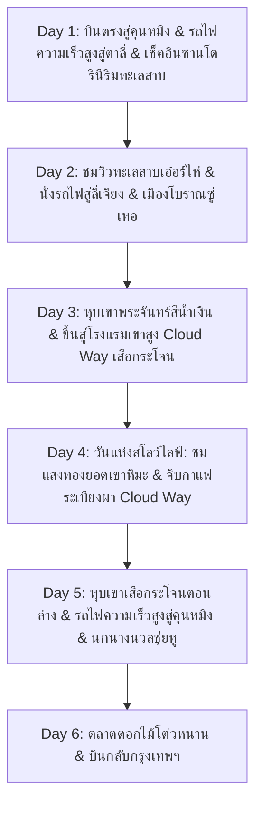

# แผนที่ 1: มนต์เสน่ห์หุบเขาเสือกระโจน & ตาลี่ ซานโตรินี (Tiger Leaping Gorge Cloud Way & Dali Santorini)

> **สถานะ**: ⭐ **ตัวเลือกแนะนำอันดับที่ 1 (Recommended First Choice - ฉบับปรับปรุงใหม่)**  
> **รูปแบบการท่องเที่ยว**: สโลว์ไลฟ์ พักผ่อนสบายๆ ไม่เร่งรีบ (จำกัดสถานที่ไฮไลท์ไม่เกิน 2 แห่งต่อวัน)  
> **ช่วงเวลาเดินทาง**: 5 – 10 ธันวาคม 2026 (6 วัน 5 คืน) *(สามารถปรับบวก-ลบได้ 1-2 วัน)*  
> **ภูมิภาค**: มณฑลยูนนาน (Yunnan) สาธารณรัฐประชาชนจีน (คุนหมิง – ตาลี่ – ลี่เจียง – หุบเขาเสือกระโจน)  
> **จัดทำโดย**: บัง (นักจัดทริปผู้เชี่ยวชาญท่องเที่ยวจีน)

---

## ไฮไลท์พิเศษฉบับปรับปรุงตามคำขอ (Special Customized Highlights)

แผนนี้ได้รับการปรับปรุงเพื่อตอบโจทย์การพักผ่อนระดับพรีเมียมแบบสโลว์ไลฟ์อย่างแท้จริง โดยตัดเมืองแชงกรีล่าออกเพื่อไม่ให้เหนื่อยกับการเดินทาง และเน้นจุดพักผ่อนสุดเอ็กซ์คลูซีฟ 2 แห่ง:
1. **พักที่ตาลี่ 1 คืน ณ "ด่านซานโตรินีเมืองจีน" (Dali Santorini / 理想邦·圣托里尼)**:
   * โรงแรมสไตล์ถ้ำสีขาวและสถาปัตยกรรมเอเจียนริมหน้าผาทะเลสาบเอ๋อร์ไห่ (Erhai Lake)
   * ชมพระอาทิตย์ตกดินสะท้อนผืนน้ำทะเลสาบและเทือกเขาชางซาน (Cangshan)
2. **พักที่โรงแรมบนเส้นทางเขาสูงหุบเขาเสือกระโจน 2 คืนเต็มอิ่ม**:
   * เช็คอินที่ **"Upper trekking route · Cloud Way · Snowy mountain view homestay" (虎跳峡高路·云途·雪山观景民宿)**
   * ห้องพักกระจกพาโนรามาบานใหญ่ที่หันหน้าเข้าหายอดเขาหิมะมังกรหยก (Jade Dragon Snow Mountain) โดยตรง
   * ชมปรากฏการณ์แสงสีทองกระทบยอดเขาหิมะ **(日照金山 - Golden Snow Mountain Sunrise)** ได้จากบนเตียงนอนและระเบียงดาดฟ้ากระจกเงาฟ้า
3. **การเดินทางนุ่มนวล ไม่ต้องเดินเทรคกิ้งโหด**: มีรถ SUV รับ-ส่งกระเป๋าและสัมภาระขึ้นสู่โรงแรมบนเขาสูงโดยตรง และเที่ยวชมหุบเขาเสือกระโจนด้วยบันไดเลื่อนกระจกชมวิว

---

## สรุปภาพรวมของทริป (Trip Overview)

* **สภาพอากาศช่วง 5 – 10 ธันวาคม**: 
  * ตาลี่ (Dali): 10°C ถึง 17°C (แดดอุ่น ฟ้าใส ลมพัดเย็นสบาย)
  * หุบเขาเสือกระโจน (Tiger Leaping Gorge): 8°C ถึง 16°C (กลางคืนมีฮีตเตอร์อุ่นสบาย)
  * คุนหมิง (Kunming): 12°C ถึง 18°C
* **ระดับความสูง**: ตาลี่ (1,970 ม.) -> ลี่เจียง (2,400 ม.) -> หุบเขาเสือกระโจน (1,800 – 2,200 ม.) -> คุนหมิง (1,890 ม.) ระดับความสูงไม่เกิน 2,400 เมตร ออกซิเจนหนาแน่น **ไม่มีปัญหาเรื่องอาการแพ้ที่สูง (AMS) เดินเที่ยวได้อย่างสบายใจ 100%**
* **การเดินทางหลัก**: บินตรงกรุงเทพฯ-คุนหมิง (เพียง 2.2 ชม.) + รถไฟความเร็วสูง (CRH) ขบวนปรับอากาศชั้นหนึ่ง + รถตู้/SUV ส่วนตัว

---

## แผนการเดินทางรายวัน (Day-by-Day Itinerary)

---

### วันที่ 1 (5 ธันวาคม 2026): กรุงเทพฯ – คุนหมิง – รถไฟความเร็วสูงสู่ตาลี่ – เช็คอินรีสอร์ทสไตล์ซานโตรินี

* **ช่วงเช้า**:
  * บินตรงจากสนามบินสุวรรณภูมิ (BKK) หรือดอนเมือง (DMK) สู่สนามบินนานาชาติคุนหมิงฉางสุ่ย (KMG) ใช้เวลาบินเพียง 2 ชั่วโมง 15 นาที
  * ผ่านด่านตรวจคนเข้าเมืองจีน (ฟรีวีซ่าสำหรับคนไทย)
* **ช่วงบ่าย (ไฮไลท์ที่ 1 - รถไฟความเร็วสูงสู่เมืองโรแมนติก "ตาลี่" Dali)**:
  * นั่งรถไฟความเร็วสูง (CRH) จากสถานีรถไฟคุนหมิง มุ่งหน้าสู่ **"เมืองตาลี่" (Dali Station)** ใช้เวลาเดินทางประมาณ 2 ชั่วโมง
  * ชมวิวทิวทัศน์ทุ่งดอกไม้และขุนเขาเขียวขจีสองข้างทาง
* **ช่วงเย็น & ค่ำ (ไฮไลท์ที่ 2 - เช็คอินโรงแรมหน้าผาสไตล์ซานโตรินี 理想邦·圣托里尼 Dali Santorini)**:
  * รถตู้ส่วนตัวรับจากสถานีตาลี่ ข้ามสะพานมุ่งหน้าสู่ **"หลี่เซียงปัง (Ideal State / Dali Santorini)"** เมืองตากอากาศสีขาวบริสุทธิ์ริมหน้าผาชายฝั่งตะวันออกของทะเลสาบเอ๋อร์ไห่
  * เช็คอินเข้าโรงแรมหรูสไตล์ซานโตรินี เช่น **Dali Songyun Cliff Resort (大理松云悬崖酒店)** หรือ **Miyue Dali Santorini Seaview Resort (大理蜜悦·圣托里尼海景酒店)**
  * ผ่อนคลายริมสระว่ายน้ำอินฟินิตี้หรือระเบียงห้องพัก ชมพระอาทิตย์อัสดงสีส้มอมชมพูตกหลังทิวเขาชางซาน (Cangshan) สะท้อนระยิบระยับบนผืนน้ำทะเลสาบเอ๋อร์ไห่ ถ่ายรูปมุมไหนก็เหมือนอยู่ทะเลอีเจียนในยุโรป
* **มื้ออาหาร**:
  * กลางวัน: อาหารว่างบนเครื่องบิน / ข้าวกล่องรถไฟความเร็วสูง
  * เย็น: ดินเนอร์อาหารตะวันตกฟิวชั่น หรือปลาคาร์ปต้มหม้อดินหมี่เซี่ยนริมหน้าผาซานโตรินี
* **ที่พัก**: โรงแรมสไตล์ซานโตรินี Dali Songyun Cliff Resort หรือ Miyue Santorini Seaview Resort (ห้องพักวิวทะเลสาบ 180 องศา)

---

### วันที่ 2 (6 ธันวาคม 2026): ทะเลสาบเอ๋อร์ไห่โค้งตัว S – รถไฟความเร็วสูงสู่ลี่เจียง – เมืองโบราณซู่เหอ

* **ช่วงเช้า (ไฮไลท์ที่ 1 - สโลว์ไลฟ์ริมทะเลสาบเอ๋อร์ไห่ & ถนนโค้งตัว S ปันซีไห่ซี)**:
  * ตื่นเช้าจิบกาแฟชมแสงอรุณกระทบผืนน้ำทะเลสาบ ทานอาหารเช้าลอยน้ำ (Floating Breakfast) หรือบุฟเฟต์ของโรงแรม
  * นั่งรถเปิดประทุนหรือรถส่วนตัวเลียบชายฝั่งตะวันตก แวะจุดถ่ายรูปแลนด์มาร์ก **"โค้งตัว S ปันซี" (Panxi S-Bay - 磻溪村S湾)** ทางปั่นจักรยานริมทะเลสาบที่มีต้นเรดวูดผลัดใบสีส้มและฝูงนกเป็ดน้ำ
* **ช่วงบ่าย**:
  * นั่งรถไฟความเร็วสูงจากสถานี Dali สู่ **"เมืองลี่เจียง" (Lijiang Station)** ใช้เวลาเพียง 1 ชั่วโมง 20 นาทีเท่านั้น
* **ช่วงบ่ายแก่ๆ & ค่ำ (ไฮไลท์ที่ 2 - เมืองโบราณซู่เหอ 束河古镇 Shuhe Ancient Town)**:
  * เช็คอินเข้าสู่เมืองโบราณซู่เหอ เมืองโบราณชนชาติน่าซีที่เงียบสงบ ลำธารใสสะอาดไหลผ่านสะพานหินชิงหลง (Qinglong Stone Bridge)
  * เดินทอดน่องแบบสโลว์ไลฟ์ใต้ร่มไม้หลิว จิบชาผู่เอ๋อร์ และทานมื้อค่ำท่ามกลางเสียงดนตรีโฟล์กเบาๆ
* **มื้ออาหาร**:
  * เช้า: บุฟเฟต์โรงแรมซานโตรินี
  * กลางวัน: ข้าวผัดเห็ดทรัฟเฟิลและยำไก่ฉีกสไตล์ไป๋
  * เย็น: หม้อไฟไก่ตุ๋นเห็ดป่ายูนนาน (Wild Mushroom Hotpot) อุ่นสบายท้อง
* **ที่พัก**: โรงแรม The Bivou Lijiang หรือ Banyan Tree Lijiang หรือ Boutique Naxi Courtyard

---

### วันที่ 3 (7 ธันวาคม 2026): ทะเลสาบพระจันทร์สีน้ำเงิน – มุ่งสู่หุบเขาเสือกระโจน – เช็คอิน Cloud Way Homestay

* **ช่วงเช้า (ไฮไลท์ที่ 1 - หุบเขาพระจันทร์สีน้ำเงิน 蓝月谷 Blue Moon Valley)**:
  * 09:00 น. เดินทางสู่เชิงเขาหิมะมังกรหยก ชมความงามบริสุทธิ์ของ **"หุบเขาพระจันทร์สีน้ำเงิน" (Blue Moon Valley)**
  * ผืนน้ำในสระหินปูนขั้นบันไดสีขาวสะท้อนแสงแดดเป็นประกายสีฟ้าครามสดใสราวกับมรกต โดยมียอดเขาหิมะมังกรหยก 13 ยอดตั้งตระหง่านอยู่เบื้องหลัง นั่งรถกอล์ฟไฟฟ้าชมวิวสบายๆ
* **ช่วงบ่าย (ไฮไลท์ที่ 2 - มุ่งสู่หุบเขาเสือกระโจน & เช็คอินโรงแรมเขาสูง Cloud Way)**:
  * นั่งรถ SUV ส่วนตัวมุ่งหน้าสู่ **"หุบเขาเสือกระโจน" (Tiger Leaping Gorge)** ไต่ระดับขึ้นสู่ถนนเส้นทางเขาสูง (Upper Trekking Route) โดยไม่ต้องเดินเท้าแบกเป้หนัก
  * เช็คอินเข้าพักที่: **"Upper trekking route · Cloud Way · Snowy mountain view homestay" (虎跳峡高路·云途·雪山观景民宿)**
  * **ความฟินระดับ 5 ดาว**: โฮมสเตย์ดีไซน์โมเดิร์นตั้งอยู่บนหน้าผาสูง หันหน้าประจันหน้ากับหน้าผาหิมะของภูเขาหิมะมังกรหยกแบบไม่มีอะไรบดบัง มีหน้าต่างกระจกบานใหญ่ตั้งแต่พื้นจรดเพดาน ฮีตเตอร์พื้น และเตาผิง
  * ชมพระอาทิตย์อัสดงยามเย็น แสงสีทองจะฉาบทาลงบนยอดเขาหิมะตรงหน้าอย่างอัศจรรย์
* **มื้ออาหาร**:
  * เช้า: บุฟเฟต์โรงแรม
  * กลางวัน: อาหารเซ็ตท้องถิ่นยูนนาน
  * เย็น: หม้อไฟซี่โครงหมูแห้งและผัดผักบนเขาสดใหม่ เสิร์ฟในห้องอาหารกระจกวิวภูเขาหิมะของ Cloud Way
* **ที่พัก**: **Upper trekking route·Cloud Way·Snowy mountain view homestay** (คืนที่ 1)

---

### วันที่ 4 (8 ธันวาคม 2026): วันแห่งการพักผ่อนสโลว์ไลฟ์: ชมแสงทองยอดเขาหิมะ & จิบกาแฟระเบียงผา Cloud Way

* **ช่วงเช้าตรู่ (ไฮไลท์ที่ 1 - มหัศจรรย์แสงแรก "รื่อจ้าวชินซาน" 日照金山 ณ Cloud Way)**:
  * 07:30 น. ไม่ต้องตื่นเช้าออกไปเบียดเสียดกับใคร เพียงเปิดม่านห้องนอนหรือก้าวออกมาระเบียง
  * ชมแสงอาทิตย์ยามรุ่งอรุณสาดส่องลงบนยอดเขาหิมะมังกรหยก เปลี่ยนภูเขาสีขาวให้กลายเป็น **"ภูเขาทองคำ" (Golden Mountain)** สะท้อนลงบนผิวน้ำของสระกระจกเงาฟ้า (Sky Mirror Pool) บนดาดฟ้าของโฮมสเตย์ ถ่ายภาพความทรงจำระดับมาสเตอร์พีซ
  * ทานอาหารเช้าช้าๆ จิบกาแฟดริปร้อนๆ สูดอากาศบริสุทธิ์ของเทือกเขาแอลป์แห่งเอเชีย
* **ช่วงกลางวัน & บ่าย (ไฮไลท์ที่ 2 - จิบชากาแฟระเบียงผา & เดินทอดน่องเส้นทางชมวิวแบบสบายๆ)**:
  * พักผ่อนอ่านหนังสือ จิบชา ฟังเสียงสายลม และถ่ายรูปชิลล์ๆ ในบริเวณโฮมสเตย์
  * หากต้องการเดินยืดเส้น สามารถเดินเล่นตามทางเดินเลียบไหล่เขาที่ราบเรียบ (ไม่ต้องปีนชัน) ไปยังจุดชมวิวน้ำตกกวนอิน หรือแวะจิบเครื่องดื่มที่ระเบียง Halfway Guesthouse ชมวิวหุบผาที่ลึกที่สุดในโลก
  * สัมผัสความสงบเงียบตัดขาดจากความวุ่นวายของโลกภายนอก
* **ช่วงค่ำ**:
  * ดื่มด่ำกับมื้อค่ำหน้าเตาผิงในโฮมสเตย์ และชมทะเลดาวระยิบระยับเต็มท้องฟ้ายามค่ำคืน (Stargazing)
* **มื้ออาหาร**:
  * เช้า: อาหารเช้าสไตล์คันทรี่ของ Cloud Way (ไข่ดาว แพนเค้ก ข้าวต้ม ชาร้อน)
  * กลางวัน: ไก่บ้านผัดเห็ดโคนและมันฝรั่งอบชีส
  * เย็น: บาร์บีคิวเนื้อย่างกระทะร้อนสไตล์พื้นเมืองบนระเบียงชมดาว
* **ที่พัก**: **Upper trekking route·Cloud Way·Snowy mountain view homestay** (คืนที่ 2)

---

### วันที่ 5 (9 ธันวาคม 2026): หุบเขาเสือกระโจนตอนบน – รถไฟความเร็วสูงสู่คุนหมิง – ฝูงนกนางนวลไซบีเรียทะเลสาบชุ่ยหู

* **ช่วงเช้า (ไฮไลท์ที่ 1 - สัมผัสพลังสายน้ำหุบเขาเสือกระโจนตอนบน 上虎跳峡)**:
  * 09:30 น. รถมารับกระเป๋าและนำท่านลงสู่ก้นหุบเขาเสือกระโจนตอนบน
  * ลงสู่จุดชมวิวริมแม่น้ำจินซาเจียงด้วย **"บันไดเลื่อนกระจกชมวิว (Scenic Escalator)"** สะดวกสบาย ไม่ต้องเดินบันไดหลายร้อยขั้น
  * ยืนข้าง **"โขดหินเสือกระโจน"** ชมสายน้ำสีเขียวมรกตกระทบแก่งหินจนเกิดละอองน้ำสีขาวพร้อมเสียงคำรามกึกก้อง สัมผัสความยิ่งใหญ่ของธรรมชาติอย่างใกล้ชิด
* **ช่วงบ่าย**:
  * รถส่งท่านสู่สถานีรถไฟความเร็วสูง Tiger Leaping Gorge Station (虎跳峡站) นั่งรถไฟความเร็วสูงตรงสู่ **"นครคุนหมิง"**
* **ช่วงเย็น (ไฮไลท์ที่ 2 - สวนสาธารณะชุ่ยหู & มหัศจรรย์ฝูงนกนางนวลไซบีเรีย 翠湖公园 红嘴鸥)**:
  * เข้าเช็คอินโรงแรม 5 ดาวใจกลางเมืองคุนหมิง
  * เดินเล่นชมความร่มรื่นของ **"สวนสาธารณะชุ่ยหู" (Green Lake Park)** ชมและให้อาหาร **"ฝูงนกนางนวลปากแดงไซบีเรีย" (Red-billed Gulls)** นับหมื่นตัวที่อพยพมาอาศัยในฤดูหนาว บินวนรอบตัวรับแสงแดดยามเย็น
* **มื้ออาหาร**:
  * เช้า: อาหารเช้าที่ Cloud Way
  * กลางวัน: อาหารว่างบนรถไฟความเร็วสูง
  * เย็น: "ก๋วยเตี๋ยวข้ามสะพาน" (Guoqiao Mixian - 过桥米线) ต้นตำรับยูนนานแท้ เสิร์ฟในชามหินร้อนเดือด
* **ที่พัก**: โรงแรม Grand Park Kunming หรือ Sofitel Kunming ระดับ 5 ดาว

---

### วันที่ 6 (10 ธันวาคม 2026): ตลาดดอกไม้โต่วหนาน – เดินทางกลับกรุงเทพฯ

* **ช่วงเช้า (ไฮไลท์ที่ 1 - ตลาดค้าดอกไม้สดโต่วหนาน 斗南花卉市场 Dounan Flower Market)**:
  * 09:30 น. เยี่ยมชม **"ตลาดดอกไม้โต่วหนาน"** ตลาดค้าส่งดอกไม้สดที่ใหญ่ที่สุดในเอเชีย
  * ชมทะเลดอกไม้นานาพันธุ์ และแวะชิมขนมเปี๊ยะอบสดไส้กลีบดอกกุหลาบ (Flower Cake / 鲜花饼) ของฝากอันดับหนึ่ง
* **ช่วงบ่าย (ไฮไลท์ที่ 2 - สู่สนามบินคุนหมิงฉางสุ่ย บินตรงกลับกรุงเทพฯ)**:
  * 12:30 น. รถรับส่งท่านสู่สนามบินนานาชาติคุนหมิงฉางสุ่ย (KMG)
  * บินตรงกลับสู่กรุงเทพฯ โดยสวัสดิภาพ ใช้เวลาบินเพียง 2 ชั่วโมงเศษ พร้อมภาพถ่ายสวยงามและความประทับใจเต็มเปี่ยม
* **มื้ออาหาร**:
  * เช้า: บุฟเฟต์โรงแรม
  * กลางวัน: อาหารตามอัธยาศัยที่สนามบิน

---

## รายละเอียดที่พักตามที่ระบุ (Accommodation Details)

1. **Dali Santorini Hotel (ตาลี่ ซานโตรินี)**:
   * **ชื่อทางการ**: Dali Ideal State Santorini (大理理想邦圣托里尼) เช่น **Dali Songyun Cliff Resort (大理松云悬崖酒店)** หรือ **Miyue Santorini Seaview Resort (大理蜜悦·圣托里尼海景酒店)**
   * **จุดเด่น**: สถาปัตยกรรมสไตล์เกาะซานโตรินีสีขาวโค้งมนบนหน้าผา อ่างอาบน้ำและสระน้ำวิวทะเลสาบเอ๋อร์ไห่ 180 องศา ชมพระอาทิตย์ตกดินที่สวยที่สุดในตาลี่
2. **Tiger Leaping Gorge High Road Homestay**:
   * **ชื่อทางการ**: **Upper trekking route·Cloud Way·Snowy mountain view homestay (虎跳峡高路·云途·雪山观景民宿)**
   * **จุดเด่น**: ตั้งอยู่บนเส้นทาง Upper Trail ชั้นสูงของหุบเขาเสือกระโจน หันหน้าเข้าหาหน้าผาและยอดเขาหิมะมังกรหยกโดยตรง หน้าต่างบานใหญ่จรดเพดาน ฮีตเตอร์พื้น ระเบียงชมแสงทองยอดเขาหิมะ และสระน้ำสะท้อนกระจกเงาฟ้า

---

## ประมาณการงบประมาณ (ต่อท่าน)

| รายการ | รายละเอียด | ค่าใช้จ่ายประมาณการ (บาท) |
| :--- | :--- | :---: |
| **ตั๋วเครื่องบินไป-กลับ** | BKK - Kunming KMG (บินตรง รวมน้ำหนักกระเป๋า) | 7,500 – 10,500 |
| **รถไฟความเร็วสูง (CRH)** | ชั้นหนึ่ง (คุนหมิง-ตาลี่, ตาลี่-ลี่เจียง, เสือกระโจน-คุนหมิง) | 3,200 – 4,200 |
| **รถตู้/SUV รับส่งตลอดทริป** | รวมรถ SUV ขึ้น-ลง Cloud Way และพาเที่ยวจุดสำคัญ (หาร 2-4 คน) | 4,500 – 6,000 |
| **โรงแรมที่พักสุดเอ็กซ์คลูซีฟ (5 คืน)** | รีสอร์ทซานโตรินีตาลี่ + โฮมสเตย์ Cloud Way 2 คืน + บูทีคลี่เจียง + 5 ดาวคุนหมิง | 12,000 – 16,500 |
| **ค่าบัตรเข้าชม & บันไดเลื่อน** | หุบเขาเสือกระโจน+บันไดเลื่อน + หุบเขาพระจันทร์สีน้ำเงิน | 2,200 – 2,800 |
| **ค่าอาหารและเครื่องดื่ม** | มื้อละประมาณ 50-80 หยวน + อาหารค่ำวิวหน้าผา Cloud Way | 4,500 – 6,000 |
| **ประกันการเดินทาง & ซิมการ์ด** | Roaming เน็ต 6 วัน + ประกันการเดินทาง | 1,000 – 1,500 |
| **รวมประมาณการต่อท่าน** | **ทริปพรีเมียม วิวระดับมาสเตอร์พีซ พักผ่อนแท้จริง ไม่เหนื่อย** | **~34,900 – 47,500 บาท** |
