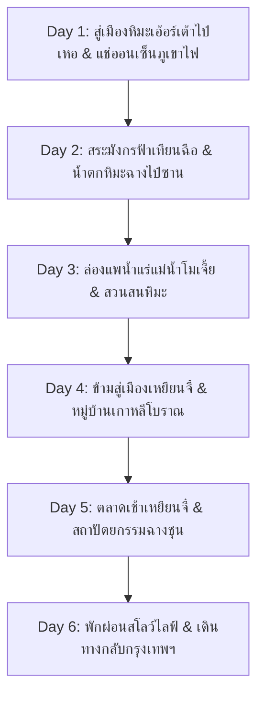

# แผนที่ 2: มหัศจรรย์แดนหิมะขุนเขาฉางไป๋ซาน & ออนเซ็นธรรมชาติ (Changbaishan Winter Fairy Tale)

> **รูปแบบการท่องเที่ยว**: สโลว์ไลฟ์ พักผ่อนสบายๆ ไม่เร่งรีบ (จำกัดสถานที่ไฮไลท์ไม่เกิน 2 แห่งต่อวัน)  
> **ช่วงเวลาเดินทาง**: 5 – 10 ธันวาคม 2026 (6 วัน 5 คืน) *(สามารถปรับบวก-ลบได้ 1-2 วัน)*  
> **ภูมิภาค**: มณฑลจี๋หลิน (Jilin) สาธารณรัฐประชาชนจีน  
> **จัดทำโดย**: บัง (นักจัดทริปผู้เชี่ยวชาญท่องเที่ยวจีน)

---

## สรุปภาพรวมของทริป (Trip Overview)

ทริปนี้จะพาท่านเดินทางสู่ **"ภูเขาไฟฉางไป๋ซาน" (长白山 - Changbaishan)** ดินแดนหิมะขาวบริสุทธิ์ทางตะวันออกเฉียงเหนือของจีน สัมผัสความมหัศจรรย์ของ **"ทะเลสาบเทียนฉือ" (Heavenly Lake)** ปากปล่องภูเขาไฟที่กลายเป็นผืนน้ำแข็งสีขาวราวภาพวาด แช่ **น้ำพุร้อนธรรมชาติกลางหิมะ (Outdoor Snow Hot Spring)** ล่องแพชมปรากฏการณ์น้ำค้างแข็งหิมะเกาะกิ่งไม้ (Rime / 雾凇) และข้ามไปสัมผัสเสน่ห์วัฒนธรรมเกาหลีในจีนที่ **เมืองเหยียนจี๋ (Yanji)**

* **สภาพอากาศช่วงต้นเดือนธันวาคม**: -15°C ถึง -25°C หิมะตกหนานุ่ม เป็นช่วง High Season ของทิวทัศน์หิมะ
* **ระดับความสูง**: ภูเขาฉางไป๋ซานสูงประมาณ 2,000 – 2,600 เมตรเหนือระดับน้ำทะเล (ความกดอากาศไม่เป็นอุปสรรคต่อคนทั่วไป ไม่ค่อยมีอาการแพ้ที่สูงรุนแรงเหมือนทิเบต)
* **การเดินทางหลัก**: เที่ยวบินจากกรุงเทพฯ + รถไฟความเร็วสูง (CRH) + รถยนต์ส่วนตัว/รถ VIP ของอุทยาน

---

## แผนการเดินทางรายวัน (Day-by-Day Itinerary)

---

### วันที่ 1 (5 ธันวาคม 2026): กรุงเทพฯ – เมืองฉางชุน – รถไฟความเร็วสูงสู่ฉางไป๋ซาน (เอ้อร์เต้าไป๋เหอ)

* **ช่วงเช้า**:
  * เดินทางออกจากสนามบินสุวรรณภูมิ (BKK) / ดอนเมือง (DMK) สู่สนามบินฉางชุนหลงเจีย (Changchun Longjia International Airport - CGQ)
  * ผ่านด่านตรวจคนเข้าเมืองจีน (ฟรีวีซ่าสำหรับผู้ถือหนังสือเดินทางไทย พักได้ไม่เกิน 30 วัน)
* **ช่วงบ่าย (ไฮไลท์ที่ 1 - การเดินทางด้วยรถไฟหัวกระสุนชมวิวหิมะ)**:
  * ขึ้นรถไฟความเร็วสูง (CRH) จากสถานีสนามบินหลงเจีย (Longjia Railway Station) ตรงสู่สถานีฉางไป๋ซาน (Changbaishan Station - 长白山站) เมืองเอ้อร์เต้าไป๋เหอ (Erdaobaihe Town)
  * ใช้เวลาเดินทางเพียงประมาณ 2 ชั่วโมง 15 นาที นั่งชมวิวทุ่งหิมะขาวโพลนสองข้างทางอย่างสะดวกสบาย อุ่นสบายด้วยฮีตเตอร์ในขบวนรถ
* **ช่วงค่ำ (ไฮไลท์ที่ 2 - แช่น้ำพุร้อนธรรมชาติกลางหิมะ Outdoor Hot Spring)**:
  * เข้าเช็คอินโรงแรมรีสอร์ทน้ำพุร้อนระดับ 5 ดาวในเมืองเอ้อร์เต้าไป๋เหอ เช่น **Crown Plaza Resort Changbaishan** หรือ **Dynasty Holy Water Hotel** ซึ่งมีตาน้ำแร่ร้อนต่อตรงจากภูเขาไฟฉางไป๋ซาน
  * สัมผัสประสบการณ์ฟินสุดขีด: แช่น้ำแร่ออนเซ็นร้อนๆ 40°C ท่ามกลางหิมะโปรยปรายและอุณหภูมิติดลบ
* **มื้ออาหาร**:
  * กลางวัน: อาหารว่างบนรถไฟ / ทานที่สถานี
  * เย็น: หม้อไฟเนื้อแกะมองโกเลีย/ตงเป่ยดั้งเดิม (Dongbei Hot Pot) อุ่นร่างกาย
* **ที่พัก**: โรงแรมระดับ 4-5 ดาว เมืองเอ้อร์เต้าไป๋เหอ (มีบ่อน้ำพุร้อนและฮีตเตอร์พื้น)

---

### วันที่ 2 (6 ธันวาคม 2026): มหัศจรรย์อุทยานฉางไป๋ซานฝั่งทิศเหนือ (North Slope)

* **ช่วงเช้า (ไฮไลท์ที่ 1 - ทะเลสาบสวรรค์เทียนฉือ 天池 Tianchi Lake)**:
  * 08:30 น. เดินทางสู่ศูนย์บริการนักท่องเที่ยวอุทยานฉางไป๋ซาน (North Gate)
  * นั่งรถบัส VIP ของอุทยานและเปลี่ยนเป็นรถ SUV ขับเคลื่อน 4 ล้อไต่เขาหิมะสู่ยอดเขาเทียนฉือ (ระดับความสูง 2,189 เมตร)
  * ชม "สระมังกรฟ้าเทียนฉือ" ทะเลสาบปากปล่องภูเขาไฟที่ใหญ่และลึกที่สุด ผืนน้ำกลายเป็นน้ำแข็งสีขาวนวลสะท้อนแสงแดดฤดูหนาว โอบล้อมด้วยยอดเขาหินสีดำและหิมะ 16 ยอด
  * *หมายเหตุ: การขึ้นชมเทียนฉือขึ้นอยู่กับสภาพอากาศและกระแสลม หากลมแรงมากเจ้าหน้าที่จะเปิดเส้นทางเป็นช่วงๆ ซึ่งไกด์และคนขับจะคอยอัปเดตแบบ Real-time*
* **ช่วงกลางวัน**:
  * แวะชิม "ไข่ต้มน้ำพุร้อน" (Julong Hot Spring Eggs) ไข่ไก่และไข่เป็ดที่ต้มจากบ่อน้ำแร่กำมะถันเดือด 83°C ไข่ขาวจะนุ่มละมุนเป็นครีม ขณะที่ไข่แดงสุกพอดี พร้อมข้าวโพดหวานต้มน้ำแร่
* **ช่วงบ่าย (ไฮไลท์ที่ 2 - น้ำตกฉางไป๋ซาน & หุบเขาบ่อน้ำพุร้อนจวี่หลง)**:
  * เดินเท้าแบบสบายๆ บนทางเดินไม้กึ่งอบอุ่น (มีไอความร้อนจากน้ำพุ) ชม **"กลุ่มน้ำพุร้อนจวี่หลง" (Julong Hot Springs)** ไอควันสีขาวลอยกรุ่นตัดกับธารน้ำแข็งหลากสีสัน
  * ชม **"น้ำตกฉางไป๋ซาน" (Changbaishan Waterfall)** น้ำตกความสูง 68 เมตร ต้นกำเนิดของแม่น้ำซงฮัวและแม่น้ำยาลู ในฤดูหนาวผิวน้ำตกกลายเป็นเสาน้ำแข็งยักษ์สุดตระการตา
* **ช่วงเย็น & ค่ำ**:
  * กลับสู่ที่พักในตัวเมืองเอ้อร์เต้าไป๋เหอ ทานมื้อค่ำและพักผ่อนในห้องพักอุ่นๆ
* **มื้ออาหาร**:
  * กลางวัน: เมนูเซ็ตอาหารพื้นเมืองตงเป่ยในอุทยาน + ไข่ต้มน้ำพุร้อน
  * เย็น: ไก่ตุ๋นโสมฉางไป๋ซานแท้ (Ginseng Chicken Soup) เสิร์ฟในหม้อดินร้อน
* **ที่พัก**: โรงแรมเดิม เมืองเอ้อร์เต้าไป๋เหอ

---

### วันที่ 3 (7 ธันวาคม 2026): ล่องแพน้ำค้างแข็งแม่น้ำปีศาจ & เที่ยวสโลว์ไลฟ์เมืองป่าสน

* **ช่วงเช้าตรู่ (ไฮไลท์ที่ 1 - ล่องแพแม่น้ำโมเจี้ย 魔界漂流 Moju Rafting)**:
  * 06:30 น. ออกเดินทางไปยังแม่น้ำโมเจี้ย (นั่งรถประมาณ 15-20 นาที)
  * สวมชุดกันน้ำกันลมและเสื้อชูชีพ ลงเรือยางล่องแพไปตามลำน้ำที่ไม่เป็นน้ำแข็งเนื่องจากมีตาน้ำอุ่น
  * ไฮไลท์สุดมหัศจรรย์: ในช่วงเวลาพระอาทิตย์ขึ้น ไอหมอกเหนือน้ำจะลอยกระทบกิ่งไม้สองฝั่งแม่น้ำ เกิดเป็นผลึกน้ำค้างแข็งสีขาวเกาะพราวทั่วทั้งป่า (雾凇 - Rime Ice) บรรยากาศเหมือนล่องลอยอยู่ในดินแดนแห่งเวทมนตร์ (ใช้เวลาล่องแพประมาณ 40-50 นาทีอย่างผ่อนคลาย)
* **ช่วงสาย**:
  * กลับเข้าโรงแรม ทานอาหารเช้าและจิบชากาแฟอุ่นๆ คลายหนาว
* **ช่วงบ่าย (ไฮไลท์ที่ 2 - สวนสนงามเหม่ยเหรินซง & หอชมวิวหิมะ)**:
  * เดินทอดน่องแบบสโลว์ไลฟ์ ณ **"สวนสนเหม่ยเหรินซง" (Beauty Pine Park - 美人松公园)** ชมต้นสนแดงสายพันธุ์หายากที่ลำต้นตรงสง่างามปกคลุมด้วยหิมะ
  * ขึ้นสู่จุดชมวิวกระจกลอยฟ้า (Glass Skywalk) มองเห็นทัศนียภาพเมืองหิมะสีขาวสะอาดตาแบบพาโนรามา ถ่ายรูปโดยไม่มีผู้คนพลุกพล่าน
* **ช่วงค่ำ**:
  * พักผ่อน ช้อปปิ้งของฝากท้องถิ่น เช่น ชาเห็ดหลินจือ, โสมป่าฉางไป๋ซาน, ลูกเบอร์รี่ป่าอบแห้ง
* **มื้ออาหาร**:
  * กลางวัน: ปลาเทราต์น้ำเย็นย่างเกลือและซุปเกี๊ยวร้อน
  * เย็น: หมูทอดราดซอสเปรี้ยวหวานตงเป่ย (กัวเปาโร่ว - 锅包肉) ต้นตำรับแท้
* **ที่พัก**: โรงแรมเดิม เมืองเอ้อร์เต้าไป๋เหอ

---

### วันที่ 4 (8 ธันวาคม 2026): เอ้อร์เต้าไป๋เหอ – นั่งรถไฟสู่เมืองเหยียนจี๋ (Yanji) สัมผัสวัฒนธรรมเกาหลี

* **ช่วงเช้า**:
  * ตื่นสายๆ สบายๆ ไม่ต้องรีบ ทานอาหารเช้าในโรงแรม
  * เช็คเอาท์และเดินทางสู่สถานีรถไฟฉางไป๋ซาน นั่งรถไฟความเร็วสูงข้ามสู่ **"เมืองเหยียนจี๋" (Yanji - 延吉)** เมืองหลวงของเขตปกครองตนเองชนชาติเกาหลีเหยียนเปียน (ใช้เวลาเพียง 1 ชั่วโมงเศษ)
* **ช่วงบ่าย (ไฮไลท์ที่ 1 - หมู่บ้านวัฒนธรรมชนเผ่าเกาหลีจีน 中国朝鲜族民俗园)**:
  * เข้าชม **"หมู่บ้านวัฒนธรรมชนชาติเกาหลีจีน"** บ้านโบราณสไตล์ฮันอกดั้งเดิมหลังคามุงกระเบื้องและฟางท่ามกลางหิมะ
  * กิจกรรมยอดนิยม: เช่าชุดฮันบกเกาหลีแบบพรีเมียม ถ่ายภาพที่ระลึกในบรรยากาศเหมือนหลุดเข้าไปในซีรีส์ย้อนยุค
* **ช่วงค่ำ (ไฮไลท์ที่ 2 - ย่านมหาวิทยาลัยเหยียนเปียน & ผนังไฟนีออนชื่อดัง)**:
  * ถ่ายรูปกับแลนด์มาร์ก **"Internet-Famous Neon Wall"** หน้ามหาวิทยาลัยเหยียนเปียน ป้ายไฟร้านค้าภาษาจีนคู่กับภาษาเกาหลีทอดยาวตลอดตึก
  * ลิ้มลองอาหารค่ำสไตล์เกาหลีรสเลิศ
* **มื้ออาหาร**:
  * กลางวัน: บะหมี่เย็นเหยียนจี๋ (Yanji Cold Noodles) ทานคู่กับหมูย่างสไตล์เกาหลี
  * เย็น: บาร์บีคิวเนื้อย่างเกาหลีเตาถ่าน (Korean BBQ) จิ้มน้ำจิ้มงา และต็อกโบกกีชีส
* **ที่พัก**: โรงแรม Yanji International Hotel หรือ Park Kairos Hotel ระดับ 4-5 ดาว

---

### วันที่ 5 (9 ธันวาคม 2026): ตลาดเช้าเหยียนจี๋ – รถไฟความเร็วสูงสู่ฉางชุน – พระราชวังหม่านจู

* **ช่วงเช้า (ไฮไลท์ที่ 1 - ตลาดเช้าสุ่ยซื่อ 水上市场 หรือ ตลาดซีซื่อ West Market)**:
  * 07:30 น. เดินสัมผัสวิถีชีวิตผู้คนท้องถิ่นในตลาดเช้า ชิมสตรีทฟู้ดร้อนๆ เช่น ซุปเนื้อวัวพริกไทย, ต็อกสดทำใหม่ๆ, กิมจิสูตรโฮมเมด, ข้าวโพดข้าวเหนียวต้ม
  * ซื้อของฝากของแห้งจากชายแดนจีน-เกาหลี
* **ช่วงสาย**:
  * นั่งรถไฟความเร็วสูงจากสถานี Yanji West สู่สถานี Changchun (ใช้เวลาประมาณ 2 ชั่วโมง 10 นาที)
* **ช่วงบ่าย (ไฮไลท์ที่ 2 - พระราชวังหุ่นเชิดหม่านจู 伪满皇宫博物院)**:
  * เยี่ยมชม **"พิพิธภัณฑ์พระราชวังแห่งรัฐแมนจูกัว" (Museum of the Imperial Palace of Manchukuo)** พระราชวังในอดีตของจักรพรรดิปูยี (จักรพรรดิองค์สุดท้ายของจีน)
  * สถาปัตยกรรมผสมผสานระหว่างจีน ญี่ปุ่น และยุโรป โอบล้อมด้วยสวนหิมะอันเงียบสงบ
* **ช่วงค่ำ**:
  * เดินเล่นย่านการค้าใจกลางเมืองฉางชุน หรือห้าง The MixC พักผ่อนสบายๆ
* **มื้ออาหาร**:
  * เช้า: สตรีทฟู้ดตลาดเช้าเหยียนจี๋
  * กลางวัน: อาหารจีนประยุกต์ในฉางชุน
  * เย็น: เป็ดย่างสไตล์ตงเป่ย และซุปเกี๊ยวน้ำร้อน
* **ที่พัก**: โรงแรม Hyatt Regency Changchun หรือ Sheraton Changchun Jingyuetan

---

### วันที่ 6 (10 ธันวาคม 2026): พักผ่อนในเมืองฉางชุน – บินกลับกรุงเทพฯ

* **ช่วงเช้า (ไฮไลท์ที่ 1 - พักผ่อนสโลว์ไลฟ์ หรือ ช้อปปิ้งของฝาก)**:
  * ทานอาหารเช้าแบบบุฟเฟต์ในโรงแรมอย่างเต็มอิ่ม
  * เดินเล่นซื้อขนมและของที่ระลึก หรือหากต้องการสัมผัสหิมะเพิ่ม สามารถแวะเดินเล่นที่สวนสาธารณะหนานหู (Nanhu Park) ทะเลสาบน้ำแข็งใจกลางเมือง
* **ช่วงบ่าย (ไฮไลท์ที่ 2 - เดินทางสู่สนามบินหลงเจีย บินกลับกรุงเทพฯ)**:
  * 12:30 น. เดินทางสู่สนามบินฉางชุนหลงเจีย (CGQ)
  * เช็คอินเที่ยวบิน เดินทางกลับสู่กรุงเทพฯ โดยสวัสดิภาพพร้อมความประทับใจ
* **มื้ออาหาร**:
  * เช้า: ห้องอาหารโรงแรม
  * กลางวัน: อาหารตามอัธยาศัยที่สนามบิน

---

## สรุปทางเลือกการปรับแผน (± 2 วัน)

* **หากเพิ่มเป็น 7-8 วัน (+1 ถึง +2 วัน)**:
  * แนะนำเพิ่มวันไป **"เมืองฮาร์บิน" (Harbin)** นั่งรถไฟความเร็วสูงจากฉางชุนเพียง 1 ชั่วโมง เพื่อชมโบสถ์เซนต์โซเฟีย (Saint Sophia Cathedral) และถนนคนเดินจงหยาง (Zhongyang Pedestrian Street)
  * หรือเพิ่มวันพักผ่อนเล่นสกีที่ **Wanda Changbaishan International Ski Resort** มีลานสกีระดับโลกและกระเช้าชมวิวหิมะ
* **หากลดเหลือ 5 วัน (-1 วัน)**:
  * ตัดเมืองเหยียนจี๋ออก โดยอยู่เที่ยวฉางไป๋ซานเต็มอิ่ม 3 คืน แล้วกลับมาค้างฉางชุน 1 คืนก่อนบินกลับ

---

## รายการสัมภาระและการเตรียมตัวรับมือความหนาว (-20°C)

1. **การแต่งกาย 3 ชั้น (Layering Principle)**:
   * **ชั้นใน (Base Layer)**: ชุดลองจอนหรือ Heattech Ultra Warm แนบเนื้อระบายเหงื่อได้ดี
   * **ชั้นกลาง (Mid Layer)**: เสื้อฟรีซ (Fleece) หรือสเวตเตอร์ขนสัตว์ ช่วยกักเก็บความร้อน
   * **ชั้นนอก (Outer Layer)**: เสื้อกันหนาวขนเป็ดหนา (Down Jacket 700+ Fill Power) แบบกันน้ำและกันลมได้ดี มีฮู้ดคลุมศีรษะ
2. **อุปกรณ์เสริมที่ห้ามลืม**:
   * ถุงมือกันหนาวกันน้ำ (แนะนำแบบทัชสกรีนได้)
   * หมวกไหมพรมคลุมหู และผ้าพันคอหนา
   * ถุงเท้าขนสัตว์หนา 2 ชั้น
   * รองเท้าบูทกันหิมะพื้นหนา ดอกยางลึก กันลื่น (Snow Boots)
   * แผ่นแปะร้อน (Heat Packs / 暖宝宝) นำไปแปะหลัง แปะเท้า และที่สำคัญ **แปะหลังโทรศัพท์มือถือ** เพื่อป้องกันแบตเตอรี่ดับเร็วจากความหนาวจัด

---

## ประมาณการงบประมาณ (ต่อท่าน)

| รายการ | รายละเอียด | ค่าใช้จ่ายประมาณการ (บาท) |
| :--- | :--- | :---: |
| **ตั๋วเครื่องบินไป-กลับ** | BKK - Changchun (รวมน้ำหนักกระเป๋า) | 12,000 – 16,000 |
| **ตั๋วรถไฟความเร็วสูง (CRH)** | ชั้นหนึ่ง/ชั้นสอง (หลงเจีย-ฉางไป๋ซาน-เหยียนจี๋-ฉางชุน) | 2,500 – 3,500 |
| **โรงแรมที่พัก (5 คืน)** | โรงแรม 4-5 ดาว พร้อมอาหารเช้าและออนเซ็น (หาร 2 คน) | 9,000 – 13,000 |
| **ค่าบัตรเข้าชม & พาหนะอุทยาน** | อุทยานฉางไป๋ซาน + รถ SUV เทียนฉือ + ล่องแพโมเจี้ย + ค่าเช่าชุด | 4,000 – 5,500 |
| **ค่าอาหารและเครื่องดื่ม** | มื้อละประมาณ 40-80 หยวน + มื้อพิเศษเนื้อย่างและหม้อไฟ | 4,500 – 6,000 |
| **ค่ารถรับส่ง & เหมารถท้องถิ่น** | เดินทางเฉลี่ย 4-6 คน | 2,000 – 3,000 |
| **ประกันการเดินทาง & ซิมการ์ด** | Roaming เน็ตไม่อั้น 6 วัน + ประกันภัยคุ้มครองฤดูหนาว | 1,000 – 1,500 |
| **รวมประมาณการต่อท่าน** | **เที่ยวแบบสบาย พักหรู อาหารครบครัน** | **~35,000 – 48,500 บาท** |
