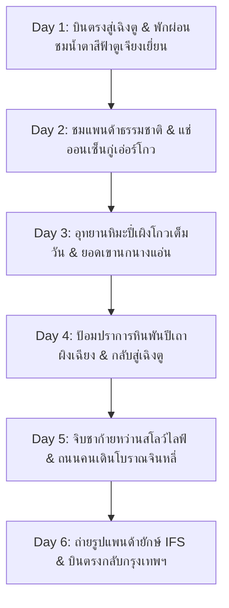

# แผนที่ 3: ดินแดนเทพนิยายหิมะปี๋เผิงโกว & ออนเซ็นกู่เอ่อร์โกว (Bipenggou Winter Wonder & Hot Springs)

> **รูปแบบการท่องเที่ยว**: สโลว์ไลฟ์ ผ่อนคลาย ไม่เร่งรีบ (จำกัดสถานที่ไฮไลท์ไม่เกิน 2 แห่งต่อวัน)  
> **ช่วงเวลาเดินทาง**: 5 – 10 ธันวาคม 2026 (6 วัน 5 คืน) *(สามารถปรับบวก-ลบได้ 1-2 วัน)*  
> **ภูมิภาค**: มณฑลเสฉวน (Sichuan) เขตปกครองตนเองชนชาติทิเบตและเฉียงอาป้า (Aba Prefecture)  
> **จัดทำโดย**: บัง (นักจัดทริปผู้เชี่ยวชาญท่องเที่ยวจีน)

---

## สรุปภาพรวมของทริป (Trip Overview)

ทริปนี้ถูกขนานนามว่าเป็น **"สวิตเซอร์แลนด์แห่งแดนเสฉวน"** เหมาะสำหรับผู้ที่ต้องการชมทัศนียภาพหิมะขาวโพลน เทือกเขาแอลป์ ทะเลสาบน้ำแข็งสีมรกต โดยเดินทางสะดวกด้วย **เที่ยวบินตรงจากกรุงเทพฯ สู่เฉิงตู (เพียง 3.5 – 4 ชั่วโมง)** จากนั้นเดินทางด้วยรถตู้เหมาส่วนตัว (Private Van) แวะชมน้องหมีแพนด้า แช่ **น้ำพุร้อนธรรมชาติกู่เอ่อร์โกว (Gu'ergou Radon Hot Springs)** ชมป้อมปราการหินโบราณพันปีของชนเผ่าเฉียง และดื่มด่ำกับวัฒนธรรมโรงน้ำชาสโลว์ไลฟ์ของเมืองเฉิงตู

* **สภาพอากาศช่วงต้นเดือนธันวาคม**: 
  * เฉิงตู: 8°C ถึง 14°C เย็นสบาย
  * ปี๋เผิงโกวและกู่เอ่อร์โกว: -5°C ถึง 5°C หิมะตกขาวโพลน น้ำในทะเลสาบเริ่มกลายเป็นน้ำแข็งใส
* **ระดับความสูง**: ค่อยๆ ไต่ระดับความสูงจากเฉิงตู (500 ม.) -> ตูเจียงเยี่ยน (700 ม.) -> กู่เอ่อร์โกว (2,200 ม.) -> ยอดเขาเอี้ยนจื่อเหยียนในอุทยานปี๋เผิงโกว (3,840 ม.) ร่างกายปรับตัวได้ง่าย โอกาสเกิดอาการแพ้ที่สูง (AMS) ต่ำมาก
* **การเดินทางหลัก**: บินตรงไป-กลับ กรุงเทพฯ-เฉิงตู + รถตู้ VIP ปรับอากาศตลอดทริป

---

## แผนการเดินทางรายวัน (Day-by-Day Itinerary)

---

### วันที่ 1 (5 ธันวาคม 2026): กรุงเทพฯ – เฉิงตู – ตูเจียงเยี่ยน (Dujiangyan)

* **ช่วงเช้า**:
  * เดินทางออกจากสนามบินสุวรรณภูมิ (BKK) หรือดอนเมือง (DMK) ด้วยเที่ยวบินตรงสู่สนามบินนานาชาติเฉิงตูเทียนฝู่ (Chengdu Tianfu TFU)
  * ผ่านด่านตรวจคนเข้าเมืองจีน (ฟรีวีซ่าสำหรับคนไทย)
* **ช่วงบ่าย (ไฮไลท์ที่ 1 - สู่เมืองมรดกโลกตูเจียงเยี่ยน)**:
  * รถตู้ VIP ส่วนตัวรับที่สนามบิน มุ่งหน้าตรงสู่ **"เมืองตูเจียงเยี่ยน" (Dujiangyan)** (ใช้เวลาเดินทางประมาณ 1.5 ชั่วโมง)
  * *เหตุผลในการจัดเส้นทาง*: การนอนที่ตูเจียงเยี่ยนในคืนแรกช่วยให้ไม่ต้องผจญกับรถติดในตัวเมืองเฉิงตู และช่วยให้วันรุ่งขึ้นเดินทางเข้าสู่เขตเทือกเขาหิมะได้รวดเร็วยิ่งขึ้น อีกทั้งระดับความสูงเพียง 700 เมตร เป็นจุดพักปรับตัวที่ดีเยี่ยม
  * เช็คอินเข้าโรงแรมริมแม่น้ำหมินเจียง พักผ่อนตามอัธยาศัย
* **ช่วงค่ำ (ไฮไลท์ที่ 2 - สะพานโบราณหนานเฉียว & แสงสีน้ำตาสีฟ้า 南桥蓝眼泪)**:
  * เดินเล่นชมความอลังการของ **"สะพานโบราณหนานเฉียว" (Nanqiao Bridge)** ยามค่ำคืน เมื่อเปิดไฟส่องกระทบสายน้ำเชี่ยวกรากของแม่น้ำหมินเจียง จะเกิดประกายสีฟ้าเขียวมรกตเรืองรองราวกับสายน้ำเวทมนตร์ (Blue Tears)
  * เดินเล่นชิมสตรีทฟู้ดรอบสะพานโบราณ
* **มื้ออาหาร**:
  * กลางวัน: อาหารว่างบนเครื่องบิน หรือทานที่สนามบิน
  * เย็น: ปลาต้มผักกาดดองสไตล์เสฉวน (酸菜鱼) และเต้าหู้หม่าล่ารสกลมกล่อม
* **ที่พัก**: โรงแรม Dujiangyan Holiday Inn Express หรือ Dujiangyan Ancient City Boutique Hotel

---

### วันที่ 2 (6 ธันวาคม 2026): ศูนย์อนุรักษ์หมีแพนด้า – หุบเขาน้ำพุร้อนกู่เอ่อร์โกว (Gu'ergou)

* **ช่วงเช้า (ไฮไลท์ที่ 1 - ศูนย์หมีแพนด้าแพนด้าวัลเลย์ 熊猫谷 Panda Valley)**:
  * 08:30 น. เยี่ยมชม **"Panda Valley (หุบเขาแพนด้าตูเจียงเยี่ยน)"** ศูนย์วิจัยและเพาะพันธุ์แพนด้าที่เน้นบรรยากาศธรรมชาติ ป่าไผ่ร่มรื่น ผู้คนไม่แออัดเหมือนในเมือง
  * ชมความน่ารักของหมีแพนด้ายักษ์กำลังกินไผ่สดในอากาศหนาว และเดินเข้าสู่โซนกึ่งเปิดชม **"แพนด้าแดง" (Red Panda)** ที่เดินเล่นอย่างอิสระบนต้นไม้
* **ช่วงกลางวัน**:
  * รับประทานอาหารกลางวันพื้นเมืองเสฉวน ณ ร้านอาหารท้องถิ่นริมทาง
* **ช่วงบ่าย (ไฮไลท์ที่ 2 - สู่หุบเขาหิมะ & แช่น้ำพุร้อนกู่เอ่อร์โกว 古尔沟温泉)**:
  * ขับรถไต่เขาเลียบแม่น้ำหมินเจียง เข้าสู่เขตปกครองตนเองชนชาติทิเบตและเฉียงอาป้า ทัศนียภาพสองข้างทางจะเริ่มเปลี่ยนเป็นยอดเขาหินสูงตระหง่านที่มีหิมะขาวปกคลุม (ใช้เวลาประมาณ 2.5 - 3 ชั่วโมง มีจุดจอดพักชมวิว)
  * เช็คอินเข้าสู่ **"กู่เอ่อร์โกว" (Gu'ergou - ความสูง 2,200 เมตร)** พักที่โรงแรมออนเซ็นระดับ 5 ดาว เช่น **Gu'ergou Huapopeng Hot Spring Hotel** หรือ **Ramada Gu'ergou Hot Spring Resort**
  * ผ่อนคลายใน **บ่อน้ำแร่ร้อนเรดอนธรรมชาติ (Natural Radon Spring)** ทั้งสระว่ายน้ำอินฟินิตี้วิวภูเขาหิมะ และบ่อแช่ส่วนตัวท่ามกลางไอน้ำอุ่น
* **มื้ออาหาร**:
  * เช้า: บุฟเฟต์โรงแรม
  * กลางวัน: ซี่โครงหมูตุ๋นมันฝรั่งภูเขาและผักป่าเสฉวน
  * เย็น: หม้อไฟเห็ดป่าทิเบตผสมเนื้อจามรี (Yak Hot Pot) รสชาติหวานน้ำต้มกระดูกกลมกล่อม
* **ที่พัก**: โรงแรมรีสอร์ทน้ำพุร้อน Gu'ergou Huapopeng Resort (หรือระดับ 4-5 ดาวเทียบเท่า)

---

### วันที่ 3 (7 ธันวาคม 2026): ท่องแดนสวรรค์หิมะอุทยานปี๋เผิงโกว (Bipenggou Scenic Area)

* **ช่วงเช้า (ไฮไลท์ที่ 1 - ทะเลสาบน้ำแข็งและป่าสนหิมะปี๋เผิงโกว 毕棚沟)**:
  * 08:30 น. ออกเดินทางสู่อุทยานปี๋เผิงโกว (ห่างจากกู่เอ่อร์โกวเพียง 30-40 นาที)
  * นั่งรถบัสชมวิวของอุทยาน ผ่านหุบเขาที่ปกคลุมด้วยหิมะขาวบริสุทธิ์
  * แวะชม **"ทะเลสาบผานหยาง" (Panyang Lake - 磐羊湖)** ผืนน้ำใสราวกระจกที่เริ่มจับตัวเป็นแผ่นน้ำแข็ง สะท้อนเงายอดเขาหิมะแหลมคมเบื้องหลัง ดุจภาพวาดในแดนสวรรค์
  * แวะชม **"ทะเลสาบจัวหม่า" (Zhuoma Lake)** ลานหิมะกว้าง และน้ำตกมังกรขาวที่กลายเป็นม่านน้ำแข็งยักษ์
* **ช่วงกลางวัน**:
  * พักทานอาหารกลางวันในศูนย์บริการนักท่องเที่ยวกลางอุทยาน จิบชาร้อนและทานข้าวกล่องอุ่นร้อนอัตโนมัติ
* **ช่วงบ่าย (ไฮไลท์ที่ 2 - ยอดเขานกนางแอ่น เอี้ยนจื่อเหยียน 燕子岩窝 3,840 เมตร)**:
  * นั่งรถกอล์ฟไฟฟ้าของอุทยานต่อไปยังจุดสูงสุด **"เอี้ยนจื่อเหยียนวอ" (Yanziyan Peak)**
  * ชมความอลังการของธารน้ำแข็งยอดเขาสูง ทุ่งหิมะกว้างใหญ่ไพศาล ท่านสามารถเดินเล่นถ่ายรูปบนสะพานไม้อย่างช้าๆ ไม่ต้องรีบร้อน
  * แวะนั่งจิบกาแฟหรือโกโก้ร้อนในคาเฟ่กระจกชมวิวหิมะ 360 องศา
* **ช่วงเย็น**:
  * นั่งรถกอล์ฟและรถบัสกลับลงมาอย่างสบายใจ กลับสู่โรงแรมที่กู่เอ่อร์โกว แช่น้ำแร่ร้อนอีกรอบเพื่อคลายความเมื่อยล้า
* **มื้ออาหาร**:
  * เช้า: บุฟเฟต์โรงแรม
  * กลางวัน: อาหารเซ็ตร้อนในอุทยาน
  * เย็น: บาร์บีคิวเนื้อแกะย่างและหม้อไฟเสฉวนแบบไม่เผ็ดมาก
* **ที่พัก**: โรงแรมเดิม เมืองกู่เอ่อร์โกว

---

### วันที่ 4 (8 ธันวาคม 2026): หมู่บ้านป้อมปราการหินพันปีเถาผิงเฉียง – กลับสู่มหานครเฉิงตู

* **ช่วงเช้า (ไฮไลท์ที่ 1 - หมู่บ้านโบราณเถาผิงเฉียง 桃坪羌寨 Taoping Qiang Village)**:
  * 09:30 น. เช็คเอาท์และออกเดินทางสู่ "หมู่บ้านเถาผิงเฉียง"
  * ชื่นชมมรดกทางสถาปัตยกรรมระดับโลกที่ได้รับฉายาว่า **"ป้อมปราการหินลึกลับแห่งบูรพาทิศ" (Mysterious Oriental Stone Castle)**
  * ตัวอาคารสร้างด้วยหินดินดิบเรียงซ้อนกันเป็นโครงข่ายเขาวงกตโดยไม่ต้องใช้ปูนซีเมนต์ มีอายุยืนยาวกว่า 2,000 ปี พร้อมระบบทางระบายน้ำใต้ดินอันชาญฉลาด
  * สัมผัสวัฒนธรรมการแต่งกายและงานเย็บปักถักร้อยของชนเผ่าเฉียง
* **ช่วงกลางวัน**:
  * ทานอาหารกลางวันสูตรดั้งเดิมของชาวเฉียง เช่น ข้าวโพดบดนึ่ง, หมูหมักรมควัน
* **ช่วงบ่าย (ไฮไลท์ที่ 2 - เดินทางกลับสู่เฉิงตู & เช็คอินย่านชุนซีลู่/ไท่กู่หลี่)**:
  * นั่งรถตู้เดินทางกลับสู่เฉิงตู (ใช้เวลาประมาณ 2.5 ชั่วโมง)
  * เช็คอินเข้าโรงแรมระดับ 4-5 ดาวใจกลางเมืองย่านถนนคนเดินชุนซีลู่ (Chunxi Road) หรือไท่กู่หลี่ (Taikoo Li)
  * พักผ่อน เดินเล่นชมตึกดีไซน์สมัยใหม่ผสมสถาปัตยกรรมโบราณ
* **มื้ออาหาร**:
  * เช้า: บุฟเฟต์โรงแรม
  * กลางวัน: อาหารพื้นเมืองชนเผ่าเฉียง
  * เย็น: หม้อไฟหมาล่าเฉิงตูชื่อดัง เช่น ร้าน Haidilao หรือ Shu Daoxia (มีน้ำซุปกระดูกหมู/มะเขือเทศสำหรับผู้ไม่ทานเผ็ด)
* **ที่พัก**: โรงแรม Grand Hyatt Chengdu หรือ Niccolo Chengdu หรือ The Temple House

---

### วันที่ 5 (9 ธันวาคม 2026): วิถีชีวิตสโลว์ไลฟ์เฉิงตู: จิบชาชาก้ายหว่าน & ถนนคนเดินโบราณจินหลี่

* **ช่วงเช้า (ไฮไลท์ที่ 1 - จิบชาชาก้ายหว่าน ณ โรงน้ำชาเฮ่อหมิง สวนเหรินหมิน 人民公园 鹤鸣茶社)**:
  * ตื่นนอนแบบไม่เร่งรีบ มุ่งหน้าสู่ **"สวนสาธารณะประชาชนเฉิงตู" (People's Park)**
  * สัมผัสหัวใจแห่งความสุขของคนเฉิงตู ณ **"โรงน้ำชาเฮ่อหมิง" (Heming Teahouse)** โรงน้ำชาเก่าแก่อายุกว่า 100 ปีริมสระน้ำ
  * สั่งชาหอมมะลิหรือชาเขียวในถ้วยฝาปิดแบบโบราณ (Gaiwan Tea) นั่งมองต้นไม้เขียวขจี ฟังเสียงนกร้อง
  * หากต้องการ สามารถลองประสบการณ์ **"แคะหูโบราณสไตล์เฉิงตู" (Ear Cleaning)** ที่ผ่อนคลายและปลอดภัย
* **ช่วงบ่าย (ไฮไลท์ที่ 2 - ถนนคนเดินโบราณจินหลี่ 锦里古街 Jinli Ancient Street)**:
  * เดินทางสู่ **"ถนนโบราณจินหลี่"** ถนนการค้าที่มีประวัติศาสตร์ย้อนไปถึงยุคสามก๊ก
  * ชมอาคารบ้านเรือนไม้โบราณที่ประดับโคมไฟสีแดงสวยงาม ชิมขนมพื้นเมือง เช่น ขนมหนวดมังกร, แป้งทอดกัวขุย (Guokui), ถังหูลู่ผลไม้เคลือบน้ำตาล
  * ซื้อของฝากงานฝีมือ เช่น ผ้าปักชู (Shu Embroidery), หน้ากากเปลี่ยนหน้าเสฉวน
* **มื้ออาหาร**:
  * เช้า: บุฟเฟต์โรงแรม
  * กลางวัน: เกี๊ยวเสฉวนน้ำมันพริกจงสุ่ยเจี่ยว (Zhong Dumplings) และบะหมี่ดันดัน
  * เย็น: อาหารจีนสไตล์เสฉวนกวางตุ้ง บรรยากาศพรีเมียม
* **ที่พัก**: โรงแรมเดิมในตัวเมืองเฉิงตู

---

### วันที่ 6 (10 ธันวาคม 2026): แพนด้ายักษ์ปีนตึก IFS – บินตรงกลับกรุงเทพฯ

* **ช่วงเช้า (ไฮไลท์ที่ 1 - แลนด์มาร์กแพนด้ายักษ์ IFS & ช้อปปิ้งของฝาก)**:
  * 09:30 น. เดินขึ้นสู่ชั้นดาดฟ้า (Rooftop Sculpture Garden) ของห้างสรรพสินค้า Chengdu IFS
  * ถ่ายรูปเช็คอินกับใบหน้าของ **"ประติมากรรมหมีแพนด้ายักษ์ปีนตึก" (Giant Panda Outdoor Sculpture)** ที่โด่งดังระดับโลก
  * เดินช้อปปิ้งซื้อของฝาก ขนม ชาเสฉวน และเครื่องสำอาง
* **ช่วงบ่าย (ไฮไลท์ที่ 2 - เดินทางสู่สนามบินเทียนฝู่ บินกลับกรุงเทพฯ)**:
  * 12:30 น. รถตู้รับจากโรงแรม มุ่งหน้าสู่สนามบินนานาชาติเฉิงตูเทียนฝู่ (TFU)
  * โหลดสัมภาระและขึ้นเครื่อง บินตรงกลับสู่กรุงเทพฯ อย่างปลอดภัยและอิ่มเอมใจ
* **มื้ออาหาร**:
  * เช้า: บุฟเฟต์โรงแรม
  * กลางวัน: อาหารว่างตามอัธยาศัยในห้าง IFS หรือสนามบิน

---

## สรุปทางเลือกการปรับแผน (± 2 วัน)

* **หากเพิ่มเป็น 7-8 วัน (+1 ถึง +2 วัน)**:
  * วันที่เพิ่มสามารถใส่ **"เขาสี่ดรุณี" (Siguniangshan - หุบเขาซวงเฉียวโกว Shuangqiaogou)** เพิ่มอีก 1-2 วันได้สบายๆ เนื่องจากอยู่เส้นทางต่อเนื่องจากปี๋เผิงโกว ทิวทัศน์ยอดเขาหิมะ 4 ยอดสวยงามดั่งภาพวาดสวิส
  * หรือแวะชม **"พิพิธภัณฑ์ซานซิงตุย" (Sanxingdui Museum)** อารยธรรมทองคำและหน้ากากสำริดโบราณ 3,000 ปีที่ยิ่งใหญ่ระดับโลก
* **หากลดเหลือ 5 วัน (-1 วัน)**:
  * รวบวันเที่ยวในเฉิงตู (วันที่ 5 และ 6) รวมเป็นวันเดียว โดยช่วงเช้าไปสวนเหรินหมิน บ่ายช้อปปิ้ง IFS แล้วเย็นเดินทางไปสนามบินบินกลับได้ทันที

---

## การเตรียมตัวและการรับมือความสูง (Altitude Tips)

1. **ระดับความสูงในทริปนี้**:
   * จุดนอนพัก: ตูเจียงเยี่ยน (700 ม.), กู่เอ่อร์โกว (2,200 ม.), เฉิงตู (500 ม.) ทั้งหมดอยู่ในเกณฑ์ปลอดภัย ไม่กระทบการนอนหลับ
   * จุดสูงสุด: อุทยานปี๋เผิงโกว (3,840 ม.) อยู่เพียงช่วงบ่ายประมาณ 2-3 ชั่วโมงเท่านั้น
2. **คำแนะนำทางการแพทย์และการปรับตัว**:
   * คืนแรกที่กู่เอ่อร์โกว ไม่ควรอาบน้ำหรือแช่น้ำพุร้อนนานเกินไป (ครั้งละ 15-20 นาทีก็เพียงพอ) และดื่มน้ำอุ่นมากๆ
   * พกออกซิเจนกระป๋อง (มีจำหน่ายทั่วไปที่กู่เอ่อร์โกวและหน้าอุทยาน ราคากระป๋องละ 25-30 หยวน) ติดตัวไว้ 1-2 กระป๋องเพื่อความอุ่นใจ
   * สวมแว่นตากันแดดที่มีสารเคลือบ UV400 เสมอ เนื่องจากแสงแดดสะท้อนหิมะอาจทำให้แสบตาได้

---

## ประมาณการงบประมาณ (ต่อท่าน)

| รายการ | รายละเอียด | ค่าใช้จ่ายประมาณการ (บาท) |
| :--- | :--- | :---: |
| **ตั๋วเครื่องบินไป-กลับ** | BKK - Chengdu TFU (บินตรง รวมน้ำหนักกระเป๋า) | 9,000 – 13,000 |
| **รถตู้ VIP ส่วนตัวตลอดทริป** | รถตู้ 7-9 ที่นั่ง พร้อมคนขับชำนาญทาง น้ำมัน ค่าทางด่วน (หาร 4-6 คน) | 4,500 – 6,000 |
| **โรงแรมที่พัก (5 คืน)** | โรงแรมออนเซ็น 5 ดาว + โรงแรม 5 ดาวในเมืองเฉิงตู (หาร 2 คน) | 8,500 – 12,000 |
| **ค่าบัตรเข้าชม & รถอุทยาน** | Panda Valley + ปี๋เผิงโกว (รวมบัตร+รถบัส+รถกอล์ฟ) + เถาผิงเฉียง | 2,500 – 3,200 |
| **ค่าอาหารและเครื่องดื่ม** | มื้อละประมาณ 40-70 หยวน + มื้อพิเศษหม้อไฟและอาหารทิเบต | 4,000 – 5,500 |
| **ประกันการเดินทาง & ซิมการ์ด** | Roaming เน็ต 6 วัน + ประกันการเดินทางครอบคลุมพื้นที่สูง | 1,000 – 1,500 |
| **รวมประมาณการต่อท่าน** | **เที่ยวสบาย บินตรง ไม่เหนื่อย อาหารและโรงแรมพรีเมียม** | **~29,500 – 41,200 บาท** |
