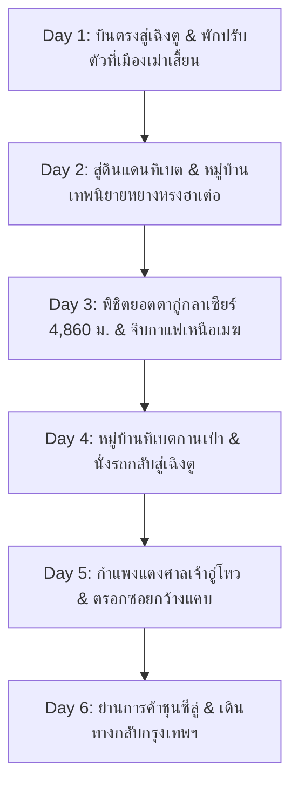

# แผนที่ 4: พิชิตยอดธารน้ำแข็งพันปีตากู่กลาเซียร์ & คาเฟ่ที่โดดเดี่ยวที่สุดในโลก (Dagu Glacier & Tibetan Fairytale)

> **รูปแบบการท่องเที่ยว**: สโลว์ไลฟ์ สบายๆ ไม่เร่งรีบ (จำกัดสถานที่ไฮไลท์ไม่เกิน 2 แห่งต่อวัน)  
> **ช่วงเวลาเดินทาง**: 5 – 10 ธันวาคม 2026 (6 วัน 5 คืน) *(สามารถปรับบวก-ลบได้ 1-2 วัน)*  
> **ภูมิภาค**: มณฑลเสฉวน (Sichuan) อำเภอเฮยสุ่ย (Heishui) เขตปกครองตนเองชนชาติทิเบตและเฉียงอาป้า  
> **จัดทำโดย**: บัง (นักจัดทริปผู้เชี่ยวชาญท่องเที่ยวจีน)

---

## สรุปภาพรวมของทริป (Trip Overview)

ทริปนี้เป็นเส้นทางในฝันของนักเดินทางสายธรรมชาติและช่างภาพ เพื่อไปสัมผัส **"ธารน้ำแข็งตากู่" (达古冰川 - Dagu Glacier)** ธารน้ำแข็งที่อายุน้อยที่สุดและเข้าถึงได้ง่ายที่สุดในโลก ด้วยการนั่ง **"กระเช้าลอยฟ้าที่สูงที่สุดในโลก" สู่ระดับความสูง 4,860 เมตรเหนือระดับน้ำทะเล** นั่งจิบกาแฟอุ่นๆ ใน **"คาเฟ่ที่โดดเดี่ยวที่สุดในโลก" (The World's Loneliest Cafe)** ท่ามกลางทะเลหมอกและยอดเขาหิมะขาวโพลน 360 องศา พร้อมทั้งแวะพักผ่อนใน **"หมู่บ้านทิเบตหยางหรงฮาเต๋อ" (Yangrong Hade)** หมู่บ้านหินโบราณกลางหุบเขาที่งดงามดั่งเทพนิยายสโนว์ไวท์

* **สภาพอากาศช่วงต้นเดือนธันวาคม**: 
  * เฉิงตู: 8°C ถึง 14°C
  * อำเภอเฮยสุ่ย (จุดนอนพัก): -2°C ถึง 8°C
  * ยอดธารน้ำแข็งตากู่ (4,860 ม.): -10°C ถึง -18°C ฟ้าเปิด แดดสดใส ลมหนาวพัดโชย มีหิมะปกคลุมหนานุ่ม
* **ระดับความสูง**: ใช้หลักการ **"Sleep Low, Visit High"** โดยนอนค้างคืนที่อำเภอเฮยสุ่ย (ระดับ 2,300 ม. ซึ่งปลอดภัยและหลับสบาย) แล้วขึ้นกระเช้าไปท่องเที่ยวบนยอดธารน้ำแข็ง 4,860 ม. ในช่วงกลางวันประมาณ 2 ชั่วโมง แล้วลงมาพักผ่อน
* **การเดินทางหลัก**: บินตรงกรุงเทพฯ-เฉิงตู + รถตู้ VIP ปรับอากาศส่วนตัวตลอดเส้นทาง

---

## แผนการเดินทางรายวัน (Day-by-Day Itinerary)

---

### วันที่ 1 (5 ธันวาคม 2026): กรุงเทพฯ – เฉิงตู – เมืองเม่าเสี้ยน (Maoxian)

* **ช่วงเช้า**:
  * บินตรงจากสนามบินสุวรรณภูมิ (BKK) / ดอนเมือง (DMK) สู่สนามบินนานาชาติเฉิงตูเทียนฝู่ (TFU)
  * ผ่านด่านตรวจคนเข้าเมืองจีน (ฟรีวีซ่าสำหรับคนไทย)
* **ช่วงบ่าย (ไฮไลท์ที่ 1 - การเดินทางชมวิวช่องแคบแม่น้ำหมินเจียงสู่เมืองเม่าเสี้ยน)**:
  * รถตู้ VIP รับท่านจากสนามบิน มุ่งหน้าขึ้นทางทิศตะวันตกเฉียงเหนือสู่ **"เมืองเม่าเสี้ยน" (Maoxian)**
  * *เหตุผลในการจัดเส้นทาง*: เมืองเม่าเสี้ยนตั้งอยู่ที่ความสูงประมาณ 1,500 เมตร เป็นจุดแวะพักกึ่งกลางที่สมบูรณ์แบบ ช่วยตัดระยะทางไม่ให้นั่งรถนานเกินไป และช่วยให้ร่างกายเริ่มปรับสมดุลกับความกดอากาศต่ำได้อย่างนุ่มนวล
  * ชมทัศนียภาพช่องเขาหินผาและแม่น้ำหมินเจียงอันยิ่งใหญ่
* **ช่วงค่ำ (ไฮไลท์ที่ 2 - สัมผัสมื้อค่ำหม้อไฟสมุนไพรเสฉวน & พักผ่อนเต็มอิ่ม)**:
  * เช็คอินเข้าโรงแรมระดับ 4 ดาวในเมืองเม่าเสี้ยน
  * เดินเล่นรับอากาศหนาวสบายๆ รอบตัวเมือง ชิมผลไม้ท้องถิ่น เช่น แอปเปิ้ลภูเขาเม่าเสี้ยนที่หวานกรอบ
* **มื้ออาหาร**:
  * กลางวัน: อาหารว่างบนเครื่องบินหรือแวะทานระหว่างทาง
  * เย็น: หม้อไฟไก่ตุ๋นสมุนไพรเสฉวนและเห็ดภูเขา รสกลมกล่อมอุ่นสบายท้อง
* **ที่พัก**: โรงแรม Maoxian International Hotel หรือเทียบเท่า (มีฮีตเตอร์)

---

### วันที่ 2 (6 ธันวาคม 2026): เม่าเสี้ยน – หมู่บ้านทิเบตหยางหรงฮาเต๋อ – อำเภอเฮยสุ่ย (Heishui)

* **ช่วงเช้า**:
  * 09:00 น. เดินทางต่อไปยังอำเภอเฮยสุ่ย (ใช้เวลาประมาณ 2 ชั่วโมงเศษ เส้นทางลาดยางเรียบสะดวกสบาย)
  * สองข้างทางเริ่มปรากฏธงมนต์ 5 สีของชาวทิเบตที่โบกสะบัดตามแรงลม และเจดีย์สีขาวทรงทิเบต
* **ช่วงบ่าย (ไฮไลท์ที่ 1 - หมู่บ้านเทพนิยายหยางหรงฮาเต๋อ 羊茸哈德 Yangrong Hade)**:
  * แวะเยือน **"หมู่บ้านทิเบตหยางหรงฮาเต๋อ"** ได้รับการยกย่องให้เป็นหนึ่งในหมู่บ้านชนเผ่าที่สวยที่สุดในจีน
  * ตัวบ้านสร้างด้วยหินสไตล์ทิเบตแท้ ทาสีสันสดใส มีลำธารใสสะอาดไหลผ่านหน้าหมู่บ้าน โอบล้อมด้วยป่าสนที่ปกคลุมด้วยหิมะ
  * เดินถ่ายรูปสโลว์ไลฟ์บนสะพานไม้ สัมผัสวิถีชีวิตชาวทิเบต ชิมชาเนยจามรีอุ่นๆ (Yak Butter Tea) ในบ้านชาวบ้าน
* **ช่วงเย็น (ไฮไลท์ที่ 2 - เช็คอินอำเภอเฮยสุ่ย & ช้อปปิ้งเตรียมพิชิตยอดเขา)**:
  * เช็คอินเข้าสู่โรงแรมในอำเภอเฮยสุ่ย (ความสูง 2,300 ม.)
  * แวะซื้อกระป๋องออกซิเจนพกพา (เตรียมไว้คนละ 2 กระป๋อง) และแผ่นแปะร้อน
  * พักผ่อนเข้านอนแต่หัวค่ำ เพื่อเตรียมร่างกายให้สดชื่นที่สุดสำหรับวันสำคัญ
* **มื้ออาหาร**:
  * เช้า: บุฟเฟต์โรงแรม
  * กลางวัน: เนื้อจามรีผัดพริกไทยดำและขนมปังข้าวบาร์เลย์ทิเบต
  * เย็น: ซุปเนื้อแกะตุ๋นหัวไชเท้าและผัดผักสด
* **ที่พัก**: โรงแรม Heishui Dagu Glacier Hotel หรือ Da Gu Glacier Impression Hotel (ระดับ 4 ดาว)

---

### วันที่ 3 (7 ธันวาคม 2026): วันแห่งไฮไลท์: ยอดธารน้ำแข็งตากู่กลาเซียร์ 4,860 ม. & คาเฟ่ที่โดดเดี่ยวที่สุดในโลก

* **ช่วงเช้า (ไฮไลท์ที่ 1 - นั่งกระเช้าลอยฟ้าที่สูงที่สุดในโลกสู่ยอดตากู่กลาเซียร์ 达古冰川)**:
  * 08:30 น. เข้าสู่อุทยานตากู่กลาเซียร์ นั่งรถบัสของอุทยานชมวิวผ่านทะเลสาบลิงทอง (Golden Monkey Lake) และทะเลสาบน้ำแข็งสีเขียวมรกต
  * นั่ง **"กระเช้าลอยฟ้าตากู่" (Dagu Ropeway)** ที่พาผู้โดยสารไต่ระดับความสูงจาก 3,400 เมตร ขึ้นสู่ยอดเขาหิมะที่ความสูง **4,860 เมตร** ภายในเวลาเพียง 15 นาที
  * ชมความยิ่งใหญ่อลังการของธารน้ำแข็งโบราณ ยอดเขาสูงเสียดฟ้า และทะเลหมอกสีขาวสุดลูกหูลูกตา
  * ถ่ายภาพเช็คอินกับป้ายศิลาจารึกจุดความสูง 4,860 เมตร และรูปปั้นนกอินทรีหิมะ
* **ช่วงกลางวัน (ไฮไลท์ที่ 2 - จิบกาแฟอุ่นใน "คาเฟ่ที่โดดเดี่ยวที่สุดในโลก" 世界上最孤独的咖啡馆)**:
  * ก้าวเข้าสู่คาเฟ่กระจก 2 ชั้นบนยอดเขา 4,860 ม. ซึ่งติดตั้งระบบปรับแรงดันและมีออกซิเจนบริสุทธิ์จ่ายภายในร้าน
  * สั่งกาแฟคาปูชิโน่ร้อนหรือช็อกโกแลตร้อน นั่งมองวิวหิมะและทะเลหมอกผ่านกระจกบานใหญ่แบบไม่มีอะไรบดบัง
  * เดินเล่นบนสะพานไม้ช้าๆ ไม่ต้องรีบ (ใช้เวลาบนยอดเขาอย่างปลอดภัยประมาณ 2 – 2.5 ชั่วโมง)
* **ช่วงบ่าย**:
  * นั่งกระเช้ากลับลงมายังระดับ 3,400 ม. และนั่งรถบัสกลับออกจากอุทยาน
  * กลับสู่โรงแรมในตัวเมืองเฮยสุ่ย นอนพักผ่อนหรือทานน้ำขิงร้อนเพื่อฟื้นฟูพลัง
* **มื้ออาหาร**:
  * เช้า: บุฟเฟต์โรงแรม
  * กลางวัน: กาแฟและขนมอบในคาเฟ่บนยอดเขา + อาหารเซ็ตร้อนในศูนย์บริการ
  * เย็น: หม้อไฟหมูสามชั้นตุ๋นมันฝรั่งแห้งสไตล์ทิเบต
* **ที่พัก**: โรงแรมเดิม อำเภอเฮยสุ่ย

---

### วันที่ 4 (8 ธันวาคม 2026): เฮยสุ่ย – หมู่บ้านโบราณกานเป่า – กลับสู่มหานครเฉิงตู

* **ช่วงเช้า (ไฮไลท์ที่ 1 - หมู่บ้านโบราณกานเป่าทิเบต 甘堡藏寨 Ganbao Tibetan Village)**:
  * 09:30 น. ออกเดินทางออกจากเฮยสุ่ย แวะชม **"หมู่บ้านทิเบตกานเป่า"**
  * หมู่บ้านหินโบราณขนาดใหญ่ริมแม่น้ำ ที่มีประวัติศาสตร์ยาวนานตั้งแต่สมัยราชวงศ์ถัง ชื่นชมกำแพงหินที่เรียงรายอย่างประณีตและสะพานแขวนข้ามลำน้ำ
  * ชมการแสดงระบำกัวจวง (Guozhuang Dance) พื้นเมืองหากตรงกับช่วงเวลาจัดกิจกรรม
* **ช่วงบ่าย (ไฮไลท์ที่ 2 - เดินทางกลับเฉิงตู & พักผ่อนนวดเท้าสไตล์เสฉวน)**:
  * ขับรถมุ่งหน้ากลับสู่เฉิงตู (ใช้เวลาประมาณ 3.5 ชั่วโมง)
  * เช็คอินเข้าโรงแรมระดับ 5 ดาวใจกลางเมืองเฉิงตู
  * ผ่อนคลายร่างกายด้วยการนวดเท้าสมุนไพรจีน (Foot Massage) คลายความเมื่อยล้าจากการเดินทางบนภูเขา
* **มื้ออาหาร**:
  * เช้า: บุฟเฟต์โรงแรม
  * กลางวัน: บะหมี่เนื้อวัวเสฉวนริมทาง
  * เย็น: เป็ดย่างเฉิงตู และเกี๊ยวน้ำกุ้งร้อน
* **ที่พัก**: โรงแรม Grand Hyatt Chengdu หรือ St. Regis Chengdu

---

### วันที่ 5 (9 ธันวาคม 2026): ซึมซับประวัติศาสตร์เฉิงตู: ศาลเจ้าอู่โหว & ตรอกกว้างแคบควานไจ่เซี่ยงจื่อ

* **ช่วงเช้า (ไฮไลท์ที่ 1 - ศาลเจ้าสามก๊กอู่โหว & กำแพงแดงป่าไผ่ 武侯祠 Wuhou Shrine)**:
  * 09:30 น. เยี่ยมชม **"ศาลเจ้าอู่โหว"** อนุสรณ์สถานรำลึกถึงเล่าปี่และขงเบ้ง ตัวละครเอกแห่งยุคสามก๊ก
  * ถ่ายรูปจุดแลนด์มาร์กชื่อดัง: **"ทางเดินกำแพงสีแดงโอบล้อมด้วยกอไผ่เขียว" (Red Wall & Bamboo Path)** ที่แสงเงาตกกระทบอย่างงดงามและเงียบสงบ
* **ช่วงบ่าย (ไฮไลท์ที่ 2 - ตรอกกว้างแคบควานไจ่เซี่ยงจื่อ 宽窄巷子 Kuanzhai Alley)**:
  * เดินเล่นในย่านประวัติศาสตร์ที่อนุรักษ์บ้านโบราณแบบ "ซื่อเหอย่วน" (Siheyuan) สไตล์ราชวงศ์ชิง
  * มีทั้งร้านน้ำชาแบบดั้งเดิม ร้านกาแฟฮิปสเตอร์ คาเฟ่งานดีไซน์ และโรงละครเปลี่ยนหน้ากากเสฉวน
  * ซื้อของที่ระลึก ชาใบไผ่ (Zhubaye Tea) และผลิตภัณฑ์เกี่ยวกับหมีแพนด้า
* **มื้ออาหาร**:
  * เช้า: บุฟเฟต์โรงแรม
  * กลางวัน: อาหารว่างเสฉวนโบราณในตรอกควานไจ่
  * เย็น: หม้อไฟหมาล่าเสฉวนแบบพรีเมียม (หรือน้ำซุปเห็ดทรัฟเฟิล)
* **ที่พัก**: โรงแรมเดิมในตัวเมืองเฉิงตู

---

### วันที่ 6 (10 ธันวาคม 2026): สโลว์ไลฟ์ถนนคนเดินชุนซีลู่ – เดินทางกลับกรุงเทพฯ

* **ช่วงเช้า (ไฮไลท์ที่ 1 - ถนนคนเดินชุนซีลู่ & ช้อปปิ้งของฝาก)**:
  * ตื่นสายๆ ทานอาหารเช้าอย่างสบายอารมณ์
  * เดินเล่นช้อปปิ้งย่านถนนคนเดินชุนซีลู่ ซื้อขนมเปี๊ยะดอกกุหลาบ, ผลไม้อบแห้ง, พริกหม่าล่าแห้งสำหรับทำอาหาร
* **ช่วงบ่าย (ไฮไลท์ที่ 2 - เดินทางสู่สนามบินเทียนฝู่ บินตรงกลับกรุงเทพฯ)**:
  * 12:30 น. รถตู้รับจากโรงแรม เดินทางสู่สนามบินนานาชาติเฉิงตูเทียนฝู่ (TFU)
  * เช็คอิน โหลดสัมภาระ และบินตรงกลับสู่กรุงเทพฯ อย่างปลอดภัยพร้อมความทรงจำสุดประทับใจ
* **มื้ออาหาร**:
  * เช้า: บุฟเฟต์โรงแรม
  * กลางวัน: อาหารว่างตามอัธยาศัยที่สนามบิน

---

## สรุปทางเลือกการปรับแผน (± 2 วัน)

* **หากเพิ่มเป็น 7-8 วัน (+1 ถึง +2 วัน)**:
  * แนะนำใส่ **"อุทยานปี๋เผิงโกว" (Bipenggou)** เข้าไปในวันที่ 4 ได้เลย เพราะอยู่ระหว่างทางขากลับจากเฮยสุ่ยลงมาเฉิงตู จะกลายเป็นทริปควบ **"ตากู่กลาเซียร์ + ปี๋เผิงโกว"** ที่คุ้มค่าที่สุด!
  * หรือแวะชม **"เขื่อนโบราณตูเจียงเยี่ยน"** และศูนย์หมีแพนด้า
* **หากลดเหลือ 5 วัน (-1 วัน)**:
  * ตัดวันเที่ยวในเมืองเฉิงตู (วันที่ 5) ออก โดยเมื่อลงจากเฮยสุ่ยถึงเฉิงตูในวันที่ 4 แล้ว ค้างเฉิงตู 1 คืน เช้าวันรุ่งขึ้นช้อปปิ้งสั้นๆ แล้วบินกลับกรุงเทพฯ ได้ทันที

---

## คำแนะนำพิเศษสำหรับความสูง 4,860 เมตร (High Altitude Health Protocol)

1. **การปฏิบัติตัวบนยอดธารน้ำแข็ง**:
   * เคลื่อนไหวช้าๆ เดินช้าๆ **ห้ามวิ่ง ห้ามกระโดดถ่ายรูปเด็ดขาด**
   * หากเริ่มมีอาการเวียนศีรษะเล็กน้อย ให้สูดออกซิเจนกระป๋องช้าๆ ลึกๆ 3-5 ครั้ง อาการจะดีขึ้นทันที
   * ดื่มน้ำอุ่นสม่ำเสมอ พกกระติกน้ำร้อนส่วนตัวติดตัว
2. **การเตรียมยา**:
   * ทานสมุนไพรจีน **"หงจิ่งเทียน" (Hongjingtian / 红景天)** ล่วงหน้า 5-7 วันก่อนเดินทาง หรือปรึกษาแพทย์เรื่องการทานยา **Acetazolamide (Diamox)** เพื่อป้องกันอาการแพ้ความสูง
3. **อุปกรณ์กันหนาวและสายตา**:
   * บนยอด 4,860 ม. ลมแรงและแสงสะท้อนหิมะเข้มข้นมาก **ต้องสวมแว่นตากันแดด UV400 ตลอดเวลา** เพื่อป้องกันอาการตาพร่า/ตาบอดหิมะ (Snow Blindness)
   * ทาครีมกันแดด SPF50+ และลิปมันป้องกันริมฝีปากแห้งแตก

---

## ประมาณการงบประมาณ (ต่อท่าน)

| รายการ | รายละเอียด | ค่าใช้จ่ายประมาณการ (บาท) |
| :--- | :--- | :---: |
| **ตั๋วเครื่องบินไป-กลับ** | BKK - Chengdu TFU (บินตรง รวมน้ำหนักกระเป๋า) | 9,000 – 13,000 |
| **รถตู้ VIP ส่วนตัวตลอดทริป** | รถตู้ 7-9 ที่นั่ง พร้อมคนขับชำนาญเส้นทางเขา น้ำมัน ทางด่วน (หาร 4-6 คน) | 4,800 – 6,500 |
| **โรงแรมที่พัก (5 คืน)** | โรงแรม 4 ดาวในเฮยสุ่ย/เม่าเสี้ยน + โรงแรม 5 ดาวในเฉิงตู (หาร 2 คน) | 7,500 – 10,500 |
| **ค่าบัตรเข้าชม & กระเช้าลอยฟ้า** | ค่าเข้าอุทยานตากู่ + รถบัส + กระเช้าไป-กลับ 4,860 ม. + ศาลเจ้าอู่โหว | 3,800 – 4,800 |
| **ค่าอาหารและเครื่องดื่ม** | มื้อละประมาณ 40-70 หยวน + มื้อพิเศษหม้อไฟและกาแฟบนยอดเขา | 4,000 – 5,500 |
| **ออกซิเจน & อุปกรณ์เสริม** | กระป๋องออกซิเจน 2-3 กระป๋อง + แผ่นแปะร้อน | 600 – 800 |
| **ประกันการเดินทาง & ซิมการ์ด** | Roaming เน็ต 6 วัน + ประกันครอบคลุมพื้นที่สูงพิเศษ | 1,200 – 1,800 |
| **รวมประมาณการต่อท่าน** | **ทริปสายถ่ายภาพระดับโลก ครบ สะดวก ปลอดภัย** | **~30,900 – 43,900 บาท** |
