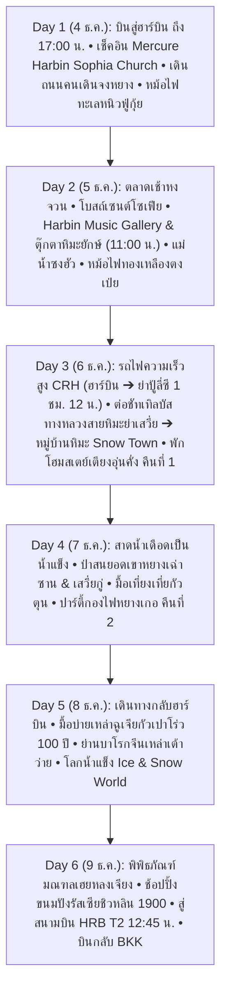

# แผนที่ 5: มนต์เสน่ห์นครน้ำแข็งฮาร์บิน & เทพนิยายรัสเซีย (Harbin Winter Romance & Russian Fairy Tale)

> **รูปแบบการท่องเที่ยว**: สโลว์ไลฟ์ พักผ่อนสบายๆ ไม่เร่งรีบ (จำกัดสถานที่ไฮไลท์ไม่เกิน 1 – 2 แห่งต่อวัน)  
> **ช่วงเวลาเดินทาง**: 4 – 9 ธันวาคม 2026 (6 วัน 5 คืน)  
> **สถานะ**: ✅ **ยืนยันการจองตั๋วเครื่องบินเรียบร้อยแล้ว (Confirmed Flight via Trip.com)**  
> **ภูมิภาค**: นครฮาร์บิน (Harbin - 哈尔滨) มณฑลเฮยหลงเจียง (Heilongjiang) สาธารณรัฐประชาชนจีน  
> **จัดทำโดย**: บัง (นักจัดทริปผู้เชี่ยวชาญท่องเที่ยวจีน)

---

## ✈️ รายละเอียดเที่ยวบินที่จองจริง (Confirmed Flight Details)

จองผ่าน Trip.com (หมายเลขการจอง: `Confirmed ✅`)  
สายการบิน **China Eastern Airlines / Shanghai Airlines**  
*ยอดชำระตั๋วเครื่องบินรวม 2 ท่าน: 25,770 บาท (เฉลี่ยท่านละ 12,885 บาท รวมโหลดสัมภาระเรียบร้อย ไม่ต้องรับกระเป๋าตอนต่อเครื่อง)*

```text
┌────────────────────────────────────────────────────────────────────────────────────────┐
│ 🛫 เที่ยวบินขาไป: วันศุกร์ที่ 4 ธันวาคม 2026 (รวมเวลา 10 ชม. 55 นาที)                      │
│    • 05:05 น. กรุงเทพฯ สุวรรณภูมิ (BKK) ➔ 10:20 น. เซี่ยงไฮ้ผู่ตง (PVG T1)               │
│      [เที่ยวบิน MU8654 ดำเนินการโดย Shanghai Airlines FM848 • บิน 4 ชม. 15 นาที]         │
│    • แวะเปลี่ยนเครื่องที่เซี่ยงไฮ้ผู่ตง (PVG T1): 3 ชม. 35 นาที                            │
│      (✨ เช็คทรูสัมภาระ: ไม่ต้องรับสัมภาระและโหลดใหม่ เดินตัวเปล่าไปรอขึ้นเครื่องได้เลย)      │
│    • 13:55 น. เซี่ยงไฮ้ผู่ตง (PVG T1) ➔ 17:00 น. ฮาร์บินไท่ผิง (HRB T2)                 │
│      [เที่ยวบิน MU330 ดำเนินการโดย Shanghai Airlines FM9063 • บิน 3 ชม. 05 นาที]         │
│    🎉 ถึงฮาร์บินเวลา 17:00 น. เร็วขึ้นมาก! เข้าโรงแรมหัวค่ำ มีเวลาเดินชิลถนนจงหยางสบายๆ    │
├────────────────────────────────────────────────────────────────────────────────────────┤
│ 🛬 เที่ยวบินขากลับ: วันพุธที่ 9 ธันวาคม 2026 (รวมเวลา 9 ชม. 45 นาที)                      │
│    • 15:10 น. ฮาร์บินไท่ผิง (HRB T2) ➔ แวะเปลี่ยนเครื่องเซี่ยงไฮ้ (ไม่ต้องโหลดกระเป๋าใหม่) │
│    • 00:55 (+1) น. เดินทางถึงกรุงเทพฯ สุวรรณภูมิ (BKK) อย่างรวดเร็วและปลอดภัย             │
│    🎉 วันสุดท้ายเที่ยวชิลซื้อของฝากและทานมื้อเที่ยงในเมืองได้ถึง 12:00 น. ก่อนไปสนามบิน   │
└────────────────────────────────────────────────────────────────────────────────────────┘
```

---

## สรุปภาพรวมของทริป (Trip Overview)

ยินดีต้อนรับสู่ **"ฮาร์บิน" (Harbin - 哈尔滨)** นครหลวงแห่งหิมะและน้ำแข็งทางตะวันออกเฉียงเหนือของจีน เจ้าของฉายา **"มอสโกแห่งโลกตะวันออก" (Oriental Moscow)** และ **"ปารีสแห่งแดนบูรพา" (Oriental Paris)** เมืองที่มีเอกลักษณ์ทางสถาปัตยกรรมผสมผสานระหว่างศิลปะรัสเซีย นีโอคลาสสิก บาโรก และความเป็นจีนดั้งเดิมอย่างลงตัว ทริปนี้ออกแบบมาเพื่อพาคุณสัมผัสบรรยากาศฤดูหนาวแสนโรแมนติกอย่างแท้จริง เดินทอดน่องบนถนนหินโบราณใต้แสงไฟสีอบอุ่น จิบชากาแฟในคาเฟ่วินเทจ ชิมไอศกรีมแท่งท่ามกลางหิมะโปรย และชมปราสาทสไตล์รัสเซียดั่งหลุดเข้าไปในเทพนิยาย

* **สภาพอากาศช่วงต้นเดือนธันวาคม (4-9 ธ.ค.)**: -10°C ถึง -22°C หิมะปกคลุมขาวโพลนทั่วเมือง แม่น้ำซงฮัวเริ่มกลายเป็นแผ่นน้ำแข็งหนาแน่น ท้องฟ้าโปร่ง แดดสดใส ลมหนาวไซบีเรียสดชื่น
* **ระดับความสูง**: 150 เมตรเหนือระดับน้ำทะเล (**ปลอดภัยจากอาการแพ้ความสูง / AMS 100%** ออกซิเจนเต็มปอด หายใจสะดวกสบาย)
* **การเดินทางหลัก**: เที่ยวบินสู่ฮาร์บิน + รถตู้ VIP ปรับอากาศส่วนตัวตลอดทริป (มีฮีตเตอร์อุ่นสบาย)

> [!NOTE]
> **หมายเหตุพิเศษจาก "บัง" เกี่ยวกับเทศกาลแกะสลักน้ำแข็ง (Harbin Ice and Snow World)**:  
> งานนิทรรศการน้ำแข็ง Harbin Ice and Snow World (冰雪大世界) ปกติจะเริ่มเปิดช่วงทดลองระบบ (Trial / Soft Opening) ราวกลางถึงปลายเดือนธันวาคม (ประมาณ 18–25 ธ.ค.) และเปิดเป็นทางการวันที่ 5 มกราคม  
> ในช่วงต้นเดือนธันวาคม (4–9 ธ.ค.) ท่านจะได้สัมผัส **"ภาพชีวิตจริงอันน่าทึ่งที่หาดูได้ยาก"** คือการชมพิธีตัดก้อนน้ำแข็งยักษ์สดๆ จากแม่น้ำซงฮัว (采冰节 - Ice Harvesting) ของชาวฮาร์บินเพื่อนำไปสร้างเมืองน้ำแข็ง พร้อมทั้งเพลิดเพลินกับลานกิจกรรมน้ำแข็งริมแม่น้ำ และปราสาทหิมะรัสเซียที่ **คฤหาสน์วอลกา (Volga Manor)** ซึ่งเปิดให้บริการเต็มรูปแบบแล้วอย่างเงียบสงบ ไร้ฝูงชนแออัด

---

## แผนการเดินทางรายวัน (Day-by-Day Itinerary)



---

### วันที่ 1 (4 ธันวาคม 2026): กรุงเทพฯ – นครฮาร์บิน (ถึง 17:00 น.) – เช็คอินโรงแรมหรู – เดินเล่นถนนคนเดินจงหยาง

* **ช่วงเช้าถึงบ่าย (การเดินทาง)**:
  * 03:00 น. พร้อมกันที่สนามบินสุวรรณภูมิ (BKK) อาคารผู้โดยสารขาออก เคาน์เตอร์ China Eastern Airlines
  * 05:05 น. ออกเดินทางสู่เซี่ยงไฮ้ด้วยเที่ยวบิน MU8654 (FM848)
  * 10:20 น. ถึงสนามบินเซี่ยงไฮ้ผู่ตง (PVG T1) แวะเปลี่ยนเครื่อง 3 ชม. 35 นาที (กระเป๋าโหลดตรงสู่ฮาร์บินเรียบร้อย เดินตัวปลิวแวะจิบกาแฟ ทานอาหารกลางวันที่สนามบิน)
  * 13:55 น. ขึ้นเครื่องต่อเที่ยวบิน MU330 (FM9063) สู่ฮาร์บิน
  * **17:00 น. เดินทางถึงสนามบินนานาชาติฮาร์บินไท่ผิง (HRB T2)** ตามตารางเป๊ะ!
* **ช่วงค่ำ (เช็คอิน & สัมผัสเมืองหิมะแรกพบ)**:
  * 17:45 น. รับสัมภาระที่สายพาน รถตู้ VIP ส่วนตัวพร้อมฮีตเตอร์อุ่นสบายรอต้อนรับที่ประตูทางออก
  * นำท่านมุ่งหน้าสู่ใจกลางเมืองฮาร์บิน (นั่งรถชมแสงไฟยามเย็นประมาณ 45-50 นาที)
  * 18:30 - 18:45 น. เช็คอินเข้าสู่ที่พักระดับ 5 ดาว / บูทีคโฮเต็ลริมถนนสายประวัติศาสตร์ เก็บสัมภาระ พักผ่อน เปลี่ยนชุดกันหนาวหนานุ่ม
  * 19:15 น. **ชิม "ไอศกรีมแท่งหม่าเตี๋ยเอ่อร์" (Modern Ice Cream / 马迭尔冰棍)**: เดินจากโรงแรมเมอร์เคียวตัดเข้าซอยเพียง 5 นาที (~350 ม.) ถึงหน้าโรงแรม Modern Hotel ประเดิมท้าความเย็นชิมไอศกรีมรสนมวานิลลาแท้สูตรโบราณปี 1906 ท่ามกลางอุณหภูมิติดลบ -16°C และไส้กรอกแดงฮาร์บินรมควันร้อนๆ
  * 19:45 น. **เดินเล่นรับลมหนาวบนถนนคนเดินจงหยาง (Zhongyang Pedestrian Street - 中央大街)**: เดินทอดน่องต่อเนื่องสัมผัสเกล็ดหิมะ ชมสถาปัตยกรรมยุโรปประดับไฟสีทองแสนอบอุ่น ก่อนเดินเชื่อมไปยังร้านหม้อไฟหนิวฟู่กุ้ยโดยไม่ต้องเดินย้อนไปมา
* **มื้ออาหาร**:
  * กลางวัน: อาหารบนเครื่องบิน / อาหารอุ่นๆ บริเวณสนามบินเซี่ยงไฮ้
  * เย็น: ลิ้มลอง **หม้อไฟทะเลตักเอง หนิวฟู่กุ้ย (Niu Fu Gui Seafood Hotpot · 牛富贵自选海鲜火锅)** ชั้น 3 อาคารเฉาเหรินกวั่งฉ่าง (潮人广场 3F) บนถนนคนเดินจงหยาง ซีฟู้ดสดๆ ตักเอง กุ้ง หอย ปู ปลา เนื้อวัวสไลซ์เกรดพรีเมียม และน้ำซุปร้อนๆ คลายหนาวสะใจ (เปิดบริการยาวนาน 11:00 - 04:00 น.)
* **ที่พัก**: **Mercure Harbin Central Street Sophia Church** (โรงแรมเมอร์เคียว ฮาร์บิน เซนทรัล สตรีท โซเฟีย เชิร์ช · 哈尔滨中央大街索菲亚美居酒店 · 道里区兆麟街92号) โรงแรม 4 ดาวเครือ Accor ห่างมหาวิหารเซนต์โซเฟียเพียง 290 ม. และใกล้ถนนคนเดินจงหยาง (พักคืนที่ 1)

---

### วันที่ 2 (5 ธันวาคม 2026): เสน่ห์ยุโรปแห่งบูรพาทิศ – โบสถ์เซนต์โซเฟีย – Harbin Music Gallery & แม่น้ำซงฮัวสายน้ำแข็ง

* **ช่วงเช้า (07:15 - 08:45 น. สัมผัสวิถีชีวิตยามเช้า)**:
  * ออกเดินทางจากโรงแรม **Mercure Harbin Central Street Sophia Church** เดินเพียง ~5 นาที (400 เมตร) ไปยัง **"ตลาดเช้าถนนหงจวน" (Hongzhuan Morning Market)**
  * เพลิดเพลินกับสตรีทฟู้ดร้อนๆ ท่ามกลางอุณหภูมิติดลบ: ปาท่องโก๋ยักษ์ทอดใหม่, ซาลาเปาอบไอน้ำพวยพุ่ง, เกี๊ยวต้มร้อนๆ, ไข่ต้มชาจีน และน้ำเต้าหู้สด
* **09:15 - 10:45 น. (ไฮไลท์ที่ 1 - มหาวิหารเซนต์โซเฟีย 圣·索菲亚大教堂 Saint Sophia Cathedral)**:
  * เดินเชื่อมจากตลาดเช้า/โรงแรมเพียง ~8 นาที สู่ **"มหาวิหารเซนต์โซเฟีย"** โบสถ์ออร์โธดอกซ์สไตล์รัสเซีย-ไบแซนไทน์ที่ใหญ่ที่สุดในตะวันออกไกล ก่อสร้างด้วยอิฐสีแดงสดและยอดโดมหัวหอมสีเขียวเข้ม
  * เดินชมฝูงนกพิราบสีขาวที่บินโฉบตัดกับยอดโดมหิมะ ถ่ายภาพมุมพาโนรามาสุดคลาสสิกที่งดงามราวกับยืนอยู่ใจกลางจัตุรัสแดงกรุงมอสโก
  * แวะเข้าชมด้านในโบสถ์ หรือจิบชา/กาแฟในคาเฟ่สไตล์รัสเซียวินเทจ
* **11:00 - 12:30 น. (ไฮไลท์ช่วงสาย - Harbin Music Gallery & สวนดนตรีริมแม่น้ำซงฮัว 哈尔滨音乐长廊)**:
  * นั่งรถ DiDi เพียง ~10-12 นาที (ประมาณ 3.8 กม.) สู่ **"Harbin Music Gallery & Music Park (哈尔滨音乐长廊)"** ริมแม่น้ำซงฮัว (ถนนโหยวอี้ตะวันตก)
  * ถ่ายรูปกับระเบียงสถาปัตยกรรมยุโรปคลาสสิกสุดอลังการและแนวเสาโรมันที่ทอดยาวริมแม่น้ำ
  * เช็คอินแลนด์มาร์กสุดไวรัลประจำฤดูหนาว **"ตุ๊กตาหิมะยักษ์" (Giant Snowman / 巨型大雪人)** สูง 18 เมตรที่สวมหมวกและผ้าพันคอสีแดงสดใส ยิ้มต้อนรับนักท่องเที่ยวท่ามกลางลานหิมะขาวโพลน
* **ช่วงกลางวัน (13:00 - 14:15 น.)**:
  * นั่งรถกลับมายังถนนคนเดินจงหยาง รับประทานอาหารกลางวันที่ภัตตาคารรัสเซียเก่าแก่ชื่อดัง **Huamei Western Restaurant (华梅西餐厅)** (ก่อตั้งปี 1925) ใกล้กับโรงแรม Mercure Harbin Central Street Sophia Church ลิ้มลองซุปเนื้อบีทรัตน์ (Borsch), สตูว์เนื้อในโถขนมปัง, ขนมปังต้าเลี่ยปา และสลัดมันฝรั่งรัสเซีย
* **ช่วงบ่ายถึงเย็น (ไฮไลท์ที่ 2 - สวนสตาลิน & ลานน้ำแข็งแม่น้ำซงฮัว & ชมพระอาทิตย์ตกสะพานรถไฟปินโจว)**:
  * เดินเล่นต่อมายังสวนสาธารณะสตาลิน (Stalin Park) ริมแม่น้ำซงฮัว แวะถ่ายรูปกับ **อนุสาวรีย์ควบคุมอุทกภัย (Flood Control Monument / 防洪纪念塔)**
  * เดินขึ้นสู่ **"สะพานรถไฟปินโจวแม่น้ำซงฮัว" (Binzhou Railway Bridge / 中东铁路第一桥)** สะพานเหล็กเก่าแก่อายุกว่า 120 ปี ซึ่งปัจจุบันปรับเป็นทางเดินชมวิวคนเดิน มีช่วงพื้นกระจกมองเห็นผืนน้ำแข็งยักษ์ด้านล่าง
  * สัมผัสช่วงเวลาต้องมนตร์ (Golden Hour): ชมพระอาทิตย์ดวงกลมโตสีส้มทอแสงอุ่นตกลงสู่ผืนน้ำแข็งแม่น้ำซงฮัว เป็นภาพทิวทัศน์ที่งดงามจับตาที่สุดของฮาร์บิน
* **ช่วงค่ำ (17:45 - 19:15 น.)**:
  * ลิ้มลอง **หม้อไฟทองเหลืองตงเป่ยดั้งเดิม (Dongbei Copper Pot Hot Pot & Spring Pancakes - 东北老北京铜锅涮肉/老昌春饼)** หม้อไฟทองเหลืองถ่านไม้โบราณ เนื้อแกะสไลซ์นุ่มๆ ในน้ำซุปกระดูกผักกาดดองร้อนกรุ่น ทานคู่กับแผ่นแป้งชุนปิ่ง คลายความหนาวและเติมพลังอย่างยอดเยี่ยม
* **ที่พัก**: **Mercure Harbin Central Street Sophia Church** (พักคืนที่ 2 · จัดกระเป๋าใบเล็กเตรียมเดินทางไป Snow Town ในวันรุ่งขึ้น · ⏰ ตั้งนาฬิกาปลุก 05:45 น. เพื่อเช็คเอาท์เวลา 06:30 น. และเดินทางไปขึ้นรถไฟความเร็วสูง CRH ที่สถานีฮาร์บิน)

---

### วันที่ 3 (6 ธันวาคม 2026): สู่หมู่บ้านหิมะในฝัน "China Snow Town" (中国雪乡 เสวี่ยเซียง) ด้วยรถไฟความเร็วสูง CRH • นอนเตียงอุ่นคั่ง คืนที่ 1

* **ช่วงเช้า (06:30 - 07:25 น. เช็คเอาท์โรงแรม & เดินทางสู่สถานีรถไฟฮาร์บิน)**:
  * 06:30 น. เช็คเอาท์ออกจากโรงแรม **Mercure Harbin Central Street Sophia Church** ฝากกระเป๋าเดินทางใบใหญ่ไว้ที่เคาน์เตอร์โรงแรมฟรี พกเฉพาะเป้ Daypack พร้อมเสื้อผ้ากันหนาวและของใช้จำเป็นสำหรับ 2 คืนที่หมู่บ้านหิมะ
  * 06:55 น. เดินทางจากถนนคนเดินจงหยางไปยัง **สถานีรถไฟความเร็วสูงฮาร์บิน (Harbin Railway Station / 哈尔滨站)** (ระยะทาง ~2.3 กม.):
    * **วิธีที่ 1 (แนะนำ - สะดวกและเร็วที่สุด)**: นั่งรถ DiDi หรือแท็กซี่หน้าปากซอยถนนจงหยาง ใช้เวลาเพียง 8 – 12 นาทีถึงประตูทิศเหนือ (North Square) ค่าโดยสาร ~10 – 15 หยวน
    * **วิธีที่ 2**: นั่งรถไฟใต้ดิน Metro Line 2 จากสถานี Zhongyang Street นั่ง 2 สถานี ลงสถานี Harbin Station ค่าตั๋ว 2 หยวน
    * ⚠️ เผื่อเวลาผ่านจุดตรวจความปลอดภัย (Security Check) และสแกนพาสปอร์ตจริงเข้าสู่ชานชาลารถไฟล่วงหน้าอย่างน้อย 30 – 40 นาที
* **07:45 - 09:00 น. (การเดินทางด้วยรถไฟความเร็วสูง CRH: ฮาร์บิน ➔ ย่าปู้ลี่ซี)**:
  * **07:46 น. รถไฟความเร็วสูงออกเดินทาง**: ขึ้นรถไฟหัวกระสุน CRH (ขบวนช่วงเช้า เช่น D8511 หรือ G913) จากสถานีฮาร์บิน มุ่งหน้าสู่ **สถานีย่าปู้ลี่ซี (Yabuli West / 亚布力西站)**
  * วิ่งด้วยความเร็ว 250 กม./ชม. ระยะทาง 200 กม. ใช้เวลาเพียง **1 ชั่วโมง 12 นาที** (ถึงย่าปู้ลี่ซีเวลา 08:58 น.)
  * ✨ **ข้อดีเหนือกว่านั่งรถบัสยาว**: เบาะนุ่มปรับเอนได้ มีระบบฮีตเตอร์อุ่นสบาย ปลอดภัยสูงจากสภาพถนนลื่นหิมะ มีห้องน้ำสะอาด ตู้น้ำร้อนชงกาแฟ/ชา และจุดชาร์จแบตเตอรี่โทรศัพท์ตลอดการเดินทาง
* **09:15 - 11:15 น. (ต่อรถชัทเทิลบัสทางหลวงสายหิมะย่าเสวี่ย: ย่าปู้ลี่ซี ➔ China Snow Town)**:
  * เดินออกจากสถานีรถไฟย่าปู้ลี่ซี (亚布力西站) บริเวณลานหน้าสถานี มีจุดบริการขึ้น **"รถชัทเทิลบัสตรงสู่หมู่บ้านหิมะ" (雪乡旅游直通车 / Yabuli West to Snow Town Shuttle Bus)** รถออกรอบเช้าเวลา 09:15 – 09:30 น. (ค่าโดยสาร ~70 – 85 หยวน/ท่าน)
  * รถแล่นบน **"ทางหลวงสายหิมะย่าเสวี่ย" (Yaxue Highway / 亚雪公路)** ถนนที่ได้รับการยกย่องว่าสวยงามและโรแมนติกที่สุดในฤดูหนาว ลัดเลาะผ่านทิวเขาป่าสนหิมะขาวบริสุทธิ์ ระยะทาง 85 กม. ใช้เวลาเดินทางเพียง 1.5 – 2 ชั่วโมง
* **ช่วงเที่ยงถึงบ่าย (11:30 - 14:00 น. สู่ดินแดนเห็ดหิมะ & เช็คอินเตียงอุ่นคั่ง)**:
  * 11:30 น. เดินทางถึงศูนย์บริการนักท่องเที่ยวหมู่บ้านหิมะจีน **China Snow Town (中国雪乡)** (เร็วกว่าและสดชื่นกว่านั่งรถบัสยาวจากฮาร์บินมาก!)
  * ซื้อตั๋วเข้าอุทยาน Snow Town ค่าธรรมเนียม 120 หยวน/ท่าน (ตั๋วมีอายุ 48 ชม. ครอบคลุมทั้ง 2 คืน พร้อมรวมค่ารถชัทเทิลบัสอุทยานไป-กลับ)
  * สแกนพาสปอร์ตผ่านประตูตรวจ แล้วขึ้นรถชัทเทิลบัสอุทยาน นั่งชมวิว 10 นาทีเข้าสู่ใจกลางหมู่บ้านหิมะ
  * เช็คอินเข้าสู่ที่พักโฮมสเตย์สไตล์พื้นบ้านตงเป่ย สัมผัสความอบอุ่นของ **"เตียงคั่ง" (Heated Kang / 暖炕)** เตียงดินเผาโบราณที่มีระบบทำความร้อนด้านล่าง อุ่นสบายคลายหนาว
  * รับประทานอาหารกลางวันพื้นบ้านตงเป่ยร้อนๆ เมนูหม้อไฟกระทะเหล็ก หรือเกี๊ยวต้มร้อนๆ เติมพลัง
* **ช่วงบ่าย (14:30 - 17:00 น. เดินถนนเสวี่ยยวิ่น & ชมบ้านเห็ดหิมะ Dream Home)**:
  * เดินเที่ยวชม **ถนนคนเดินเสวี่ยยวิ่น (Xueyun Street / 雪韵大街)** ถนนสายหลักที่มีอาคารไม้โบราณและโคมไฟสีแดงประดับประดา
  * เข้าชมจุดไฮไลท์สำคัญ **"บ้านเห็ดหิมะ" (Dream Home / 梦幻家园)** หิมะตกสะสมหนากว่า 2 เมตร ทับถมตามธรรมชาติจนกลายเป็นรูปเห็ดหิมะโค้งมนน่ารักราวกับหลุดออกมาจากนิทาน
* **ช่วงค่ำ (17:30 - 20:30 น. ทางเดินไม้ชมวิวมุมสูงเขาปั้งฉุย & ทะเลโคมไฟแดง)**:
  * เดินขึ้นสู่ **ทางเดินไม้เขาปั้งฉุย (Bangchui Mountain Boardwalk / 棒槌山观光栈道)** จุดชมวิวมุมสูงยอดนิยม
  * ชมภาพพาโนรามายามพลบค่ำ (Blue Hour) แสงไฟสีส้มและโคมไฟสีแดงสว่างไสวตัดกับผืนหิมะขาวบริสุทธิ์ของทั้งหมู่บ้าน สวยงามตรึงตาตรึงใจ ร่วมชมขบวนพาเหรดเต้นระบำหยางเกอและลานกองไฟกลางหมู่บ้าน
* **มื้ออาหาร**:
  * เช้า: ขนมปัง/ของว่างอุ่นๆ ยามเช้าก่อนขึ้นรถไฟ
  * กลางวัน: อาหารพื้นเมืองตงเป่ยร้อนๆ ในหมู่บ้านหิมะ
  * เย็น: หมูผัดเปรี้ยวหวานตงเป่ย ผัดผักกาดขาวดองวุ้นเส้น และเกี๊ยวต้มร้อนๆ
* **ที่พัก**: โฮมสเตย์เตียงอุ่นคั่ง (Heated Kang) ในหมู่บ้านหิมะจีน Snow Town (พักค้างคืนที่ 1/2)

---

### วันที่ 4 (7 ธันวาคม 2026): ตะลุยหิมะ Snow Town & ยอดเขาหยางเฉ่าซาน เต็มวัน • พักค้างคืนที่ 2

* **ช่วงเช้า (07:30 - 09:00 น. ไฮไลท์สาดน้ำร้อนกลายเป็นเกล็ดน้ำแข็ง)**:
  * ตื่นเช้ารับอากาศบริสุทธิ์สดชื่น -25°C ชมควันไฟสีขาวลอยขึ้นจากปล่องไฟบ้านไม้ยามเช้า
  * ร่วมทำกิจกรรมสุดฮิตอันดับ 1 ในเมืองหิมะ **"สาดน้ำเดือดให้กลายเป็นละอองน้ำแข็งกลางอากาศ" (泼水成冰)** ถ่ายภาพสโลว์โมชั่นพระอาทิตย์ขึ้นตัดกับม่านละอองน้ำแข็งสีทองระยิบระยับ
* **09:30 - 13:00 น. (ตะลุยป่าสนน้ำค้างแข็งยอดเขาหยางเฉ่าซาน & จุดชมวิวหุบเขาหิมะเสวี่ยกู่)**:
  * นั่งสโนว์โมบิลหรือรถลุยหิมะขึ้นสู่ **ยอดเขาหยางเฉ่าซาน (Mount Yangcao / 羊草山)** ความสูง 1,235 เมตรเหนือระดับน้ำทะเล ซึ่งเป็นจุดชมวิวรอยต่อระหว่าง Snow Town และ Snow Valley (เสวี่ยกู่)
  * เดินชม **ป่าสนน้ำค้างแข็ง (Rime Ice Forest)** ทะเลหมอกและทุ่งหิมะสีขาวโพลนกว้างไกลสุดลูกหูลูกตา
* **ช่วงกลางวัน (13:15 - 14:45 น. มื้อกลางวันหม้อไฟกระทะเหล็กตงเป่ย)**:
  * อิ่มอร่อยกับ **"หม้อไฟกระทะเหล็กตงเป่ย" (Tieguo Dun / 铁锅炖)** เมนูขึ้นชื่อของชาวอีสานจีน ตุ๋นไก่บ้าน ซี่โครงหมู เห็ดป่า และมันฝรั่ง พร้อมแปะแผ่นแป้งข้าวโพดรอบขอบกระทะร้อนฉ่า หอมอร่อยคลายหนาว
* **ช่วงบ่าย (15:00 - 17:30 น. สไลเดอร์หิมะ เลื่อนม้าลาก & ถ่ายภาพชุดพื้นเมือง)**:
  * เล่นกิจกรรมหิมะสุดสนุก เช่น สไลเดอร์ห่วงยางหิมะ (Snow Tubing), นั่งเลื่อนม้าลากชมรอบหมู่บ้าน
  * แวะร้านไปรษณีย์หมู่บ้านหิมะ (Snow Town Post Office) เขียนและส่งโปสการ์ดประทับตราที่ระลึก
* **ช่วงค่ำ (19:00 - 21:00 น. ปาร์ตี้รอบกองไฟ & ระบำหยางเกอ)**:
  * ร่วมสนุกกับ **ขบวนแห่ระบำหยางเกอ (Yangge Folk Dance)** และปาร์ตี้เต้นรำรอบกองไฟกลางลานหิมะถนนเสวี่ยยวิ่น
  * ชิมขนมพื้นบ้านหน้าหนาว: ลูกพลับแช่แข็งหวานฉ่ำ, ถังหูลู่ผลไม้เคลือบน้ำตาลกรอบ
* **ที่พัก**: โฮมสเตย์เตียงอุ่นคั่ง (Heated Kang) ในหมู่บ้านหิมะจีน Snow Town (พักค้างคืนที่ 2/2)

---

### วันที่ 5 (8 ธันวาคม 2026): เช็คเอาท์ Snow Town ➔ เดินทางกลับฮาร์บิน • ย่านบาโรกจีนเหล่าเต้าว่าย • โลกน้ำแข็ง Ice & Snow World

* **ช่วงเช้า (08:30 - 13:00 น. อำลาหมู่บ้านหิมะ เดินทางกลับนครฮาร์บิน)**:
  * เดินเก็บภาพความประทับใจยามเช้าของหมู่บ้านหิมะเป็นครั้งสุดท้าย
  * เช็คเอาท์ออกจากโฮมสเตย์ นั่งรถนำเที่ยวกลับสู่ตัวเมืองฮาร์บิน (~4 ชม.)
* **ช่วงบ่าย (13:30 - 14:45 น. มื้อบ่ายร้านเหล่าฉูเจีย ต้นกำเนิดกัวเปาโร่ว 100 ปี)**:
  * เดินทางถึงฮาร์บิน แวะรับประทานอาหารกลางวันที่ร้านระดับตำนาน **Laochushi (老厨家)** ชิม **"กัวเปาโร่ว" (锅包肉)** หมูทอดเปรี้ยวหวานกรอบนอกนุ่มในสูตรต้นตำรับแท้ 100 ปี
* **15:00 - 16:15 น. (ย่านประวัติศาสตร์สถาปัตยกรรมบาโรกจีน เหล่าเต้าว่าย Lao Daowai)**:
  * เดินเที่ยวชม **"ย่านเหล่าเต้าว่าย" (Chinese Baroque Historic Block)** กลุ่มสถาปัตยกรรมบาโรกผสมผสานลวดลายมงคลจีนโบราณที่สมบูรณ์และใหญ่ที่สุดในโลก
  * ชมเรือนสี่ประสานโบราณ (Siheyuan) และร้านค้าโบราณย้อนยุค
* **ช่วงเย็นถึงค่ำ (16:30 - 20:30 น. มหาปราสาทโลกน้ำแข็งและหิมะ Harbin Ice and Snow World)**:
  * มุ่งหน้าสู่อภิมหาแลนด์มาร์กระดับโลก **"โลกน้ำแข็งและหิมะฮาร์บิน" (Harbin Ice and Snow World / 冰雪大世界)**
  * ตื่นตาตื่นใจกับปราสาทน้ำแข็งแกะสลักยักษ์เรืองแสงไฟ LED สีสันอลังการ และสนุกกับสไลเดอร์น้ำแข็งยักษ์ความยาวกว่า 500 เมตร
* **ช่วงค่ำ (21:00 น.)**:
  * เดินทางกลับเข้าเช็คอินที่พักในเมืองฮาร์บิน พักผ่อนเก็บกระเป๋า
* **ที่พัก**: โรงแรมในนครฮาร์บิน (คืนที่ 5)

---

### วันที่ 6 (9 ธันวาคม 2026): สโลว์ไลฟ์ช้อปปิ้งของฝาก – สู่สนามบินฮาร์บิน T2 – บินกลับกรุงเทพฯ

* **ช่วงเช้า (สโลว์ไลฟ์เก็บตก ช้อปปิ้งของฝาก & ทานมื้อเที่ยงสบายๆ)**:
  * 08:30 - 09:30 น. ตื่นสายสบายๆ ทานอาหารเช้าและจิบกาแฟชมวิวเมืองหิมะจากห้องพัก
  * 09:30 - 11:30 น. เดินเล่นย่านการค้า ซื้อขนมปังรัสเซียก้อนโต "ต้าเลี่ยปา" (Dal Lieba) ที่อบสดใหม่กลิ่นหอมกรุ่น, ช็อกโกแลตรัสเซีย, และไส้กรอกแดงฮาร์บิน
  * 11:30 - 12:15 น. รับประทานอาหารกลางวันมื้อส่งท้ายฮาร์บิน ทานบะหมี่เนื้อร้อนๆ หรือเกี๊ยวน้ำ
  * 12:15 น. เช็คเอาท์ออกจากโรงแรม รถตู้ VIP รับสัมภาระ นำคณะมุ่งหน้าสู่สนามบินนานาชาติฮาร์บินไท่ผิง (HRB T2)
* **ช่วงบ่ายถึงค่ำ (การเดินทางกลับอย่างราบรื่น)**:
  * 13:00 น. ถึงสนามบินฮาร์บินไท่ผิง อาคาร 2 (T2) โหลดสัมภาระและผ่านด่านตรวจความปลอดภัย (เวลาเหลือเฟือ สบายใจ ไม่ต้องวิ่ง)
  * **15:10 น. ออกเดินทางจากฮาร์บินด้วยเที่ยวบินของ China Eastern / Shanghai Airlines**
  * แวะเปลี่ยนเครื่องที่เซี่ยงไฮ้ผู่ตง (สัมภาระเช็คทรูโหลดตรงถึงไทย ไม่ต้องแบก)
  * **00:55 น. (+1) เดินทางถึงสนามบินสุวรรณภูมิ (BKK)** โดยสวัสดิภาพ พร้อมความทรงจำแสนอบอุ่นในเมืองหิมะดั่งเทพนิยาย
* **มื้ออาหาร**:
  * เช้า: ห้องอาหารโรงแรม
  * กลางวัน: อาหารจีนพื้นเมืองในฮาร์บิน
  * เย็น: อาหารบริการบนเที่ยวบิน

---

## สรุปทางเลือกการปรับแผน (± 2 วัน)

* **หากเพิ่มเป็น 7-8 วัน (+1 ถึง +2 วัน)**:
  * **ทางเลือก A: เที่ยวหมู่บ้านหิมะในเทพนิยาย (China Snow Town / 中国雪乡 - Xuexiang)**  
    นั่งรถตู้หรือรถไฟความเร็วสูงต่อรถตู้ 3.5 ชม. ไปนอนพักค้างคืนที่หมู่บ้านหิมะ สัมผัสกระท่อมเห็ดหิมะ (Snow Mushrooms) ชมโคมแดงสว่างไสวยามค่ำคืนท่ามกลางหิมะหนา 1 เมตร
  * **ทางเลือก B: เล่นสกีระดับโอลิมปิกที่ย่าปู้ลี่ (Yabuli Ski Resort / 亚布力滑雪场)**  
    นั่งรถไฟความเร็วสูงเพียง 1 ชม. 15 นาทีจากฮาร์บิน สู่ลานสกีมาตรฐานระดับโลก มีกระเช้าชมวิวบนยอดเขาและคอร์สสอนสกีสำหรับมือใหม่
  * **ทางเลือก C: เชื่อมต่อทริปกับฉางไป๋ซาน (Changbaishan)**  
    นั่งรถไฟความเร็วสูง (CRH) ลงใต้ต่อไปยังเมืองฉางชุนและฉางไป๋ซานเพื่อแช่ออนเซ็นภูเขาไฟกลางหิมะ
* **หากลดเหลือ 5 วัน (-1 วัน)**:
  * รวมกิจกรรมวันที่ 4 และวันที่ 5 เข้าด้วยกัน โดยเลือกเที่ยวสวนเสือไซบีเรียในตอนเช้า และเที่ยว Chinese Baroque ในตอนบ่าย

---

## รายการสัมภาระ & การเตรียมตัวรับมือความหนาวจัด (-10°C ถึง -22°C)

ฮาร์บินเป็นหนึ่งในเมืองที่หนาวที่สุดของจีนในฤดูหนาว แม้จะหนาวจัดแต่อากาศเป็นความหนาวแบบแห้ง (Dry Cold) ซึ่งหากแต่งกายถูกวิธีตามหลักการ จะรู้สึกอุ่นสบายและเที่ยวได้อย่างมีความสุขอย่างยิ่ง:

1. **หลักการแต่งกาย 3 ชั้น (The 3-Layer System)**:
   * **ชั้นใน (Base Layer)**: ชุดลองจอนหรือ Thermal Underwear (แนะนำ Heattech Ultra Warm) แนบชิดผิวหนัง ช่วยระบายเหงื่อและกักเก็บความร้อนของร่างกาย
   * **ชั้นกลาง (Mid Layer)**: เสื้อสเวตเตอร์ไหมพรมหนา หรือเสื้อฟรีซ (Fleece) + กางเกงบุขนหนา
   * **ชั้นนอก (Outer Layer)**: เสื้อโค้ทขนเป็ดตัวยาวคลุมสะโพก (Down Coat 700+ Fill Power) หรือแจ็กเก็ตกันลม-กันหิมะ (Windproof/Water-resistant)
2. **เครื่องกันหนาวส่วนปลาย (สำคัญที่สุด!)**:
   * **รองเท้าบูทกันหิมะ (Snow Boots)**: ต้องบุขนด้านใน พื้นยางหนามีดอกยางลึกกันลื่น และมีขนาดหลวมกว่าเท้าปกติ 1 เบอร์ เพื่อให้ใส่ถุงเท้าขนสัตว์หนา 2 ชั้นได้โดยไม่อึดอัด
   * **ถุงมือกันหนาวกันน้ำ**: แนะนำถุงมือ 2 ชั้น (ชั้นในเป็นผ้าฟลีซบางทัชสกรีนได้ ชั้นนอกเป็นถุงมือสกีกันน้ำ)
   * **หมวกไหมพรมบุขนที่คลุมปิดใบหู**: เพื่อป้องกันอาการปวดหูจากลมหนาว
   * **ผ้าพันคอหนา & หน้ากากกันลม (Balaclava / Face Mask)**: ปกป้องใบหน้าและลำคอไม่ให้โดนลมบาดผิว
3. **อุปกรณ์ไอทีและการดูแลแบตเตอรี่**:
   * **แผ่นแปะร้อน (Heat Packs / 暖宝宝 - หนวนเป่าเปา)**: ซื้อพกไว้จำนวนมาก แปะที่หลัง ฝ่าเท้า และ **แปะหลังโทรศัพท์มือถือ / พาวเวอร์แบงก์** เพราะแบตเตอรี่ Lithium จะหมดไวมากเมื่อสัมผัสอากาศเย็นจัด
   * **พาวเวอร์แบงก์ (Power Bank)**: พกติดตัวในกระเป๋าเสื้อด้านในที่อุ่นเสมอ ห้ามใส่ในกระเป๋าสะพายด้านนอก

---

## ประมาณการงบประมาณ (ต่อท่าน)

| รายการ | รายละเอียด | ค่าใช้จ่ายจริง / ประมาณการ (บาท) |
| :--- | :--- | :---: |
| **ตั๋วเครื่องบินไป-กลับ** | ✅ **จองแล้วผ่าน Trip.com (BKK-PVG-HRB-BKK รวมโหลดกระเป๋า)** | **12,885** *(ราคาจริง)* |
| **โรงแรมที่พัก (5 คืน)** | โรงแรมระดับ 4-5 ดาวใจกลางเมือง พร้อมอาหารเช้า (หาร 2 คน) | 9,500 – 13,000 |
| **รถตู้ VIP ส่วนตัวตลอดทริป** | รถตู้ปรับอากาศพร้อมคนขับท้องถิ่นชำนาญเส้นทางหิมะ (หาร 4-6 คน) | 4,500 – 6,500 |
| **ค่าบัตรเข้าชมสถานที่** | โบสถ์เซนต์โซเฟีย + Volga Manor + สวนเสือไซบีเรีย (รวมรถบัส) + สวนเกาะพระอาทิตย์ | 3,200 – 4,200 |
| **ค่าอาหารและเครื่องดื่ม** | มื้อละประมาณ 40-90 หยวน + ภัตตาคารรัสเซียและหม้อไฟตงเป่ย | 4,500 – 6,000 |
| **กิจกรรมหิมะ & จิปาถะ** | แก้วน้ำแข็งวอดก้า, ห่วงยางสไลด์หิมะ, ไอศกรีมหม่าเตี๋ยเอ่อร์, ของฝาก | 1,500 – 2,500 |
| **ประกันการเดินทาง & ซิมการ์ด** | ประกันคุ้มครองสภาพอากาศหนาวจัด + ซิม Roaming 6 วัน | 1,000 – 1,500 |
| **รวมประมาณการต่อท่าน** | **ทริปพรีเมียม สโลว์ไลฟ์ สบาย ไม่เหนื่อยล้า** | **~37,085 – 46,585 บาท** |

---

## คู่มืออาหารท้องถิ่นตงเป่ยและรัสเซียที่ต้องลอง (Food Guide)

```text
┌────────────────────────────────────────────────────────────────────────┐
│                   เมนูเด็ดเมืองฮาร์บิน (Must-Try Foods)                 │
├────────────────────────────────┬───────────────────────────────────────┤
│ 1. กัวเปาโร่ว (锅包肉)         │ หมูทอดราดซอสเปรี้ยวหวาน กรอบนอกชุ่มฉ่ำ  │
│ 2. ไอศกรีมหม่าเตี๋ยเอ่อร์ (马迭尔)│ ไอศกรีมแท่งนมสดในตำนานตั้งแต่ปี 1906     │
│ 3. ไส้กรอกแดงฮาร์บิน (哈尔滨红肠) │ ไส้กรอกหมูรมควันไม้ผล หอมกรุ่นสไตล์รัสเซีย │
│ 4. เที่ยกัวตุน (铁锅炖)          │ ปลากระทะเหล็ก/ไก่ตุ๋นหม้อไฟเตาฟืนโบราณ   │
│ 5. ซุปบอร์ชต์รัสเซีย (红菜汤)   │ ซุปบีทรัตน์และเนื้อตุ๋นนุ่มสไตล์รัสเซีย  │
│ 6. ขนมปังต้าเลี่ยปา (大列巴)     │ ขนมปังหมักยีสต์ธรรมชาติก้อนยักษ์กลิ่นหอม  │
└────────────────────────────────┴───────────────────────────────────────┘
```

---

## พิกัดและแอปพลิเคชันจำเป็นสำหรับการเดินทาง

* **การนำทาง & แผนที่ (Amap / 高德地图)**:
  * สนามบินฮาร์บินไท่ผิง: 哈尔滨太平国际机场 T2 (Harbin Taiping Airport T2)
  * มหาวิหารเซนต์โซเฟีย: 圣·索菲亚教堂 (St. Sophia Cathedral)
  * ถนนคนเดินจงหยาง: 中央大街步行街 (Zhongyang Pedestrian Street)
  * คฤหาสน์วอลกา: 伏尔加庄园 (Volga Manor)
  * สวนเสือไซบีเรีย: 东北虎林园 (Siberian Tiger Park)
  * ชุมชนบาโรกจีน: 中华巴洛克历史文化区 (Chinese Baroque Historic Block)
  * โรงอุปรากรฮาร์บิน: 哈尔滨大剧院 (Harbin Grand Opera House)
* **การชำระเงิน**: ใช้ **Alipay** (ผูกบัตรเครดิตไทย / YouTrip / TrueMoney) ใช้งานได้ 100% ทุกร้านค้าแม้แต่ร้านรถเข็นริมทาง
* **การสื่อสาร**: ซิม Roaming ไม่บล็อกโซเชียลมีเดีย + Google Translate (ดาวน์โหลดภาษาจีนออฟไลน์ไว้ล่วงหน้า)

---

## ❄️ ทางเลือกเสริมพิเศษ: ต่อขยายทริปสู่ หมู่บ้านหิมะ (Snow Town) & หุบเขาหิมะ (Snow Valley)

หากท่านต้องการขยายโปรแกรมเดินทางจากฮาร์บิน ออกไปสัมผัส **"อาณาจักรหิมะอันดับ 1 ของจีน"** ชมปรากฏการณ์เห็ดหิมะ และสัมผัสประสบการณ์เดินป่าหิมะข้ามขุนเขาหยางเฉ่าซาน (The Yangcaoshan Snow Traverse 15 กม.):

* 📖 **คู่มือเจาะลึกฉบับสมบูรณ์**: [Snow_Town_and_Snow_Valley_Guide.md](file:///d:/01_DOCKER/cakephp2/www/Travel/Harbin/Snow_Town_and_Snow_Valley_Guide.md)
* 🍄 **เอกสารเจาะลึกหมู่บ้านหิมะ**: [20_China_Snow_Town_Xuexiang.md](file:///d:/01_DOCKER/cakephp2/www/Travel/Harbin/20_China_Snow_Town_Xuexiang.md)
* 🌲 **เอกสารเจาะลึกหุบเขาหิมะ**: [21_China_Snow_Valley_Xuegu.md](file:///d:/01_DOCKER/cakephp2/www/Travel/Harbin/21_China_Snow_Valley_Xuegu.md)

