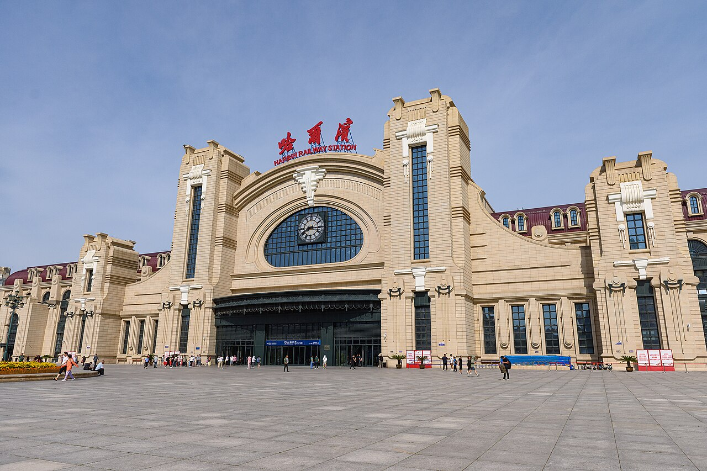

# 00. สถานีรถไฟความเร็วสูงฮาร์บิน (Harbin Railway Station (HSR Hub))

* **ชื่อภาษาไทย**: สถานีรถไฟความเร็วสูงฮาร์บิน
* **ชื่อภาษาจีน**: 哈尔滨站 (高铁站)
* **พินอิน**: Hā'ěrbīn Zhàn
* **ชื่อภาษาอังกฤษ**: Harbin Railway Station (HSR Hub)
* **ประเภท**: ศูนย์กลางรถไฟความเร็วสูง (High-Speed Rail Hub)
* **ไอคอน**: 🚅

---

## 1. รายละเอียดและจุดเด่น (Description & Highlights)

สถานีรถไฟฮาร์บินไม่เพียงเป็นชุมทางคมนาคมความเร็วสูงหลักของมณฑลเฮยหลงเจียง แต่ยังเป็นผลงานสถาปัตยกรรมระดับมาสเตอร์พีซที่สะท้อนประวัติศาสตร์เส้นทางรถไฟสายตะวันออกของจีน (Chinese Eastern Railway) ตัวอาคารโอ่อ่าด้วยลวดลายปูนปั้นสไตล์ยุโรป หลังคาทรงโดม และโคมไฟวินเทจ ให้ความรู้สึกเหมือนกำลังก้าวเข้าสู่สถานีรถไฟในยุโรปยุคคลาสสิก

* **สรุปจุดเด่นสั้น**:
  * ศูนย์กลางรถไฟหัวกระสุนเชื่อมปักกิ่ง ฉางชุน เสิ่นหยาง และย่าปู้ลี่
  * ตัวอาคารสร้างด้วยสถาปัตยกรรมยุโรปอาร์ตนูโวคลาสสิกงดงามที่สุดแห่งหนึ่งในจีน
  * เชื่อมต่อรถไฟใต้ดิน Metro สาย 2 และจุดเรียก DiDi ใจกลางเมือง

* **ไฮไลท์สำคัญที่ไม่ควรพลาด**:
  * สถาปัตยกรรมจำลองสถานีรถไฟฮาร์บินยุค 1903 ผสมผสานศิลปะฝรั่งเศสและรัสเซีย
  * จุดเริ่มต้นการเดินทางด้วยรถไฟความเร็วสูงสู่ลานสกีระดับโลกย่าปู้ลี่ (เพียง 1 ชม. 15 นาที)
  * มีพิพิธภัณฑ์ประวัติศาสตร์อันจุงกึน (Ahn Jung-geun Memorial Hall) อยู่ภายในบริเวณสถานี
  * เดินทางสู่ถนนคนเดินจงหยางและโบสถ์เซนต์โซเฟียด้วยแท็กซี่เพียง 5-8 นาที

---

## 2. วิธีการเดินทาง (Transportation)

* **จากสถานีรถไฟฮาร์บิน (Harbin Station)**: ตั้งอยู่ใจกลางเมือง เขตเต้าหลี่ (Daoli District)
* **จากสนามบินฮาร์บินไท่ผิง (HRB Airport)**: นั่ง Airport Shuttle Bus สาย 1 (20 หยวน) หรือ DiDi ประมาณ 45 นาที (100-120 หยวน)
* **การเดินทางภายใน & คำแนะนำพื้นที่**: มีฮีตเตอร์อุ่นสบาย ลิฟต์ บันไดเลื่อน และศูนย์บริการนักท่องเที่ยวภาษาอังกฤษ

---

## 3. เวลาเปิด - ปิด และค่าเข้าชม (Opening Hours & Admission)

* **เวลาเปิดทำการ**: เปิดบริการตลอด 24 ชั่วโมง (ตามตารางเดินรถไฟ)
* **อัตราค่าเข้าชม**: เข้าสู่สถานีฟรี (ค่าตั๋วรถไฟตามระยะทาง เช่น ไปย่าปู้ลี่ ~75 หยวน)
* **ช่วงเวลาที่แนะนำ**: ช่วงเช้าและหัวค่ำเมื่อเปิดไฟประดับอาคารยุโรปสีทองอร่าม

---

## 4. คะแนนความน่าสนใจสำหรับนักท่องเที่ยว (Traveler Rating)

* **คะแนน**: ⭐⭐⭐⭐⭐ (4.9 / 5.0)
* **ความคิดเห็น & บรรยากาศ**: สถานีรถไฟสถาปัตยกรรมอาร์ตนูโวยุโรปสุดคลาสสิก ดั่งสถานีรถไฟในปารีส สะอาด เชื่อมต่อรถไฟใต้ดิน Line 2
* **คีย์เวิร์ดแท็ก**: `รถไฟความเร็วสูง` · `สถานีฮาร์บิน` · `จุดต่อรถ` · `Art Nouveau` · `Harbin Station`

---

## 5. พิกัดบนแผนที่ (Map Coordinates)

* **พิกัด GPS (AMAP / GCJ-02)**: `45.7570° N, 126.6268° E`
* **คำค้นหาใน Gaode Map (高德地图)**: `哈尔滨站 (高铁站)`
* **Google Maps Link**: [คลิกดูแผนที่บน Google Maps](https://maps.google.com/?q=45.757,126.6268)
