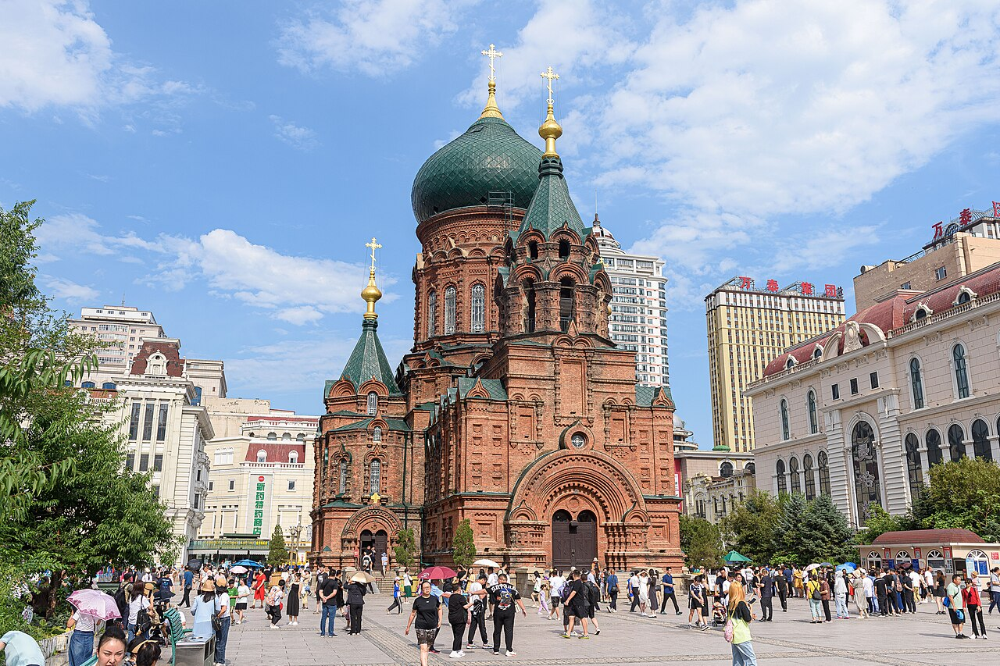

# 01. มหาวิหารเซนต์โซเฟีย (Saint Sophia Cathedral)

* **ชื่อภาษาไทย**: มหาวิหารเซนต์โซเฟีย
* **ชื่อภาษาจีน**: 圣·索菲亚大教堂
* **พินอิน**: Shèng Suǒfēiyà Dàjiàotáng
* **ชื่อภาษาอังกฤษ**: Saint Sophia Cathedral
* **ประเภท**: สถาปัตยกรรมรัสเซีย & โบสถ์ (Russian Heritage & Church)
* **ไอคอน**: ⛪

---

## 1. รายละเอียดและจุดเด่น (Description & Highlights)

มหาวิหารเซนต์โซเฟียคือจิตวิญญาณแห่งประวัติศาสตร์และสัญลักษณ์อันโดดเด่นที่สุดของนครฮาร์บิน ก่อสร้างขึ้นเพื่อเป็นโบสถ์ทหารประจำกองทัพรัสเซียในอดีต โครงสร้างอิฐแดงเข้มยอดโดมสีเขียวเข้มสูงตระหง่านตัดกับหิมะขาวโพลนในฤดูหนาว ยามเย็นเมื่อเปิดไฟประดับสีส้มทองอบอุ่น โบสถ์แห่งนี้จะสะกดสายตาทุกคู่ดั่งภาพวาดในเทพนิยายยุโรปโบราณ

* **สรุปจุดเด่นสั้น**:
  * โบสถ์ออร์โธดอกซ์รัสเซียที่ใหญ่และสมบูรณ์ที่สุดในเอเชียตะวันออก
  * จุดถ่ายภาพยอดฮิต: ฝูงนกพิราบบินผ่านโดมหัวหอมสีเขียวเข้มและอิฐแดง
  * จิบกาแฟรัสเซียในคาเฟ่วินเทจชมวิวโบสถ์ยามค่ำคืนใต้แสงไฟสีทอง

* **ไฮไลท์สำคัญที่ไม่ควรพลาด**:
  * สร้างขึ้นในปี 1907 ด้วยอิฐสีแดงสดผสมผสานศิลปะไบแซนไทน์และรัสเซียดั้งเดิม
  * ยอดโดมหัวหอมสีเขียวเข้มสูง 53.3 เมตร ถือเป็นสัญลักษณ์เชิงสถาปัตยกรรมของเมือง
  * ภายในจัดแสดงภาพถ่ายประวัติศาสตร์นครฮาร์บินและโมเดลจำลองเมืองโบราณ
  * ช่วงฤดูหนาวพื้นจัตุรัสจะปกคลุมด้วยหิมะขาวบริสุทธิ์ ให้บรรยากาศดั่งจัตุรัสแดงในมอสโก

---

## 2. วิธีการเดินทาง (Transportation)

* **จากสถานีรถไฟฮาร์บิน (Harbin Station)**: ห่างจากสถานีรถไฟฮาร์บินเพียง 1.5 กม. นั่ง DiDi 8 หยวน หรือเดิน 20 นาที
* **จากสนามบินฮาร์บินไท่ผิง (HRB Airport)**: นั่งรถตู้จากสนามบินประมาณ 45 นาที (100-120 หยวน)
* **การเดินทางภายใน & คำแนะนำพื้นที่**: ลานจัตุรัสเป็นพื้นหินแกรนิตกว้างขวาง มีจุดให้อาหารนกพิราบและร้านขายของที่ระลึก

---

## 3. เวลาเปิด - ปิด และค่าเข้าชม (Opening Hours & Admission)

* **เวลาเปิดทำการ**: จัตุรัสเปิดตลอด 24 ชม. (ภายในหอศิลป์เปิด 08:30 - 17:00 น.)
* **อัตราค่าเข้าชม**: จัตุรัสภายนอกเข้าฟรี (เข้าชมภายในโบสถ์ 20 หยวน ~100 บาท)
* **ช่วงเวลาที่แนะนำ**: 15:30 - 17:30 น. (ชมแสงทไวไลท์และไฟประดับสีทองตัดกับหิมะ)

---

## 4. คะแนนความน่าสนใจสำหรับนักท่องเที่ยว (Traveler Rating)

* **คะแนน**: ⭐⭐⭐⭐⭐ (4.9 / 5.0)
* **ความคิดเห็น & บรรยากาศ**: แลนด์มาร์กอันดับ 1 ของฮาร์บิน โดมหัวหอมสีเขียวมรกต ฝูงนกพิราบบินตัดหิมะ คาเฟ่วินเทจสุดโรแมนติก
* **คีย์เวิร์ดแท็ก**: `โบสถ์เซนต์โซเฟีย` · `สถาปัตยกรรมรัสเซีย` · `แลนด์มาร์กฮาร์บิน` · `Byzantine` · `Saint Sophia`

---

## 5. พิกัดบนแผนที่ (Map Coordinates)

* **พิกัด GPS (AMAP / GCJ-02)**: `45.7686° N, 126.6278° E`
* **คำค้นหาใน Gaode Map (高德地图)**: `圣·索菲亚大教堂`
* **Google Maps Link**: [คลิกดูแผนที่บน Google Maps](https://maps.google.com/?q=45.7686,126.6278)
