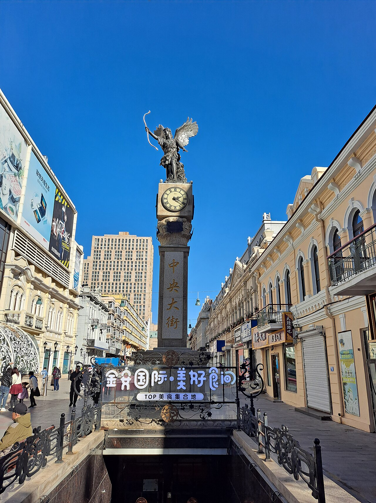

# 02. ถนนคนเดินหินร้อยปีจงหยาง (Zhongyang Pedestrian Street)

* **ชื่อภาษาไทย**: ถนนคนเดินหินร้อยปีจงหยาง
* **ชื่อภาษาจีน**: 中央大街步行街
* **พินอิน**: Zhōngyāng Dàjiē
* **ชื่อภาษาอังกฤษ**: Zhongyang Pedestrian Street
* **ประเภท**: ถนนคนเดิน & ประวัติศาสตร์ (Historic Street & Walkway)
* **ไอคอน**: 🏮

---

## 1. รายละเอียดและจุดเด่น (Description & Highlights)

ถนนคนเดินจงหยาง หรือ 'ถนนสายกลาง' คือเส้นเลือดใหญ่ทางประวัติศาสตร์และการท่องเที่ยวของฮาร์บิน สร้างขึ้นตั้งแต่ปี 1898 เพื่อรองรับชุมชนชาวรัสเซีย ตลอดสองข้างทางเต็มไปด้วยอาคารสถาปัตยกรรมตะวันตกหลากหลายยุคสมัย พื้นถนนปูด้วยหินแกรนิตขัดมันที่ทนทานนับศตวรรษ ในฤดูหนาวจะมีประติมากรรมน้ำแข็งประดับสองข้างทาง พร้อมกลิ่นหอมของขนมปังอบและกาแฟกรุ่น

* **สรุปจุดเด่นสั้น**:
  * ถนนคนเดินปูด้วยหินก้อนสี่เหลี่ยมสไตล์รัสเซียความยาว 1.4 กิโลเมตร
  * ชิมไอศกรีมแท่งหม่าเตี๋ยเอ่อร์ (Modern Popsicle) กลางอุณหภูมิติดลบ -15°C
  * ศูนย์รวมอาคารมรดกสไตล์บาโรก เรอเนสซองส์ และอาร์ตนูโวกว่า 70 หลัง

* **ไฮไลท์สำคัญที่ไม่ควรพลาด**:
  * ปูด้วยหินแกรนิตสี่เหลี่ยมลูกเต๋าที่ในอดีตมีมูลค่าเทียบเท่าก้อนเงินก้อนทอง
  * ชิมไส้กรอกแดงฮาร์บินรมควันไม้ผลร้อนๆ กลิ่นหอมฟุ้งริมทางเดิน
  * โรงแรม Modern Hotel (马迭尔宾馆) สร้างขึ้นปี 1906 บรรยากาศวินเทจยุโรปแท้
  * ทอดยาวจากใจกลางเมืองไปสิ้นสุดที่อนุสาวรีย์สตาลินริมแม่น้ำซงฮัว

---

## 2. วิธีการเดินทาง (Transportation)

* **จากสถานีรถไฟฮาร์บิน (Harbin Station)**: ห่างจากสถานีรถไฟฮาร์บิน 2 กม. รถไฟใต้ดิน Line 2 ลงสถานี Zhongyangdajie
* **จากสนามบินฮาร์บินไท่ผิง (HRB Airport)**: Airport Bus สาย 3 หรือ DiDi 100 หยวน
* **การเดินทางภายใน & คำแนะนำพื้นที่**: ถนนคนเดินปลอดรถยนต์ 100% มีม้านั่งและประติมากรรมน้ำแข็งริมทาง

---

## 3. เวลาเปิด - ปิด และค่าเข้าชม (Opening Hours & Admission)

* **เวลาเปิดทำการ**: เปิดตลอด 24 ชั่วโมง (ร้านค้าเปิด 09:30 - 22:00 น.)
* **อัตราค่าเข้าชม**: เข้าชมฟรีตลอดเส้นทาง
* **ช่วงเวลาที่แนะนำ**: 16:00 - 20:30 น. (เดินชมไฟกลางคืน บรรยากาศโรแมนติกที่สุด)

---

## 4. คะแนนความน่าสนใจสำหรับนักท่องเที่ยว (Traveler Rating)

* **คะแนน**: ⭐⭐⭐⭐⭐ (4.9 / 5.0)
* **ความคิดเห็น & บรรยากาศ**: ถนนหินแกรนิตรัสเซียอายุกว่า 120 ปี สถาปัตยกรรมบาโรก ไอศกรีมหม่าเตี๋ยเอ่อร์ และร้านอาหารรัสเซียคลาสสิก
* **คีย์เวิร์ดแท็ก**: `ถนนจงหยาง` · `ไอศกรีมหม่าเตี๋ยเอ่อร์` · `สถาปัตยกรรมยุโรป` · `Zhongyang Street` · `Cobblestones`

---

## 5. พิกัดบนแผนที่ (Map Coordinates)

* **พิกัด GPS (AMAP / GCJ-02)**: `45.7725° N, 126.6208° E`
* **คำค้นหาใน Gaode Map (高德地图)**: `中央大街步行街`
* **Google Maps Link**: [คลิกดูแผนที่บน Google Maps](https://maps.google.com/?q=45.7725,126.6208)
