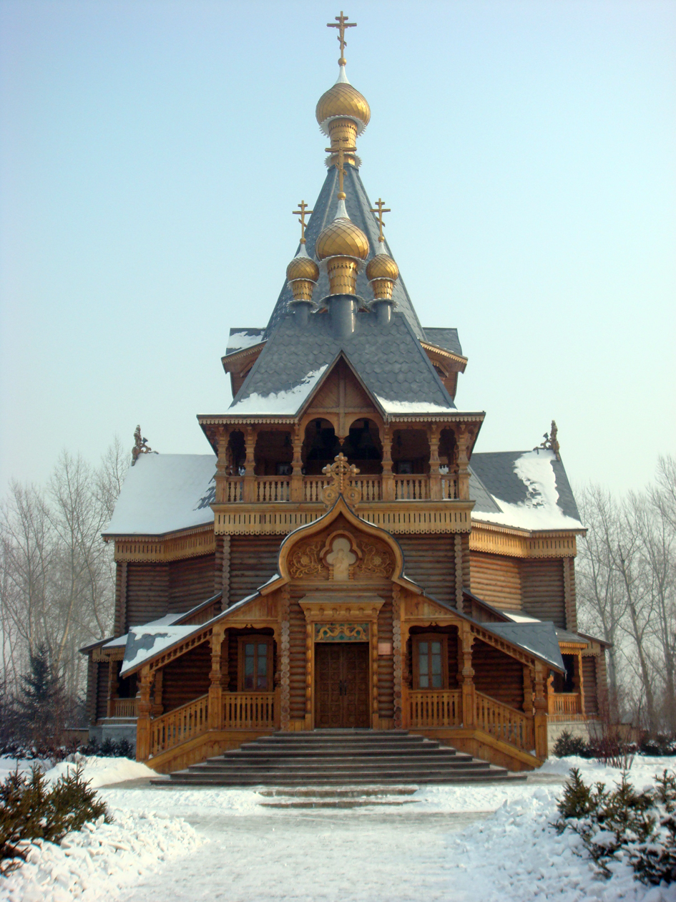

# 03. คฤหาสน์รัสเซียวอลกา (Volga Manor)

* **ชื่อภาษาไทย**: คฤหาสน์รัสเซียวอลกา
* **ชื่อภาษาจีน**: 伏尔加庄园
* **พินอิน**: Fú'ěrjiā Zhuāngyuán
* **ชื่อภาษาอังกฤษ**: Volga Manor
* **ประเภท**: สถาปัตยกรรมรัสเซีย & ปราสาท (Russian Heritage & Castle)
* **ไอคอน**: 🏰

---

## 1. รายละเอียดและจุดเด่น (Description & Highlights)

คฤหาสน์วอลกา (Volga Manor) ตั้งอยู่ชานเมืองฮาร์บินริมแม่น้ำอาซีเค่อ เป็นสถานที่รวบรวมสถาปัตยกรรมรัสเซียคลาสสิกที่เคยสาบสูญไปในอดีตกว่า 30 หลัง ท่ามกลางทุ่งหิมะสีขาวและป่าต้นเบิร์ชสีเงิน ไฮไลท์ห้ามพลาดคือการเข้าชมปราสาทไวน์วอดก้า ชิมเครื่องดื่มในแก้วน้ำแข็ง และขึ้นไปเล่นสไลเดอร์หิมะลงมาจากยอดปราสาทสูง

* **สรุปจุดเด่นสั้น**:
  * อาณาจักรวัฒนธรรมรัสเซียขนาด 600,000 ตร.ม. ริมแม่น้ำอาซีเค่อกลายเป็นน้ำแข็ง
  * ลิ้มลองวอดก้ารัสเซียในแก้วที่แกะจากก้อนน้ำแข็งแท้ ณ ปราสาทไวน์วอดก้า
  * สนุกกับสไลเดอร์หิมะ (Snow Tubing) ทิ้งตัวลงจากหอคอยปราสาทสีทอง

* **ไฮไลท์สำคัญที่ไม่ควรพลาด**:
  * โบสถ์ไม้เซนต์นิโคลัส (St. Nicholas Church) สร้างจำลองด้วยเทคนิคเข้าเดือยไม้ไร้ตะปู 1:1
  * ปราสาทปาฟลอฟ (Pavlov Castle) ริมทะเลสาบน้ำแข็งสุดอลังการ
  * การแสดงระบำพื้นเมืองรัสเซียแท้โดยศิลปินชาวยุโรป
  * บรรยากาศเงียบสงบ ไร้ฝูงชนแออัด ดุจหลุดเข้าไปในชนบทชนชั้นสูงของรัสเซีย

---

## 2. วิธีการเดินทาง (Transportation)

* **จากสถานีรถไฟฮาร์บิน (Harbin Station)**: ห่างจากตัวเมืองไปทางตะวันออกเฉียงใต้ 30 กม. แนะนำเหมารถตู้ VIP หรือ DiDi 80-100 หยวน
* **จากสนามบินฮาร์บินไท่ผิง (HRB Airport)**: นั่งรถตู้ส่วนตัวประมาณ 1 ชม.
* **การเดินทางภายใน & คำแนะนำพื้นที่**: มีรถรางชมวิว เรือลากเลื่อนหิมะ และร้านอาหารรัสเซียระดับพรีเมียม

---

## 3. เวลาเปิด - ปิด และค่าเข้าชม (Opening Hours & Admission)

* **เวลาเปิดทำการ**: ทุกวัน 08:30 - 17:00 น. (ฤดูหนาว)
* **อัตราค่าเข้าชม**: ค่าเข้าชมฤดูหนาวประมาณ 150-165 หยวน (~750-820 บาท รวมกิจกรรมหิมะ)
* **ช่วงเวลาที่แนะนำ**: 10:00 - 15:00 น. (แดดอบอุ่น แสงสะท้อนหิมะถ่ายภาพสวยที่สุด)

---

## 4. คะแนนความน่าสนใจสำหรับนักท่องเที่ยว (Traveler Rating)

* **คะแนน**: ⭐⭐⭐⭐⭐ (4.8 / 5.0)
* **ความคิดเห็น & บรรยากาศ**: อาณาจักรปราสาทและโบสถ์ไม้รัสเซียท่ามกลางป่าสนขาว จิบวอดก้าในแก้วน้ำแข็งแท้ และสไลเดอร์หิมะจากยอดปราสาท
* **คีย์เวิร์ดแท็ก**: `วอลกามาเนอร์` · `ปราสาทรัสเซีย` · `วอดก้าแก้วน้ำแข็ง` · `Snow Tubing` · `Volga Manor`

---

## 5. พิกัดบนแผนที่ (Map Coordinates)

* **พิกัด GPS (AMAP / GCJ-02)**: `45.6415° N, 126.9175° E`
* **คำค้นหาใน Gaode Map (高德地图)**: `伏尔加庄园`
* **Google Maps Link**: [คลิกดูแผนที่บน Google Maps](https://maps.google.com/?q=45.6415,126.9175)
