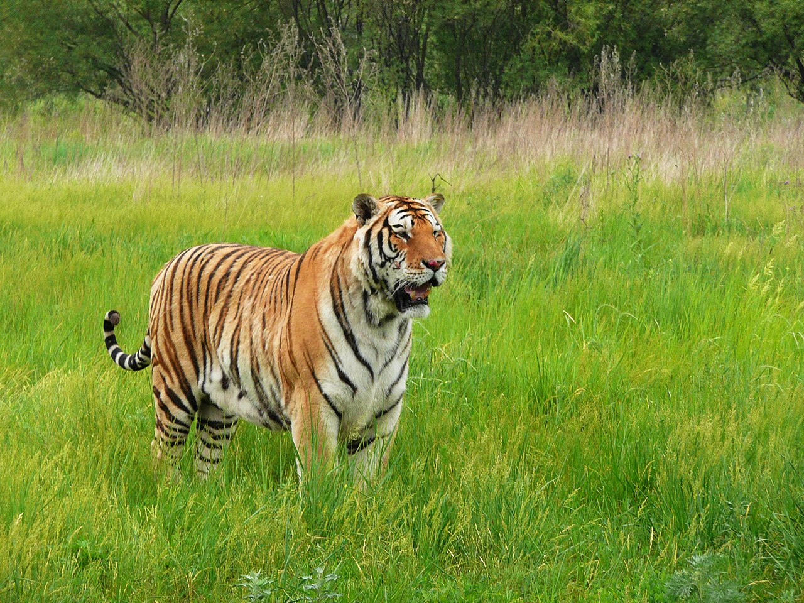

# 04. สวนเสือไซบีเรีย (Siberian Tiger Park)

* **ชื่อภาษาไทย**: สวนเสือไซบีเรีย
* **ชื่อภาษาจีน**: 东北虎林园
* **พินอิน**: Dōngběi Hǔ Lín Yuán
* **ชื่อภาษาอังกฤษ**: Siberian Tiger Park
* **ประเภท**: สัตว์ป่า & ธรรมชาติหิมะ (Wildlife & Nature)
* **ไอคอน**: 🐅

---

## 1. รายละเอียดและจุดเด่น (Description & Highlights)

สวนเสือไซบีเรีย (Harbin Siberian Tiger Park) ตั้งอยู่ริมฝั่งเหนือของแม่น้ำซงฮัว ก่อตั้งขึ้นเพื่ออนุรักษ์และเพาะพันธุ์พญาเสือไซบีเรีย (เสือตงเป่ย) ที่ใกล้สูญพันธุ์ นักท่องเที่ยวจะได้นั่งรถบัสตาข่ายเหล็กนิรภัยเข้าไปในทุ่งหิมะกว้างใหญ่ ชมฝูงเสือไซบีเรียตัวมหึมาวิ่งเล่น นอนเกลือกกลิ้งบนหิมะ และกระโดดล่าอาหารอย่างใกล้ชิด

* **สรุปจุดเด่นสั้น**:
  * ศูนย์อนุรักษ์เสือไซบีเรียสายพันธุ์แท้กว่า 1,000 ตัวกลางหิมะธรรมชาติ
  * นั่งรถบัสติดตะแกรงนิรภัยพิเศษลุยลานหิมะ สัมผัสเสือยักษ์อย่างปลอดภัย
  * สัมผัสความยิ่งใหญ่ของราชาแห่งผืนป่าฤดูหนาวขนหนานุ่มฟู

* **ไฮไลท์สำคัญที่ไม่ควรพลาด**:
  * เสือไซบีเรียเป็นเสือสายพันธุ์ใหญ่ที่สุดในโลก ปรับตัวเข้ากับความหนาว -30°C ได้อย่างสมบูรณ์แบบ
  * สามารถซื้อเนื้อสดป้อนให้อาหารเสือผ่านช่องคีบนิรภัยจากในรถ
  * ชมลูกเสือแรกเกิดน่ารักในอาคารอนุบาลสัตว์ป่า
  * ทิวทัศน์เสือวิ่งไล่ล่ากลางป่าสนขาวหิมะโพลน เป็นภาพที่หาดูได้เฉพาะที่นี่

---

## 2. วิธีการเดินทาง (Transportation)

* **จากสถานีรถไฟฮาร์บิน (Harbin Station)**: ห่างจากสถานีฮาร์บิน 12 กม. นั่ง DiDi ข้ามสะพานแม่น้ำซงฮัว 25-35 หยวน
* **จากสนามบินฮาร์บินไท่ผิง (HRB Airport)**: นั่งรถตู้ประมาณ 50 นาที
* **การเดินทางภายใน & คำแนะนำพื้นที่**: มีทางเดินสะพานไม้ยกสูงมีรั้วกั้น และรถซาฟารีกระจกนิรภัย

---

## 3. เวลาเปิด - ปิด และค่าเข้าชม (Opening Hours & Admission)

* **เวลาเปิดทำการ**: ทุกวัน 08:30 - 16:30 น. (รอบสุดท้าย 16:00 น.)
* **อัตราค่าเข้าชม**: บัตรเข้าชมรวมรถบัสนิรภัย 110-130 หยวน (~550-650 บาท)
* **ช่วงเวลาที่แนะนำ**: 09:30 - 11:30 น. (ช่วงเวลาเสือตื่นตัวและกินอาหารเช้า)

---

## 4. คะแนนความน่าสนใจสำหรับนักท่องเที่ยว (Traveler Rating)

* **คะแนน**: ⭐⭐⭐⭐⭐ (4.8 / 5.0)
* **ความคิดเห็น & บรรยากาศ**: สวนเพาะพันธุ์เสือไซบีเรียที่ใหญ่ที่สุดในโลก นั่งรถบัสกรงนิรภัยให้อาหารพญาเสือตัวโตขนฟูกลางทุ่งหิมะ
* **คีย์เวิร์ดแท็ก**: `สวนเสือไซบีเรีย` · `เสือตงเป่ย` · `ให้อาหารเสือ` · `Siberian Tiger` · `Wildlife`

---

## 5. พิกัดบนแผนที่ (Map Coordinates)

* **พิกัด GPS (AMAP / GCJ-02)**: `45.8152° N, 126.6358° E`
* **คำค้นหาใน Gaode Map (高德地图)**: `东北虎林园`
* **Google Maps Link**: [คลิกดูแผนที่บน Google Maps](https://maps.google.com/?q=45.8152,126.6358)
