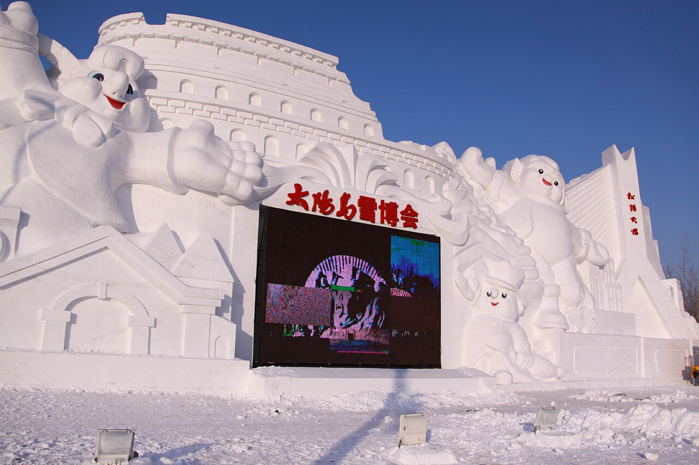

# 05. สวนเกาะพระอาทิตย์ (Sun Island Scenic Area)

* **ชื่อภาษาไทย**: สวนเกาะพระอาทิตย์
* **ชื่อภาษาจีน**: 太阳岛风景区
* **พินอิน**: Tàiyáng Dǎo Fēngjǐngqū
* **ชื่อภาษาอังกฤษ**: Sun Island Scenic Area
* **ประเภท**: เทศกาลน้ำแข็ง & หิมะ (Ice & Snow Expo)
* **ไอคอน**: ⛄

---

## 1. รายละเอียดและจุดเด่น (Description & Highlights)

เกาะพระอาทิตย์ (Taiyangdao) คือเกาะขนาดใหญ่กลางแม่น้ำซงฮัว ในช่วงฤดูหนาวจะถูกเนรมิตให้เป็น 'โลกแห่งประติมากรรมหิมะขาวบริสุทธิ์' ศิลปินจากทั่วทุกมุมโลกจะมาร่วมแข่งขันสร้างสรรค์ผลงานแกะสลักหิมะขนาดยักษ์ ทั้งรูปเทพนิยาย บุคคลสำคัญ และสถาปัตยกรรมระดับโลก ถือเป็นจุดเช็คอินที่ห้ามพลาดสำหรับผู้ที่รักงานศิลปะและการถ่ายภาพ

* **สรุปจุดเด่นสั้น**:
  * แหล่งจัดแสดงงานศิลปะแกะสลักหิมะระดับนานาชาติที่ใหญ่ที่สุดในโลก
  * ชมประติมากรรมหิมะขนาดยักษ์ความยาวกว่า 100 เมตร สูงเทียมตึก
  * นั่งกระเช้าลอยฟ้าข้ามแม่น้ำซงฮัวจากฝั่งเมืองเก่ามาลงที่เกาะได้โดยตรง

* **ไฮไลท์สำคัญที่ไม่ควรพลาด**:
  * ประติมากรรมแกะสลักหิมะจากศิลปินชั้นนำทั่วโลก ละเอียดอ่อนช้อยดั่งหินอ่อน
  * บรรยากาศขาวบริสุทธิ์ 360 องศา ไร้แสงไฟสังเคราะห์ เน้นความงามตามธรรมชาติ
  * มีหมู่บ้านรัสเซียจำลองโบราณ (Russian Style Town) ซ่อนอยู่บนเกาะ
  * เป็นส่วนสำคัญของเทศกาลน้ำแข็งฮาร์บินควบคู่กับ Ice and Snow World

---

## 2. วิธีการเดินทาง (Transportation)

* **จากสถานีรถไฟฮาร์บิน (Harbin Station)**: นั่ง Metro Line 2 ข้ามแม่น้ำลงสถานี Taiyangdao หรือนั่งกระเช้าลอยฟ้า
* **จากสนามบินฮาร์บินไท่ผิง (HRB Airport)**: นั่งรถตู้ 45 นาที
* **การเดินทางภายใน & คำแนะนำพื้นที่**: มีรถรางพลังงานไฟฟ้าชมวิวรอบเกาะ และจุดจิบชากาแฟอุ่นๆ

---

## 3. เวลาเปิด - ปิด และค่าเข้าชม (Opening Hours & Admission)

* **เวลาเปิดทำการ**: ทุกวัน 08:30 - 17:00 น. (ช่วงนิทรรศการหิมะ)
* **อัตราค่าเข้าชม**: ค่าเข้าชมนิทรรศการแกะสลักหิมะฤดูหนาว ~198-220 หยวน (~990-1,100 บาท)
* **ช่วงเวลาที่แนะนำ**: 10:30 - 14:30 น. (แดดส่ององค์หิมะสว่างจ้า ถ่ายภาพเห็นรายละเอียดชัดเจน)

---

## 4. คะแนนความน่าสนใจสำหรับนักท่องเที่ยว (Traveler Rating)

* **คะแนน**: ⭐⭐⭐⭐⭐ (4.8 / 5.0)
* **ความคิดเห็น & บรรยากาศ**: ศูนย์กลางงานประติมากรรมแกะสลักหิมะระดับนานาชาติ ประติมากรรมหิมะขนาดยักษ์สูงหลายสิบเมตร ละเอียดประณีต
* **คีย์เวิร์ดแท็ก**: `เกาะพระอาทิตย์` · `แกะสลักหิมะ` · `Sun Island` · `Snow Sculpture` · `Taiyangdao`

---

## 5. พิกัดบนแผนที่ (Map Coordinates)

* **พิกัด GPS (AMAP / GCJ-02)**: `45.7905° N, 126.5935° E`
* **คำค้นหาใน Gaode Map (高德地图)**: `太阳岛风景区`
* **Google Maps Link**: [คลิกดูแผนที่บน Google Maps](https://maps.google.com/?q=45.7905,126.5935)
