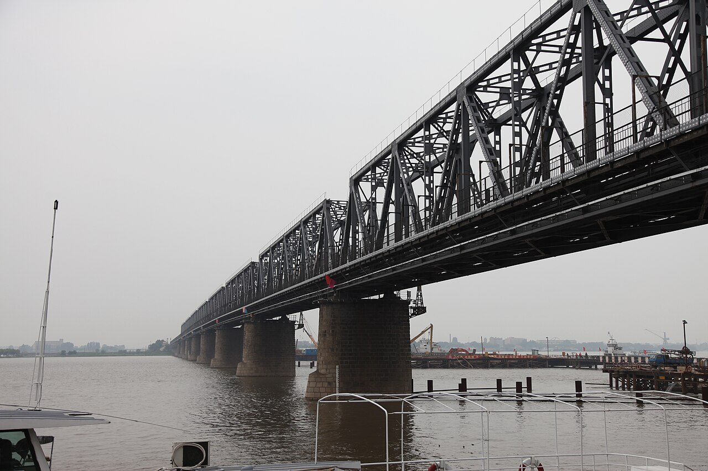

# 06. สะพานรถไฟประวัติศาสตร์ปินโจวแม่น้ำซงฮัว (Binzhou Railway Bridge (Songhua River Historic Bridge))

* **ชื่อภาษาไทย**: สะพานรถไฟประวัติศาสตร์ปินโจวแม่น้ำซงฮัว
* **ชื่อภาษาจีน**: 中东铁路第一桥 (滨州铁路桥)
* **พินอิน**: Zhōngdōng Tiělù Dìyī Qiáo
* **ชื่อภาษาอังกฤษ**: Binzhou Railway Bridge (Songhua River Historic Bridge)
* **ประเภท**: สะพานประวัติศาสตร์ & วิวแม่น้ำ (Historic Bridge & Scenic View)
* **ไอคอน**: 🌉

---

## 1. รายละเอียดและจุดเด่น (Description & Highlights)

สะพานรถไฟปินโจว หรือที่ชาวบ้านเรียกว่า 'สะพานเหล็กเก่า' (Old Glass Bridge) สร้างขึ้นตั้งแต่ปี 1900 เป็นสะพานข้ามแม่น้ำซงฮัวแห่งแรก หลังจากปลดประจำการจากการเดินรถไฟ ได้ถูกปรับปรุงให้เป็นสวนสาธารณะลอยฟ้าสำหรับคนเดิน ถือเป็นจุดชมวิวแม่น้ำซงฮัวที่งดงามที่สุด โดยเฉพาะยามเย็นที่ดวงอาทิตย์สีส้มทอแสงตัดกับโครงเหล็กและผืนน้ำแข็ง

* **สรุปจุดเด่นสั้น**:
  * สะพานเหล็กข้ามแม่น้ำซงฮัวแห่งแรก สร้างขึ้นตั้งแต่ปี 1900 โดยวิศวกรรัสเซีย
  * ปัจจุบันปรับเป็นทางเดินชมวิวคนเดิน มีจุดพื้นกระจกมองเห็นธารน้ำแข็งด้านล่าง
  * จุดชมพระอาทิตย์ตกดิน (Sunset) ที่โรแมนติกและสวยที่สุดในตัวเมืองฮาร์บิน

* **ไฮไลท์สำคัญที่ไม่ควรพลาด**:
  * สถาปัตยกรรมโครงสร้างเหล็กถักสีเขียวมะกอกวินเทจ ความยาวกว่า 1 กิโลเมตร
  * รางรถไฟประวัติศาสตร์สายตะวันออกของจีนที่จักรพรรดิและผู้นำระดับโลกเคยเดินทางผ่าน
  * ช่วงกลางสะพานมีช่องกระจกใสบานใหญ่ มองเห็นแผ่นน้ำแข็งและกระแสน้ำเย็นเฉียบ
  * มองเห็นกระเช้าลอยฟ้าและเส้นขอบฟ้าเมืองฮาร์บินแบบพาโนรามา 360 องศา

---

## 2. วิธีการเดินทาง (Transportation)

* **จากสถานีรถไฟฮาร์บิน (Harbin Station)**: ห่างจากสถานีฮาร์บิน 3 กม. เดินต่อมาจากสวนสตาลินได้เลย
* **จากสนามบินฮาร์บินไท่ผิง (HRB Airport)**: นั่งรถตู้ 45 นาที
* **การเดินทางภายใน & คำแนะนำพื้นที่**: มีทางลาดคนพิการและพื้นยางกันลื่นตลอดความยาวสะพาน 1,050 เมตร

---

## 3. เวลาเปิด - ปิด และค่าเข้าชม (Opening Hours & Admission)

* **เวลาเปิดทำการ**: เปิดตลอด 24 ชั่วโมง (ไฟประดับสะพานเปิด 16:30 - 22:00 น.)
* **อัตราค่าเข้าชม**: เข้าชมและเดินข้ามฟรี 100%
* **ช่วงเวลาที่แนะนำ**: 15:30 - 17:00 น. (ชมแสงพระอาทิตย์ตกดินสะท้อนผืนน้ำแข็ง)

---

## 4. คะแนนความน่าสนใจสำหรับนักท่องเที่ยว (Traveler Rating)

* **คะแนน**: ⭐⭐⭐⭐⭐ (4.8 / 5.0)
* **ความคิดเห็น & บรรยากาศ**: สะพานเหล็กทางรถไฟ 120 ปี ปรับเป็นทางเดินชมวิว มีพื้นกระจกใสชมธารน้ำแข็งและพระอาทิตย์ตกดินสีส้มทอง
* **คีย์เวิร์ดแท็ก**: `สะพานปินโจว` · `แม่น้ำซงฮัว` · `พื้นกระจก` · `พระอาทิตย์ตก` · `Binzhou Bridge`

---

## 5. พิกัดบนแผนที่ (Map Coordinates)

* **พิกัด GPS (AMAP / GCJ-02)**: `45.7795° N, 126.6350° E`
* **คำค้นหาใน Gaode Map (高德地图)**: `中东铁路第一桥 (滨州铁路桥)`
* **Google Maps Link**: [คลิกดูแผนที่บน Google Maps](https://maps.google.com/?q=45.7795,126.635)
