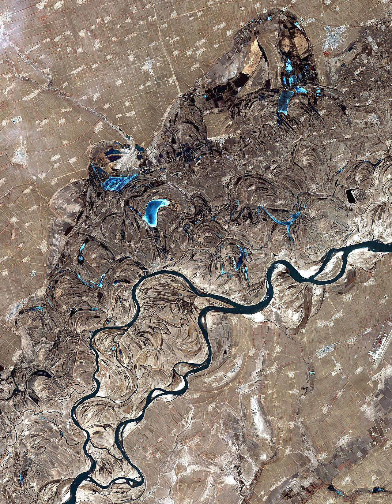

# 07. ลานกิจกรรมน้ำแข็งและหิมะแม่น้ำซงฮัว (Songhua River Ice & Snow Carnival)

* **ชื่อภาษาไทย**: ลานกิจกรรมน้ำแข็งและหิมะแม่น้ำซงฮัว
* **ชื่อภาษาจีน**: 松花江冰雪嘉年华
* **พินอิน**: Sōnghuā Jiāng Bīngxuě Jiāniánhuá
* **ชื่อภาษาอังกฤษ**: Songhua River Ice & Snow Carnival
* **ประเภท**: เทศกาลน้ำแข็ง & กิจกรรมหิมะ (Ice Carnival & Snow Fun)
* **ไอคอน**: ⛸️

---

## 1. รายละเอียดและจุดเด่น (Description & Highlights)

ในฤดูหนาว แม่น้ำซงฮัวที่กว้างใหญ่จะกลายสภาพเป็นแผ่นน้ำแข็งหนาทึบและกลายเป็น 'ลานหิมะและน้ำแข็งกลางแจ้ง' ขนาดยักษ์ของชาวฮาร์บิน นักท่องเที่ยวสามารถเดินลงไปบนแม่น้ำ สัมผัสความมหัศจรรย์ของธรรมชาติ เพลิดเพลินกับกิจกรรมกีฬาฤดูหนาวพื้นบ้าน และชมวิถีชีวิตการตัดน้ำแข็งก้อนยักษ์ที่นำไปใช้สร้างปราสาทน้ำแข็ง

* **สรุปจุดเด่นสั้น**:
  * แม่น้ำซงฮัวกลายเป็นผืนน้ำแข็งยักษ์กว้างขวาง เดินเท้าลงไปบนแม่น้ำได้ 100%
  * สนุกกับกิจกรรมฤดูหนาว: จักรยานน้ำแข็ง, รถบัมพ์น้ำแข็ง, บานาน่าโบ๊ทลากบนหิมะ
  * ชมพิธีและวิถีชีวิตการตัดก้อนน้ำแข็งยักษ์ (Ice Harvesting) สดๆ จากแม่น้ำ

* **ไฮไลท์สำคัญที่ไม่ควรพลาด**:
  * สัมผัสประสบการณ์เดินบนแม่น้ำน้ำแข็งสายประวัติศาสตร์ที่มีน้ำไหลอยู่ใต้แผ่นน้ำแข็งหนา
  * กิจกรรมแคร่เลื่อนโบราณตงเป่ย (Ice Sled) ใช้ไม้สองอันไถลไปข้างหน้าอย่างเพลิดเพลิน
  * ลานสเก็ตน้ำแข็งธรรมชาติกลางแจ้งขนาดใหญ่ที่สุดในฮาร์บิน
  * มีเต็นท์อุ่นและร้านขายอาหารสตรีทฟู้ดร้อนๆ อาทิ มันเผา ข้าวโพดต้ม และชาร้อน

---

## 2. วิธีการเดินทาง (Transportation)

* **จากสถานีรถไฟฮาร์บิน (Harbin Station)**: เดินจากปลายถนนคนเดินจงหยาง ทะลุสวนสตาลินลงสู่แม่น้ำได้ทันที
* **จากสนามบินฮาร์บินไท่ผิง (HRB Airport)**: นั่งรถตู้ 45 นาที
* **การเดินทางภายใน & คำแนะนำพื้นที่**: มีบันไดทางลงแม่น้ำพร้อมแผ่นยางกันลื่น และจุดเช่าอุปกรณ์กันหนาว

---

## 3. เวลาเปิด - ปิด และค่าเข้าชม (Opening Hours & Admission)

* **เวลาเปิดทำการ**: ทุกวัน 09:00 - 21:00 น. (ช่วงแม่น้ำเป็นน้ำแข็ง ธ.ค. - ก.พ.)
* **อัตราค่าเข้าชม**: ลงเดินเล่นบนลานน้ำแข็งฟรี (เครื่องเล่นคิดแยกชิ้นละ 20-50 หยวน)
* **ช่วงเวลาที่แนะนำ**: 14:00 - 18:00 น. (เล่นกิจกรรมยามบ่ายต่อเนื่องถึงชมไฟประดับยามค่ำ)

---

## 4. คะแนนความน่าสนใจสำหรับนักท่องเที่ยว (Traveler Rating)

* **คะแนน**: ⭐⭐⭐⭐⭐ (4.8 / 5.0)
* **ความคิดเห็น & บรรยากาศ**: แม่น้ำทั้งสายกลายเป็นลานน้ำแข็งหนา 1 เมตร แคร่เลื่อนหิมะ ปั่นจักรยานน้ำแข็ง ชมชาวบ้านตัดก้อนน้ำแข็งยักษ์
* **คีย์เวิร์ดแท็ก**: `แม่น้ำซงฮัว` · `ลานน้ำแข็ง` · `เลื่อนหิมะ` · `ตัดน้ำแข็ง` · `Songhua Carnival`

---

## 5. พิกัดบนแผนที่ (Map Coordinates)

* **พิกัด GPS (AMAP / GCJ-02)**: `45.7790° N, 126.6185° E`
* **คำค้นหาใน Gaode Map (高德地图)**: `松花江冰雪嘉年华`
* **Google Maps Link**: [คลิกดูแผนที่บน Google Maps](https://maps.google.com/?q=45.779,126.6185)
