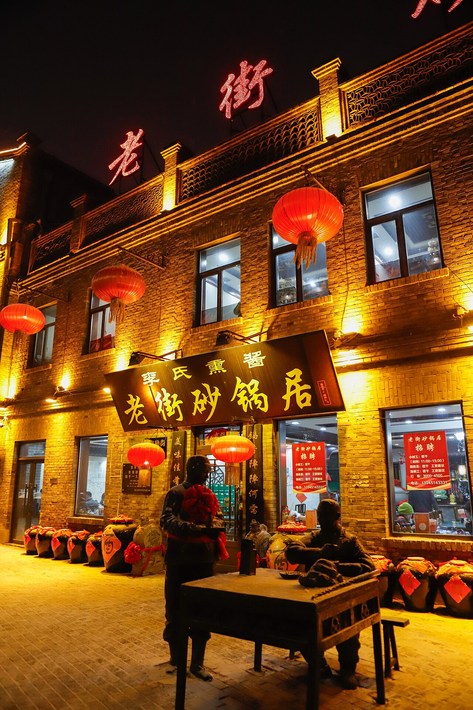

# 08. ชุมชนวัฒนธรรมบาโรกจีนโบราณ เหล่าเต้าว่าย (Chinese Baroque Historic Block (Lao Daowai))

* **ชื่อภาษาไทย**: ชุมชนวัฒนธรรมบาโรกจีนโบราณ เหล่าเต้าว่าย
* **ชื่อภาษาจีน**: 中华巴洛克历史文化区 (老道外)
* **พินอิน**: Zhōnghuá Bāluòkè (Lǎo Dàowài)
* **ชื่อภาษาอังกฤษ**: Chinese Baroque Historic Block (Lao Daowai)
* **ประเภท**: สถาปัตยกรรมบาโรก & ย่านอาหารเก่าแก่ (Baroque Heritage & Heritage Food)
* **ไอคอน**: 🏯

---

## 1. รายละเอียดและจุดเด่น (Description & Highlights)

ย่านประวัติศาสตร์วัฒนธรรมบาโรกจีน (Chinese Baroque Block) ในเขตเหล่าเต้าว่าย เป็นตัวแทนของภูมิปัญญาชาวพ่อค้าจีนยุคแรกในฮาร์บิน ที่จ้างช่างฝีมือสร้างอาคารด้านหน้าเลียนแบบสไตล์ยุโรปอันหรูหรา แต่สลักลวดลายมงคลจีน และสร้างด้านหลังเป็นเรือนพักอาศัยแบบจีนสี่ประสาน ย่านนี้ยังเป็นสวรรค์ของนักชิมอาหารตงเปื่อระดับตำนาน

* **สรุปจุดเด่นสั้น**:
  * กลุ่มอาคารสไตล์ Chinese Baroque ที่ใหญ่และสมบูรณ์ที่สุดในโลก
  * หน้าตึกเป็นปูนปั้นบาโรกยุโรป แต่ด้านในเป็นเรือนสี่ประสาน (ซื่อเหอย่วน) จีนโบราณ
  * แหล่งรวมร้านอาหารระดับตำนาน 100 ปี โดยเฉพาะร้านต้นกำเนิดหมูเปรี้ยวหวาน 'กัวเปาโร่ว'

* **ไฮไลท์สำคัญที่ไม่ควรพลาด**:
  * สถาปัตยกรรมสุดมหัศจรรย์: ปูนปั้นลวดลายค้างคาว ลูกทับทิม และดอกบัวบนเสากรีก-โรมัน
  * ร้านอาหาร Laochushi (老厨家) ผู้คิดค้นเมนูกัวเปาโร่วถวายขุนนางในสมัยราชวงศ์ชิง
  * ชมร้านขายยาสมุนไพรโบราณและโรงน้ำชาที่ยังคงรักษาวิถีชีวิตดั้งเดิม
  * มุมถ่ายภาพสตรีทอาร์ตและสะพานไม้เชื่อมเรือนโบราณที่เปี่ยมเสน่ห์คลาสสิก

---

## 2. วิธีการเดินทาง (Transportation)

* **จากสถานีรถไฟฮาร์บิน (Harbin Station)**: ห่างจากสถานีฮาร์บิน 4 กม. รถไฟใต้ดิน Line 3 ลงสถานี Zhonghuabaluoke
* **จากสนามบินฮาร์บินไท่ผิง (HRB Airport)**: นั่งรถตู้ 50 นาที
* **การเดินทางภายใน & คำแนะนำพื้นที่**: ตรอกซอยคนเดินโบราณ ปูด้วยหินก้อน มีโรงน้ำชาและพิพิธภัณฑ์พื้นบ้าน

---

## 3. เวลาเปิด - ปิด และค่าเข้าชม (Opening Hours & Admission)

* **เวลาเปิดทำการ**: เปิดตลอด 24 ชั่วโมง (ร้านอาหารเปิด 10:30 - 21:00 น.)
* **อัตราค่าเข้าชม**: เข้าชมฟรีตลอดทั้งย่าน
* **ช่วงเวลาที่แนะนำ**: 11:00 - 14:00 น. (ทานมื้อกลางวันร้านตำนาน) หรือ 17:00 น. (ชมโคมไฟยามเย็น)

---

## 4. คะแนนความน่าสนใจสำหรับนักท่องเที่ยว (Traveler Rating)

* **คะแนน**: ⭐⭐⭐⭐⭐ (4.8 / 5.0)
* **ความคิดเห็น & บรรยากาศ**: สถาปัตยกรรมบาโรกตะวันตกผสมผสานเรือนสี่ประสานจีนดั้งเดิม แหล่งกำเนิดร้านกัวเปาโร่ว 100 ปี Laochushi
* **คีย์เวิร์ดแท็ก**: `บาโรกจีน` · `เหล่าเต้าว่าย` · `กัวเปาโร่ว` · `Laochushi` · `Chinese Baroque`

---

## 5. พิกัดบนแผนที่ (Map Coordinates)

* **พิกัด GPS (AMAP / GCJ-02)**: `45.7875° N, 126.6635° E`
* **คำค้นหาใน Gaode Map (高德地图)**: `中华巴洛克历史文化区 (老道外)`
* **Google Maps Link**: [คลิกดูแผนที่บน Google Maps](https://maps.google.com/?q=45.7875,126.6635)
