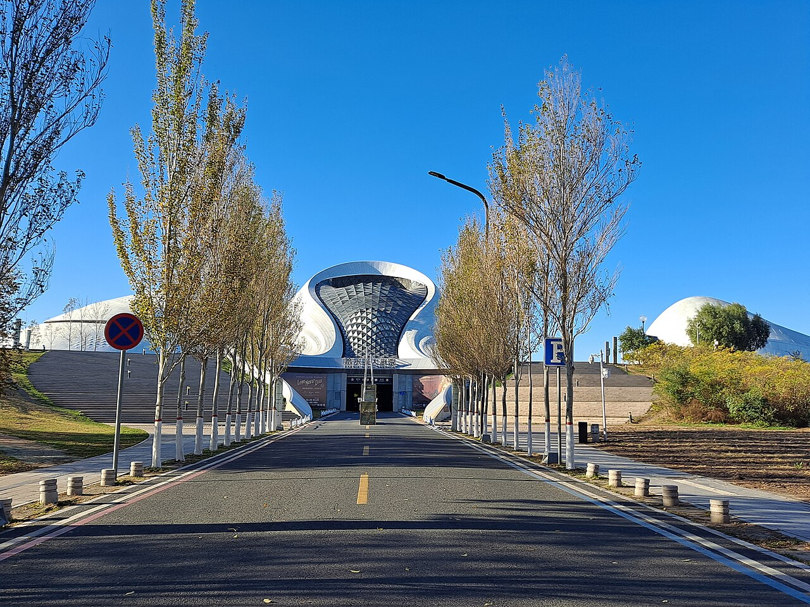

# 09. โรงอุปรากรฮาร์บิน (Harbin Grand Opera House)

* **ชื่อภาษาไทย**: โรงอุปรากรฮาร์บิน
* **ชื่อภาษาจีน**: 哈尔滨大剧院
* **พินอิน**: Hā'ěrbīn Dàjùyuàn
* **ชื่อภาษาอังกฤษ**: Harbin Grand Opera House
* **ประเภท**: สถาปัตยกรรมระดับโลก & ศิลปะ (World Architecture & Performing Arts)
* **ไอคอน**: 🎭

---

## 1. รายละเอียดและจุดเด่น (Description & Highlights)

โรงอุปรากรฮาร์บิน (Harbin Grand Opera House) คือความภาคภูมิใจในฐานะเมืองแห่งดนตรีของยูเนสโก อาคารสีขาวรูปทรงโค้งมนล้ำสมัยตั้งตระหง่านอยู่กลางพื้นที่ชุ่มน้ำทางตอนเหนือของแม่น้ำซงฮัว ในฤดูหนาวอาคารจะกลมกลืนไปกับผืนหิมะรอบข้างอย่างน่าอัศจรรย์ ผู้มาเยือนสามารถเดินขึ้นบันไดวนภายนอกสู่ดาดฟ้าเพื่อชมทิวทัศน์อันกว้างไกลสุดสายตา

* **สรุปจุดเด่นสั้น**:
  * ได้รับรางวัลอาคารวัฒนธรรมยอดเยี่ยมระดับโลก (ArchDaily Building of the Year)
  * ตัวอาคารโค้งมนสีขาวกลมกลืนกับภูมิประเทศหิมะและพื้นที่ชุ่มน้ำแม่น้ำซงฮัว
  * มีบันไดวนภายนอกให้เดินขึ้นสู่จุดชมวิวบนหลังคาชมทัศนียภาพหิมะแบบ 360 องศา

* **ไฮไลท์สำคัญที่ไม่ควรพลาด**:
  * การออกแบบของ Ma Yansong ที่ตั้งใจให้ตัวอาคารเหมือน 'ก้อนหิมะและธารน้ำแข็งที่ลมพัดขึ้นรูป'
  * ภายในแกรนด์เธียเตอร์ใช้วัสดุไม้ธรรมชาติสร้างเสียงสะท้อนอะคูสติกระดับโลก
  * บันไดลอยฟ้าภายนอกอาคารเปิดให้สาธารณชนเดินขึ้นไปชมวิวพื้นที่ชุ่มน้ำที่กลายเป็นทุ่งหิมะสีขาว
  * ได้รับคัดเลือกให้เป็นหนึ่งในโรงละครโอเปร่าที่สวยที่สุดในโลกโดยนิตยสารสถาปัตยกรรมสากล

---

## 2. วิธีการเดินทาง (Transportation)

* **จากสถานีรถไฟฮาร์บิน (Harbin Station)**: ห่างจากสถานีฮาร์บิน 10 กม. นั่ง DiDi ข้ามสะพาน 25-30 หยวน
* **จากสนามบินฮาร์บินไท่ผิง (HRB Airport)**: นั่งรถตู้ 45 นาที
* **การเดินทางภายใน & คำแนะนำพื้นที่**: มีฮอลล์ใหญ่ตกแต่งด้วยไม้แมนจูเรียนแอชดัดโค้ง และคาเฟ่วิวพาโนรามา

---

## 3. เวลาเปิด - ปิด และค่าเข้าชม (Opening Hours & Admission)

* **เวลาเปิดทำการ**: ภายนอกชมได้ตลอด 24 ชม. (ภายในเปิดตามรอบการแสดงและการนำชม 09:00 - 16:30 น.)
* **อัตราค่าเข้าชม**: เดินชมภายนอกและขึ้นดาดฟ้าฟรี (ค่าทัวร์ชมภายในประมาณ 30-50 หยวน)
* **ช่วงเวลาที่แนะนำ**: 15:00 - 17:00 น. (ช่วงแสงอาทิตย์อัสดงสะท้อนแผ่นอะลูมิเนียมสีขาวและหิมะ)

---

## 4. คะแนนความน่าสนใจสำหรับนักท่องเที่ยว (Traveler Rating)

* **คะแนน**: ⭐⭐⭐⭐⭐ (4.9 / 5.0)
* **ความคิดเห็น & บรรยากาศ**: สถาปัตยกรรมระดับโลกทรงคลื่นหิมะสีขาว ออกแบบโดย MAD Architects สวยสง่าดั่งประติมากรรมธรรมชาติกลางหิมะ
* **คีย์เวิร์ดแท็ก**: `โรงอุปรากรฮาร์บิน` · `MAD Architects` · `สถาปัตยกรรมระดับโลก` · `Opera House` · `Modern Landmark`

---

## 5. พิกัดบนแผนที่ (Map Coordinates)

* **พิกัด GPS (AMAP / GCJ-02)**: `45.8115° N, 126.5680° E`
* **คำค้นหาใน Gaode Map (高德地图)**: `哈尔滨大剧院`
* **Google Maps Link**: [คลิกดูแผนที่บน Google Maps](https://maps.google.com/?q=45.8115,126.568)
