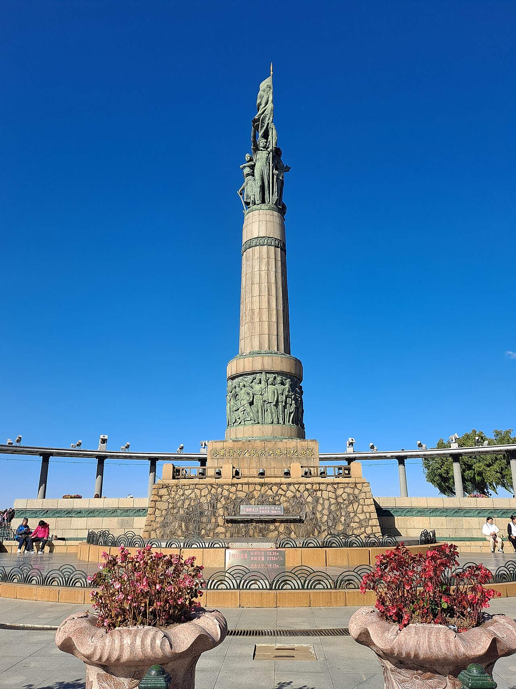

# 10. อนุสาวรีย์ควบคุมอุทกภัย & สวนสตาลิน (Flood Control Monument & Stalin Park)

* **ชื่อภาษาไทย**: อนุสาวรีย์ควบคุมอุทกภัย & สวนสตาลิน
* **ชื่อภาษาจีน**: 防洪纪念塔与斯大林公园
* **พินอิน**: Fánghóng Jìniàntǎ & Sīdàlín Gōngyuán
* **ชื่อภาษาอังกฤษ**: Flood Control Monument & Stalin Park
* **ประเภท**: อนุสรณ์สถาน & สวนริมแม่น้ำ (Monument & Riverside Park)
* **ไอคอน**: 🏛️

---

## 1. รายละเอียดและจุดเด่น (Description & Highlights)

อนุสาวรีย์ควบคุมอุทกภัยแม่น้ำซงฮัว (Harbin Flood Control Monument) ตั้งอยู่อย่างสง่างามที่ปลายสุดของถนนคนเดินจงหยาง โอบล้อมด้วยสวนสาธารณะสตาลิน (Stalin Park) ที่ร่มรื่นด้วยทิวสนรัสเซีย ในฤดูหนาวกิ่งสนจะปกคลุมด้วยหิมะขาวโพลน บริเวณนี้เป็นจุดนัดพบยอดนิยมของชาวเมืองและนักท่องเที่ยวในการชมทัศนียภาพของแม่น้ำซงฮัว

* **สรุปจุดเด่นสั้น**:
  * อนุสาวรีย์หินสูง 22.5 เมตร สร้างขึ้นในปี 1958 รำลึกชัยชนะเหนือน้ำท่วมใหญ่แม่น้ำซงฮัว
  * สวนสาธารณะริมแม่น้ำสไตล์รัสเซีย ทอดยาวกว่า 1.7 กิโลเมตร เต็มไปด้วยต้นสนหิมะ
  * จุดเชื่อมต่อสำคัญระหว่างถนนคนเดินจงหยางกับลานกิจกรรมน้ำแข็งบนแม่น้ำ

* **ไฮไลท์สำคัญที่ไม่ควรพลาด**:
  * สถาปัตยกรรมเสาโรมันกึ่งวงกลมรอบอนุสาวรีย์ สะท้อนความเข้มแข็งของประชาชน
  * เส้นรอบวงฐานอนุสาวรีย์สลักระดับน้ำท่วมประวัติศาสตร์ปี 1932 และ 1957
  * ทิวทัศน์ริมฝั่งแม่น้ำซงฮัวที่กว้างไกล มองเห็นเกาะพระอาทิตย์อยู่ฝั่งตรงข้าม
  * จุดขึ้นกระเช้าลอยฟ้าข้ามแม่น้ำซงฮัวอยู่ใกล้เคียงในบริเวณสวนสตาลิน

---

## 2. วิธีการเดินทาง (Transportation)

* **จากสถานีรถไฟฮาร์บิน (Harbin Station)**: เดินตรงจากถนนคนเดินจงหยางจนสุดทางทิศเหนือ
* **จากสนามบินฮาร์บินไท่ผิง (HRB Airport)**: นั่งรถตู้ 45 นาที
* **การเดินทางภายใน & คำแนะนำพื้นที่**: ทางเดินเลียบแม่น้ำกว้างขวาง มีประติมากรรมน้ำแข็งและม้านั่งพักผ่อน

---

## 3. เวลาเปิด - ปิด และค่าเข้าชม (Opening Hours & Admission)

* **เวลาเปิดทำการ**: เปิดตลอด 24 ชั่วโมง
* **อัตราค่าเข้าชม**: เข้าชมฟรี 100%
* **ช่วงเวลาที่แนะนำ**: 16:00 - 19:00 น. (ช่วงพลบค่ำเมื่อเปิดไฟประดับอนุสาวรีย์ริมแม่น้ำ)

---

## 4. คะแนนความน่าสนใจสำหรับนักท่องเที่ยว (Traveler Rating)

* **คะแนน**: ⭐⭐⭐⭐⭐ (4.8 / 5.0)
* **ความคิดเห็น & บรรยากาศ**: แลนด์มาร์กสำคัญปลายถนนคนเดินจงหยาง สวนสาธารณะสไตล์รัสเซียทิวสนหิมะและทางเดินริมแม่น้ำซงฮัว
* **คีย์เวิร์ดแท็ก**: `อนุสาวรีย์น้ำท่วม` · `สวนสตาลิน` · `แม่น้ำซงฮัว` · `Stalin Park` · `Monument`

---

## 5. พิกัดบนแผนที่ (Map Coordinates)

* **พิกัด GPS (AMAP / GCJ-02)**: `45.7798° N, 126.6178° E`
* **คำค้นหาใน Gaode Map (高德地图)**: `防洪纪念塔与斯大林公园`
* **Google Maps Link**: [คลิกดูแผนที่บน Google Maps](https://maps.google.com/?q=45.7798,126.6178)
