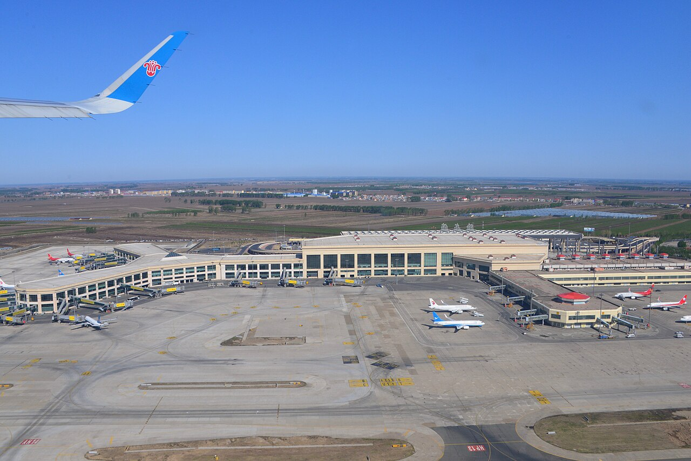

# 11. ท่าอากาศยานนานาชาติฮาร์บินไท่ผิง T2 (Harbin Taiping International Airport T2)

* **ชื่อภาษาไทย**: ท่าอากาศยานนานาชาติฮาร์บินไท่ผิง T2
* **ชื่อภาษาจีน**: 哈尔滨太平国际机场 T2
* **พินอิน**: Hā'ěrbīn Tàipíng Jīchǎng
* **ชื่อภาษาอังกฤษ**: Harbin Taiping International Airport T2
* **ประเภท**: สนามบินนานาชาติ & เกตเวย์ (International Airport & Hub)
* **ไอคอน**: ✈️

---

## 1. รายละเอียดและจุดเด่น (Description & Highlights)

สนามบินนานาชาติฮาร์บินไท่ผิง (Harbin Taiping International Airport - HRB) คือประตูหน้าด่านแรกที่ต้อนรับผู้มาเยือนจากทั่วโลกสู่นครน้ำแข็ง อาคารผู้โดยสาร Terminal 2 มีระบบทำความร้อนที่อบอุ่นและสิ่งอำนวยความสะดวกครบครัน โดยเฉพาะห้องเปลี่ยนเสื้อผ้ากันหนาวเพื่อให้ผู้โดยสารสามารถสวมชุดลองจอนและเสื้อโค้ทหนาก่อนก้าวออกจากอาคาร

* **สรุปจุดเด่นสั้น**:
  * ท่าอากาศยานนานาชาติหลักแห่งเดียวของฮาร์บิน (รหัสสนามบิน: HRB)
  * อาคารผู้โดยสาร T2 ทันสมัย รองรับเที่ยวบินภายในประเทศจีนทั้งหมด
  * มีจุดบริการรถรับส่ง Airport Shuttle Bus และจุดเรียกแท็กซี่ / DiDi เป็นระเบียบ

* **ไฮไลท์สำคัญที่ไม่ควรพลาด**:
  * อาคาร T2 มีห้องเปลี่ยนเครื่องแต่งกายกันหนาว (Changing Rooms) บริเวณสายพานรับกระเป๋า
  * เที่ยวบินต่อเครื่องจากเซี่ยงไฮ้ (PVG) จะลงจอดที่อาคาร T2 นี้โดยตรง
  * มีเคาน์เตอร์แจกแผนที่ท่องเที่ยวและซิมการ์ดบริการแก่นักท่องเที่ยวต่างชาติ
  * ทางด่วนเชื่อมต่อตรงสู่ใจกลางเมืองฮาร์บินอย่างรวดเร็วและปลอดภัย

---

## 2. วิธีการเดินทาง (Transportation)

* **จากสถานีรถไฟฮาร์บิน (Harbin Station)**: ห่างจากสถานีรถไฟฮาร์บินและถนนจงหยาง 38 กม. นั่งรถตู้ VIP ประมาณ 45-50 นาที
* **จากสนามบินฮาร์บินไท่ผิง (HRB Airport)**: จุดเริ่มต้นการเดินทางในทริปนี้
* **การเดินทางภายใน & คำแนะนำพื้นที่**: มีฮีตเตอร์พื้น ห้องเปลี่ยนชุดกันหนาว ร้านอาหารตงเป่ย และร้านจำหน่ายของฝาก

---

## 3. เวลาเปิด - ปิด และค่าเข้าชม (Opening Hours & Admission)

* **เวลาเปิดทำการ**: เปิดบริการตลอด 24 ชั่วโมง
* **อัตราค่าเข้าชม**: เข้าสู่สนามบินฟรี (Airport Bus เข้าเมือง 20 หยวน / แท็กซี่ 100-120 หยวน)
* **ช่วงเวลาที่แนะนำ**: ตามตารางบิน (เที่ยวบินที่เราจองถึง 17:00 น. และขากลับออก 15:10 น.)

---

## 4. คะแนนความน่าสนใจสำหรับนักท่องเที่ยว (Traveler Rating)

* **คะแนน**: ⭐⭐⭐⭐⭐ (4.8 / 5.0)
* **ความคิดเห็น & บรรยากาศ**: ประตูบานใหญ่สู่นครหิมะ จุดที่เที่ยวบินของ China Eastern / Shanghai Airlines ลงจอด สะดวก ทันสมัย มีฮีตเตอร์อุ่น
* **คีย์เวิร์ดแท็ก**: `สนามบินฮาร์บิน` · `ไท่ผิง T2` · `China Eastern` · `Airport` · `HRB`

---

## 5. พิกัดบนแผนที่ (Map Coordinates)

* **พิกัด GPS (AMAP / GCJ-02)**: `45.6234° N, 126.2503° E`
* **คำค้นหาใน Gaode Map (高德地图)**: `哈尔滨太平国际机场 T2`
* **Google Maps Link**: [คลิกดูแผนที่บน Google Maps](https://maps.google.com/?q=45.6234,126.2503)
