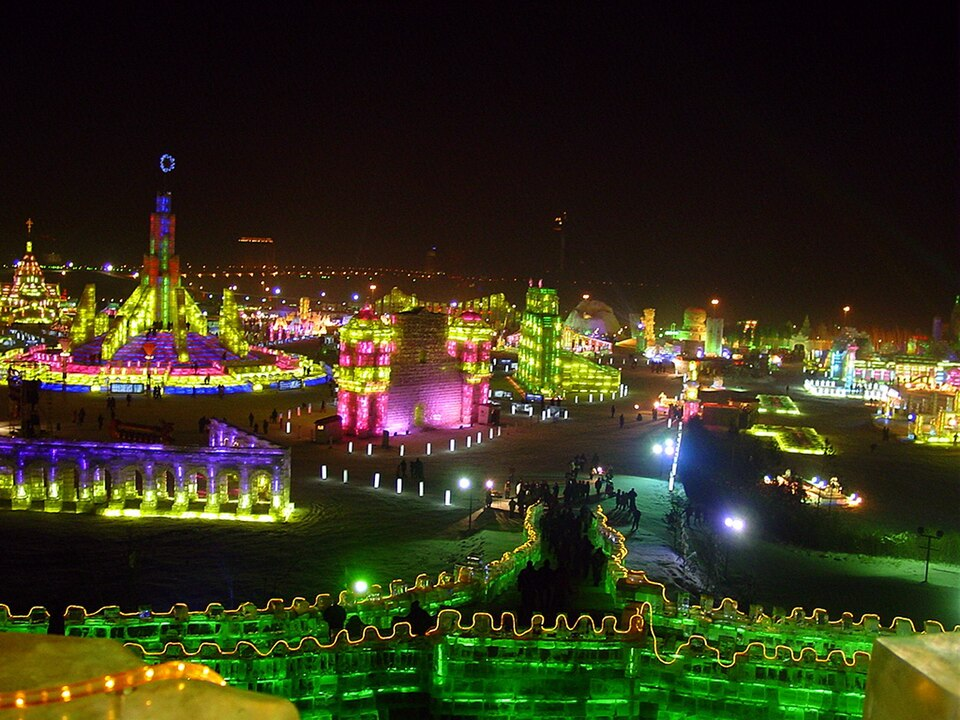

# 12. สวนสนุกน้ำแข็งและหิมะฮาร์บิน (Harbin Ice and Snow World)

* **ชื่อภาษาไทย**: สวนสนุกน้ำแข็งและหิมะฮาร์บิน
* **ชื่อภาษาจีน**: 哈尔滨冰雪大世界
* **พินอิน**: Hā'ěrbīn Bīngxuě Dàshìjiè
* **ชื่อภาษาอังกฤษ**: Harbin Ice and Snow World
* **ประเภท**: เทศกาลน้ำแข็ง & สวนสนุกระดับโลก (Ice & Snow World Park)
* **ไอคอน**: 🏰

---

## 1. รายละเอียดและจุดเด่น (Description & Highlights)

ฮาร์บิน ไอซ์ แอนด์ สโนว์ เวิลด์ (Harbin Ice and Snow World) คือสุดยอดไฮไลท์ระดับโลกที่สร้างชื่อเสียงให้แก่นครฮาร์บิน จัดขึ้นเป็นประจำทุกปีตั้งแต่ปี 1999 บนพื้นที่กว่า 800,000 ตารางเมตร ช่างฝีมือนับหมื่นคนจะตัดก้อนน้ำแข็งยักษ์จากแม่น้ำซงฮัวมาประกอบเป็นปราสาท พระราชวัง และสไลเดอร์น้ำแข็ง ประดับด้วยเทคโนโลยีแสงสีเสียงตระการตา

* **สรุปจุดเด่นสั้น**:
  * นิทรรศการน้ำแข็งแกะสลักกลางแจ้งที่ใหญ่ที่สุดในโลก ใช้ก้อนน้ำแข็งกว่า 250,000 ลบ.ม.
  * ไฮไลท์ระดับตำนาน: สไลเดอร์น้ำแข็งยักษ์ (Super Ice Slide) ความยาวทะลุ 500 เมตร
  * ยามค่ำคืนปราสาทน้ำแข็งจะส่องสว่างด้วยไฟ LED หลากสีสันราวกับดินแดนแห่งเวทมนตร์

* **ไฮไลท์สำคัญที่ไม่ควรพลาด**:
  * ปราสาทน้ำแข็งหลักสูงกว่า 40 เมตร สร้างจากก้อนน้ำแข็งธรรมชาติจากแม่น้ำซงฮัว
  * ชิงช้าสวรรค์ยักษ์ Snowflake Ferris Wheel ชมวิวเมืองน้ำแข็งจากความสูง 120 เมตร
  * การแสดงระบำน้ำแข็งระดับนานาชาติ Harbin Ice Show โดยนักสเก็ตมืออาชีพ
  * *หมายเหตุ: ต้นเดือน ธ.ค. เป็นช่วงเร่งก่อสร้างและตัดน้ำแข็ง หากเปิด Soft Opening สามารถเข้าชมได้ทันที*

---

## 2. วิธีการเดินทาง (Transportation)

* **จากสถานีรถไฟฮาร์บิน (Harbin Station)**: นั่งรถไฟใต้ดิน Metro Line 2 ตรงลงสถานี Bingxuedashijie Station (ทางออก 3)
* **จากสนามบินฮาร์บินไท่ผิง (HRB Airport)**: นั่งรถตู้ประมาณ 40 นาที
* **การเดินทางภายใน & คำแนะนำพื้นที่**: มีโถงพักอุ่นขนาดใหญ่ ร้านฟาสต์ฟู้ด คาเฟ่ และจุดบริการให้เช่าแผ่นแปะร้อน

---

## 3. เวลาเปิด - ปิด และค่าเข้าชม (Opening Hours & Admission)

* **เวลาเปิดทำการ**: 11:00 - 22:00 น. (เปิดไฟประดับ 16:00 น. / ช่วงเปิดทดลองระบบปลาย ธ.ค. - ก.พ.)
* **อัตราค่าเข้าชม**: บัตรเข้าชมประมาณ 328-398 หยวน (~1,640-1,990 บาท)
* **ช่วงเวลาที่แนะนำ**: 15:30 - 19:30 น. (เข้าชมช่วงรอยต่อระหว่างกลางวันและแสงไฟกลางคืน)

---

## 4. คะแนนความน่าสนใจสำหรับนักท่องเที่ยว (Traveler Rating)

* **คะแนน**: ⭐⭐⭐⭐⭐ (4.9 / 5.0)
* **ความคิดเห็น & บรรยากาศ**: อาณาจักรปราสาทและเมืองน้ำแข็งแกะสลักที่ใหญ่ที่สุดในโลก สไลเดอร์น้ำแข็งยาว 500 เมตร ประดับไฟ LED สีสันตระการตา
* **คีย์เวิร์ดแท็ก**: `ไอซ์แอนด์สโนว์เวิลด์` · `ปราสาทน้ำแข็ง` · `สไลเดอร์น้ำแข็ง` · `Ice and Snow World` · `Harbin Festival`

---

## 5. พิกัดบนแผนที่ (Map Coordinates)

* **พิกัด GPS (AMAP / GCJ-02)**: `45.7845° N, 126.5615° E`
* **คำค้นหาใน Gaode Map (高德地图)**: `哈尔滨冰雪大世界`
* **Google Maps Link**: [คลิกดูแผนที่บน Google Maps](https://maps.google.com/?q=45.7845,126.5615)
