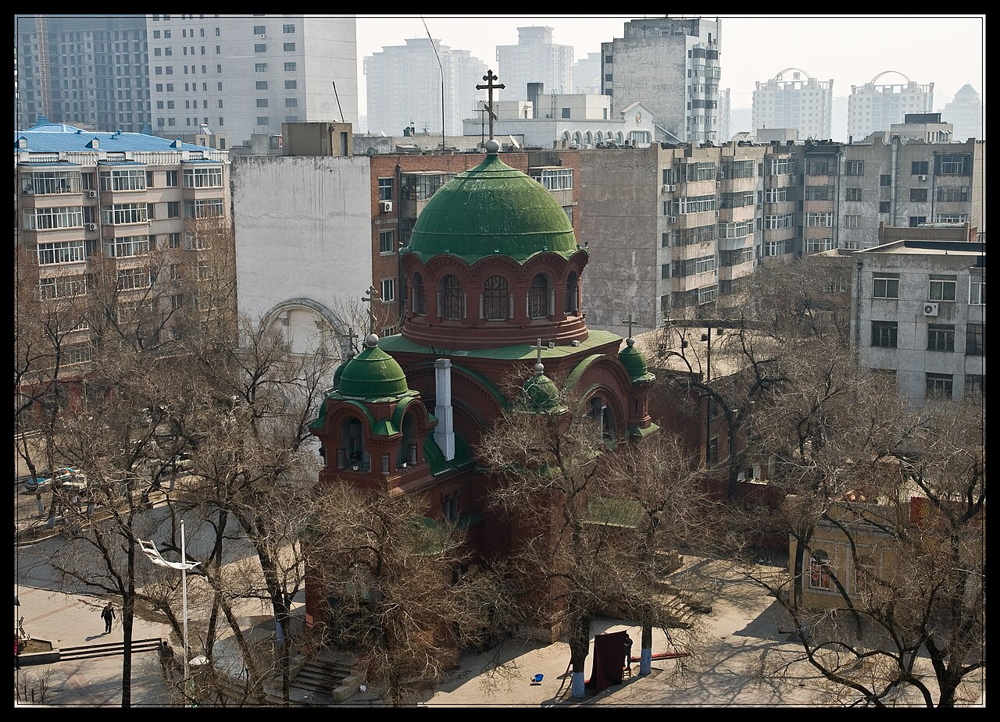

# 13. ถนนกัวโกรี่ & โบสถ์เซนต์อเล็กเซเยฟ (Gogol Street & Saint Alekseyev Church)

* **ชื่อภาษาไทย**: ถนนกัวโกรี่ & โบสถ์เซนต์อเล็กเซเยฟ
* **ชื่อภาษาจีน**: 果戈里大街与圣阿列克谢耶夫教堂
* **พินอิน**: Guǒgēlǐ Dàjiē & Shèng Ālièkèxièyéfū
* **ชื่อภาษาอังกฤษ**: Gogol Street & Saint Alekseyev Church
* **ประเภท**: สถาปัตยกรรมรัสเซีย & โบสถ์บาโรก (Russian Heritage & Baroque Church)
* **ไอคอน**: ⛪

---

## 1. รายละเอียดและจุดเด่น (Description & Highlights)

ถนนกัวโกรี่ (Gogol Street) เป็นถนนประวัติศาสตร์ที่สะท้อนอิทธิพลของวัฒนธรรมและวรรณกรรมรัสเซียในฮาร์บินอย่างลึกซึ้ง ไฮไลท์เด่นคือโบสถ์เซนต์อเล็กเซเยฟ โบสถ์สีแดงชาดที่มีสถาปัตยกรรมบาโรกอันวิจิตรงดงาม และร้านหนังสือ Gogol Bookstore ที่บรรยากาศอบอุ่น เหมาะแก่การแวะพักจิบชากาแฟท่ามกลางลมหนาว

* **สรุปจุดเด่นสั้น**:
  * ถนนเก่าแก่ตั้งแต่ปี 1901 ตั้งชื่อเพื่อเป็นเกียรติแก่นักประพันธ์ชื่อดังชาวรัสเซีย 'นิโคไล กัวโกรี่'
  * โบสถ์เซนต์อเล็กเซเยฟ สถาปัตยกรรมบาโรก-รัสเซียสีแดงชาด ยอดโดมเต็นท์สวยงาม
  * แวะร้านหนังสือ Gogol Bookstore ร้านหนังสือสไตล์ยุโรปคลาสสิกที่สวยติดอันดับต้นๆ ของจีน

* **ไฮไลท์สำคัญที่ไม่ควรพลาด**:
  * โบสถ์เซนต์อเล็กเซเยฟ (革新街教堂) สีแดงชาดสดใส เป็นโบสถ์ที่ยังคงเปิดประกอบพิธีกรรมทางศาสนา
  * ร้านหนังสือ Gogol Bookstore ตกแต่งด้วยโคมไฟแชนเดอเลียร์ไม้คลาสสิกและเปียโนโบราณ
  * ชิมขนมปังรัสเซีย 'ชิวหลินต้าเลี่ยปา' (Qiulin Lieba) ร้านต้นตำรับเก่าแก่กว่า 100 ปี
  * สัมผัสวิถีชีวิตผู้คนท้องถิ่นในย่านที่พักอาศัยสไตล์รัสเซียที่ยังคงรักษากลิ่นอายเดิมไว้อย่างดี

---

## 2. วิธีการเดินทาง (Transportation)

* **จากสถานีรถไฟฮาร์บิน (Harbin Station)**: ห่างจากสถานีฮาร์บิน 2.5 กม. รถไฟใต้ดิน Line 1 ลงสถานี Yidaeryuan หรือ DiDi 10 หยวน
* **จากสนามบินฮาร์บินไท่ผิง (HRB Airport)**: นั่งรถตู้ 45 นาที
* **การเดินทางภายใน & คำแนะนำพื้นที่**: มีร้านกาแฟ ร้านขนมปังรัสเซีย และร้านขายของโบราณสองข้างทาง

---

## 3. เวลาเปิด - ปิด และค่าเข้าชม (Opening Hours & Admission)

* **เวลาเปิดทำการ**: ถนนและจัตุรัสเปิด 24 ชม. (โบสถ์และร้านหนังสือเปิด 09:00 - 20:30 น.)
* **อัตราค่าเข้าชม**: เข้าชมฟรี
* **ช่วงเวลาที่แนะนำ**: 14:30 - 18:00 น. (เดินชมสถาปัตยกรรม แวะจิบกาแฟในร้านหนังสือ)

---

## 4. คะแนนความน่าสนใจสำหรับนักท่องเที่ยว (Traveler Rating)

* **คะแนน**: ⭐⭐⭐⭐☆ (4.7 / 5.0)
* **ความคิดเห็น & บรรยากาศ**: ถนนการค้าเก่าแก่สไตล์รัสเซีย โบสถ์คาทอลิกสไตล์บาโรกสีแดงสด ร้านหนังสือรัสเซียที่มีชื่อเสียงที่สุดในฮาร์บิน
* **คีย์เวิร์ดแท็ก**: `ถนนกัวโกรี่` · `โบสถ์เซนต์อเล็กเซเยฟ` · `ร้านหนังสือรัสเซีย` · `Gogol Street` · `Alekseyev`

---

## 5. พิกัดบนแผนที่ (Map Coordinates)

* **พิกัด GPS (AMAP / GCJ-02)**: `45.7485° N, 126.6480° E`
* **คำค้นหาใน Gaode Map (高德地图)**: `果戈里大街与圣阿列克谢耶夫教堂`
* **Google Maps Link**: [คลิกดูแผนที่บน Google Maps](https://maps.google.com/?q=45.7485,126.648)
