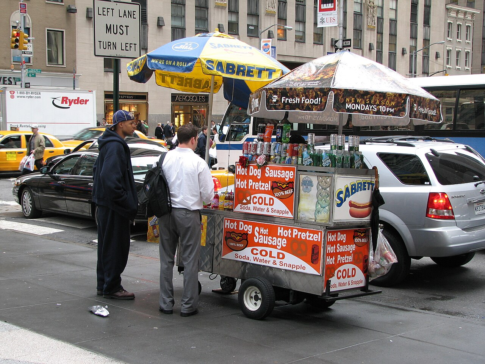

# 15. ตลาดเช้าหงจวน (Hongzhuan Morning Market)

* **ชื่อภาษาไทย**: ตลาดเช้าหงจวน
* **ชื่อภาษาจีน**: 红专街早市
* **พินอิน**: Hóngzhuān Jiē Zǎoshì
* **ชื่อภาษาอังกฤษ**: Hongzhuan Morning Market
* **ประเภท**: ตลาดเช้า & สตรีทฟู้ดตงเป่ย (Morning Market & Street Food)
* **ไอคอน**: 🥟

---

## 1. รายละเอียดและจุดเด่น (Description & Highlights)

ตลาดเช้าหงจวน (Hongzhuan Morning Market) คือสถานที่สัมผัสจิตวิญญาณแห่งชีวิตยามเช้าของชาวฮาร์บินอย่างแท้จริง ในขณะที่อากาศภายนอกหนาวเหน็บติดลบ ไอควันสีขาวจากหม้อนึ่งซาลาเปา กระทะทอดเกี๊ยว และหม้อต้มซุปเนื้อวัวจะพวยพุ่งขึ้นสู่อากาศสร้างบรรยากาศที่มีเสน่ห์ อาหารทุกอย่างทำสดใหม่ ร้อนกรุ่น และราคาสบายกระเป๋า

* **สรุปจุดเด่นสั้น**:
  * ตลาดเช้าพื้นเมืองแท้ๆ อายุกว่าหลายทศวรรษ ตั้งอยู่ใจกลางเมืองใกล้ถนนจงหยาง
  * สัมผัสภาพชีวิตจริงสุดคึกคัก: ไอควันจากเตานึ่งพวยพุ่งปะทะอากาศติดลบ -15°C
  * ชิมเมนูเด็ด: ซาลาเปาทอด (Shuijianbao), ขนมไข่เบอร์เกอร์ (Danbaorou), เกี๊ยวตงเป่ย

* **ไฮไลท์สำคัญที่ไม่ควรพลาด**:
  * ขนมปังอบกรอบ 'โหยวเถียว' จิ้มน้ำเต้าหู้ร้อนๆ สูตรถั่วเหลืองตงเป่ยแท้
  * ผลไม้เคลือบน้ำตาลแช่แข็งตามธรรมชาติ (ถังหูลู่ - Tanghulu) เย็นกรอบหวานฉ่ำ
  * ปลาแช่แข็งธรรมชาติวางเรียงรายขายบนแผงโดยไม่ต้องใช้ตู้เย็น
  * สัมผัสความอบอุ่นและอัธยาศัยไมตรีของชาวตงเป่ยอย่างแท้จริง

---

## 2. วิธีการเดินทาง (Transportation)

* **จากสถานีรถไฟฮาร์บิน (Harbin Station)**: ห่างจากสถานีฮาร์บิน 1.5 กม. เดินจากโรงแรมย่านถนนจงหยางเพียง 5-10 นาที
* **จากสนามบินฮาร์บินไท่ผิง (HRB Airport)**: นั่งรถตู้ 45 นาที
* **การเดินทางภายใน & คำแนะนำพื้นที่**: ถนนคนเดินแคบๆ อัดแน่นด้วยแผงลอยสองข้างทาง สวมรองเท้ากันลื่น

---

## 3. เวลาเปิด - ปิด และค่าเข้าชม (Opening Hours & Admission)

* **เวลาเปิดทำการ**: ทุกวัน 05:30 - 09:00 น. (ตลาดวายประมาณ 09:00 น.)
* **อัตราค่าเข้าชม**: เข้าชมฟรี (อาหารชิ้นละ 2 - 10 หยวน อิ่มอร่อยราคาประหยัดมาก)
* **ช่วงเวลาที่แนะนำ**: 06:30 - 08:00 น. (ช่วงของสดใหม่ ควันพวยพุ่ง บรรยากาศคึกคักที่สุด)

---

## 4. คะแนนความน่าสนใจสำหรับนักท่องเที่ยว (Traveler Rating)

* **คะแนน**: ⭐⭐⭐⭐⭐ (4.8 / 5.0)
* **ความคิดเห็น & บรรยากาศ**: ตลาดเช้าสตรีทฟู้ดอันดับ 1 ของฮาร์บิน สัมผัสไอควันสีขาวพวยพุ่งในอุณหภูมิติดลบ ชิมเกี๊ยวทอด ซาลาเปาร้อนๆ ขนมกล้วยทอด
* **คีย์เวิร์ดแท็ก**: `ตลาดเช้าหงจวน` · `สตรีทฟู้ดฮาร์บิน` · `เกี๊ยวซ่า` · `Hongzhuan Market` · `Breakfast`

---

## 5. พิกัดบนแผนที่ (Map Coordinates)

* **พิกัด GPS (AMAP / GCJ-02)**: `45.7710° N, 126.6190° E`
* **คำค้นหาใน Gaode Map (高德地图)**: `红专街早市`
* **Google Maps Link**: [คลิกดูแผนที่บน Google Maps](https://maps.google.com/?q=45.771,126.619)
