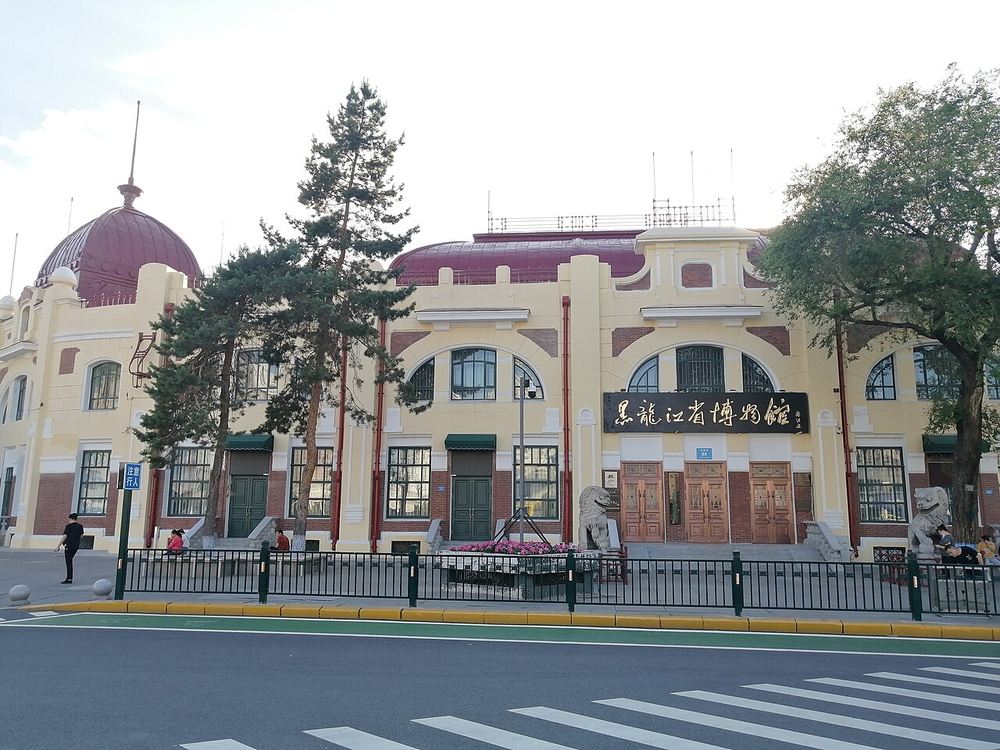

# 16. พิพิธภัณฑ์มณฑลเฮยหลงเจียง (Heilongjiang Provincial Museum)

* **ชื่อภาษาไทย**: พิพิธภัณฑ์มณฑลเฮยหลงเจียง
* **ชื่อภาษาจีน**: 黑龙江省博物馆
* **พินอิน**: Hēilóngjiāng Shěng Bówùguǎn
* **ชื่อภาษาอังกฤษ**: Heilongjiang Provincial Museum
* **ประเภท**: พิพิธภัณฑ์ & ประวัติศาสตร์ (Museum & Provincial History)
* **ไอคอน**: 🏛️

---

## 1. รายละเอียดและจุดเด่น (Description & Highlights)

พิพิธภัณฑ์มณฑลเฮยหลงเจียง (Heilongjiang Provincial Museum) ตั้งอยู่ ณ จัตุรัสพิพิธภัณฑ์ใจกลางเมือง ตัวอาคารเป็นสถาปัตยกรรมบาโรกของรัสเซียที่มีเอกลักษณ์ ภายในจัดแสดงโบราณวัตถุและฟอสซิลสิ่งมีชีวิตยุคน้ำแข็ง โดยเฉพาะโครงกระดูกช้างแมมมอธที่สร้างความตื่นตาตื่นใจแก่ผู้เข้าชม เป็นสถานที่หลบหนาวและเรียนรู้ประวัติศาสตร์ที่ยอดเยี่ยม

* **สรุปจุดเด่นสั้น**:
  * อาคารเก่าแก่สไตล์บาโรกสีเหลืองมัสตาร์ด สร้างขึ้นตั้งแต่ปี 1904 ในอดีตคือห้างค้ามอสโก
  * ไฮไลท์ระดับโลก: ฟอสซิลโครงกระดูก 'ช้างแมมมอธไซบีเรีย' ที่สมบูรณ์ที่สุดในเอเชีย
  * จัดแสดงประวัติศาสตร์ชนเผ่าเร่ร่อนทางเหนือและอารยธรรมราชวงศ์จินโบราณ

* **ไฮไลท์สำคัญที่ไม่ควรพลาด**:
  * โครงกระดูกช้างแมมมอธยักษ์ความสูงกว่า 4.5 เมตร ขุดพบในพื้นที่ทุ่งน้ำแข็งเฮยหลงเจียง
  * ฟอสซิลกวางยักษ์ดึกดำบรรพ์ (Megaloceros) ยุคน้ำแข็ง
  * มังกรทองคำสัมฤทธิ์โบราณ (Gold Plated Dragon) มรดกทางวัฒนธรรมชั้นเอกของราชวงศ์จิน
  * สถาปัตยกรรมภายนอกอาคารสีเหลืองตัดกับหิมะขาว เป็นจุดถ่ายภาพที่สวยคลาสสิกมาก

---

## 2. วิธีการเดินทาง (Transportation)

* **จากสถานีรถไฟฮาร์บิน (Harbin Station)**: ห่างจากสถานีฮาร์บินเพียง 800 เมตร รถไฟใต้ดิน Line 1 ลงสถานี Bowuguan Station
* **จากสนามบินฮาร์บินไท่ผิง (HRB Airport)**: นั่งรถตู้ 45 นาที
* **การเดินทางภายใน & คำแนะนำพื้นที่**: มีระบบฮีตเตอร์อุ่นสบาย ตู้ฝากสัมภาระ และคำบรรยายภาษาอังกฤษ

---

## 3. เวลาเปิด - ปิด และค่าเข้าชม (Opening Hours & Admission)

* **เวลาเปิดทำการ**: อังคาร - อาทิตย์ 09:00 - 16:30 น. (ปิดวันจันทร์)
* **อัตราค่าเข้าชม**: เข้าชมฟรี (แสดงหนังสือเดินทาง Passport ที่เคาน์เตอร์)
* **ช่วงเวลาที่แนะนำ**: 10:00 - 12:00 น. หรือ 13:30 - 15:30 น.

---

## 4. คะแนนความน่าสนใจสำหรับนักท่องเที่ยว (Traveler Rating)

* **คะแนน**: ⭐⭐⭐⭐☆ (4.7 / 5.0)
* **ความคิดเห็น & บรรยากาศ**: ตึกสถาปัตยกรรมบาโรกยุโรปสีเหลืองมัสตาร์ด จัดแสดงฟอสซิลช้างแมมมอธไซบีเรียสมบูรณ์แบบและโบราณวัตถุราชวงศ์จิน
* **คีย์เวิร์ดแท็ก**: `พิพิธภัณฑ์เฮยหลงเจียง` · `แมมมอธ` · `ประวัติศาสตร์` · `Museum` · `Heilongjiang`

---

## 5. พิกัดบนแผนที่ (Map Coordinates)

* **พิกัด GPS (AMAP / GCJ-02)**: `45.7565° N, 126.6385° E`
* **คำค้นหาใน Gaode Map (高德地图)**: `黑龙江省博物馆`
* **Google Maps Link**: [คลิกดูแผนที่บน Google Maps](https://maps.google.com/?q=45.7565,126.6385)
