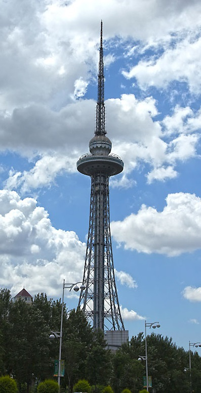

# 17. หอคอยมังกรหลงถ่า (Dragon Tower (Long Ta))

* **ชื่อภาษาไทย**: หอคอยมังกรหลงถ่า
* **ชื่อภาษาจีน**: 龙塔 (黑龙江省广播电视塔)
* **พินอิน**: Lóng Tǎ (Dragon Tower)
* **ชื่อภาษาอังกฤษ**: Dragon Tower (Long Ta)
* **ประเภท**: หอคอยชมเมือง & วิวมุมสูง (Observation Tower & City View)
* **ไอคอน**: 🗼

---

## 1. รายละเอียดและจุดเด่น (Description & Highlights)

หอคอยมังกร หรือ 'หลงถ่า' (Dragon Tower) เป็นแลนด์มาร์กสมัยใหม่ที่สำคัญของฮาร์บิน ด้วยความสูงถึง 336 เมตร ทำให้เป็นจุดชมวิวมุมสูงที่ดีที่สุดของเมือง นักท่องเที่ยวสามารถขึ้นลิฟต์ความเร็วสูงสู่ชั้นชมวิว ท้าความกล้าบนทางเดินพื้นกระจกใส และรับประทานอาหารในภัตตาคารหมุนชมแสงไฟเมืองหิมะระยิบระยับ

* **สรุปจุดเด่นสั้น**:
  * หอคอยส่งสัญญาณโทรทัศน์โครงสร้างเหล็กอิสระที่สูงเป็นอันดับ 2 ของโลก (336 เมตร)
  * ทางเดินพื้นกระจกใสลอยฟ้ากลางแจ้ง (Glass Skywalk) ท้าทายความกล้าที่ระดับความสูง 181 เมตร
  * จุดชมวิวมุมสูงมองเห็นผังเมืองฮาร์บินที่ปกคลุมด้วยหิมะขาวกว้างไกลสุดสายตา

* **ไฮไลท์สำคัญที่ไม่ควรพลาด**:
  * ทางเดินกระจกใสกลางแจ้งระยะทาง 181 เมตร ให้ความรู้สึกเหมือนกำลังเดินอยู่บนท้องฟ้า
  * ภัตตาคารหมุนลอยฟ้า (Revolving Restaurant) หมุนรอบตัวเมือง 360 องศาใน 1 ชั่วโมง
  * กล้องส่องทางไกลกำลังขยายสูงมองเห็นแม่น้ำซงฮัวและโบสถ์เซนต์โซเฟีย
  * มีนิทรรศการวัฒนธรรมมังกรจีนโบราณและงานศิลปะพื้นบ้านภายในหอคอย

---

## 2. วิธีการเดินทาง (Transportation)

* **จากสถานีรถไฟฮาร์บิน (Harbin Station)**: ห่างจากสถานีฮาร์บิน 5 กม. นั่ง DiDi ประมาณ 15 หยวน
* **จากสนามบินฮาร์บินไท่ผิง (HRB Airport)**: นั่งรถตู้ 50 นาที
* **การเดินทางภายใน & คำแนะนำพื้นที่**: มีลิฟต์ความเร็วสูง ภัตตาคารหมุน และนิทรรศการมังกรจีน

---

## 3. เวลาเปิด - ปิด และค่าเข้าชม (Opening Hours & Admission)

* **เวลาเปิดทำการ**: ทุกวัน 09:00 - 18:00 น. (รอบสุดท้าย 17:00 น.)
* **อัตราค่าเข้าชม**: ค่าขึ้นชมหอคอยประมาณ 120-150 หยวน (~600-750 บาท)
* **ช่วงเวลาที่แนะนำ**: 15:00 - 17:00 น. (ชมวิวพระอาทิตย์ตกดินและแสงไฟเมืองยามค่ำ)

---

## 4. คะแนนความน่าสนใจสำหรับนักท่องเที่ยว (Traveler Rating)

* **คะแนน**: ⭐⭐⭐⭐☆ (4.7 / 5.0)
* **ความคิดเห็น & บรรยากาศ**: หอส่งสัญญาณโทรทัศน์โครงสร้างเหล็กสูง 336 เมตร มีทางเดินพื้นกระจกลอยฟ้ารอบหอคอยชมเมืองหิมะ 360 องศา
* **คีย์เวิร์ดแท็ก**: `หอคอยมังกร` · `หลงถ่า` · `Dragon Tower` · `วิวมุมสูง` · `Skywalk`

---

## 5. พิกัดบนแผนที่ (Map Coordinates)

* **พิกัด GPS (AMAP / GCJ-02)**: `45.7480° N, 126.6780° E`
* **คำค้นหาใน Gaode Map (高德地图)**: `龙塔 (黑龙江省广播电视塔)`
* **Google Maps Link**: [คลิกดูแผนที่บน Google Maps](https://maps.google.com/?q=45.748,126.678)
