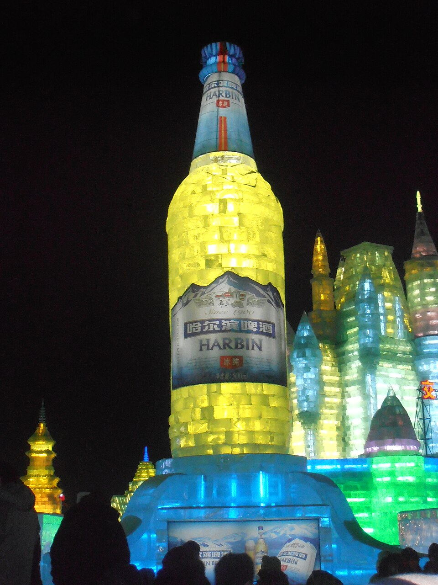

# 18. พิพิธภัณฑ์เบียร์ฮาร์บิน (Harbin Beer Museum)

* **ชื่อภาษาไทย**: พิพิธภัณฑ์เบียร์ฮาร์บิน
* **ชื่อภาษาจีน**: 哈尔滨啤酒博物馆
* **พินอิน**: Hā'ěrbīn Píjiǔ Bówùguǎn
* **ชื่อภาษาอังกฤษ**: Harbin Beer Museum
* **ประเภท**: วัฒนธรรม & ตำนานเบียร์ร้อยปี (Brewery Heritage & Culture)
* **ไอคอน**: 🍺

---

## 1. รายละเอียดและจุดเด่น (Description & Highlights)

พิพิธภัณฑ์เบียร์ฮาร์บิน (Harbin Beer Museum) บอกเล่าเรื่องราวความผูกพันระหว่างเมืองฮาร์บินกับวัฒนธรรมเบียร์ที่มีมายาวนานกว่า 120 ปี ที่นี่เป็นจุดกำเนิดของเบียร์ขวดแรกในประเทศจีน ภายในจัดแสดงนิทรรศการมัลติมีเดียอันทันสมัย ควบคู่กับประวัติศาสตร์ยุคบุกเบิก และปิดท้ายด้วยการชิมเบียร์สดแสนอร่อย

* **สรุปจุดเด่นสั้น**:
  * แหล่งกำเนิด 'เบียร์ฮาร์บิน' แบรนด์เบียร์ที่เก่าแก่ที่สุดในประวัติศาสตร์จีน (ก่อตั้งปี 1900)
  * พิพิธภัณฑ์เบียร์ขนาดใหญ่ที่สุดในจีน จัดแสดงสายการผลิตโบราณและเทคโนโลยีทันสมัย
  * รวมสิทธิ์ชิมเบียร์สดต้นตำรับกลั่นใหม่ฟรี (Fresh Draft Beer Tasting)

* **ไฮไลท์สำคัญที่ไม่ควรพลาด**:
  * ก่อตั้งขึ้นโดยนายวาเบลฟสกี (Jan Wróblewski) พ่อค้าชาวโปแลนด์-รัสเซียเพื่อรองรับคนงานรถไฟ
  * ชมรถไฟโบราณจำลองยุค 1900 บาร์รัสเซียโบราณ และถังหมักเบียร์ทองแดงขนาดยักษ์
  * มีโรงภาพยนตร์ 4D เสมือนจริงพานักท่องเที่ยวจำลองการเดินทางไปกับฟองเบียร์
  * ชิมเบียร์สดที่ยังไม่ผ่านการกรอง (Unfiltered White Beer) รสชาตินุ่มละมุน หอมกลิ่นมอลต์

---

## 2. วิธีการเดินทาง (Transportation)

* **จากสถานีรถไฟฮาร์บิน (Harbin Station)**: ห่างจากสถานีฮาร์บิน 18 กม. นั่งรถตู้ VIP หรือ DiDi 40-50 หยวน
* **จากสนามบินฮาร์บินไท่ผิง (HRB Airport)**: นั่งรถตู้ 35 นาที
* **การเดินทางภายใน & คำแนะนำพื้นที่**: อาคารติดแอร์/ฮีตเตอร์ทันสมัย มีบาร์เบียร์สด และโรงภาพยนตร์ 4D

---

## 3. เวลาเปิด - ปิด และค่าเข้าชม (Opening Hours & Admission)

* **เวลาเปิดทำการ**: อังคาร - อาทิตย์ 09:00 - 17:00 น. (ปิดวันจันทร์)
* **อัตราค่าเข้าชม**: บัตรเข้าชมรวมชิมเบียร์สด 50 หยวน (~250 บาท)
* **ช่วงเวลาที่แนะนำ**: 13:30 - 16:00 น. (ช่วงบ่าย ชิมเบียร์สดคู่กับของว่างอุ่นๆ)

---

## 4. คะแนนความน่าสนใจสำหรับนักท่องเที่ยว (Traveler Rating)

* **คะแนน**: ⭐⭐⭐⭐⭐ (4.8 / 5.0)
* **ความคิดเห็น & บรรยากาศ**: ต้นกำเนิดเบียร์แบรนด์แรกของประเทศจีนตั้งแต่ปี 1900 โดยชาวรัสเซีย ชมประวัติศาสตร์และชิมเบียร์สดกลั่นใหม่รสเลิศ
* **คีย์เวิร์ดแท็ก**: `เบียร์ฮาร์บิน` · `พิพิธภัณฑ์เบียร์` · `โรงเบียร์1900` · `Harbin Beer` · `Brewery`

---

## 5. พิกัดบนแผนที่ (Map Coordinates)

* **พิกัด GPS (AMAP / GCJ-02)**: `45.5890° N, 126.7020° E`
* **คำค้นหาใน Gaode Map (高德地图)**: `哈尔滨啤酒博物馆`
* **Google Maps Link**: [คลิกดูแผนที่บน Google Maps](https://maps.google.com/?q=45.589,126.702)
