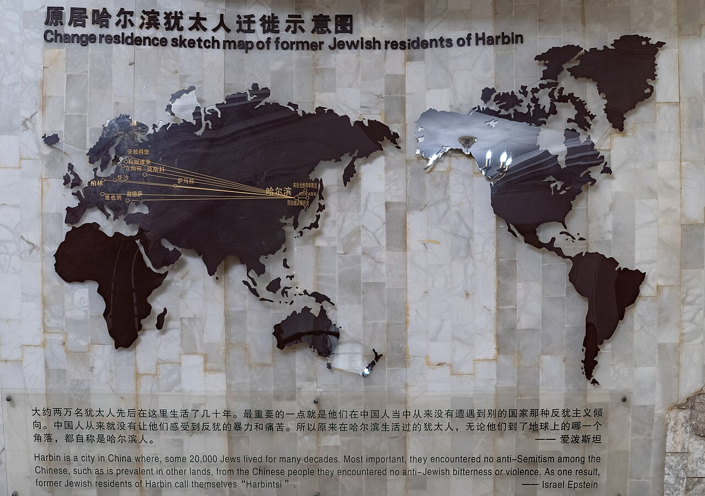

# 19. สวนดนตรีฮาร์บิน & โบสถ์ยิวโบราณ (Harbin Music Park & Jewish New Synagogue)

* **ชื่อภาษาไทย**: สวนดนตรีฮาร์บิน & โบสถ์ยิวโบราณ
* **ชื่อภาษาจีน**: 音乐公园与哈尔滨犹太总会堂
* **พินอิน**: Yīnyuè Gōngyuán & Yóutài Zǒnghuìtáng
* **ชื่อภาษาอังกฤษ**: Harbin Music Park & Jewish New Synagogue
* **ประเภท**: เมืองแห่งดนตรี & ประวัติศาสตร์ชาวยิว (City of Music & Jewish Heritage)
* **ไอคอน**: 🎻

---

## 1. รายละเอียดและจุดเด่น (Description & Highlights)

สวนดนตรีฮาร์บิน (Harbin Music Park) ตั้งอยู่ริมฝั่งใต้ของแม่น้ำซงฮัว เพื่อเฉลิมฉลองการได้รับการยกย่องจาก UNESCO ให้เป็น 'เมืองแห่งดนตรี' (City of Music) ในช่วงฤดูหนาว ที่นี่จะกลายเป็นบ้านของ 'ตุ๊กตาหิมะยักษ์' ที่มีชื่อเสียงโด่งดังไปทั่วโลก พร้อมทั้งเชื่อมโยงกับโบสถ์ยิวโบราณที่สะท้อนประวัติศาสตร์อันหลากหลายทางวัฒนธรรมของฮาร์บิน

* **สรุปจุดเด่นสั้น**:
  * ประติมากรรมตุ๊กตาหิมะยักษ์ (Giant Snowman) สูง 18 เมตร แลนด์มาร์กถ่ายรูปไวรัลประจำฤดูหนาว
  * สวนสาธารณะริมแม่น้ำซงฮัวที่ออกแบบตามธีมดนตรีคลาสสิก ฉลองเมืองแห่งดนตรียูเนสโก
  * โบสถ์ยิวฮาร์บิน (New Synagogue) อาคารประวัติศาสตร์ของชุมชนชาวยิวกว่า 20,000 คนในอดีต

* **ไฮไลท์สำคัญที่ไม่ควรพลาด**:
  * ตุ๊กตาหิมะยักษ์ตัวอ้วนกลมสวมหมวกและผ้าพันคอสีแดง เป็นสัญลักษณ์ต้อนรับฤดูหนาวที่ทุกคนต้องแวะถ่ายรูป
  * ทางเดินประดับด้วยประติมากรรมเครื่องดนตรีคลาสสิก อาทิ ไวโอลิน ฮาร์ป และโน้ตดนตรี
  * โบสถ์ยิวฮาร์บิน (Harbin Jewish New Synagogue) จัดแสดงเรื่องราวของชาวยิวในฮาร์บินที่มีบทบาททางดนตรี
  * มองเห็นพระอาทิตย์ตกดินเหนือแม่น้ำซงฮัวในบรรยากาศเงียบสงบและโรแมนติก

---

## 2. วิธีการเดินทาง (Transportation)

* **จากสถานีรถไฟฮาร์บิน (Harbin Station)**: ห่างจากสถานีฮาร์บิน 4.5 กม. นั่ง DiDi 12-15 หยวน
* **จากสนามบินฮาร์บินไท่ผิง (HRB Airport)**: นั่งรถตู้ 40 นาที
* **การเดินทางภายใน & คำแนะนำพื้นที่**: ทางเดินเลียบแม่น้ำกว้างขวาง ลานประติมากรรมหิมะ และม้านั่งพักผ่อน

---

## 3. เวลาเปิด - ปิด และค่าเข้าชม (Opening Hours & Admission)

* **เวลาเปิดทำการ**: สวนสาธารณะเปิด 24 ชม. (พิพิธภัณฑ์ประวัติศาสตร์ชาวยิวเปิด 09:00 - 17:00 น.)
* **อัตราค่าเข้าชม**: สวนดนตรีและถ่ายรูปตุ๊กตาหิมะฟรี (พิพิธภัณฑ์ประวัติศาสตร์ชาวยิว 25 หยวน)
* **ช่วงเวลาที่แนะนำ**: 14:00 - 16:30 น. (ถ่ายรูปคู่ตุ๊กตาหิมะยักษ์ แสงแดดสะท้อนหิมะอบอุ่น)

---

## 4. คะแนนความน่าสนใจสำหรับนักท่องเที่ยว (Traveler Rating)

* **คะแนน**: ⭐⭐⭐⭐⭐ (4.8 / 5.0)
* **ความคิดเห็น & บรรยากาศ**: แลนด์มาร์กริมแม่น้ำซงฮัว เมืองแห่งดนตรีของ UNESCO ประติมากรรมตุ๊กตาหิมะยักษ์ริมแม่น้ำ และโบสถ์ยิวโบราณที่ใหญ่ที่สุดในจีน
* **คีย์เวิร์ดแท็ก**: `สวนดนตรี` · `ตุ๊กตาหิมะยักษ์` · `โบสถ์ยิว` · `City of Music` · `Giant Snowman`

---

## 5. พิกัดบนแผนที่ (Map Coordinates)

* **พิกัด GPS (AMAP / GCJ-02)**: `45.7610° N, 126.5780° E`
* **คำค้นหาใน Gaode Map (高德地图)**: `音乐公园与哈尔滨犹太总会堂`
* **Google Maps Link**: [คลิกดูแผนที่บน Google Maps](https://maps.google.com/?q=45.761,126.578)
