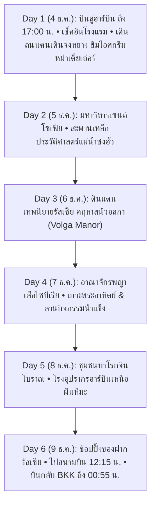

# แผนที่ 5: มนต์เสน่ห์นครน้ำแข็งฮาร์บิน & เทพนิยายรัสเซีย (Harbin Winter Romance & Russian Fairy Tale)

> **รูปแบบการท่องเที่ยว**: สโลว์ไลฟ์ พักผ่อนสบายๆ ไม่เร่งรีบ (จำกัดสถานที่ไฮไลท์ไม่เกิน 1 – 2 แห่งต่อวัน)  
> **ช่วงเวลาเดินทาง**: 4 – 9 ธันวาคม 2026 (6 วัน 5 คืน)  
> **สถานะ**: ✅ **ยืนยันการจองตั๋วเครื่องบินเรียบร้อยแล้ว (Confirmed Flight via Trip.com)**  
> **ภูมิภาค**: นครฮาร์บิน (Harbin - 哈尔滨) มณฑลเฮยหลงเจียง (Heilongjiang) สาธารณรัฐประชาชนจีน  
> **จัดทำโดย**: บัง (นักจัดทริปผู้เชี่ยวชาญท่องเที่ยวจีน)

---

## ✈️ รายละเอียดเที่ยวบินที่จองจริง (Confirmed Flight Details)

จองผ่าน Trip.com (หมายเลขการจอง: `1622932337344364`)  
สายการบิน **China Eastern Airlines / Shanghai Airlines**  
*ยอดชำระตั๋วเครื่องบินรวม 2 ท่าน: 25,770 บาท (เฉลี่ยท่านละ 12,885 บาท รวมโหลดสัมภาระเรียบร้อย ไม่ต้องรับกระเป๋าตอนต่อเครื่อง)*

```text
┌────────────────────────────────────────────────────────────────────────────────────────┐
│ 🛫 เที่ยวบินขาไป: วันศุกร์ที่ 4 ธันวาคม 2026 (รวมเวลา 10 ชม. 55 นาที)                      │
│    • 05:05 น. กรุงเทพฯ สุวรรณภูมิ (BKK) ➔ 10:20 น. เซี่ยงไฮ้ผู่ตง (PVG T1)               │
│      [เที่ยวบิน MU8654 ดำเนินการโดย Shanghai Airlines FM848 • บิน 4 ชม. 15 นาที]         │
│    • แวะเปลี่ยนเครื่องที่เซี่ยงไฮ้ผู่ตง (PVG T1): 3 ชม. 35 นาที                            │
│      (✨ เช็คทรูสัมภาระ: ไม่ต้องรับสัมภาระและโหลดใหม่ เดินตัวเปล่าไปรอขึ้นเครื่องได้เลย)      │
│    • 13:55 น. เซี่ยงไฮ้ผู่ตง (PVG T1) ➔ 17:00 น. ฮาร์บินไท่ผิง (HRB T2)                 │
│      [เที่ยวบิน MU330 ดำเนินการโดย Shanghai Airlines FM9063 • บิน 3 ชม. 05 นาที]         │
│    🎉 ถึงฮาร์บินเวลา 17:00 น. เร็วขึ้นมาก! เข้าโรงแรมหัวค่ำ มีเวลาเดินชิลถนนจงหยางสบายๆ    │
├────────────────────────────────────────────────────────────────────────────────────────┤
│ 🛬 เที่ยวบินขากลับ: วันพุธที่ 9 ธันวาคม 2026 (รวมเวลา 9 ชม. 45 นาที)                      │
│    • 15:10 น. ฮาร์บินไท่ผิง (HRB T2) ➔ แวะเปลี่ยนเครื่องเซี่ยงไฮ้ (ไม่ต้องโหลดกระเป๋าใหม่) │
│    • 00:55 (+1) น. เดินทางถึงกรุงเทพฯ สุวรรณภูมิ (BKK) อย่างรวดเร็วและปลอดภัย             │
│    🎉 วันสุดท้ายเที่ยวชิลซื้อของฝากและทานมื้อเที่ยงในเมืองได้ถึง 12:00 น. ก่อนไปสนามบิน   │
└────────────────────────────────────────────────────────────────────────────────────────┘
```

---

## สรุปภาพรวมของทริป (Trip Overview)

ยินดีต้อนรับสู่ **"ฮาร์บิน" (Harbin - 哈尔滨)** นครหลวงแห่งหิมะและน้ำแข็งทางตะวันออกเฉียงเหนือของจีน เจ้าของฉายา **"มอสโกแห่งโลกตะวันออก" (Oriental Moscow)** และ **"ปารีสแห่งแดนบูรพา" (Oriental Paris)** เมืองที่มีเอกลักษณ์ทางสถาปัตยกรรมผสมผสานระหว่างศิลปะรัสเซีย นีโอคลาสสิก บาโรก และความเป็นจีนดั้งเดิมอย่างลงตัว ทริปนี้ออกแบบมาเพื่อพาคุณสัมผัสบรรยากาศฤดูหนาวแสนโรแมนติกอย่างแท้จริง เดินทอดน่องบนถนนหินโบราณใต้แสงไฟสีอบอุ่น จิบชากาแฟในคาเฟ่วินเทจ ชิมไอศกรีมแท่งท่ามกลางหิมะโปรย และชมปราสาทสไตล์รัสเซียดั่งหลุดเข้าไปในเทพนิยาย

* **สภาพอากาศช่วงต้นเดือนธันวาคม (4-9 ธ.ค.)**: -10°C ถึง -22°C หิมะปกคลุมขาวโพลนทั่วเมือง แม่น้ำซงฮัวเริ่มกลายเป็นแผ่นน้ำแข็งหนาแน่น ท้องฟ้าโปร่ง แดดสดใส ลมหนาวไซบีเรียสดชื่น
* **ระดับความสูง**: 150 เมตรเหนือระดับน้ำทะเล (**ปลอดภัยจากอาการแพ้ความสูง / AMS 100%** ออกซิเจนเต็มปอด หายใจสะดวกสบาย)
* **การเดินทางหลัก**: เที่ยวบินสู่ฮาร์บิน + รถตู้ VIP ปรับอากาศส่วนตัวตลอดทริป (มีฮีตเตอร์อุ่นสบาย)

> [!NOTE]
> **หมายเหตุพิเศษจาก "บัง" เกี่ยวกับเทศกาลแกะสลักน้ำแข็ง (Harbin Ice and Snow World)**:  
> งานนิทรรศการน้ำแข็ง Harbin Ice and Snow World (冰雪大世界) ปกติจะเริ่มเปิดช่วงทดลองระบบ (Trial / Soft Opening) ราวกลางถึงปลายเดือนธันวาคม (ประมาณ 18–25 ธ.ค.) และเปิดเป็นทางการวันที่ 5 มกราคม  
> ในช่วงต้นเดือนธันวาคม (4–9 ธ.ค.) ท่านจะได้สัมผัส **"ภาพชีวิตจริงอันน่าทึ่งที่หาดูได้ยาก"** คือการชมพิธีตัดก้อนน้ำแข็งยักษ์สดๆ จากแม่น้ำซงฮัว (采冰节 - Ice Harvesting) ของชาวฮาร์บินเพื่อนำไปสร้างเมืองน้ำแข็ง พร้อมทั้งเพลิดเพลินกับลานกิจกรรมน้ำแข็งริมแม่น้ำ และปราสาทหิมะรัสเซียที่ **คฤหาสน์วอลกา (Volga Manor)** ซึ่งเปิดให้บริการเต็มรูปแบบแล้วอย่างเงียบสงบ ไร้ฝูงชนแออัด

---

## แผนการเดินทางรายวัน (Day-by-Day Itinerary)



---

### วันที่ 1 (4 ธันวาคม 2026): กรุงเทพฯ – นครฮาร์บิน (ถึง 17:00 น.) – เช็คอินโรงแรมหรู – เดินเล่นถนนคนเดินจงหยาง

* **ช่วงเช้าถึงบ่าย (การเดินทาง)**:
  * 03:00 น. พร้อมกันที่สนามบินสุวรรณภูมิ (BKK) อาคารผู้โดยสารขาออก เคาน์เตอร์ China Eastern Airlines
  * 05:05 น. ออกเดินทางสู่เซี่ยงไฮ้ด้วยเที่ยวบิน MU8654 (FM848)
  * 10:20 น. ถึงสนามบินเซี่ยงไฮ้ผู่ตง (PVG T1) แวะเปลี่ยนเครื่อง 3 ชม. 35 นาที (กระเป๋าโหลดตรงสู่ฮาร์บินเรียบร้อย เดินตัวปลิวแวะจิบกาแฟ ทานอาหารกลางวันที่สนามบิน)
  * 13:55 น. ขึ้นเครื่องต่อเที่ยวบิน MU330 (FM9063) สู่ฮาร์บิน
  * **17:00 น. เดินทางถึงสนามบินนานาชาติฮาร์บินไท่ผิง (HRB T2)** ตามตารางเป๊ะ!
* **ช่วงค่ำ (เช็คอิน & สัมผัสเมืองหิมะแรกพบ)**:
  * 17:45 น. รับสัมภาระที่สายพาน รถตู้ VIP ส่วนตัวพร้อมฮีตเตอร์อุ่นสบายรอต้อนรับที่ประตูทางออก
  * นำท่านมุ่งหน้าสู่ใจกลางเมืองฮาร์บิน (นั่งรถชมแสงไฟยามเย็นประมาณ 45-50 นาที)
  * 18:30 - 18:45 น. เช็คอินเข้าสู่ที่พักระดับ 5 ดาว / บูทีคโฮเต็ลริมถนนสายประวัติศาสตร์ เก็บสัมภาระ พักผ่อน เปลี่ยนชุดกันหนาวหนานุ่ม
  * 19:15 น. **เดินเล่นรับลมหนาวบนถนนคนเดินจงหยาง (Zhongyang Pedestrian Street - 中央大街)**: เดินทอดน่องสัมผัสเกล็ดหิมะ ชมสถาปัตยกรรมยุโรปประดับไฟสีทองแสนอบอุ่น
  * **กิจกรรมห้ามพลาดคืนแรก**: ท้าความเย็นชิม **"ไอศกรีมแท่งหม่าเตี๋ยเอ่อร์" (Modern Ice Cream / 马迭尔冰棍)** รสนมวานิลลาแท้สูตรโบราณ 1906 ท่ามกลางอุณหภูมิติดลบ -15°C และชิมไส้กรอกแดงฮาร์บินรมควันร้อนๆ
* **มื้ออาหาร**:
  * กลางวัน: อาหารบนเครื่องบิน / อาหารอุ่นๆ บริเวณสนามบินเซี่ยงไฮ้
  * เย็น: ลิ้มลอง **หม้อไฟทองเหลืองตงเป่ยดั้งเดิม (Dongbei Copper Pot Hot Pot)** เนื้อแกะสไลซ์นุ่มๆ ในน้ำซุปต้มกระดูกร้อนกรุ่น ผักกาดดอง และเส้นมันหนึบ คลายความหนาวและเติมพลังอย่างยอดเยี่ยม
* **ที่พัก**: โรงแรมระดับ 5 ดาว เช่น **The Ritz-Carlton Harbin**, **Sofitel Harbin** หรือ **Modern Hotel (马迭尔宾馆)** โรงแรมประวัติศาสตร์บนถนนจงหยาง (มีระบบฮีตเตอร์พื้นและเครื่องทำความร้อนมาตรฐานระดับสากล)

---

### วันที่ 2 (5 ธันวาคม 2026): มหาวิหารเซนต์โซเฟีย – สะพานรถไฟแม่น้ำซงฮัวสายประวัติศาสตร์

* **ช่วงเช้า (ไฮไลท์ที่ 1 - มหาวิหารเซนต์โซเฟีย 圣·索菲亚大教堂 Saint Sophia Cathedral)**:
  * 09:30 น. (ตื่นสายๆ พักผ่อนเต็มอิ่ม ไม่ต้องรีบเร่ง) เดินทางสู่ **"โบสถ์เซนต์โซเฟีย"** โบสถ์ออร์โธดอกซ์สไตล์รัสเซีย-ไบแซนไทน์ที่ใหญ่ที่สุดในตะวันออกไกล ก่อสร้างด้วยอิฐสีแดงสดและยอดโดมหัวหอมสีเขียวเข้ม
  * เดินชมฝูงนกพิราบสีขาวที่บินโฉบตัดกับยอดโดมหิมะ ถ่ายภาพมุมพาโนรามาสุดคลาสสิกที่งดงามราวกับยืนอยู่ใจกลางจัตุรัสแดงกรุงมอสโก
  * แวะเข้าชมด้านในโบสถ์ ซึ่งปัจจุบันจัดแสดงเป็นหอศิลป์ภาพถ่ายประวัติศาสตร์ของนครฮาร์บิน
  * **พักเบรกจิบชา**: แวะคาเฟ่สไตล์รัสเซียฝั่งตรงข้ามโบสถ์ จิบฮ็อตช็อกโกแลตเข้มข้นหรือลาเต้อุ่นๆ พร้อมชมวิวโบสถ์ผ่านกระจกบานใหญ่
* **ช่วงกลางวัน**:
  * รับประทานอาหารกลางวันที่ภัตตาคารรัสเซียเก่าแก่ชื่อดัง เช่น **Huamei Western Restaurant (华梅西餐厅)** ลิ้มลองซุปเนื้อบีทรัตน์ (Borsch), สตูว์เนื้อในโถขนมปัง, ขนมปังต้าเลี่ยปา และสลัดมันฝรั่งรัสเซีย
* **ช่วงบ่ายถึงเย็น (ไฮไลท์ที่ 2 - สะพานเหล็กรถไฟแม่น้ำซงฮัว & ชมพระอาทิตย์ตกดินเหนือธารน้ำแข็ง)**:
  * เดินเล่นต่อมายังสวนสาธารณะสตาลิน (Stalin Park) ริมแม่น้ำซงฮัว แวะถ่ายรูปกับ **อนุสาวรีย์ควบคุมอุทกภัย (Flood Control Monument / 防洪纪念塔)**
  * เดินขึ้นสู่ **"สะพานรถไฟปินโจวแม่น้ำซงฮัว" (Binzhou Railway Bridge / 中东铁路第一桥)** สะพานเหล็กเก่าแก่อายุกว่า 120 ปี ซึ่งปัจจุบันปรับเป็นทางเดินชมวิวคนเดิน มีช่วงพื้นกระจกมองเห็นผืนน้ำแข็งยักษ์ด้านล่าง
  * สัมผัสช่วงเวลาต้องมนตร์ (Golden Hour): ชมพระอาทิตย์ดวงกลมโตสีส้มทอแสงอุ่นตกลงสู่ผืนน้ำแข็งแม่น้ำซงฮัว เป็นภาพทิวทัศน์ที่งดงามจับตาที่สุดของฮาร์บิน
* **ช่วงค่ำ**:
  * เดินทอดน่องช้อปปิ้งของที่ระลึกรัสเซีย ช็อกโกแลตรัสเซีย และตุ๊กตาแม่ลูกดก (Matryoshka dolls)
* **มื้ออาหาร**:
  * เช้า: บุฟเฟต์อาหารเช้า ณ โรงแรม
  * กลางวัน: อาหารรัสเซียคลาสสิกร้าน Huamei Western Restaurant
  * เย็น: หมูทอดราดซอสเปรี้ยวหวานตงเป่ยกระทะร้อน **"กัวเปาโร่ว" (锅包肉)** สูตรดั้งเดิมฮาร์บิน กรอบนอกนุ่มใน ทานคู่กับซี่โครงหมูตุ๋นถั่วแขกและข้าวโพดหวาน
* **ที่พัก**: โรงแรมเดิมใจกลางเมืองฮาร์บิน

---

### วันที่ 3 (6 ธันวาคม 2026): ดินแดนเทพนิยายรัสเซีย "คฤหาสน์วอลกา" (Volga Manor)

* **ช่วงเช้า (ไฮไลท์ที่ 1 - สู่คฤหาสน์รัสเซียวอลกา 伏尔加庄园 Volga Manor)**:
  * 09:00 น. นั่งรถตู้ส่วนตัวมุ่งหน้าสู่ชานเมืองทิศตะวันออกเฉียงใต้สู่ **"Volga Manor"** (ใช้เวลาเดินทางเพียง 45 นาที)
  * อาณาจักรวัฒนธรรมและสถาปัตยกรรมรัสเซียขนาดใหญ่กว่า 600,000 ตารางเมตร ท่ามกลางหิมะขาวบริสุทธิ์ แม่น้ำอาซีเค่อ (Ashikhe River) ที่กลายเป็นลานน้ำแข็ง และป่าเบิร์ชสีขาว
  * ชมสถาปัตยกรรมปราสาทและโบสถ์รัสเซียจำลอง 20 กว่าหลัง อาทิ **โบสถ์เซนต์นิโคลัส (St. Nicholas Church)** โบสถ์ไม้โบราณที่สร้างจำลองแบบ 1:1 ด้วยเทคนิคไม่ใช้ตะปูแม้แต่ตัวเดียว และ **ปราสาทปาฟลอฟ (Pavlov Castle)**
* **ช่วงกลางวัน**:
  * รับประทานอาหารกลางวันแบบรัสเซียดั้งเดิมในห้องอาหารปราสาทสีทอง จิ้มขนมปังสดกับเนยและซุปร้อนๆ
* **ช่วงบ่าย (ไฮไลท์ที่ 2 - กิจกรรมหิมะสุดชิล & ลิ้มรสวอดก้าในแก้วน้ำแข็ง)**:
  * แวะปราสาทไวน์วอดก้า (Vodka Wine Castle): สัมผัสประสบการณ์สุดพิเศษ ลองจิบวอดก้ารัสเซียหรือเครื่องดื่มเบอร์รี่ป่าใน **"แก้วที่ทำจากก้อนน้ำแข็งแท้ๆ"** ในห้องใต้ดินน้ำแข็งเย็นเฉียบ
  * สนุกกับกิจกรรมฤดูหนาวที่ไม่ต้องออกแรงเหนื่อย เช่น **การนั่งห่วงยางสไลด์ลงจากเนินปราสาทหิมะ (Snow Tubing Castle Slide)** หรือนั่งรถม้าลากเลื่อนชมทิวทัศน์ป่าสนขาวรอบคฤหาสน์
  * ถ่ายรูปสไตล์แฟชั่นหน้าหนาวในบรรยากาศยุโรปแท้ๆ โดยไม่มีผู้คนรบกวน
* **ช่วงเย็น**:
  * เดินทางกลับเข้าตัวเมืองฮาร์บินอย่างผ่อนคลาย (หรือเลือกพักค้างคืนที่โรงแรมสไตล์รัสเซียใน Volga Manor ได้)
* **มื้ออาหาร**:
  * เช้า: บุฟเฟต์อาหารเช้า ณ โรงแรม
  * กลางวัน: อาหารรัสเซียรสเลิศในปราสาท Volga Manor
  * เย็น: เกี๊ยวตงเป่ยต้นตำรับลูกโตไส้หมูผักกาดดองและเนื้อกุ้ง (Dongbei Dumplings / 东北水饺) เสิร์ฟร้อนๆ คู่กับกระเทียมดองหวาน
* **ที่พัก**: โรงแรมเดิมใจกลางเมืองฮาร์บิน

---

### วันที่ 4 (7 ธันวาคม 2026): สวนพญาเสือไซบีเรีย – สวนเกาะพระอาทิตย์ & ลานกิจกรรมน้ำแข็งแม่น้ำซงฮัว

* **ช่วงเช้า (ไฮไลท์ที่ 1 - สวนเสือไซบีเรีย 东北虎林园 Siberian Tiger Park)**:
  * 09:30 น. ข้ามสะพานแม่น้ำซงฮัวสู่เกาะทางเหนือ เยี่ยมชม **"สวนเสือไซบีเรีย"** ศูนย์เพาะพันธุ์และอนุรักษ์เสือไซบีเรียที่ใหญ่ที่สุดในโลก
  * สัมผัสความตื่นเต้นอย่างปลอดภัยบน **รถบัสกระจกนิรภัยพิเศษ (Jeep / Protected Bus)** วิ่งเข้าไปในลานหิมะธรรมชาติ สังเกตพฤติกรรมพญาเสือไซบีเรียตัวโตขนฟูหนา สง่างามท่ามกลางหิมะขาวบริสุทธิ์
  * สามารถซื้อเนื้อสดป้อนให้อาหารเสือผ่านช่องนิรภัยได้ เป็นประสบการณ์ระดับโลกที่หาชมได้เฉพาะแถบตงเป่ยเท่านั้น
* **ช่วงกลางวัน**:
  * แวะรับประทานเมนู **"ปลาแม่น้ำซงฮัวตุ๋นหม้อดินตงเป่ย" (Songhua River Braised Fish)** ปลาสดเนื้อหวานตุ๋นกับเต้าหู้และแผ่นแป้งข้าวโพดแนบขอบหม้อ (Tiebingzi) รสชาติกลมกล่อมหอมเตาฟืน
* **ช่วงบ่าย (ไฮไลท์ที่ 2 - สวนเกาะพระอาทิตย์ 太阳岛 Sun Island & ลานหิมะแม่น้ำซงฮัว)**:
  * เที่ยวชม **"เกาะพระอาทิตย์" (Taiyangdao)** แหล่งจัดแสดงงานแกะสลักหิมะระดับนานาชาติ ชมศิลปินกำลังแกะสลักผลงานประติมากรรมหิมะขนาดยักษ์สูงหลายสิบเมตร ละเอียดประณีต
  * ช่วงบ่ายแก่ๆ แวะลงไปสัมผัส **"ลานกิจกรรมน้ำแข็งแม่น้ำซงฮัว" (Songhua River Ice & Snow Carnival)** แม่น้ำทั้งสายกลายเป็นผืนน้ำแข็งหนาเกือบ 1 เมตร สามารถทดลองนั่งแคร่เลื่อนหิมะโบราณ (Ice Sled), ปั่นจักรยานบนลานน้ำแข็ง หรือชมชาวท้องถิ่นเล่นสเก็ตน้ำแข็งอย่างมีชีวิตชีวา
* **ช่วงค่ำ**:
  * เดินเล่นชมการประดับไฟถนนกัวโกรี่ (Gogol Street / 果戈里大街) และจิบกาแฟสโลว์ไลฟ์
* **มื้ออาหาร**:
  * เช้า: บุฟเฟต์อาหารเช้า ณ โรงแรม
  * กลางวัน: ปลาแม่น้ำตุ๋นหม้อไฟกระทะเหล็ก (Tieguo Dun / 铁锅炖)
  * เย็น: บาร์บีคิวเนื้อย่างตงเป่ยเสียบไม้ (Dongbei Chuan'r / 东北烤串) ย่างถ่านหอมกรุ่น ปรุงรสด้วยพริกหม่าล่าและยี่หร่า
* **ที่พัก**: โรงแรมเดิมใจกลางเมืองฮาร์บิน

---

### วันที่ 5 (8 ธันวาคม 2026): ย่านชุมชนบาโรกจีนโบราณ – โรงอุปรากรฮาร์บินเหนือผืนหิมะ

* **ช่วงเช้า (ไฮไลท์ที่ 1 - ย่านวัฒนธรรมบาโรกจีนโบราณ 中华巴洛克历史文化街区 Chinese Baroque Block)**:
  * 09:30 น. เดินทางสู่ย่าน **"เหล่าเต้าว่าย" (Lao Daowai)** ย่านประวัติศาสตร์ที่มีกลุ่มอาคารสถาปัตยกรรมแบบ **"Chinese Baroque"** ที่สมบูรณ์และใหญ่ที่สุดในโลก
  * ลักษณะเด่นอันทรงคุณค่า: ภายนอกตึกตกแต่งลวดลายปูนปั้นสไตล์บาโรกยุโรป แต่แฝงด้วยลวดลายมงคลจีน เช่น ผลทับทิม ค้างคาว ดอกโบตั๋น และเมื่อเดินผ่านซุ้มประตูเข้าไปด้านใน จะพบกับลานเรือนสี่ประสาน (Siheyuan) สไตล์จีนโบราณ
  * เดินถ่ายรูปชิลๆ ชมร้านค้าเก่าแก่ ร้านขายยาสมุนไพรโบราณ โรงน้ำชา และมุมถ่ายรูปสตรีทอาร์ตวินเทจ
* **ช่วงกลางวัน**:
  * แวะชิมร้านอาหารระดับตำนานอายุกว่า 100 ปี เช่น **Laochushi (老厨家)** ร้านต้นกำเนิดเมนูหมูเปรี้ยวหวาน "กัวเปาโร่ว" ตัวจริงเสียงจริง หรือร้านเกี๊ยวนึ่งเก่าแก่
* **ช่วงบ่าย (ไฮไลท์ที่ 2 - โรงอุปรากรฮาร์บิน 哈尔滨大剧院 Harbin Grand Opera House)**:
  * นั่งรถข้ามแม่น้ำไปยังเกาะฝั่งเหนือ ชมความอัศจรรย์ของ **"Harbin Grand Opera House"** สถาปัตยกรรมระดับโลกที่ได้รับรางวัลอาคารวัฒนธรรมยอดเยี่ยม ออกแบบโดย MAD Architects
  * ตัวอาคารสร้างด้วยเส้นสายโค้งมนสีขาวกลมกลืนกับภูมิทัศน์หิมะและผืนน้ำแข็ง ราวกับประติมากรรมหิมะที่ถูกปั้นแต่งโดยธรรมชาติ
  * เดินขึ้นบันไดวนภายนอกสู่จุดชมวิวบนดาดฟ้า ชมทัศนียภาพพื้นที่ชุ่มน้ำหิมะสีขาวกว้างไกลสุดสายตา
* **ช่วงค่ำ**:
  * พักผ่อนเก็บกระเป๋า ซื้อของฝากชื่อดัง อาทิ ไส้กรอกแดงฮาร์บินสุญญากาศ, ช็อกโกแลตรัสเซีย, ชาสมุนไพร และลูกเกดไซบีเรีย
* **มื้ออาหาร**:
  * เช้า: บุฟเฟต์อาหารเช้า ณ โรงแรม
  * กลางวัน: อาหารจีนระดับตำนาน ร้าน Laochushi
  * เย็น: เป็ดย่างหนังกรอบสไตล์ตงเป่ย และซุปเห็ดป่าตุ๋นบำรุงสุขภาพ
* **ที่พัก**: โรงแรมเดิมใจกลางเมืองฮาร์บิน

---

### วันที่ 6 (9 ธันวาคม 2026): สโลว์ไลฟ์ช้อปปิ้งของฝาก – สู่สนามบินฮาร์บิน T2 – บินกลับกรุงเทพฯ

* **ช่วงเช้า (สโลว์ไลฟ์เก็บตก ช้อปปิ้งของฝาก & ทานมื้อเที่ยงสบายๆ)**:
  * 08:30 - 09:30 น. ตื่นสายสบายๆ ทานอาหารเช้าและจิบกาแฟชมวิวเมืองหิมะจากห้องพัก
  * 09:30 - 11:30 น. เดินเล่นย่านการค้า ซื้อขนมปังรัสเซียก้อนโต "ต้าเลี่ยปา" (Dal Lieba) ที่อบสดใหม่กลิ่นหอมกรุ่น, ช็อกโกแลตรัสเซีย, และไส้กรอกแดงฮาร์บิน
  * 11:30 - 12:15 น. รับประทานอาหารกลางวันมื้อส่งท้ายฮาร์บิน ทานบะหมี่เนื้อร้อนๆ หรือเกี๊ยวน้ำ
  * 12:15 น. เช็คเอาท์ออกจากโรงแรม รถตู้ VIP รับสัมภาระ นำคณะมุ่งหน้าสู่สนามบินนานาชาติฮาร์บินไท่ผิง (HRB T2)
* **ช่วงบ่ายถึงค่ำ (การเดินทางกลับอย่างราบรื่น)**:
  * 13:00 น. ถึงสนามบินฮาร์บินไท่ผิง อาคาร 2 (T2) โหลดสัมภาระและผ่านด่านตรวจความปลอดภัย (เวลาเหลือเฟือ สบายใจ ไม่ต้องวิ่ง)
  * **15:10 น. ออกเดินทางจากฮาร์บินด้วยเที่ยวบินของ China Eastern / Shanghai Airlines**
  * แวะเปลี่ยนเครื่องที่เซี่ยงไฮ้ผู่ตง (สัมภาระเช็คทรูโหลดตรงถึงไทย ไม่ต้องแบก)
  * **00:55 น. (+1) เดินทางถึงสนามบินสุวรรณภูมิ (BKK)** โดยสวัสดิภาพ พร้อมความทรงจำแสนอบอุ่นในเมืองหิมะดั่งเทพนิยาย
* **มื้ออาหาร**:
  * เช้า: ห้องอาหารโรงแรม
  * กลางวัน: อาหารจีนพื้นเมืองในฮาร์บิน
  * เย็น: อาหารบริการบนเที่ยวบิน

---

## สรุปทางเลือกการปรับแผน (± 2 วัน)

* **หากเพิ่มเป็น 7-8 วัน (+1 ถึง +2 วัน)**:
  * **ทางเลือก A: เที่ยวหมู่บ้านหิมะในเทพนิยาย (China Snow Town / 中国雪乡 - Xuexiang)**  
    นั่งรถตู้หรือรถไฟความเร็วสูงต่อรถตู้ 3.5 ชม. ไปนอนพักค้างคืนที่หมู่บ้านหิมะ สัมผัสกระท่อมเห็ดหิมะ (Snow Mushrooms) ชมโคมแดงสว่างไสวยามค่ำคืนท่ามกลางหิมะหนา 1 เมตร
  * **ทางเลือก B: เล่นสกีระดับโอลิมปิกที่ย่าปู้ลี่ (Yabuli Ski Resort / 亚布力滑雪场)**  
    นั่งรถไฟความเร็วสูงเพียง 1 ชม. 15 นาทีจากฮาร์บิน สู่ลานสกีมาตรฐานระดับโลก มีกระเช้าชมวิวบนยอดเขาและคอร์สสอนสกีสำหรับมือใหม่
  * **ทางเลือก C: เชื่อมต่อทริปกับฉางไป๋ซาน (Changbaishan)**  
    นั่งรถไฟความเร็วสูง (CRH) ลงใต้ต่อไปยังเมืองฉางชุนและฉางไป๋ซานเพื่อแช่ออนเซ็นภูเขาไฟกลางหิมะ
* **หากลดเหลือ 5 วัน (-1 วัน)**:
  * รวมกิจกรรมวันที่ 4 และวันที่ 5 เข้าด้วยกัน โดยเลือกเที่ยวสวนเสือไซบีเรียในตอนเช้า และเที่ยว Chinese Baroque ในตอนบ่าย

---

## รายการสัมภาระ & การเตรียมตัวรับมือความหนาวจัด (-10°C ถึง -22°C)

ฮาร์บินเป็นหนึ่งในเมืองที่หนาวที่สุดของจีนในฤดูหนาว แม้จะหนาวจัดแต่อากาศเป็นความหนาวแบบแห้ง (Dry Cold) ซึ่งหากแต่งกายถูกวิธีตามหลักการ จะรู้สึกอุ่นสบายและเที่ยวได้อย่างมีความสุขอย่างยิ่ง:

1. **หลักการแต่งกาย 3 ชั้น (The 3-Layer System)**:
   * **ชั้นใน (Base Layer)**: ชุดลองจอนหรือ Thermal Underwear (แนะนำ Heattech Ultra Warm) แนบชิดผิวหนัง ช่วยระบายเหงื่อและกักเก็บความร้อนของร่างกาย
   * **ชั้นกลาง (Mid Layer)**: เสื้อสเวตเตอร์ไหมพรมหนา หรือเสื้อฟรีซ (Fleece) + กางเกงบุขนหนา
   * **ชั้นนอก (Outer Layer)**: เสื้อโค้ทขนเป็ดตัวยาวคลุมสะโพก (Down Coat 700+ Fill Power) หรือแจ็กเก็ตกันลม-กันหิมะ (Windproof/Water-resistant)
2. **เครื่องกันหนาวส่วนปลาย (สำคัญที่สุด!)**:
   * **รองเท้าบูทกันหิมะ (Snow Boots)**: ต้องบุขนด้านใน พื้นยางหนามีดอกยางลึกกันลื่น และมีขนาดหลวมกว่าเท้าปกติ 1 เบอร์ เพื่อให้ใส่ถุงเท้าขนสัตว์หนา 2 ชั้นได้โดยไม่อึดอัด
   * **ถุงมือกันหนาวกันน้ำ**: แนะนำถุงมือ 2 ชั้น (ชั้นในเป็นผ้าฟลีซบางทัชสกรีนได้ ชั้นนอกเป็นถุงมือสกีกันน้ำ)
   * **หมวกไหมพรมบุขนที่คลุมปิดใบหู**: เพื่อป้องกันอาการปวดหูจากลมหนาว
   * **ผ้าพันคอหนา & หน้ากากกันลม (Balaclava / Face Mask)**: ปกป้องใบหน้าและลำคอไม่ให้โดนลมบาดผิว
3. **อุปกรณ์ไอทีและการดูแลแบตเตอรี่**:
   * **แผ่นแปะร้อน (Heat Packs / 暖宝宝 - หนวนเป่าเปา)**: ซื้อพกไว้จำนวนมาก แปะที่หลัง ฝ่าเท้า และ **แปะหลังโทรศัพท์มือถือ / พาวเวอร์แบงก์** เพราะแบตเตอรี่ Lithium จะหมดไวมากเมื่อสัมผัสอากาศเย็นจัด
   * **พาวเวอร์แบงก์ (Power Bank)**: พกติดตัวในกระเป๋าเสื้อด้านในที่อุ่นเสมอ ห้ามใส่ในกระเป๋าสะพายด้านนอก

---

## ประมาณการงบประมาณ (ต่อท่าน)

| รายการ | รายละเอียด | ค่าใช้จ่ายจริง / ประมาณการ (บาท) |
| :--- | :--- | :---: |
| **ตั๋วเครื่องบินไป-กลับ** | ✅ **จองแล้วผ่าน Trip.com (BKK-PVG-HRB-BKK รวมโหลดกระเป๋า)** | **12,885** *(ราคาจริง)* |
| **โรงแรมที่พัก (5 คืน)** | โรงแรมระดับ 4-5 ดาวใจกลางเมือง พร้อมอาหารเช้า (หาร 2 คน) | 9,500 – 13,000 |
| **รถตู้ VIP ส่วนตัวตลอดทริป** | รถตู้ปรับอากาศพร้อมคนขับท้องถิ่นชำนาญเส้นทางหิมะ (หาร 4-6 คน) | 4,500 – 6,500 |
| **ค่าบัตรเข้าชมสถานที่** | โบสถ์เซนต์โซเฟีย + Volga Manor + สวนเสือไซบีเรีย (รวมรถบัส) + สวนเกาะพระอาทิตย์ | 3,200 – 4,200 |
| **ค่าอาหารและเครื่องดื่ม** | มื้อละประมาณ 40-90 หยวน + ภัตตาคารรัสเซียและหม้อไฟตงเป่ย | 4,500 – 6,000 |
| **กิจกรรมหิมะ & จิปาถะ** | แก้วน้ำแข็งวอดก้า, ห่วงยางสไลด์หิมะ, ไอศกรีมหม่าเตี๋ยเอ่อร์, ของฝาก | 1,500 – 2,500 |
| **ประกันการเดินทาง & ซิมการ์ด** | ประกันคุ้มครองสภาพอากาศหนาวจัด + ซิม Roaming 6 วัน | 1,000 – 1,500 |
| **รวมประมาณการต่อท่าน** | **ทริปพรีเมียม สโลว์ไลฟ์ สบาย ไม่เหนื่อยล้า** | **~37,085 – 46,585 บาท** |

---

## คู่มืออาหารท้องถิ่นตงเป่ยและรัสเซียที่ต้องลอง (Food Guide)

```text
┌────────────────────────────────────────────────────────────────────────┐
│                   เมนูเด็ดเมืองฮาร์บิน (Must-Try Foods)                 │
├────────────────────────────────┬───────────────────────────────────────┤
│ 1. กัวเปาโร่ว (锅包肉)         │ หมูทอดราดซอสเปรี้ยวหวาน กรอบนอกชุ่มฉ่ำ  │
│ 2. ไอศกรีมหม่าเตี๋ยเอ่อร์ (马迭尔)│ ไอศกรีมแท่งนมสดในตำนานตั้งแต่ปี 1906     │
│ 3. ไส้กรอกแดงฮาร์บิน (哈尔滨红肠) │ ไส้กรอกหมูรมควันไม้ผล หอมกรุ่นสไตล์รัสเซีย │
│ 4. เที่ยกัวตุน (铁锅炖)          │ ปลากระทะเหล็ก/ไก่ตุ๋นหม้อไฟเตาฟืนโบราณ   │
│ 5. ซุปบอร์ชต์รัสเซีย (红菜汤)   │ ซุปบีทรัตน์และเนื้อตุ๋นนุ่มสไตล์รัสเซีย  │
│ 6. ขนมปังต้าเลี่ยปา (大列巴)     │ ขนมปังหมักยีสต์ธรรมชาติก้อนยักษ์กลิ่นหอม  │
└────────────────────────────────┴───────────────────────────────────────┘
```

---

## พิกัดและแอปพลิเคชันจำเป็นสำหรับการเดินทาง

* **การนำทาง & แผนที่ (Amap / 高德地图)**:
  * สนามบินฮาร์บินไท่ผิง: 哈尔滨太平国际机场 T2 (Harbin Taiping Airport T2)
  * มหาวิหารเซนต์โซเฟีย: 圣·索菲亚教堂 (St. Sophia Cathedral)
  * ถนนคนเดินจงหยาง: 中央大街步行街 (Zhongyang Pedestrian Street)
  * คฤหาสน์วอลกา: 伏尔加庄园 (Volga Manor)
  * สวนเสือไซบีเรีย: 东北虎林园 (Siberian Tiger Park)
  * ชุมชนบาโรกจีน: 中华巴洛克历史文化区 (Chinese Baroque Historic Block)
  * โรงอุปรากรฮาร์บิน: 哈尔滨大剧院 (Harbin Grand Opera House)
* **การชำระเงิน**: ใช้ **Alipay** (ผูกบัตรเครดิตไทย / YouTrip / TrueMoney) ใช้งานได้ 100% ทุกร้านค้าแม้แต่ร้านรถเข็นริมทาง
* **การสื่อสาร**: ซิม Roaming ไม่บล็อกโซเชียลมีเดีย + Google Translate (ดาวน์โหลดภาษาจีนออฟไลน์ไว้ล่วงหน้า)

---

## ❄️ ทางเลือกเสริมพิเศษ: ต่อขยายทริปสู่ หมู่บ้านหิมะ (Snow Town) & หุบเขาหิมะ (Snow Valley)

หากท่านต้องการขยายโปรแกรมเดินทางจากฮาร์บิน ออกไปสัมผัส **"อาณาจักรหิมะอันดับ 1 ของจีน"** ชมปรากฏการณ์เห็ดหิมะ และสัมผัสประสบการณ์เดินป่าหิมะข้ามขุนเขาหยางเฉ่าซาน (The Yangcaoshan Snow Traverse 15 กม.):

* 📖 **คู่มือเจาะลึกฉบับสมบูรณ์**: [Snow_Town_and_Snow_Valley_Guide.md](file:///d:/01_DOCKER/cakephp2/www/Travel/Harbin/Snow_Town_and_Snow_Valley_Guide.md)
* 🍄 **เอกสารเจาะลึกหมู่บ้านหิมะ**: [20_China_Snow_Town_Xuexiang.md](file:///d:/01_DOCKER/cakephp2/www/Travel/Harbin/20_China_Snow_Town_Xuexiang.md)
* 🌲 **เอกสารเจาะลึกหุบเขาหิมะ**: [21_China_Snow_Valley_Xuegu.md](file:///d:/01_DOCKER/cakephp2/www/Travel/Harbin/21_China_Snow_Valley_Xuegu.md)

