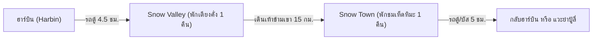

# คู่มือฉบับสมบูรณ์: หมู่บ้านหิมะ (Snow Town) & หุบเขาหิมะ (Snow Valley)

> **จัดทำโดย**: บัง (China Travel Planner - ผู้เชี่ยวชาญการจัดทริปท่องเที่ยวประเทศจีน)  
> **หมวดหมู่**: ข้อมูลภูมิศาสตร์, โลจิสติกส์การเดินทาง, การเดินป่าหิมะข้ามขุนเขา (Snow Traverse) และแผนการเดินทาง  
> **ช่วงเวลาแนะนำในการท่องเที่ยว**: ปลายเดือนพฤศจิกายน – ปลายเดือนกุมภาพันธ์ (สวยที่สุด: 10 ธ.ค. – 20 ม.ค.)  
> **สภาพอากาศ**: หนาวจัดสุดขั้ว -20°C ถึง -35°C (หนาวกว่าในตัวเมืองฮาร์บิน 5-10 องศา)

---

## 🗺️ 1. ภาพรวมเชิงภูมิศาสตร์ (Geographical Concept)

หลายคนมักสับสนระหว่าง **"Snow Town"** กับ **"Snow Valley"** ความจริงแล้วทั้งสองแห่งคือ **หมู่บ้านคนละฝั่งของภูเขาลูกเดียวกัน** นั่นคือ **"เทือกเขาหยางเฉ่าซาน" (Mount Yangcao - 羊草山 สูง 1,235 เมตร)**

```text
                                 ยอดเขาหยางเฉ่าซาน (1,235 ม.)
                                  ▲ (จุดชมวิวป่าสนหิมะ & ทะเลหมอก)
                                 / \
      (ลาดเขาด้านเหนือ / ร่มเงา)   /   \   (ลาดเขาด้านใต้ / แดดส่อง)
                                /     \
                               /       \
                              /         \
                             /           \
 🌲 หุบเขาหิมะ (Snow Valley)                 🍄 หมู่บ้านหิมะ (Snow Town)
 [ฟาร์มป่าไม้ตงเซิง - 东升林场]                  [ฟาร์มป่าไม้ซวงเฟิง - 双峰林场]
 • สูง 800 ม. จากระดับน้ำทะเล                 • สูง 1,100 ม. จากระดับน้ำทะเล
 • บรรยากาศชนบทแท้ เงียบสงบ                  • แสงสีอลังการ โคมแดงคึกคัก
 • นอนเตียงคั่งโบราณ ค่าใช้จ่ายเบาๆ            • มี "เห็ดหิมะ" หนาแน่นระดับโลก
 • ฟรีค่าเข้าหมู่บ้าน                          • ค่าเข้าอุทยาน 120 หยวน
 ────────────────────────────────────────────────────────────────────────
 ➔ ระยะทางเดินเท้าข้ามยอดเขา: 15 กิโลเมตร (ใช้เวลาเดิน 4 - 6 ชั่วโมง)
 ➔ ระยะทางขับรถยนต์อ้อมภูเขา: 120 กิโลเมตร (ใช้เวลาขับรถ 2.5 - 3 ชั่วโมง)
```

---

## ⚖️ 2. ตารางเปรียบเทียบหมัดต่อหมัด: Snow Town vs Snow Valley

| หัวข้อเปรียบเทียบ | 🍄 China Snow Town (中国雪乡) | 🌲 China Snow Valley (中国雪谷) |
| :--- | :--- | :--- |
| **ชื่อทางการ** | ฟาร์มป่าไม้ซวงเฟิง (Shuangfeng Forest Farm) | ฟาร์มป่าไม้ตงเซิง (Dongsheng Forest Farm) |
| **ที่ตั้งทางปกครอง** | เมืองไห่หลิน เมืองหมู่ตานเจียง (Mudanjiang) | เมืองอู่ฉาง (Wuchang - ถิ่นข้าวหอมมะลิเลื่องชื่อ) |
| **ระยะทางจากฮาร์บิน** | ~280 กิโลเมตร (นั่งรถ 5 – 5.5 ชั่วโมง) | ~240 กิโลเมตร (นั่งรถ 4 – 4.5 ชั่วโมง) |
| **ลักษณะหิมะ** | หิมะเหนียวนุ่มเกาะตัว ก่อตัวเป็น **"เห็ดหิมะ"** | หิมะผงละเอียด นุ่มฟูตามธรรมชาติ (Powder Snow) |
| **บรรยากาศ & ฟีลลิ่ง** | สว่างไสว โคมแดง แสงสีทอง เมืองเทพนิยาย | เงียบสงบ ชนบท วิถีชีวิตคนป่าไม้ตงเป่ยแท้ๆ |
| **ระดับความเชิงพาณิชย์** | สูงมาก มีร้านค้า ร้านกาแฟ ถนนคนเดินครบครัน | ต่ำมาก เป็นโฮมสเตย์ชาวบ้าน บ้านไม้เรียบง่าย |
| **ค่าธรรมเนียมเข้า** | **120 หยวน/ท่าน** (ตั๋ว 48 ชม. รวมรถบัสอุทยาน) | **ฟรี!** ไม่มีค่าเข้าหมู่บ้าน |
| **ระดับราคาที่พัก** | สูง (1,500 – 4,500+ บาท/คืน ในช่วงไฮซีซั่น) | สบายกระเป๋า (600 – 1,500 บาท/คืน) |
| **ประเภทที่พัก** | โรงแรมสไตล์รีสอร์ท หรือโฮมสเตย์โมเดิร์น | โฮมสเตย์พื้นบ้าน นอนเตียงคั่งอุ่นเตาฟืน (火炕) |
| **อาหารการกิน** | หลากหลาย ร้านสุกี้ตงเป่ย หม้อไฟ ขนมปังรัสเซีย | อาหารกระทะเหล็กตงเป่ยแท้ (ไก่ตุ๋นเห็ด, ซี่โครงหมู) |
| **เหมาะที่สุดสำหรับ** | สายถ่ายรูปวิวอลังการ ครอบครัว คู่รักชิลๆ | สายธรรมชาติ สายลุย แบ็คแพ็คเกอร์ ชอบเดินป่า |

---

## 🥾 3. มหากาพย์การเดินป่าหิมะข้ามเขา: The Yangcaoshan Snow Traverse (林海雪原穿越)

เส้นทางเดินเท้าจาก **Snow Valley ➔ ข้ามยอดเขาหยางเฉ่าซาน ➔ สู่ Snow Town** ได้รับการยกย่องให้เป็น **"เส้นทางเดินป่าฤดูหนาวคลาสสิกอันดับ 1 ของประเทศจีน"**

### ทำไมต้องเดินจาก Snow Valley ไป Snow Town (正穿越)?
นักเดินป่าและผู้นำทางท้องถิ่นแนะนำให้เดินจาก **Snow Valley (ตงเซิง) ➔ Snow Town (ซวงเฟิง)** เสมอ ด้วย 4 เหตุผลสำคัญ:
1. **ทางเดินขึ้นค่อยเป็นค่อยไป**: ฝั่ง Snow Valley ลาดเขาจะชันน้อยกว่า ค่อยๆ ไต่ระดับผ่านป่าสนและลำธารน้ำแข็ง ร่างกายไม่เหนื่อยล้าจนเกินไป
2. **ชมวิวป่าสนหิมะพาโนรามาช่วงเที่ยง**: ถึงยอดเขาหยางเฉ่าซาน (1,235 ม.) ตอนกลางวัน แดดส่องประกายหิมะ ทะเลหมอกขาวโพลน
3. **ทางลงสั้นและสบาย**: ฝั่ง Snow Town ทางลงยาวเพียง 5 กิโลเมตร เป็นทางลาดลง สามารถเดินชิลๆ หรือสไลด์ถาดหิมะลงมาได้
4. **รางวัลที่น่าประทับใจที่สุด**: เมื่อเดินลงมาถึง Snow Town จะเป็นเวลาประมาณ **15:30 – 16:30 น.** แสงทไวไลท์กำลังเริ่ม และโคมไฟสีแดงนับพันดวงบนถนนเสวี่ยยวิ่นกำลังเปิดสว่างต้อนรับคุณพอดี!

### สรุป 3 ช่วงของการเดินเท้า (ระยะทางรวม 15 กม. / 4 - 6 ชม.):
* **ช่วงที่ 1: ตีนเขาหมู่บ้าน Snow Valley ➔ จุดพักตรวจตั๋วชาเย่เหอ (5 กม.)**:
  * ทางราบเลียบป่าโปร่ง มีลำธารน้ำแข็ง
  * *ตัวช่วยทุ่นแรง*: สามารถนั่ง **เลื่อนม้าลาก (Horse Sleigh)** ค่าบริการ ~80-100 หยวน/คน เพื่อประหยัดแรง
* **ช่วงที่ 2: จุดตรวจตั๋ว ➔ ยอดเขาหยางเฉ่าซาน (5 กม. ชันปานกลาง)**:
  * เส้นทางตัดผ่านป่าสนไซบีเรีย ป่าต้นเบิร์ชขาว และหิมะหนา 1-2 เมตร
  * *ตัวช่วยทุ่นแรง*: มีบริการ **สโนว์โมบิล (Snowmobile)** บิดทะยานฝ่าหิมะขึ้นสู่ยอดเขาใน 10 นาที (~150-200 หยวน/คน)
* **ช่วงที่ 3: ยอดเขาหยางเฉ่าซาน ➔ ลงสู่หมู่บ้าน Snow Town (5 กม. ขาลง)**:
  * ทางลาดลงสู่หมู่บ้าน เดินง่าย มีบันไดหิมะและทางสไลด์
  * ผ่านด่านตรวจตั๋วเข้าสู่ถนนคนเดินเสวี่ยยวิ่นโดยตรง

### บริการส่งกระเป๋าเดินทางข้ามเขา (Luggage Forwarding Service - 行李托运)
> **ไม่ต้องแบกกระเป๋าเดินทางข้ามเขา!**  
> ทุกโฮมสเตย์ใน Snow Valley มีบริการส่งกระเป๋าเดินทางใบใหญ่ข้ามเขา โดยรถตู้ขนส่งจะขับอ้อมถนนภูเขา 120 กม. นำกระเป๋าไปส่งรอที่โรงแรมปลายทางใน Snow Town ในราคาเพียง **50 – 80 หยวนต่อใบ** (กระเป๋าจะไปถึงก่อนที่คุณจะเดินลงมาถึง) นักท่องเที่ยวจึงสะพายเพียงเป้เดย์แพ็กขนาดเล็ก (ใส่น้ำอุ่น, แผ่นแปะร้อน, กล้อง, แบตสำรอง) เดินตัวปลิวสบายๆ

---

## 🎒 4. รายการอุปกรณ์จำเป็นสำหรับการเดินป่าหิมะ (Trekker's Gear Checklist)

1. **ไอเซนหนามกันลื่นสวมรองเท้า (Ice Crampons / 冰爪)**: **สำคัญที่สุด!** ช่วยยึดเกาะพื้นหิมะอัดแข็งและลานน้ำแข็งไม่ให้ลื่นล้ม (หาซื้อได้ใน Snow Valley ราคา 15-25 หยวน)
2. **ปลอกกันหิมะเข้ารองเท้า (Snow Gaiters / 雪套)**: สวมหุ้มตั้งแต่ข้อเท้าถึงใต้หัวเข่า ป้องกันไม่ให้หิมะหนาเป็นเมตรทะลักเข้าไปในรองเท้าบูทจนเปียกชื้น
3. **รองเท้าบูทลุยหิมะกันน้ำ (Waterproof Snow Boots)**: ต้องบุขนอุ่นหนาและพื้นรองเท้ามีดอกยางลึก
4. **ไม้เท้าเดินป่า (Trekking Poles)**: ช่วยพยุงตัวและกระจายน้ำหนัก ลดภาระหัวเข่าตอนเดินขึ้นและลงเขา
5. **กระติกน้ำสุญญากาศเก็บความร้อน (Thermos Flask)**: อุณหภูมิ -30°C น้ำในขวดพลาสติกจะกลายเป็นน้ำแข็งภายใน 30 นาที ต้องใช้กระติกเก็บน้ำร้อนไว้จิบระหว่างทาง
6. **แผ่นแปะร้อน (暖宝宝 - Heat Packs)**: สำหรับแปะฝ่าเท้า แปะหน้าท้อง และที่สำคัญที่สุดคือ **แปะหลังเคสโทรศัพท์มือถือ/แบตเตอรี่กล้อง** เพื่อป้องกันเครื่องดับฉับพลันจากความหนาว
7. **แว่นตากันแดดหรือแว่นสกี (Ski Goggles)**: แสงแดดสะท้อนหิมะขาวบริสุทธิ์บนยอดเขาหยางเฉ่าซานมีความเข้มสูงมาก หากไม่สวมแว่นตาอาจเกิดอาการตาพร่า/โรคตาบอดหิมะ (Snow Blindness)

---

## 🚗 5. แผนการเดินทางและการจัดโปรแกรม (Recommended Itineraries)

### ทางเลือกที่ 1: วงรอบสามเหลี่ยมหิมะคลาสสิก 3 วัน 2 คืน (The Snow Triangle)
*เหมาะสำหรับ: ผู้ที่ต้องการสัมผัสทั้งความเงียบสงบ การเดินป่า และแสงสีเทพนิยาย*



* **วันแรก**: 06:30 น. รถมินิบัสรับจากโรงแรมในฮาร์บิน ➔ 11:30 น. ถึง **Snow Valley** เช็คอินโฮมสเตย์ ➔ ทานอาหารตงเป่ยกระทะเหล็ก ➔ บ่ายเล่นกิจกรรมสาดน้ำร้อนกลายเป็นน้ำแข็ง (泼水成冰), ถาดเลื่อนหิมะ ➔ เย็นทานเกี๊ยวตงเป่ย ล้อมกองไฟ นอนเตียงคั่งอุ่น
* **วันที่สอง**: 07:30 น. ส่งกระเป๋าใหญ่ข้ามเขา ➔ เริ่มต้นการเดินเท้าข้าม **ยอดเขาหยางเฉ่าซาน (1,235 ม.)** ชมวิวป่าสนหิมะและทะเลหมอก ➔ 15:30 น. เดินลงสู่ **Snow Town** เข้าเช็คอิน ➔ 16:30 น. เดินชมวิวพาโนรามาบนทางเดินไม้ปั้งฉุยซาน ➔ ชมถนนเสวี่ยยวิ่นใต้แสงโคมแดง
* **วันที่สาม**: 08:00 น. เดินถ่ายภาพเห็ดหิมะยามเช้า ➔ 11:00 น. ขึ้นรถบัส Longyun หรือรถตู้เหมาเดินทางกลับสู่ **Harbin** (หรือแวะเล่นสกีที่ย่าปู้ลี่ Yabuli) ➔ ถึงตัวเมืองฮาร์บินเวลา 16:30 น.

---

### ทางเลือกที่ 2: ทริปพักผ่อนสบายๆ ไม่เดินป่า 2 วัน 1 คืน (Snow Town Highlights Only)
*เหมาะสำหรับ: ผู้สูงอายุ ครอบครัว หรือผู้ที่ไม่ต้องการเดินป่าไกล*

* **วันแรก**: 07:00 น. รถตู้ VIP รับจากฮาร์บิน มุ่งหน้าตรงสู่ **Snow Town** (5 ชม.) ➔ 12:30 น. ถึง Snow Town เช็คอิน ➔ บ่ายเที่ยวชมบ้านในฝัน (Dream Home) ➔ เย็นชมวิวบนทางเดินไม้และเดินถนนคนเดินเสวี่ยยวิ่น
* **วันที่สอง**: 08:30 น. นั่งรถตีนตะขาบหิมะขึ้นชมวิวบน **ยอดเขาต้าทูติ่งจื่อ (Datudingzishan)** ➔ 12:30 น. เดินทางกลับฮาร์บิน หรือขึ้นรถไฟความเร็วสูงที่สถานีย่าปู้ลี่ซีกลับฮาร์บิน

---

## 💡 6. คำแนะนำและข้อควรระวังพิเศษจาก "บัง" (Bang's Insider Advice)

1. **จองที่พักล่วงหน้าเสมอ**: ในช่วงเดือนธันวาคมและมกราคม ห้องพักใน Snow Town มีจำกัดมากและราคาสูงขึ้น 2-3 เท่า ควรจองล่วงหน้าอย่างน้อย 3-6 สัปดาห์
2. **ระวังเรื่องราคาอาหารใน Snow Town**: ในอดีตเคยมีประเด็นเรื่องราคาอาหารแพง ปัจจุบันทางการจีนควบคุมเข้มงวดขึ้น แต่ราคาโดยรวมยังสูงกว่าในเมือง 30-50% แนะนำให้ **ตรวจสอบราคาในเมนูทุกครั้งก่อนสั่ง** หรือเลือกทานร้านที่มีป้ายราคาชัดเจน
3. **ห้องน้ำระหว่างเดินป่า**: บนเส้นทางข้ามเขาหยางเฉ่าซานจะมีจุดบริการห้องน้ำเฉพาะที่จุดพักชาเย่เหอและบนยอดเขาเท่านั้น เป็นห้องน้ำธรรมชาติแบบเรียบง่าย ควรเตรียมทิชชูเปียกและแอลกอฮอล์พกพาไปด้วย
4. **ความคุ้มค่าของการนอน Snow Valley**: หากคุณชอบความเงียบสงบ ถ่ายรูปดาวเต็มฟ้า และอยากคุยกับชาวบ้านท้องถิ่น Snow Valley จะให้ความประทับใจที่จริงใจและอบอุ่นกว่า Snow Town อย่างเห็นได้ชัด!
