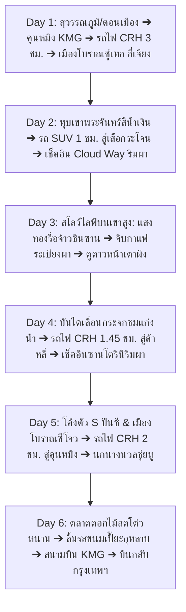

# แผนที่ 1: เส้นทางวงรอบยูนนาน ลี่เจียง – หุบเขาเสือกระโจน – ตาลี่ ซานโตรินี (Yunnan Grand Loop: BKK ➔ คุนหมิง ➔ ลี่เจียง ➔ หุบเขาเสือกระโจน ➔ Dali ➔ คุนหมิง ➔ BKK)

> **สถานะ**: ⭐ **ตัวเลือกแนะนำอันดับที่ 1 (ฉบับปรับปรุงใหม่ล่าสุด: เส้นทางวงรอบยอดนิยม BKK ➔ คุนหมิง ➔ ลี่เจียง ➔ เขาเสือกระโจน ➔ Dali ➔ คุนหมิง ➔ BKK)**  
> **รูปแบบการท่องเที่ยว**: สโลว์ไลฟ์ พักผ่อนสบายๆ ไม่เร่งรีบ (จำกัดสถานที่ไฮไลท์ไม่เกิน 1 - 2 แห่งต่อวัน)  
> **ช่วงเวลาเดินทาง**: 5 – 10 ธันวาคม 2026 (6 วัน 5 คืน) *(สามารถปรับเป็น 7 วัน 6 คืน ได้ตามความชอบ)*  
> **ภูมิภาค**: มณฑลยูนนาน (Yunnan) สาธารณรัฐประชาชนจีน (คุนหมิง – ลี่เจียง – หุบเขาเสือกระโจน – ตาลี่ – คุนหมิง)  
> **จัดทำโดย**: บัง (นักจัดทริปผู้เชี่ยวชาญท่องเที่ยวจีน)

---

## 🌟 จุดเด่นและข้อได้เปรียบของเส้นทางวงรอบใหม่ (Grand Loop Advantages)

เส้นทางที่ท่านเลือกปรับเปลี่ยนนี้ **BKK ➔ คุนหมิง ➔ ลี่เจียง ➔ เขาเสือกระโจน ➔ Dali ➔ คุนหมิง ➔ BKK** ถือเป็น **"เส้นทางวงรอบที่ชาญฉลาดและลงตัวที่สุดในยูนนาน" (The Perfect Yunnan Loop)** ด้วยเหตุผลหลัก 4 ประการ:

```mermaid
graph LR
    BKK["✈️ กรุงเทพฯ"] --> KMG["คุนหมิง (Kunming)"]
    KMG -- "🚅 รถไฟ CRH 3 ชม." --> LJ["1. ลี่เจียง (Lijiang)<br>เมืองเก่าซู่เหอ & วิวเขาหิมะ"]
    LJ -- "🚗/🚅 1 ชม." --> TLG["2. เสือกระโจน (TLG)<br>พัก Cloud Way ริมผา 2 คืน"]
    TLG -- "🚅 รถไฟ CRH 1.45 ชม." --> DALI["3. ต้าหลี่ (Dali)<br>ซานโตรินี & ทะเลสาบเอ๋อร์ไห่"]
    DALI -- "🚅 รถไฟ CRH 2 ชม." --> KM2["4. คุนหมิง (Kunming)<br>นกนางนวลไซบีเรีย & ตลาดดอกไม้"]
    KM2 --> BKK2["✈️ กรุงเทพฯ"]
    
    style LJ fill:#e1f5fe,stroke:#0288d1,stroke-width:2px
    style TLG fill:#fff3e0,stroke:#f57c00,stroke-width:2px
    style DALI fill:#f3e5f5,stroke:#7b1fa2,stroke-width:2px
    style KM2 fill:#e8f5e9,stroke:#388e3c,stroke-width:2px
```

1. **ไม่มีการเดินทางย้อนศร (Zero Backtracking)**:
   * นั่งรถไฟความเร็วสูง (CRH) ยิงตรงจากคุนหมิงขึ้นเหนือสู่จุดที่ไกลที่สุดคือ **"ลี่เจียง"** ในวันแรก
   * จากนั้นเดินทางระยะสั้นสู่ **"หุบเขาเสือกระโจน"**
   * แล้วค่อยๆ ล่องใต้ลงมาสู่ **"ต้าหลี่"**
   * และปิดท้ายด้วยการนั่งรถไฟความเร็วสูงจากต้าหลี่กลับคุนหมิง **เพียง 2 ชั่วโมงเท่านั้น!** (แทนที่จะต้องนั่งรถไฟยิงยาว 3.5 ชม. จากเสือกระโจน/ลี่เจียงกลับคุนหมิงในวันท้ายๆ ทำให้วันขากลับไม่เหนื่อยล้า)
2. **การปรับตัวกับความสูงที่นุ่มนวลและปลอดภัย 100% (Altitude Acclimatization)**:
   * คุนหมิง (1,890 ม.) ➔ ลี่เจียง (2,400 ม.) ➔ หุบเขาเสือกระโจน (1,900 – 2,100 ม.) ➔ ต้าหลี่ (1,970 ม.) ➔ คุนหมิง (1,890 ม.)
   * ตลอดทั้งทริปไม่มีจุดนอนที่เกิน 2,400 เมตร ออกซิเจนหนาแน่น **ไม่มีปัญหาเรื่องแพ้ที่สูง (AMS) สบายใจ ปลอดภัย สำหรับทุกวัย**
3. **พักผ่อนสโลว์ไลฟ์ระดับพรีเมียมครบ 3 อารมณ์**:
   * **ลี่เจียง (Lijiang)**: ดื่มด่ำความเงียบสงบของเมืองโบราณซู่เหอ (Shuhe) ทัศนียภาพของยอดเขาหิมะมังกรหยก และน้ำใสสีมรกตของหุบเขาพระจันทร์สีน้ำเงิน (Blue Moon Valley) โดยไม่ต้องไปแย่งคิวขึ้นกระเช้า
   * **หุบเขาเสือกระโจน (Tiger Leaping Gorge)**: พักผ่อน 2 คืนเต็ม ณ โฮมสเตย์กระจกพาโนรามา **Cloud Way Homestay** ตื่นมาชมปรากฏการณ์แสงแรกสีทองกระทบยอดเขาหิมะมังกรหยก **(日照金山 - Rizhao Jinshan)** จิบกาแฟระเบียงผา และลงไปสัมผัสพลังสายน้ำด้วย **บันไดเลื่อนกระจกชมวิว**
   * **ต้าหลี่ (Dali)**: เช็คอินรีสอร์ทหน้าผาสไตล์ถ้ำสีขาว **"Dali Santorini" (理想邦)** ริมทะเลสาบเอ๋อร์ไห่ ชมพระอาทิตย์อัสดงหลังเขาชางซาน ปั่นจักรยานโค้งตัว S ปันซี และสัมผัสวัฒนธรรมชาวไป๋ ณ เมืองโบราณซีโจว
4. **ปิดท้ายที่คุนหมิงอย่างอบอุ่น**:
   * ชมความน่ารักของฝูงนกนางนวลปากแดงไซบีเรียนับหมื่นตัวที่สวนสาธารณะชุ่ยหู และช้อปปิ้งตลาดดอกไม้สดที่ใหญ่ที่สุดในเอเชียก่อนบินกลับ

---

## 📊 สรุปภาพรวมของทริป (Trip Overview)

* **สภาพอากาศช่วงต้นธันวาคม (5 – 10 ธันวาคม)**: 
  * ลี่เจียง (Lijiang): 5°C ถึง 16°C (กลางวันแดดอุ่น ฟ้าใส กลางคืนหนาวสดชื่น มีฮีตเตอร์อุ่นสบาย)
  * หุบเขาเสือกระโจน (Tiger Leaping Gorge): 7°C ถึง 16°C (อากาศบริสุทธิ์ แดดจัด ไร้ฝน)
  * ต้าหลี่ (Dali): 10°C ถึง 17°C (อบอุ่นที่สุดในทริป ลมพัดเย็นสบายริมทะเลสาบ)
  * คุนหมิง (Kunming): 11°C ถึง 18°C (เมืองแห่งฤดูใบไม้ผลิ)
* **ระดับความสูง**: 1,800 – 2,400 ม. (ออกซิเจนสมบูรณ์ ไม่มีความเสี่ยง AMS)
* **การเดินทางหลัก**:
  * บินตรงกรุงเทพฯ – คุนหมิง (เพียง 2.2 ชม.)
  * รถไฟความเร็วสูง (CRH) ชั้นหนึ่ง (First Class): คุนหมิง ➔ ลี่เจียง (3 ชม.), เสือกระโจน ➔ ต้าหลี่ (1.45 ชม.), ต้าหลี่ ➔ คุนหมิง (2 ชม.)
  * รถ SUV / รถตู้ VIP ส่วนตัว: รับ-ส่งสถานีรถไฟ ข้ามทะเลสาบ และพาขึ้นสู่ที่พัก Cloud Way บนเขาสูงโดยตรง

---

## ✈️ ➔ 🚅 คู่มือเจาะลึก: การเดินทางจากสนามบินคุนหมิงฉางสุ่ย (KMG) สู่สถานีรถไฟคุนหมิง (Kunming Railway Station)

> **⚠️ ข้อควรระวังสำคัญที่สุดเรื่อง "สถานีรถไฟในคุนหมิง"**:
> ในเมืองคุนหมิงมี 2 สถานีรถไฟหลัก:
> 1. **"สถานีรถไฟคุนหมิง" (昆明站 - Kunming Railway Station)** *(แนะนำ 100% สำหรับทริปนี้)*: ตั้งอยู่ใจกลางเมือง เป็นสถานีต้นทางของรถไฟความเร็วสูงขบวนตรงสู่ **ลี่เจียง (Lijiang)** และ **ต้าหลี่ (Dali)** ที่มีรอบถี่ที่สุด
> 2. **"สถานีรถไฟคุนหมิงใต้" (昆明南站 - Kunming South)**: อยู่ไกลออกไปทางทิศใต้ (อำเภอเฉิงก้ง เกือบ 50 กม. จากสนามบิน) **ไม่แนะนำ** ให้เลือกสถานีนี้เพราะจะเสียเวลาเดินทางเพิ่มขึ้นโดยไม่จำเป็น

### 📊 ตารางเปรียบเทียบการเดินทางจากสนามบิน KMG สู่สถานีรถไฟคุนหมิง (昆明站)

| วิธีการเดินทาง | ยานพาหนะ / เส้นทาง | ระยะเวลาเดินทาง | ค่าโดยสาร (ประมาณ) | จุดขึ้นรถในสนามบิน KMG | จุดเด่น & ความเหมาะสม |
| :--- | :--- | :---: | :---: | :--- | :--- |
| **ตัวเลือกที่ 1 (แนะนำสำหรับคนสัมภาระเยอะ)** | **รถแท็กซี่ / DiDi** *(เรียกรถผ่านแอป Alipay)* | **35 – 45 นาที** *(ช่วงเร่งด่วน 50 นาที)* | **80 – 110 หยวน** (~400 – 550 บาท) *รวมค่าทางด่วนแล้ว* | **ชั้น 1 (Arrival Hall)** ออกประตูทางออก 3 หรือตามป้าย **网约车 (Online Car Hailing / DiDi)** | สะดวกสบายที่สุด ขึ้นทางด่วน Airport Expressway ส่งถึงหน้าประตูทางเข้าสถานีรถไฟชั้น 2 ไม่ต้องยกกระเป๋า เหมาะมากสำหรับเดินทาง 2-4 ท่าน |
| **ตัวเลือกที่ 2 (แนะนำสำหรับคุมเวลา 100%)** | **รถไฟใต้ดิน (Kunming Metro)** • สาย 6 (สีฟ้า) ➔ ต่อสาย 2 (สีแดง) | **45 – 50 นาที** *(ตรงเวลา ไม่เสี่ยงรถติด)* | **6 หยวน** (~30 บาท) / ท่าน | **ชั้น B1 Terminal** เดินตามป้าย **地铁 (Metro)** สู่สถานี **Airport Center (机场中心站)** | ตรงเวลาแน่นอน 100% ขบวนรถไฟใต้ดินวิ่งนุ่ม มีแอร์ ช่องวางกระเป๋า สถานีมีลิฟต์และบันไดเลื่อนครบวงจร |
| **ตัวเลือกที่ 3** | **แอร์พอร์ตบัส (Airport Express Line 2)** *(空港快线 2号线)* | **50 – 60 นาที** *(ขึ้นกับสภาพการจราจร)* | **25 หยวน** (~125 บาท) / ท่าน | **ชั้น 1 ด้านนอกประตู 3** เคาน์เตอร์จำหน่ายตั๋ว **空港快线** | รถบัสปรับอากาศขนาดใหญ่ โหลดสัมภาระใต้ท้องรถ วิ่งตรงไปลงหน้าโรงแรม Jinjiang Hotel (เดิน 300 เมตรถึงสถานีรถไฟ) ออกทุก 20-30 นาที |

### 🗺️ ขั้นตอนการขึ้นรถไฟความเร็วสูงในจีนสำหรับนักท่องเที่ยวไทย (ฟรีวีซ่า)
* **ไม่ต้องออกตั๋วกระดาษ (E-Ticket 100%)**: เมื่อจองตั๋วผ่าน Trip.com หรือแอป 12306 ระบบจะผูกข้อมูลตั๋วเข้ากับเลขหนังสือเดินทางโดยตรง
* **ช่องทางเข้าสถานี (Security & Gate)**: ให้เดินเข้าช่อง **"Manual Check / Passport Gate" (人工通道)** ที่มีเจ้าหน้าที่ประจำอยู่ ยื่น **หนังสือเดินทางไทยเล่มจริง** ให้เจ้าหน้าที่สแกน (ห้ามเดินเข้าช่องสแกนบัตรประชาชนจีนอัตโนมัติ)
* **การเผื่อเวลา (Buffer Time)**: ไฟลท์บินลงจอดประมาณ 11:30 น. ➔ จองตั๋วรถไฟความเร็วสูงรอบ **14:00 น. หรือ 14:30 น.** เป็นต้นไป จะมีเวลาผ่าน ตม. นั่งรถเข้าเมือง ทานมื้อกลางวันเบาๆ และเดินขึ้นรถไฟอย่างสง่างาม ไม่ต้องวิ่งเร่งรีบ

---

## 🗓️ ตัวเลือกการจัดตารางเวลา: 6 วัน 5 คืน vs 7 วัน 6 คืน

| วันที่ | แผนมาตรฐาน: 6 วัน 5 คืน (6D5N) | แผนขยายสโลว์ไลฟ์: 7 วัน 6 คืน (7D6N) |
| :---: | :--- | :--- |
| **Day 1** | BKK ➔ คุนหมิง ➔ รถไฟ CRH 3 ชม. ➔ **พักลี่เจียง (ซู่เหอ)** คืนที่ 1 | BKK ➔ คุนหมิง ➔ รถไฟ CRH 3 ชม. ➔ **พักลี่เจียง (ซู่เหอ)** คืนที่ 1 |
| **Day 2** | ลี่เจียง (หุบเขาพระจันทร์สีน้ำเงิน) ➔ รถ SUV 1 ชม. ➔ **พักเสือกระโจน Cloud Way** คืนที่ 1 | ลี่เจียง (หุบเขาพระจันทร์สีน้ำเงิน & เมืองเก่า) ➔ **พักลี่เจียง** คืนที่ 2 |
| **Day 3** | หุบเขาเสือกระโจน (แสงทองรื่อจ้าวชินซาน & จิบกาแฟผา) ➔ **พัก Cloud Way** คืนที่ 2 | ลี่เจียง ➔ รถ SUV 1 ชม. ➔ **พักเสือกระโจน Cloud Way** คืนที่ 1 |
| **Day 4** | บันไดเลื่อนแก่งเสือกระโจน ➔ รถไฟ CRH 1.45 ชม. ➔ **พักต้าหลี่ ซานโตรินี** คืนที่ 1 | หุบเขาเสือกระโจน (แสงทองรื่อจ้าวชินซาน) ➔ **พัก Cloud Way** คืนที่ 2 |
| **Day 5** | ต้าหลี่ (โค้งตัว S ปันซี & ซีโจว) ➔ รถไฟ CRH 2 ชม. ➔ **พักคุนหมิง (ชุ่ยหู)** คืนที่ 1 | บันไดเลื่อนเสือกระโจน ➔ รถไฟ CRH 1.45 ชม. ➔ **พักต้าหลี่ ซานโตรินี** คืนที่ 1 |
| **Day 6** | ตลาดดอกไม้สดโต่วหนาน ➔ ขนมเปี๊ยะกุหลาบ ➔ บินกลับกรุงเทพฯ (BKK) | ต้าหลี่เต็มวัน (โค้งตัว S ปันซี, ซีโจว, เมืองเก่าต้าหลี่) ➔ **พักต้าหลี่** คืนที่ 2 |
| **Day 7** | — | ต้าหลี่ ➔ รถไฟ 2 ชม. ➔ คุนหมิง (ชุ่ยหู & ตลาดดอกไม้) ➔ บินกลับกรุงเทพฯ |

*(ด้านล่างนี้แจกแจงรายละเอียดแบบสมบูรณ์ตาม **แผนมาตรฐาน 6 วัน 5 คืน** ที่กระชับและคุ้มค่าที่สุด)*

---

## 🗺️ แผนการเดินทางรายวันแบบละเอียด (Day-by-Day Itinerary 6 วัน 5 คืน)

---

### วันที่ 1 (5 ธันวาคม 2026): กรุงเทพฯ – นครคุนหมิง – รถไฟความเร็วสูงสู่ลี่เจียง – พักผ่อนเมืองโบราณซู่เหอ

* **08:00 – 11:30 น. (ช่วงเช้า: บินตรงสู่ดินแดนแห่งฤดูใบไม้ผลิ)**:
  * ออกเดินทางจากกรุงเทพฯ (BKK/DMK) สู่ **สนามบินนานาชาติคุนหมิงฉางสุ่ย (KMG - 昆明长水国际机场)** ใช้เวลาบินเพียง 2 ชั่วโมง 15 นาที
  * ผ่านด่านตรวจคนเข้าเมืองจีน (ฟรีวีซ่า 60 วันสำหรับคนไทย) สแกนลายนิ้วมือและตรวจพาสปอร์ต รับกระเป๋าสัมภาระ
* **11:30 – 13:00 น. (ช่วงเชื่อมต่อ: สนามบิน KMG ➔ สถานีรถไฟคุนหมิง 昆明站)**:
  * นั่งรถยนต์ DiDi / Taxi ขึ้นทางด่วน Airport Expressway เพียง **35 – 45 นาที** (ค่าโดยสาร ~80-100 หยวน) ส่งถึงประตูทางเข้าสถานีรถไฟคุนหมิงชั้น 2
  * เดินเข้าสถานีผ่านช่องตรวจพาสปอร์ต (人工通道) นำสัมภาระเข้าเครื่องสแกน แวะพักทานมื้อกลางวันหรือซื้อเครื่องดื่ม/ของว่าง
* **13:45 – 17:15 น. (ไฮไลท์ที่ 1: นั่งรถไฟหัวกระสุน CRH คุนหมิง ➔ ลี่เจียง 3.5 ชั่วโมง)**:
  * ขึ้นรถไฟความเร็วสูง (CRH) ขบวนปรับอากาศชั้นหนึ่ง (First Class) มุ่งหน้าสู่ **สถานีรถไฟลี่เจียง (丽江站 - Lijiang Railway Station)**
  * ขบวนรถไฟวิ่งนุ่มสบาย ข้ามผ่านสะพานลอยฟ้า ช่องเขาหินปูน ผ่านเมืองฉู่สงและทัศนียภาพอันงดงามของทะเลสาบเอ๋อร์ไห่ทางทิศตะวันออก ก่อนไต่ระดับเข้าสู่ที่ราบสูงลี่เจียง
* **17:30 – 20:30 น. (ไฮไลท์ที่ 2: สโลว์ไลฟ์เมืองโบราณซู่เหอ 束河古镇 Shuhe Ancient Town & ดินเนอร์น่าซี)**:
  * รถตู้ส่วนตัวรับจากสถานีรถไฟลี่เจียง เดินทางเพียง 25 นาที สู่ **"เมืองโบราณซู่เหอ" (Shuhe Ancient Town)**
  * เช็คอินเข้าโรงแรมบูทีคระดับพรีเมียม เช่น **The Bivou Lijiang** หรือ **Banyan Tree Lijiang** สัมผัสความเงียบสงบ ลำธารน้ำใสไหลผ่านหน้าร้านค้าไม้โบราณ และมีทิวทัศน์ยอดเขาหิมะมังกรหยกตั้งตระหง่านอยู่เบื้องหลัง
  * เดินเล่นรับลมหนาวยามเย็น ชมสะพานชิงหลง (Qinglong Bridge) ที่ปูด้วยหินโบราณอายุกว่า 400 ปี โคมไฟสีส้มสะท้อนผิวน้ำ บรรยากาศโรแมนติก ไม่แออัดพลุกพล่านเหมือนเมืองเก่าต้าเหยียน
* **มื้ออาหาร**:
  * กลางวัน: อาหารว่างบนเครื่องบิน / ก๋วยเตี๋ยวและของว่างที่สถานีรถไฟคุนหมิง
  * เย็น: **"หม้อไฟซี่โครงหมูแห้งน่าซี" (Naxi Cured Ribs Hotpot - 丽江腊排骨火锅)** ต้มในน้ำซุปกระดูกหมูหอมกรุ่น ใส่ผักสดบนดอย เห็ดป่ายูนนาน และเต้าหู้แผ่น
* **ที่พัก**: โรงแรมบูทีคสุดสงบ **The Bivou Lijiang (丽江花间堂 / 丽江嵌雪楼精品酒店)** หรือ **Banyan Tree Lijiang (丽江悦榕庄)** (คืนที่ 1)

#### 🚌 ตารางสรุปขั้นตอนการต่อรถ & ยานพาหนะจริง Day 1
| ช่วงที่ | เส้นทาง (จาก ➔ ถึง) | ยานพาหนะ & รายละเอียดการเดินทาง | ระยะเวลา | ค่าใช้จ่าย (ประมาณ) | เคล็ดลับของบัง (Pro-Tips) |
| :---: | :--- | :--- | :---: | :---: | :--- |
| **1** | กรุงเทพฯ (BKK/DMK) ➔ สนามบินคุนหมิง (KMG) | **✈️ เครื่องบินพาณิชย์ (Direct Flight)** บินตรงจากไทย ผ่าน ตม. ฟรีวีซ่าไทย-จีน สแกนลายนิ้วมือที่ Kiosk เข้าช่อง All Passports ตรวจพาสปอร์ตไทย | 2 ชม. 15 นาที | รวมในตั๋วเครื่องบิน | พาสปอร์ตต้องมีอายุเหลือเกิน 6 เดือน ไม่ต้องกรอกใบ ตม. กระดาษแล้ว |
| **2** | สนามบิน KMG ➔ สถานีรถไฟคุนหมิง (昆明站) | **🚕 DiDi / Taxi (ทางเลือกแนะนำ ⭐)**: เดินไปชั้น 1 ประตู 3 จุดนัดพบรถออนไลน์ (网约车) เรียก DiDi ผ่าน Alipay ขึ้นทางด่วนส่งถึงหน้าสถานีชั้น 2 ไม่ต้องยกกระเป๋า *(หรือ 🚇 Metro สาย 6 ต่อสาย 2 ที่ Tangzixiang)* | 35 – 45 นาที | 80 – 110 หยวน / คัน *(Metro: 6 หยวน/คน)* | ห้ามเลือกสถานี "คุนหมิงใต้" (Kunming South) เด็ดขาด ให้เลือก "สถานีคุนหมิง" (昆明站) ในเมืองเท่านั้น |
| **3** | สถานีรถไฟคุนหมิง (昆明站) ➔ สถานีรถไฟลี่เจียง (丽江站) | **🚅 รถไฟความเร็วสูง (CRH ขบวน C/D ชั้นหนึ่ง First Class)** เข้าสถานีผ่านช่อง Manual Check (人工通道) สแกนพาสปอร์ตเล่มจริง ไม่ต้องใช้ตั๋วกระดาษ ตรวจสัมภาระ X-Ray ขึ้นชานชาลาก่อนเวลา 15 นาที มีแอร์ ปลั๊กไฟ และช่องวางกระเป๋า 28 นิ้ว | 3 ชม. 15 นาที | ~330 หยวน / ที่นั่ง (~1,650 บาท) | จองรอบบ่าย 13:45 หรือ 14:15 น. มีเวลาต่อจากไฟลท์บินเช้าอย่างสบาย ไม่ต้องวิ่งเร่งรีบ |
| **4** | สถานีรถไฟลี่เจียง (丽江站) ➔ โรงแรมในเมืองโบราณซู่เหอ (束河古镇) | **🚐 รถตู้รับ-ส่งส่วนตัว / DiDi + 🛒 รถเข็นกระเป๋าโรงแรม** คนขับรอรับที่ทางออกสถานี วิ่งถนนเลี่ยงเมืองส่งถึงประตูทิศเหนือเมืองโบราณซู่เหอ พนักงานโรงแรมนำรถเข็นมารับกระเป๋าพาเดินเข้าโรงแรม | 25 – 30 นาที | 40 – 60 หยวน / คัน (~200 – 300 บาท) | ถนนในเมืองเก่าเป็นหินโบราณ แจ้งโรงแรมล่วงหน้าให้พนักงานเข็นรถลากกระเป๋าพาเข้าที่พัก ล้อกระเป๋าจะไม่พัง |

---

### วันที่ 2 (6 ธันวาคม 2026): ลี่เจียง (หุบเขาพระจันทร์สีน้ำเงิน & เมืองโบราณไป๋ซา) – เดินทางสู่หุบเขาเสือกระโจน – เช็คอิน Cloud Way ริมผา

* **08:30 – 11:30 น. (ไฮไลท์ที่ 1: สวรรค์สีมรกต "หุบเขาพระจันทร์สีน้ำเงิน" 蓝月谷 Blue Moon Valley)**:
  * ทานอาหารเช้าพร้อมชมวิวยอดเขาหิมะยามเช้า นั่งรถส่วนตัวเพียง 30 นาที สู่เชิงเขาหิมะมังกรหยก
  * เที่ยวชม **"หุบเขาพระจันทร์สีน้ำเงิน" (Blue Moon Valley - 蓝月谷 / แม่น้ำไป๋สุ่ยเหอ 白水河)**:
    * ผืนน้ำสีฟ้าเทอร์ควอยซ์และมรกตใสแจ๋วที่เกิดจากการละลายของธารน้ำแข็งบนยอดเขาหิมะมังกรหยก
    * ไหลลดหลั่นเป็นชั้นหินปูนสีขาวงดงามราวกับขั้นบันไดหิมะ สะท้อนเงายอดเขาสูงตระหง่านสีขาวบริสุทธิ์
    * **ความสบายระดับพรีเมียม**: เดินเล่นบนทางไม้เรียบเลียบริมน้ำ ถ่ายรูปคู่กับจามรีขาวและน้ำตกชั้นหินปูน โดยไม่ต้องขึ้นกระเช้าสูง ไม่ต้องเบียดเสียด ไม่เหนื่อยล้า และไม่มีปัญหาแพ้ความสูง
* **12:00 – 13:30 น. (แวะจิบกาแฟชมวิวเขาหิมะ: เมืองโบราณไป๋ซา 白沙古镇 Baisha Ancient Town)**:
  * แวะเมืองโบราณดั้งเดิมของชาวน่าซี นั่งคาเฟ่สโลว์บาร์บนระเบียงไม้ชั้นสอง จิบกาแฟดริปยูนนานอุ่นๆ ชมยอดเขาหิมะมังกรหยกในมุมมองที่ชัดเจนที่สุด
  * ทานมื้อกลางวัน: ไก่ตุ๋นหม้อดินสมุนไพรยูนนาน และผัดเห็ดสด
* **13:30 – 15:30 น. (การเดินทาง: มุ่งหน้าสู่หุบเขาเสือกระโจน & รถ SUV ไต่ถนนเขาสูง)**:
  * ออกเดินทางด้วยรถ SUV ส่วนตัวจากลี่เจียง มุ่งหน้าสู่ **"หุบเขาเสือกระโจน" (Tiger Leaping Gorge - 虎跳峡)** ระยะทางเพียง 75 กม. ใช้เวลาเดินทางเพียง 1 ชั่วโมง 15 นาที
  * ผ่านด่านตรวจบัตรอุทยาน รถ SUV พาไต่ระดับขึ้นสู่ถนนเขาสูงชั้นบน (Upper Trekking Route / หมู่บ้านเปิ่นตี้วาน Bendiwan) อย่างนุ่มนวล โดยผู้เดินทางไม่ต้องแบกเป้เดินเท้าปีนเขาเอง
* **16:00 – 19:30 น. (ไฮไลท์ที่ 2: เช็คอิน Cloud Way Homestay วิวหน้าผามาสเตอร์พีซ)**:
  * เช็คอินเข้าพักที่: **"Upper trekking route · Cloud Way · Snowy mountain view homestay" (虎跳峡高路·云途·雪山观景民宿)**
  * **ประสบการณ์ระดับพรีเมียม**: โฮมสเตย์โมเดิร์นริมหน้าผาหันหน้าเข้าหาหน้าผาหินยักษ์และยอดเขาหิมะมังกรหยกตรงข้ามแบบ Eye-Level หน้าต่างกระจกบานใหญ่ตั้งแต่พื้นจรดเพดาน มีฮีตเตอร์พื้น เตาผิงไม้สน และสระน้ำกระจกเงาฟ้าบนดาดฟ้า
  * พักผ่อนจิบชายามบ่ายริมระเบียง ชมแสงแดดยามเย็นสีทองสาดส่องลงบนหน้าผาหินปูน สูงชันและลึกที่สุดแห่งหนึ่งในโลก
* **มื้ออาหาร**:
  * เช้า: บุฟเฟต์ของโรงแรมในลี่เจียง
  * กลางวัน: อาหารเซ็ตยูนนานเชิงเขา ณ เมืองโบราณไป๋ซา
  * เย็น: **"หม้อไฟไก่ดำสมุนไพรและผัดผักสดภูเขา"** เสิร์ฟในห้องอาหารกระจกวิวหุบเขาของ Cloud Way
* **ที่พัก**: **Upper trekking route·Cloud Way·Snowy mountain view homestay** (คืนที่ 1 บนเขาสูง)

#### 🚌 ตารางสรุปขั้นตอนการต่อรถ & ยานพาหนะจริง Day 2
| ช่วงที่ | เส้นทาง (จาก ➔ ถึง) | ยานพาหนะ & รายละเอียดการเดินทาง | ระยะเวลา | ค่าใช้จ่าย (ประมาณ) | เคล็ดลับของบัง (Pro-Tips) |
| :---: | :--- | :--- | :---: | :---: | :--- |
| **1** | เมืองโบราณซู่เหอ ➔ หุบเขาพระจันทร์สีน้ำเงิน (蓝月谷) | **🚙 รถตู้ VIP / SUV ส่วนตัว ➔ 🚌 รถบัสสีเขียวอุทยาน (Eco-Shuttle)** รถส่วนตัววิ่งถนนสายเขาหิมะ 35 นาที ถึงลานจอดรถศูนย์บริการอุทยาน จากนั้นต่อรถบัสสีเขียวของอุทยาน 15 นาที สู่จุดชมวิวสระมรกต | 50 นาที | รวมในเหมารถ / บัสรวมในตั๋ว | ไม่ต้องขึ้นกระเช้าสูงใหญ่ เดินเที่ยวเฉพาะโซนน้ำสีฟ้ามรกตด้านล่าง ถ่ายรูปสวย อากาศสบาย ไม่เสี่ยงแพ้ความสูง |
| **2** | หุบเขาพระจันทร์สีน้ำเงิน ➔ เมืองโบราณไป๋ซา (白沙古镇) | **🚙 รถตู้ / SUV ส่วนตัว** รถรับจากจุดนัดพบบริเวณลานจอด วิ่งลงเขาสู่เมืองโบราณไป๋ซา เมืองดั้งเดิมสงบของชาวน่าซี | 25 นาที | รวมในบริการเหมารถ | แวะคาเฟ่ชั้นสองบนถนนโบราณ นั่งจิบกาแฟดริปร้อนๆ มองเห็นยอดเขาหิมะมังกรหยกในมุมที่ชัดที่สุด |
| **3** | เมืองโบราณไป๋ซา ➔ ทางเข้าอุทยานหุบเขาเสือกระโจน (虎跳峡) | **🚙 รถตู้ / SUV ส่วนตัว** วิ่งข้ามพรมแดนลี่เจียงสู่เขตตี๋ชิ่ง (แชงกรีล่า) เลียบแม่น้ำจินซาเจียง ถนนลาดยางเรียบกริบ ผ่านด่านตรวจบัตรอุทยานเสือกระโจน | 1 ชม. 10 นาที | ตั๋วเข้าอุทยาน 45 หยวน/คน | รถสามารถขับผ่านด่านตรวจขึ้นสู่ถนน Upper Trail ได้เลย โดยไม่ต้องแวะเปลี่ยนรถ |
| **4** | ทางเข้าอุทยานเสือกระโจน ➔ โฮมสเตย์ Cloud Way (ริมผาเขาสูง) | **🚙 รถ SUV 4WD ขับเคลื่อน 4 ล้อของโรงแรม Cloud Way (แนะนำ 100% ⭐)** ไต่ถนนคอนกรีตเลียบหน้าผาหินยักษ์ ลัดเลาะผ่านหมู่บ้านเปิ่นตี้วาน (Bendiwan) สูงชัน ส่งถึงหน้าล็อบบี้ Cloud Way | 25 – 30 นาที | บริการรับส่งของโรงแรม / เหมารถ 350-400 หยวน | ไม่ต้องแบกเป้เดินเขา 2 วัน นั่งรถ SUV สบายๆ ชมวิวหน้าผาพาโนรามาได้แบบเดียวกัน 100% |

---

### วันที่ 3 (7 ธันวาคม 2026): วันแห่งความสุขสโลว์ไลฟ์: มหัศจรรย์แสงแรก "รื่อจ้าวชินซาน" – จิบกาแฟระเบียงผา – ชมทะเลดาวหน้าเตาผิง

* **07:30 – 09:30 น. (ไฮไลท์ที่ 1: แสงแรกแห่งขุนเขาทองคำ "รื่อจ้าวชินซาน" 日照金山 Rizhao Jinshan)**:
  * ไม่ต้องตื่นเช้าไปแย่งคิวกับใคร เพียงลืมตาตื่นขึ้นมาแล้วเปิดม่านห้องนอน ณ Cloud Way
  * ชมปรากฏการณ์ธรรมชาติสุดอัศจรรย์ **"รื่อจ้าวชินซาน" (Rizhao Jinshan - Golden Snow Mountain Sunrise)** แสงอาทิตย์ยามรุ่งอรุณสาดส่องลงบนยอดเขาหิมะมังกรหยก เปลี่ยนยอดเขาสีขาวให้กลายเป็นประกายสีทองคำอร่ามตา สะท้อนลงบนสระน้ำกระจกเงาฟ้า (Sky Mirror Pool) บนดาดฟ้าโฮมสเตย์ เป็นภาพจำที่งดงามที่สุดครั้งหนึ่งในชีวิต
  * ทานอาหารเช้าสไตล์คันทรี่ช้าๆ จิบกาแฟดริปร้อนๆ สูดลมหนาวสดชื่น 8°C
* **10:30 – 16:30 น. (ไฮไลท์ที่ 2: จิบกาแฟระเบียงผา & เดินเล่นเส้นทางราบเลียบหน้าผาหุบเขาลึก)**:
  * วันนี้เป็นวันพักผ่อนอย่างแท้จริง ไม่ต้องเก็บกระเป๋า ไม่ต้องย้ายโรงแรม
  * นอนเล่นอ่านหนังสือ ถ่ายภาพ และชมวิวโตรกผาที่ลึกที่สุดแห่งหนึ่งในโลก
  * หากต้องการเดินยืดเส้น สามารถเดินเล่นตามเส้นทางเทรลราบเรียบเลียบไหล่เขา (ทางราบสบาย ไม่ต้องปีนป่าย) ไปยัง **"จุดชมวิวน้ำตกกวนอิน" (Guanyin Waterfall)** และแวะนั่งชิลล์ที่ระเบียงของ **Halfway Guesthouse** ชมวิวมุมกว้าง 360 องศา
* **ช่วงค่ำ (ความสุขหน้าเตาผิง & ทะเลดาวเต็มฟ้า Stargazing)**:
  * ดื่มด่ำกับมื้อค่ำบาร์บีคิวย่างกระทะร้อนหน้าเตาผิงฟืนไม้สน
  * ดาดฟ้าของ Cloud Way มืดสนิท ปราศจากมลภาวะทางแสง ยามค่ำคืนจะมองเห็นทางช้างเผือกและทะเลดาวระยิบระยับเต็มท้องฟ้า
* **มื้ออาหาร**:
  * เช้า: อาหารเช้าสไตล์คันทรี่ของ Cloud Way (ไข่ดาว แพนเค้ก ข้าวต้ม ชาร้อน)
  * กลางวัน: ไก่บ้านผัดเห็ดโคนและมันฝรั่งอบชีส
  * เย็น: บาร์บีคิวเนื้อย่างกระทะร้อนสไตล์พื้นเมืองริมระเบียงชมดาว
* **ที่พัก**: **Upper trekking route·Cloud Way·Snowy mountain view homestay** (คืนที่ 2 บนเขาสูง)

#### 🚌 ตารางสรุปขั้นตอนการต่อรถ & ยานพาหนะจริง Day 3
| ช่วงที่ | เส้นทาง (จาก ➔ ถึง) | ยานพาหนะ & รายละเอียดการเดินทาง | ระยะเวลา | ค่าใช้จ่าย (ประมาณ) | เคล็ดลับของบัง (Pro-Tips) |
| :---: | :--- | :--- | :---: | :---: | :--- |
| **1** | ห้องพัก Cloud Way ➔ สระกระจกเงาฟ้าบนดาดฟ้า (Sky Mirror Pool) | **🚶 เดินเท้าขึ้นบันไดภายในโรงแรม** ตื่นนอน 07:15 น. เดินขึ้นดาดฟ้าเพื่อชมปรากฏการณ์ "รื่อจ้าวชินซาน" (แสงทองฉาบทายอดเขาหิมะ) สระน้ำจะสะท้อนเงายอดเขาสีทองคู่ขนาน | 3 นาที | ฟรี (เฉพาะแขกพัก) | แสงสีทองจะฉาบยอดเขาเพียงช่วงเวลาสั้นๆ ประมาณ 07:35 – 08:00 น. เท่านั้น เตรียมกล้องและมือถือให้พร้อม |
| **2** | Cloud Way ➔ จุดชมวิวน้ำตกกวนอิน & Halfway Guesthouse | **🚶‍♂️ เดินเท้าเส้นทางราบเลียบหน้าผา (Flat Cliff Trail - ไม่ชัน)** ทางเดินดินและหินเลียบหน้าผา ลมพัดเย็นสบาย ชมวิวด้านล่างแม่น้ำจินซาเจียงและหน้าผาหินตั้งฉาก | 30 – 40 นาที (1.5 กม.) | ฟรี | เส้นทางช่วงนี้เป็นทางราบเลาะไหล่เขา ไม่ใช่ทางปีนเขาชัน ใส่รองเท้าผ้าใบเดินเล่นสบายๆ ได้ทุกคน |

---

### วันที่ 4 (8 ธันวาคม 2026): บันไดเลื่อนกระจกชมแก่งน้ำเสือกระโจน – รถไฟความเร็วสูงสู่ต้าหลี่ (1.45 ชม.) – เช็คอินรีสอร์ทหน้าผาซานโตรินีต้าหลี่

* **09:00 – 11:30 น. (ไฮไลท์ที่ 1: สัมผัสพลังสายน้ำหุบเขาเสือกระโจนตอนบน & บันไดเลื่อนกระจกชมวิว 上虎跳峡)**:
  * รถมารับกระเป๋าสัมภาระและนำท่านลงสู่ก้นหุบเขาเสือกระโจนตอนบน (Upper Tiger Leaping Gorge)
  * ลงสู่ริมฝั่งแม่น้ำจินซาเจียงด้วย **"บันไดเลื่อนกระจกชมวิว" (Scenic Escalator)** สะดวกสบาย ไม่ต้องเดินบันไดหลายร้อยขั้น
  * ยืนข้าง **"โขดหินเสือกระโจน" (Tiger Leaping Stone - 虎跳石)** สัมผัสพลังสายน้ำสีเขียวมรกตที่บีบแคบไหลเชี่ยวกรากกระทบโขดหิน เกิดละอองน้ำฟุ้งกระจายและเสียงคำรามกึกก้องสะท้อนหุบผา
* **12:00 – 13:30 น. (มื้อกลางวัน & เดินทางสู่สถานีรถไฟ)**:
  * ทานมื้อกลางวันอาหารท้องถิ่นรสชาติดั้งเดิม จากนั้นรถส่งสู่ **สถานีรถไฟความเร็วสูงเสือกระโจน (Tiger Leaping Gorge Station - 虎跳峡站)**
* **14:00 – 15:45 น. (การเดินทาง: รถไฟความเร็วสูงขบวนตรง เสือกระโจน ➔ ต้าหลี่ เพียง 1.45 ชั่วโมง)**:
  * ขึ้นรถไฟหัวกระสุน (CRH) ขบวนตรง มุ่งหน้าลงใต้สู่ **สถานีรถไฟต้าหลี่ (大理站 - Dali Station)**
  * วิ่งผ่านอุโมงค์และสะพานข้ามหุบเขา สะดวก รวดเร็ว สัมภาระวางสบาย ไม่ต้องเปลี่ยนขบวน
* **16:15 – 19:30 น. (ไฮไลท์ที่ 2: เช็คอินรีสอร์ทหน้าผาซานโตรินีต้าหลี่ หลี่เซียงปัง 理想邦·大理圣托里尼)**:
  * รถตู้ส่วนตัวรับจากสถานีรถไฟต้าหลี่ ข้ามฝั่งตะวันออกของทะเลสาบเอ๋อร์ไห่เพียง 20 นาที (16 กม.)
  * เข้าสู่ **"หลี่เซียงปัง" (Ideal State / Dali Santorini)** รีสอร์ทหรูสีขาวสไตล์เมดิเตอร์เรเนียนริมหน้าผาสูง
  * เช็คอินเข้าห้องพักวิวทะเลสาบแบบพาโนรามา ณ **Dali Songyun Cliff Resort (大理松云悬崖酒店)** หรือ **Miyue Dali Santorini Resort**
  * **ช่วงเวลาทอง (Golden Hour 17:45 - 18:45 น.)**: ผ่อนคลายริมระเบียงห้องพักหรือสระน้ำอินฟินิตี้ ชมพระอาทิตย์อัสดงสีส้มอมชมพูค่อยๆ ลับขอบฟ้าหลังยอดเขาชางซาน (Cangshan) สะท้อนแสงระยิบระยับทั่วผืนน้ำทะเลสาบเอ๋อร์ไห่ สวยสะกดใจราวกับอยู่เกาะซานโตรินีในยุโรป
* **มื้ออาหาร**:
  * เช้า: บุฟเฟต์ของ Cloud Way
  * กลางวัน: อาหารเซ็ตท้องถิ่นเชิงเขาเสือกระโจน
  * เย็น: ดินเนอร์อาหารฟิวชั่นหรือปลาคาร์ปต้มหม้อดินหมี่เซี่ยนรสเลิศ ณ ห้องอาหารริมผาของรีสอร์ทซานโตรินี
* **ที่พัก**: โรงแรมสไตล์ซานโตรินีริมผา **Dali Songyun Cliff Resort** หรือ **Miyue Santorini Seaview Resort** (คืนที่ 1 ในต้าหลี่)

#### 🚌 ตารางสรุปขั้นตอนการต่อรถ & ยานพาหนะจริง Day 4
| ช่วงที่ | เส้นทาง (จาก ➔ ถึง) | ยานพาหนะ & รายละเอียดการเดินทาง | ระยะเวลา | ค่าใช้จ่าย (ประมาณ) | เคล็ดลับของบัง (Pro-Tips) |
| :---: | :--- | :--- | :---: | :---: | :--- |
| **1** | โฮมสเตย์ Cloud Way ➔ ศูนย์บริการเสือกระโจนตอนบน (上虎跳) | **🚙 รถ SUV 4WD ลงจากเขาสูง** รถขนสัมภาระและผู้เดินทางลงจากถนนเขาสูง สู่ลานจอดรถศูนย์บริการนักท่องเที่ยวจุดชมวิวเสือกระโจนตอนบน | 25 นาที | รวมในบริการเหมารถ | ฝากสัมภาระใบใหญ่ไว้ในกระโปรงท้ายรถ นำเฉพาะกระเป๋าสะพายและกล้องลงไปชมแก่งน้ำ |
| **2** | ลานจุดชมวิว ➔ ริมฝั่งแม่น้ำจินซาเจียง (โขดหินเสือกระโจน) | **🛗 บันไดเลื่อนกระจกชมวิว (Scenic Escalator 4 ตอน ไป-กลับ) ⭐** ยืนบนบันไดเลื่อนปรับอากาศชมวิวผ่านกระจก 4 ตอน เลื่อนลงสู่ริมแม่น้ำจินซาเจียง และเลื่อนขึ้นกลับชิลล์ๆ ไม่ต้องเดินขึ้นลงบันไดหิน 1,000 ขั้น | 10 นาที | ไป-กลับ 70 หยวน (~350 บาท) | สบายมาก ไม่ปวดเข่า ประหยัดพลังงานขาได้ 100% เหมาะสำหรับทุกวัย |
| **3** | ศูนย์บริการเสือกระโจน ➔ สถานีรถไฟความเร็วสูงเสือกระโจน (虎跳峡站) | **🚙 รถยนต์ส่วนตัว / แท็กซี่ท้องถิ่น** วิ่งออกจากเขตหุบเขาข้ามสะพานสู่ตัวอำเภอเสือกระโจน ส่งถึงลานหน้าสถานีรถไฟความเร็วสูงเสือกระโจน (สถานีใหม่สายลี่เจียง-แชงกรีล่า) | 15 – 20 นาที | รวมในเหมารถ / แท็กซี่ ~40 หยวน | เผื่อเวลาถึงสถานีก่อนเวลารถไฟออก 30 นาที เพื่อสแกนพาสปอร์ตและสัมภาระ |
| **4** | สถานีรถไฟเสือกระโจน (虎跳峡站) ➔ สถานีรถไฟต้าหลี่ (大理站) | **🚅 รถไฟความเร็วสูง (CRH ขบวนตรง)** ขึ้นรถไฟหัวกระสุนสายตรง มุ่งหน้าลงใต้สู่สถานีรถไฟต้าหลี่ วิ่งผ่านอุโมงค์และทัศนียภาพหุบเขา ไม่ต้องเปลี่ยนขบวน | 1 ชม. 45 นาที | ~110 หยวน / ที่นั่ง (~550 บาท) | รถไฟขบวนตรงสายนี้สะดวกมาก วิ่งผ่านลี่เจียงแล้วตรงเข้าต้าหลี่ทันที สัมภาระวางสบาย |
| **5** | สถานีรถไฟต้าหลี่ (大理站) ➔ รีสอร์ทซานโตรินีต้าหลี่ (理想邦) | **🚐 รถตู้รับ-ส่งส่วนตัว / DiDi** วิ่งข้ามสะพานทะเลสาบเอ๋อร์ไห่ทางทิศตะวันออก เลียบถนนเลคไซด์ไฮเวย์ ไต่ขึ้นสู่รีสอร์ทหน้าผาหลี่เซียงปัง (Ideal State) | 20 – 25 นาที (16 กม.) | ~45 – 60 หยวน / คัน | ถึงรีสอร์ทช่วง 17:00 – 17:30 น. พอดีกับช่วงเวลา Golden Hour ชมพระอาทิตย์ตกดินหลังเขาชางซาน |

---

### วันที่ 5 (9 ธันวาคม 2026): สโลว์ไลฟ์ต้าหลี่ (โค้งตัว S ปันซี & เมืองโบราณซีโจว) – รถไฟความเร็วสูง 2 ชม. สู่คุนหมิง – ฝูงนกนางนวลไซบีเรียทะเลสาบชุ่ยหู

* **08:30 – 11:30 น. (ไฮไลท์ที่ 1: ปั่นจักรยานรับลมหนาวริมผืนน้ำ & โค้งตัว S ปันซี 磻溪村S湾)**:
  * ทานอาหารเช้าลอยน้ำ (Floating Breakfast) หรือบุฟเฟต์พร้อมวิวยามเช้าของทะเลสาบเอ๋อร์ไห่
  * นั่งรถส่วนตัวข้ามมาฝั่งตะวันตก แวะจุดเช็คอินยอดนิยม **"โค้งตัว S ปันซี" (Panxi S-Bay - 磻溪村S湾)**
  * เช่าจักรยานคลาสสิกปั่นช้าๆ เลียบเลนสีเขียวริมน้ำ (Erhai Ecological Greenway) ชมทิวสนเรดวูดผลัดใบสีส้มทอง และฝูงนกเป็ดน้ำว่ายลอยผิวน้ำ อากาศเย็นสดชื่น 12°C ถ่ายรูปมุมโค้งริมน้ำสุดโรแมนติก แวะจิบกาแฟสโลว์บาร์ริมทะเลสาบ
* **11:30 – 14:30 น. (ไฮไลท์ที่ 2: มนต์เสน่ห์ชาวไป๋ "เมืองโบราณซีโจว" 喜洲古镇 Xizhou Ancient Town)**:
  * เดินทางสู่เมืองโบราณซีโจว ชมสถาปัตยกรรมคฤหาสน์โบราณของชนเผ่าไป๋ (Bai Courtyard Architecture)
  * ถ่ายภาพแลนด์มาร์กตึกหัวมุมคลาสสิก **"จ้วนเจี่ยวโหลว" (Zhuanjiao Lou - 转角楼)**
  * เดินทอดน่องชม **ทุ่งนาข้าวสาลีสีทองริมเมือง** กว้างใหญ่ไพศาล มีฉากหลังเป็นเทือกเขาชางซานสูงตระหง่าน
  * ชิมของว่างขึ้นชื่อ **"ขนมปาปาซีโจว" (Xizhou Baba - 喜洲粑粑)** โรตียูนนานอบโอ่งดินเผาโบราณ กรอบนอกนุ่มใน หอมกรุ่น
* **15:30 – 17:30 น. (การเดินทาง: รถไฟความเร็วสูง ต้าหลี่ ➔ คุนหมิง เพียง 2 ชั่วโมง)**:
  * รถส่งท่านสู่ **สถานีรถไฟต้าหลี่ (大理站)** ขึ้นรถไฟความเร็วสูง (CRH) ขบวนตรงกลับสู่ **สถานีรถไฟคุนหมิง (昆明站)**
  * ใช้เวลาเดินทางเพียง **2 ชั่วโมง** ถือเป็นข้อได้เปรียบใหญ่ของทริปนี้ เพราะระยะทางใกล้กว่าการนั่งรถไฟจากเสือกระโจนหรือลี่เจียงมาก ทำให้ไม่เหนื่อยล้า
* **18:00 – 20:30 น. (ไฮไลท์ที่ 3: สวนสาธารณะชุ่ยหู & มหัศจรรย์ฝูงนกนางนวลไซบีเรีย 翠湖公园 红嘴鸥)**:
  * เช็คอินเข้าโรงแรมหรู 5 ดาวใจกลางเมืองคุนหมิง
  * เดินเล่นชมบรรยากาศยามเย็น ณ **"สวนสาธารณะชุ่ยหู" (Green Lake Park)**
  * สัมผัสความน่ารักของ **"ฝูงนกนางนวลปากแดงไซบีเรีย" (Red-billed Gulls)** นับหมื่นตัวที่บินอพยพหนีหนาวมาอาศัย ซื้อขนมปังให้นกนางนวลที่บินโฉบรับจากมือ บรรยากาศอบอุ่นและมีชีวิตชีวา
* **มื้ออาหาร**:
  * เช้า: บุฟเฟต์ของรีสอร์ทซานโตรินี
  * กลางวัน: ยำไก่ฉีกสไตล์ไป๋, ข้าวผัดเห็ดทรัฟเฟิล และขนมปาปาซีโจวร้อนๆ
  * เย็น: **"ก๋วยเตี๋ยวข้ามสะพาน" (Guoqiao Mixian - 过桥米线)** ต้นตำรับยูนนานแท้ เสิร์ฟในชามหินร้อนเดือดพร้อมเครื่องเคียงกว่า 10 ชนิด
* **ที่พัก**: โรงแรมระดับ 5 ดาวใจกลางเมือง **Grand Park Kunming** หรือ **Sofitel Kunming**

#### 🚌 ตารางสรุปขั้นตอนการต่อรถ & ยานพาหนะจริง Day 5
| ช่วงที่ | เส้นทาง (จาก ➔ ถึง) | ยานพาหนะ & รายละเอียดการเดินทาง | ระยะเวลา | ค่าใช้จ่าย (ประมาณ) | เคล็ดลับของบัง (Pro-Tips) |
| :---: | :--- | :--- | :---: | :---: | :--- |
| **1** | ซานโตรินีต้าหลี่ (ฝั่งตะวันออก) ➔ โค้งตัว S ปันซี (ฝั่งตะวันตก) | **🚙 รถยนต์ส่วนตัว / DiDi** วิ่งข้ามถนนเลียบทะเลสาบเอ๋อร์ไห่รอบทิศเหนือ ผ่านเมืองโบราณต้าหลี่ สู่หมู่บ้านปันซีไห่ซี | 30 – 35 นาที (28 กม.) | ~60 – 80 หยวน / คัน | ออกช่วงเช้า 08:30 น. แดดยังไม่แรง ลมพัดสบาย และนักท่องเที่ยวยังไม่หนาแน่น |
| **2** | ทางเข้าหมู่บ้านปันซี ➔ โค้งตัว S ริมน้ำ (Panxi S-Bay) | **🚲 เช่าจักรยานคลาสสิก (ทางเลือกแนะนำ ⭐) หรือ 🛺 รถกอล์ฟไฟฟ้าอุทยาน** เช่าจักรยานวินเทจมีตะกร้าดอกไม้ ปั่นเลียบเลนสีเขียว Erhai Greenway รับลมหนาว 12°C แวะถ่ายรูปมุมโค้งน้ำและทิวสนสีส้ม | 1.5 – 2 ชม. | จักรยาน: 15-20 หยวน/วัน *(รถกอล์ฟ: 30 หยวน/คน)* | ห้ามนำมอเตอร์ไซค์หรือสกู๊ตเตอร์ไฟฟ้าเข้าไปในเลนสีเขียว ปั่นจักรยานปลอดภัยและได้ภาพสวยที่สุด |
| **3** | โค้งตัว S ปันซี ➔ เมืองโบราณซีโจว (喜洲古镇) | **🚙 รถยนต์ส่วนตัว / DiDi** วิ่งขึ้นเหนือเลียบทางหลวงชนบท ผ่านทุ่งนาเขียวขจีและสีทอง สู่ลานจอดรถเมืองโบราณซีโจว | 15 นาที (12 กม.) | ~25 – 35 หยวน / คัน | แวะชิมขนมปาปาซีโจวอบโอ่งดินเผาร้อนๆ และถ่ายภาพตึกหัวมุมจ้วนเจี่ยวโหลว |
| **4** | เมืองโบราณซีโจว ➔ สถานีรถไฟความเร็วสูงต้าหลี่ (大理站) | **🚙 รถยนต์ส่วนตัว / DiDi** วิ่งลงใต้เลียบถนนหลวง Da-Li Expressway มุ่งตรงสู่สถานีรถไฟต้าหลี่ใจกลางเมือง | 35 – 40 นาที (32 กม.) | ~70 – 90 หยวน / คัน | เผื่อเวลาถึงสถานีต้าหลี่ก่อน 15:00 น. สำหรับรถไฟรอบ 15:30 น. |
| **5** | สถานีรถไฟต้าหลี่ (大理站) ➔ สถานีรถไฟคุนหมิง (昆明站) | **🚅 รถไฟความเร็วสูง (CRH ขบวนตรง)** รถไฟหัวกระสุนวิ่งตรงผ่านฉู่สง ยิงยาวกลับสู่ใจกลางนครคุนหมิงอย่างนุ่มนวลและตรงเวลา | **เพียง 2 ชั่วโมงถ้วน!** | ~145 หยวน / ที่นั่ง (~725 บาท) | เป็นจุดเด่นที่สุดของเส้นทางวงรอบนี้ เพราะใช้เวลาเพียง 2 ชม. จากต้าหลี่ถึงคุนหมิง ไม่เหนื่อยล้า |
| **6** | สถานีรถไฟคุนหมิง (昆明站) ➔ โรงแรม 5 ดาว & สวนสาธารณะชุ่ยหู (翠湖公园) | **🚕 DiDi / Taxi** เรียกรถ DiDi หน้าสถานีส่งตรงถึงล็อบบี้โรงแรม Grand Park Kunming ริมสวนชุ่ยหู เดินข้ามถนน 3 นาทีไปชมฝูงนกนางนวลไซบีเรียนับหมื่นตัว | 12 – 15 นาที (5 กม.) | ~20 หยวน / คัน | ซื้อขนมปังให้นกนางนวลที่ซุ้มขายในสวนชิ้นละ 10 หยวน นกจะบินโฉบรับจากมือ บรรยากาศน่ารักมาก |

---

### วันที่ 6 (10 ธันวาคม 2026): ตลาดดอกไม้สดโต่วหนาน – เดินทางสู่สนามบินคุนหมิงฉางสุ่ย – บินตรงกลับกรุงเทพฯ

* **09:30 – 12:00 น. (ไฮไลท์ที่ 1: ตลาดค้าดอกไม้สดโต่วหนาน 斗南花卉市场 Dounan Flower Market)**:
  * เยี่ยมชม **"ตลาดดอกไม้โต่วหนาน"** ตลาดค้าส่งดอกไม้สดที่ใหญ่ที่สุดในทวีปเอเชีย ละลานตากับดอกไม้เมืองหนาวนานาพันธุ์ เช่น กุหลาบ ลิลลี่ ไฮเดรนเยีย ในราคาท้องถิ่น
  * แวะชิมและซื้อ **"ขนมเปี๊ยะอบสดไส้กลีบดอกกุหลาบ" (Flower Cake / 鲜花饼)** อบใหม่จากเตาร้อนๆ กลิ่นหอมละมุน ของฝากอันดับหนึ่งประจำมณฑลยูนนาน
* **12:30 – 14:00 น. (การเดินทาง: มุ่งหน้าสู่สนามบินนานาชาติคุนหมิงฉางสุ่ย KMG)**:
  * รถรับส่งท่านสู่สนามบิน KMG ใช้เวลาเดินทางประมาณ 40 นาที
  * เช็คอิน โหลดสัมภาระ และผ่านด่านตรวจความปลอดภัย
* **16:00 – 17:30 น. (ช่วงเย็น: บินตรงกลับสู่กรุงเทพฯ โดยสวัสดิภาพ)**:
  * บินตรงกลับสู่กรุงเทพฯ (BKK/DMK) ใช้เวลาบินเพียง 2 ชั่วโมง 15 นาที
  * จบทริปวงรอบยูนนานมาสเตอร์พีซ เต็มเปี่ยมด้วยความสุข การพักผ่อนอย่างแท้จริง และภาพถ่ายความทรงจำอันทรงคุณค่า
* **มื้ออาหาร**:
  * เช้า: บุฟเฟต์นานาชาติของโรงแรม 5 ดาว
  * กลางวัน: อาหารตามอัธยาศัยที่สนามบินคุนหมิงฉางสุ่ย

#### 🚌 ตารางสรุปขั้นตอนการต่อรถ & ยานพาหนะจริง Day 6
| ช่วงที่ | เส้นทาง (จาก ➔ ถึง) | ยานพาหนะ & รายละเอียดการเดินทาง | ระยะเวลา | ค่าใช้จ่าย (ประมาณ) | เคล็ดลับของบัง (Pro-Tips) |
| :---: | :--- | :--- | :---: | :---: | :--- |
| **1** | โรงแรมริมสวนชุ่ยหู ➔ ตลาดค้าดอกไม้สดโต่วหนาน (斗南花卉市场) | **🚗 DiDi / รถตู้ VIP (แนะนำ ⭐) หรือ 🚇 Metro สาย 1/4** เรียก DiDi ขึ้นทางด่วนวงแหวนใต้ ส่งถึงหน้าตลาดดอกไม้โต่วหนาน มีที่เก็บสัมภาระพร้อม *(หรือขึ้น Metro ลงสถานี Dounan ออก Exit C)* | 25 – 30 นาที (20 กม.) | 45 – 60 หยวน / คัน *(Metro: 5 หยวน/คน)* | ตลาดโต่วหนานเป็นตลาดดอกไม้สดที่ใหญ่ที่สุดในเอเชีย สามารถซื้อขนมเปี๊ยะดอกกุหลาบอบสด (鲜花饼) เป็นของฝากกลับไทยได้ |
| **2** | ตลาดดอกไม้สดโต่วหนาน ➔ สนามบินนานาชาติคุนหมิงฉางสุ่ย (KMG) | **🚗 รถยนต์ส่วนตัว / DiDi** ขึ้นทางด่วนวงแหวนตะวันออกต่อ Airport Expressway วิ่งตรงสู่ชั้น 3 อาคารผู้โดยสารขาออก สนามบิน KMG | 35 – 40 นาที (38 กม.) | 90 – 110 หยวน / คัน | ควรถึงสนามบินก่อนเวลาบินอย่างน้อย 2.5 ชั่วโมง เพื่อเช็คอิน โหลดสัมภาระ และผ่านด่าน ตม. ขาออก |
| **3** | สนามบินนานาชาติคุนหมิงฉางสุ่ย (KMG) ➔ กรุงเทพฯ (BKK / DMK) | **✈️ เครื่องบินพาณิชย์ (Direct Flight)** บินตรงกลับสู่สนามบินสุวรรณภูมิ/ดอนเมือง จบทริปวงรอบยูนนานระดับมาสเตอร์พีซอย่างราบรื่นและเปี่ยมสุข | 2 ชม. 15 นาที | รวมในตั๋วเครื่องบิน | อย่าลืมนำขนมเปี๊ยะกุหลาบและของฝากขึ้นเครื่องหรือโหลดใต้ท้องเครื่องตามข้อกำหนดของสายการบิน |

---

## 🏨 รายละเอียดที่พักตามที่ระบุ (Accommodation Details)

| เมือง | ชื่อที่พักแนะนำ | จุดเด่น & ความพิเศษ |
| :--- | :--- | :--- |
| **ลี่เจียง (Lijiang)** *(1 คืน)* | **The Bivou Lijiang (丽江花间堂 / 丽江嵌雪楼)** หรือ **Banyan Tree Lijiang (丽江悦榕庄)** | ตั้งอยู่ในเมืองโบราณซู่เหอ สถาปัตยกรรมไม้คลาสสิกริมลำธารใส มองเห็นยอดเขาหิมะมังกรหยก สงบเงียบ ปราศจากเสียงรบกวน |
| **หุบเขาเสือกระโจน** *(2 คืน)* | **Upper trekking route·Cloud Way·Snowy mountain view homestay** *(虎跳峡高路·云途·雪山观景民宿)* | โฮมสเตย์กระจกริมผาบน Upper Trail หันหน้าเข้าหายอดเขาหิมะมังกรหยกโดยตรง ชมแสงแรก "รื่อจ้าวชินซาน" จากเตียงนอน มีฮีตเตอร์พื้นและสระน้ำสะท้อนเงาฟ้า |
| **ต้าหลี่ (Dali)** *(1 คืน)* | **Dali Songyun Cliff Resort (大理松云悬崖酒店)** หรือ **Miyue Dali Santorini Resort** | รีสอร์ทหรูสีขาวสไตล์ซานโตรินีริมหน้าผาหลี่เซียงปัง วิวทะเลสาบเอ๋อร์ไห่ 180 องศา ชมพระอาทิตย์ตกดินหลังเขาชางซานที่สวยที่สุดในต้าหลี่ |
| **คุนหมิง (Kunming)** *(1 คืน)* | **Grand Park Kunming (昆明君乐酒店)** หรือ **Sofitel Kunming (昆明索菲特大酒店)** | โรงแรมระดับ 5 ดาวใจกลางเมือง ติดสวนสาธารณะชุ่ยหู เดินเพียงไม่กี่ก้าวไปชมฝูงนกนางนวลไซบีเรีย เตียงนุ่มสบายมาตรฐานสากล |

---

## 🚅 ข้อมูลสถานีรถไฟและขบวนรถไฟความเร็วสูง (High-Speed Rail Guide)

| เส้นทาง | สถานีต้นทาง ➔ สถานีปลายทาง | ระยะเวลาเดินทาง | ประเภทขบวน | ข้อแนะนำ |
| :--- | :--- | :---: | :---: | :--- |
| **ช่วงที่ 1** | **Kunming (昆明站)** ➔ **Lijiang (丽江站)** | **~3 ชม. 15 นาที** | CRH ขบวน C / D | แนะนำเลือกรอบบ่าย (13:45 – 14:30 น.) เผื่อเวลาต่อจากไฟลท์บินเช้าได้อย่างสบาย |
| **ช่วงที่ 2** | **Lijiang ➔ Hutiaoxia** *(หรือรถ SUV 1.2 ชม.)* | **~25 นาที** *(รถไฟ)* | CRH ขบวน C / D | สามารถเลือกนั่งรถไฟสายใหม่ หรือนั่งรถ SUV ส่วนตัวตรงขึ้นเขา Cloud Way ได้ทันที |
| **ช่วงที่ 3** | **Tiger Leaping Gorge (虎跳峡站)** ➔ **Dali (大理站)** | **~1 ชม. 45 นาที** | CRH ขบวน C / D | รถไฟสายตรงวิ่งลงใต้ ไม่ต้องเปลี่ยนขบวน สะดวกและเร็วมาก |
| **ช่วงที่ 4** | **Dali (大理站)** ➔ **Kunming (昆明站)** | **~2 ชั่วโมง** | CRH ขบวน C / D / G | ขบวนรถไฟออกแทบทุก 20-30 นาที วิ่งตรงกลับใจกลางเมืองคุนหมิง |

---

## 💰 ประมาณการงบประมาณ (ต่อท่าน)

| รายการ | รายละเอียด | ค่าใช้จ่ายประมาณการ (บาท) |
| :--- | :--- | :---: |
| **ตั๋วเครื่องบินไป-กลับ** | BKK - Kunming KMG (บินตรง รวมน้ำหนักกระเป๋า) | 7,500 – 10,500 |
| **รถไฟความเร็วสูง (CRH)** | ชั้นหนึ่ง (First Class) ตลอด 3-4 ช่วงการเดินทาง | 3,400 – 4,500 |
| **รถตู้/SUV รับส่งตลอดทริป** | รวมรถ SUV รับส่งขึ้น-ลง Cloud Way และพาเที่ยวจุดสำคัญ (หาร 2-4 ท่าน) | 4,500 – 6,000 |
| **โรงแรมที่พักสุดหรู (5 คืน)** | บูทีคซู่เหอลี่เจียง 1 คืน + Cloud Way 2 คืน + ซานโตรินีต้าหลี่ 1 คืน + 5 ดาวคุนหมิง 1 คืน | 13,000 – 17,500 |
| **ค่าบัตรเข้าชม & บันไดเลื่อน** | บัตรหุบเขาพระจันทร์สีน้ำเงิน + บัตรเสือกระโจน + บันไดเลื่อนกระจกชมวิว | 1,400 – 1,800 |
| **ค่าอาหารและเครื่องดื่ม** | มื้อละประมาณ 50-80 หยวน + มื้อค่ำวิวหน้าผา Cloud Way & ดินเนอร์ซานโตรินี | 4,500 – 5,800 |
| **ประกันการเดินทาง & ซิมการ์ด** | Roaming เน็ต 6 วัน + ประกันการเดินทางครอบคลุมต่างประเทศ | 1,000 – 1,500 |
| **รวมประมาณการต่อท่าน** | **ทริปพรีเมียม สโลว์ไลฟ์แท้จริง วงรอบสมบูรณ์แบบ ไม่เหนื่อย ไม่ย้อนศร** | **~35,300 – 47,600 บาท** |

---

## 📱 เช็คลิสต์แอปพลิเคชันและการเตรียมตัวสำหรับท่องเที่ยวจีน (ปี 2026)

* **ฟรีวีซ่าจีน (Visa-Free)**: พาสปอร์ตไทยเข้าจีนได้โดยไม่ต้องขอวีซ่า พำนักได้สูงสุด 30 วัน (ต่อครั้ง) ตรวจสอบอายุพาสปอร์ตให้เหลือมากกว่า 6 เดือน
* **การชำระเงิน (Cashless Society)**:
  * **Alipay**: ผูกบัตร YouTrip, Travel Card, TrueMoney หรือบัตรเครดิตไทย ใช้สแกนจ่ายได้ 100% ตั้งแต่ร้านหรูยันร้านข้างทาง
  * **WeChat Pay**: ผูกบัตรเครดิตไทยไว้เป็นช่องทางสำรอง
* **การเดินทาง & แผนที่**:
  * **Amap (高德地图 - Gaode Map)**: แม่นยำที่สุดในจีน ค้นหาพิกัดและเส้นทางได้เป๊ะ
  * **DiDi**: เรียกรถผ่านมินิแอปใน Alipay ได้ทันที ตัดเงินอัตโนมัติ ไม่ต้องโทรคุย
* **อินเทอร์เน็ต**: ซิม Roaming จากไทย (เช่น AIS SIM2Fly, True Travel SIM) หรือ eSIM ข้ามพรมแดน เพื่อให้ใช้งาน Facebook, LINE, Google, YouTube ได้ตามปกติโดยไม่ติดบล็อก

---

## 🏮 เจาะลึก 10 สุดยอดแหล่งท่องเที่ยวไฮไลท์แห่งเมืองลี่เจียง (Lijiang Top 10 Attractions Guide)

> [!TIP]
> **คำแนะนำสไตล์สโลว์ไลฟ์จาก "บัง" (Bang's Slow-Travel Wisdom):**  
> ลี่เจียงตั้งอยู่บนที่ราบสูงความสูงเฉลี่ยประมาณ 2,400 เมตรจากระดับน้ำทะเล อากาศเย็นสบายตลอดทั้งปี มีแดดอุ่นช่วงกลางวันและหนาวเย็นยามค่ำคืน เคล็ดลับในการเที่ยวลี่เจียงให้ประทับใจคือ **"ไม่เร่งรีบ"** แบ่งจังหวะการเดินทางให้สมดุลระหว่างเมืองโบราณ ธรรมชาติ และภูเขาหิมะ เพื่อให้ร่างกายปรับตัวได้ดีและไม่เหนื่อยล้าจนเกินไปครับ

### 📋 ตารางสรุป 10 สุดยอดแหล่งท่องเที่ยวลี่เจียง (+ ชุมทางรถไฟ HSR)

| ลำดับ | สถานที่ท่องเที่ยว (ไทย / จีน / Pinyin) | หมวดหมู่ | ระดับความสูง | ค่าเข้าชมโดยประมาณ | เวลาเปิด & แสงสวยที่สุด | จุดเด่น & คำแนะนำจากบัง |
| :---: | :--- | :---: | :---: | :---: | :---: | :--- |
| **0** | **สถานีรถไฟความเร็วสูงลี่เจียง** `丽江站 (Lìjiāng Zhàn)` | ชุมทางคมนาคม | ~2,400 ม. | ฟรี *(ค่าตั๋วตามเส้นทาง)* | 06:00 - 23:00 น. (ตามเวลารถไฟ) | ประตูหลักสู่ลี่เจียง มีรถเมล์สาย 16/18 ตรงสู่เมืองเก่า (2 หยวน) และจุด DiDi เป็นระเบียบ |
| **1** | **เมืองโบราณลี่เจียง (ต้าเหยียน)** `丽江古城 (大研古镇)` | เมืองโบราณมรดกโลก | 2,416 ม. | บำรุงเมืองเก่า 50 หยวน *(สุ่มตรวจบางจุด)* | 24 ชม. เช้า 07:00-09:00 / ค่ำ 19:30 | มรดกโลก UNESCO ไร้กำแพงล้อมรอบ กังหันน้ำคู่ ลำธารใส โคมไฟแดงยามราตรีสุดโรแมนติก |
| **2** | **เมืองโบราณซู่เหอ** `束河古镇 (Shùhé Gǔzhèn)` | เมืองโบราณคาราวานม้า | 2,440 ม. | เข้าชมฟรี | 24 ชม. บ่าย 14:00-17:30 น. | จุดพักคาราวานม้าชาม้าโบราณ เงียบสงบกว่าต้าเหยียน สระน้ำมรกตจิ่วติ่งหลงถาน สะพานชิงหลง |
| **3** | **เมืองโบราณไป๋ซา & จิตรกรรมฝาผนัง** `白沙古镇 (Báishā Gǔzhèn)` | ชุมชนดั้งเดิม & ศิลปะ | 2,480 ม. | ฟรี (จิตรกรรม 30 หยวน) | 08:30 - 17:30 น. เช้า 09:00 / บ่าย 15:30 | เมืองหลวงแรกของชาวน่าซี คาเฟ่ดาดฟ้าวิวเขาหิมะ ภาพจิตรกรรมฝาผนัง 500 ปี ผสานพุทธ-เต๋า-ตงปา |
| **4** | **ภูเขาหิมะมังกรหยก & กลาเซียร์ปาร์ค** `玉龙雪山 · 冰川公园` | ขุนเขาหิมะศักดิ์สิทธิ์ | 4,506 – 4,680 ม. | ~240 หยวน *(อุทยาน 100 + กระเช้า 140)* | 07:00 - 18:00 น. เช้าตรู่ 07:30-10:00 น. | กระเช้าใหญ่ขึ้นสู่ 4,506 ม. บันไดไม้แตะหมุด 4,680 ม. ธารน้ำแข็งล้านปี **ต้องเตรียมออกซิเจนกระป๋อง** |
| **5** | **หุบเขาพระจันทร์สีน้ำเงิน (ไป๋สุ่ยเหอ)** `蓝月谷 (Lányuè Gǔ)` | ธารน้ำแร่ธรรมชาติ | 2,800 ม. | รวมในตั๋วอุทยานหิมะ *(รถกอล์ฟเสริม 50 หยวน)* | 08:00 - 17:30 น. เที่ยง-บ่าย 11:30-15:00 | ธารน้ำแร่สีมรกตและฟ้าเทอร์ควอยซ์ 4 บึงขั้นบันไดหินปูน วิวยอดเขาหิมะสะท้อนน้ำดุจเทพนิยาย |
| **6** | **สระน้ำมังกรดำ (สวนเฮยหลงถาน)** `黑龙潭公园 (Hēilóngtán)` | สระมรกต & เงาสะท้อน | 2,420 ม. | เข้าชมฟรี *(โชว์ตั๋วเมืองเก่า 50 หยวน)* | 07:00 - 19:30 น. เช้า 07:30-09:30 น. | มุมถ่ายรูปโปสการ์ดระดับโลก สะพาน 5 ช่อง ศาลาเต๋อยั่วโหลว สะท้อนเงายอดเขาหิมะมังกรหยก |
| **7** | **คฤหาสน์ตระกูลมู่ & หอว่านกู่โหลว** `木府 · 狮子山万古楼` | พระราชวัง & จุดชมวิว | 2,430 – 2,490 ม. | มู่ฝู่ 40 หยวน หอว่านกู่โหลว 35 หยวน | 08:30 - 17:30 น. บ่ายแก่ 15:30-18:00 น. | พระราชวังต้องห้ามจำลองแห่งยูนนาน หอไม้ 5 ชั้นไร้ตะปูบนเขาสิงโต วิวหลังคาเมืองเก่า 360° |
| **8** | **ทะเลสาบลาชื่อไห่ & ทางคาราวานชาม้า** `拉市海 (Lāshìhǎi)` | พื้นที่ชุ่มน้ำ & ขี่ม้า | 2,437 ม. | พื้นที่ชุ่มน้ำ 30 หยวน *(แพ็กเกจม้า 160-260)* | 08:30 - 18:00 น. เช้า 09:00-11:30 น. | สวรรค์นกอพยพฤดูหนาว ขี่ม้าแคระยูนนานเลาะป่าสนเขา ล่องแพไม้ไผ่ชมผืนน้ำอันสงบเงียบ |
| **9** | **การแสดงความประทับใจลี่เจียง & หุบเขาตงปา** `印象丽江 (Yìnxiàng Lìjiāng)` | การแสดงกลางแจ้งระดับโลก | 3,100 ม. | บัตรปกติ 280 หยวน บัตร VIP 346 หยวน | รอบ 11:10 / 13:30 น. (ความยาว 65 นาที) | กำกับโดยจางอี้โหมว นักแสดงชาวเขา 500 ชีวิต เวทีดินแดงกลางแจ้ง มีเขาหิมะเป็นฉากหลังจริง ทรงพลังมาก |
| **10** | **หมู่บ้านโบราณยวี่หู (บ้าน ดร.โจเซฟ ร็อค)** `玉湖村 (Yùhú Cūn)` | หมู่บ้านหินโบราณ | 2,650 ม. | ฟรี (บ้านพัก 25 หยวน) | 08:30 - 18:00 น. บ่าย 13:30-16:30 น. | หมู่บ้านหินภูเขาไฟดั้งเดิมเชิงเขาหิมะ บ้านพักนักพฤกษศาสตร์ National Geographic ทะเลสาบหยกยวี่หู |

---

### 🗺️ รายละเอียดเจาะลึก 10 จุดท่องเที่ยวลี่เจียง

#### 1. เมืองโบราณลี่เจียง (ต้าเหยียน) · 丽江古城 (大研古镇)
* **พิกัด AMAP (GCJ-02)**: `26.8720, 100.2380` | **ความสูง**: 2,416 เมตร
* **เวลาทำการ**: เปิดตลอด 24 ชั่วโมง (ร้านค้า & คาเฟ่ 09:00 – 23:30 น.)
* **การเดินทาง**: นั่ง DiDi จากสถานีรถไฟลี่เจียง 20-25 หยวน (20 นาที) หรือรถเมล์สาย 16/18 ลงป้าย Nanmen (南门) 2 หยวน
* **ไฮไลท์ห้ามพลาด**:
  * **กังหันน้ำโบราณคู่ (Big Waterwheels)** และกำแพงแผ่นไม้ขอพรตงปาที่ประตูทิศเหนือ
  * **สะพานหินต้าสือเฉียว (Dashi Bridge)** สะพานหินทรงโค้งจุดถ่ายรูปเงาสะท้อนโคมไฟแดงยามค่ำคืน
  * **จัตุรัสซื่อฟางเจีย (Sifang Street)** ลานกลางเมืองศูนย์รวมวัฒนธรรมและการเต้นรำพื้นเมืองชาวน่าซี
* **คำแนะนำจากบัง**: หลีกเลี่ยงการลากกระเป๋าเดินทางผ่านตรอกหินกรวดลึกๆ แนะนำเลือกโรงแรมใกล้ประตูเมืองทิศใต้ (Nanmen) หรือทิศเหนือ แล้วเดินเที่ยวตัวเปล่าจะสบายที่สุดครับ

#### 2. เมืองโบราณซู่เหอ · 束河古镇
* **พิกัด AMAP (GCJ-02)**: `26.9200, 100.2050` | **ความสูง**: 2,440 เมตร
* **เวลาทำการ**: เปิดตลอด 24 ชั่วโมง (ร้านค้าเปิด 09:30 – 22:30 น.)
* **การเดินทาง**: นั่ง DiDi จากเมืองเก่าต้าเหยียนขึ้นไปทางเหนือ 6 กม. เพียง 12-15 หยวน (15 นาที)
* **ไฮไลท์ห้ามพลาด**:
  * **สะพานหินชิงหลงเฉียว (Qinglong Bridge)** สะพานหินอายุ 400 ปีที่มีรอยสึกจากเกือกม้าคาราวานในอดีต
  * **สระน้ำมังกรเก้าเศียร (จิ่วติ่งหลงถาน - Jiuding Longtan)** ตาน้ำผุดใสบริสุทธิ์จากหิมะมังกรหยก
  * **พิพิธภัณฑ์วัฒนธรรมคาราวานชาม้า** ย้อนรอยประวัติศาสตร์การค้าใบชาสู่หลังคาโลก
* **คำแนะนำจากบัง**: เหมาะมากสำหรับการมานั่งจิบชาริมน้ำช่วงบ่ายสองถึงห้าโมงเย็น บรรยากาศเงียบสงบ ต้นหลิวพริ้วไหว คนไม่พลุกพล่านเหมือนต้าเหยียน

#### 3. เมืองโบราณไป๋ซา & จิตรกรรมฝาผนัง · 白沙古镇 (白沙壁画)
* **พิกัด AMAP (GCJ-02)**: `26.9550, 100.2150` | **ความสูง**: 2,480 เมตร
* **เวลาทำการ**: เมืองโบราณเปิดตลอดวัน / อาคารจิตรกรรมฝาผนังเปิด 08:30 – 17:30 น.
* **การเดินทาง**: DiDi จากต้าเหยียน 20-25 หยวน (20 นาที) หรือขึ้นรถเมล์สาย 6
* **ไฮไลท์ห้ามพลาด**:
  * **คาเฟ่ดาดฟ้าชมวิวเขาหิมะ** เช่น 7 Sea Cafe จิบกาแฟพร้อมฉากหลังยอดเขาหิมะมังกรหยกสุดอลังการ
  * **จิตรกรรมฝาผนังไป๋ซา ณ วัดต้าเป่าจี (Dabaoji Palace)** ภาพเขียนพุทธ-เต๋า-ทิเบต-ตงปา อายุ 500 ปี
  * **วิถีชีวิตชนเผ่าดั้งเดิม** ช่างปักผ้าไหมซวงซือ และคุณยายชาวน่าซีขายผักผลไม้พื้นเมือง
* **คำแนะนำจากบัง**: แนะนำมาช่วงเช้า 09:00 - 11:30 น. แสงแดดส่องกระทบหน้าผาหิมะมังกรหยกขาวสว่าง ถ่ายรูปคู่กับแก้วกาแฟบนดาดฟ้าได้สวยงามที่สุด

#### 4. ภูเขาหิมะมังกรหยก & กลาเซียร์ปาร์ค · 玉龙雪山 · 冰川公园
* **พิกัด AMAP (GCJ-02)**: `27.1050, 100.1980` | **ความสูง**: 4,506 – 4,680 เมตร
* **เวลาทำการ**: 07:00 – 18:00 น. (กระเช้ารอบสุดท้ายขึ้นประมาณ 15:30 น.)
* **การเดินทาง**: รถบัสอุทยานสาย 101 หน้าเมืองเก่าต้าเหยียน (15 หยวน) หรือ DiDi 80-100 หยวน
* **ค่าใช้จ่าย**: ค่าเข้าอุทยาน 100 หยวน + ค่ากระเช้าใหญ่กลาเซียร์ปาร์คและรถชัตเติล 140 หยวน
* **ไฮไลท์ห้ามพลาด**:
  * **กระเช้าใหญ่ลอยฟ้า (Grand Cableway)** ไต่ระดับสู่ความสูง 4,506 เมตร ทะลุม่านหมอกสู่ดินแดนหิมะ
  * **สะพานไม้แตะหลักหมุด 4,680 เมตร** จุดสูงสุดที่นักท่องเที่ยวเดินเท้าขึ้นถึง สัมผัสธารน้ำแข็งล้านปี
* **คำแนะนำจากบัง**: **ต้องจองตั๋วกระเช้าใหญ่ล่วงหน้าแบบระบุตัวตน (Real-Name Booking)** เตรียมกระป๋องออกซิเจน 1-2 กระป๋องต่อท่าน เสื้อกันหนาวหนา แว่นกันแดด และเดินก้าวช้าๆ ห้ามวิ่งเด็ดขาดครับ

#### 5. หุบเขาพระจันทร์สีน้ำเงิน (แม่น้ำไป๋สุ่ยเหอ) · 蓝月谷 (白水河)
* **พิกัด AMAP (GCJ-02)**: `27.1350, 100.2350` | **ความสูง**: 2,800 เมตร
* **เวลาทำการ**: 08:00 – 17:30 น. (อยู่ในเขตอุทยานภูเขาหิมะมังกรหยก)
* **การเดินทาง**: นั่งรถชัตเติลบัสของอุทยานต่อจากสถานีกระเช้าใหญ่ หรือจากศูนย์บริการกานไห่จื่อ
* **ไฮไลท์ห้ามพลาด**:
  * **4 บึงมรกตขั้นบันได**: บึงอวี้เย่ว์ (Yuye Lake), บึงจิ้งถัน (Jingtan Lake), บึงหลานเย่ว์ (Lanyue Lake), และบึงทิงเทา (Tingtao Lake)
  * **ม่านน้ำตกหินปูนสีขาว** น้ำแร่ใสประกายสีฟ้าครามเทอร์ควอยซ์
  * **จุดถ่ายรูปคู่กับจามรีขาวริมน้ำ** โดยมียอดเขาหิมะมังกรหยกเป็นฉากหลัง
* **คำแนะนำจากบัง**: แนะนำให้เดินเท้าตามสะพานไม้ริมธารน้ำจากบึงบนลงสู่บึงล่าง ไม่จำเป็นต้องเสียเงินนั่งรถกอล์ฟ 50 หยวน เพราะการเดินเท้าจะได้ดื่มด่ำกับมุมถ่ายภาพที่สวยและสงบกว่ามาก

#### 6. สระน้ำมังกรดำ (สวนเฮยหลงถาน) · 黑龙潭公园
* **พิกัด AMAP (GCJ-02)**: `26.8870, 100.2320` | **ความสูง**: 2,420 เมตร
* **เวลาทำการ**: 07:00 – 19:30 น.
* **การเดินทาง**: เดินเท้าเลียบทางน้ำขึ้นไปทางทิศเหนือจากกังหันน้ำใหญ่เมืองเก่าลี่เจียงเพียง 1.2 กม. (15 นาที) หรือ DiDi 10 หยวน
* **ไฮไลท์ห้ามพลาด**:
  * **มุมสะท้อนน้ำมังกรหยกในตำนาน**: สะพาน 5 ช่องซูฉุ่ยเฉียว ศาลาเต๋อยั่วโหลว และยอดเขาหิมะมังกรหยก
  * **ตาน้ำพุหยก (Yuquan Spring)** แหล่งน้ำผุดธรรมชาติใต้ดินใสแจ๋วที่หล่อเลี้ยงเมืองลี่เจียง
* **คำแนะนำจากบัง**: ควรมาถึงตั้งแต่เช้าตรู่ 07:30 - 08:30 น. ก่อนลมจะพัด เพื่อให้ผิวน้ำนิ่งสนิทดั่งกระจกเงา จะได้ภาพสะท้อนยอดเขาหิมะมังกรหยกที่คมชัดที่สุด

#### 7. คฤหาสน์ตระกูลมู่ & หอว่านกู่โหลว (เขาสิงโต) · 木府 · 狮子山万古楼
* **พิกัด AMAP (GCJ-02)**: `26.8685, 100.2340` | **ความสูง**: 2,430 – 2,490 เมตร
* **เวลาทำการ**: คฤหาสน์มู่ 08:30 – 17:30 น. / จุดชมวิวเขาสิงโตเปิดถึง 21:00 น.
* **ค่าเข้าชม**: คฤหาสน์ตระกูลมู่ 40 หยวน / หอว่านกู่โหลวบนเขาสิงโต 35 หยวน
* **การเดินทาง**: ตั้งอยู่ในเมืองโบราณต้าเหยียน เดินเท้าจากจัตุรัสซื่อฟางเจียเพียง 5-8 นาที
* **ไฮไลท์ห้ามพลาด**:
  * **สถาปัตยกรรมพระราชวังต้องห้ามยูนนาน**: ท้องพระโรง ท้องพระคลัง และสวนหลวงจำลอง
  * **หอว่านกู่โหลว (Wangu Tower)** หอไม้ 5 ชั้น สูง 33 เมตร สร้างด้วยเทคนิคเข้าลิ่มไม้โบราณไม่ใช้ตะปู
  * **จุดชมวิวเมืองเก่าลี่เจียง 360 องศา** มองเห็นทะเลหลังคากระเบื้องสีเทาโค้งมนทอดยาวจรดเชิงเขา
* **คำแนะนำจากบัง**: มาช่วง 16:00 - 18:00 น. เดินชมคฤหาสน์เสร็จแล้วเดินทะลุขึ้นเขาสิงโต นั่งจิบชาที่คาเฟ่บนยอดเขาชมพระอาทิตย์ตกและไฟเมืองโบราณเริ่มสว่างไสว

#### 8. ทะเลสาบลาชื่อไห่ & เส้นทางคาราวานชาม้า · 拉市海湿地公园
* **พิกัด AMAP (GCJ-02)**: `26.8850, 100.1400` | **ความสูง**: 2,437 เมตร
* **เวลาทำการ**: 08:30 – 18:00 น.
* **การเดินทาง**: DiDi จากเมืองเก่าต้าเหยียนไปทางทิศตะวันตก 12 กม. ประมาณ 20-25 หยวน (20 นาที)
* **ไฮไลท์ห้ามพลาด**:
  * **ขี่ม้าแคระยูนนานตามรอยคาราวานชาม้าโบราณ** ลัดเลาะผ่านป่าสนและเส้นทางภูเขา
  * **ล่องแพไม้ไผ่ชมพื้นที่ชุ่มน้ำ** ผืนน้ำสงบนิ่งสะท้อนเงาท้องฟ้าและทุ่งหญ้า
  * **ชมนกน้ำอพยพหายาก** ในช่วงเดือนพฤศจิกายนถึงมีนาคม
* **คำแนะนำจากบัง**: ควรตกลงราคาแพ็กเกจขี่ม้าและเส้นทางให้ชัดเจนก่อนขึ้นม้า (แนะนำเส้นทางมาตรฐาน 1.5 ชม. ราคาประมาณ 160-200 หยวน) มีคนจูงม้าคอยดูแลตลอดทาง ปลอดภัยและเหมาะกับทุกวัย

#### 9. การแสดงความประทับใจลี่เจียง & หุบเขาตงปา · 印象丽江 · 东巴谷
* **พิกัด AMAP (GCJ-02)**: `27.1250, 100.2450` | **ความสูง**: 3,100 เมตร
* **รอบการแสดง**: 11:10 น. และ 13:30 น. (ความยาว 65 นาที)
* **ค่าบัตรชม**: ที่นั่งธรรมดา 280 หยวน / ที่นั่ง VIP 346 หยวน
* **การเดินทาง**: ลานกานไห่จื่อ ในเขตอุทยานภูเขาหิมะมังกรหยก
* **ไฮไลท์ห้ามพลาด**:
  * **เวทีกลางแจ้งดินแดง 360 องศา** โดยมียอดเขาหิมะมังกรหยกเป็นฉากหลังธรรมชาติ
  * **นักแสดงชาวเขาพื้นเมืองกว่า 500 ชีวิตและม้าศึก** ขับขานบทเพลงศักดิ์สิทธิ์และพิธีขอพรจากสวรรค์
* **คำแนะนำจากบัง**: เป็นโชว์กลางแจ้งที่แดดและลมค่อนข้างแรง ควรเตรียมแว่นกันแดด หมวกปีกกว้าง และทาครีมกันแดด แนะนำจองรอบ 11:10 น. หรือ 13:30 น. จัดคู่กับทริปขึ้นกระเช้าหรือเที่ยวหุบเขาพระจันทร์สีน้ำเงินในวันเดียวกันได้อย่างลงตัว

#### 10. หมู่บ้านโบราณยวี่หู (บ้านหินดั้งเดิม ดร.โจเซฟ ร็อค) · 玉湖村 (洛克故居)
* **พิกัด AMAP (GCJ-02)**: `27.0250, 100.2180` | **ความสูง**: 2,650 เมตร
* **เวลาทำการ**: 08:30 – 18:00 น. (บ้านพัก ดร.ร็อค เปิด 09:00 – 17:00 น.)
* **การเดินทาง**: DiDi จากเมืองเก่าต้าเหยียน 16 กม. ประมาณ 30-35 หยวน (30 นาที)
* **ไฮไลท์ห้ามพลาด**:
  * **บ้านพัก ดร.โจเซฟ ร็อค (Joseph Rock's Former Residence)** นักสำรวจ National Geographic ผู้เผยแพร่วัฒนธรรมน่าซีสู่โลก
  * **สถาปัตยกรรมบ้านหินภูเขาไฟสีเทาดำ** ก่อขึ้นด้วยหินไข่นกกระทาโบราณ เป็นเอกลักษณ์แห่งเดียวในยูนนาน
  * **ทะเลสาบหยกยวี่หู (Yuhu Lake)** อ่างเก็บน้ำธรรมชาติใต้หน้าผาหิมะมังกรหยก บรรยากาศเงียบสงบ ไร้ความวุ่นวาย
* **คำแนะนำจากบัง**: หมู่บ้านนี้ยังคงความเป็นชนบทแท้จริง ไร้ความปรุงแต่งเชิงพาณิชย์ เหมาะมากสำหรับผู้ที่หลงใหลประวัติศาสตร์และการเดินถ่ายภาพสตรีทวิถีชีวิตชนเผ่าอย่างช้าๆ ครับ
